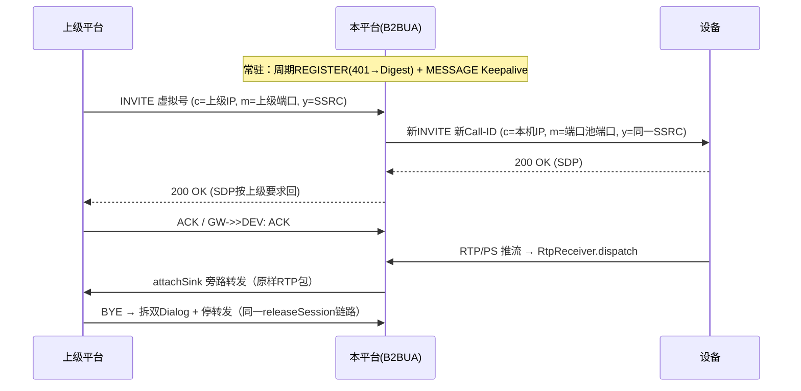
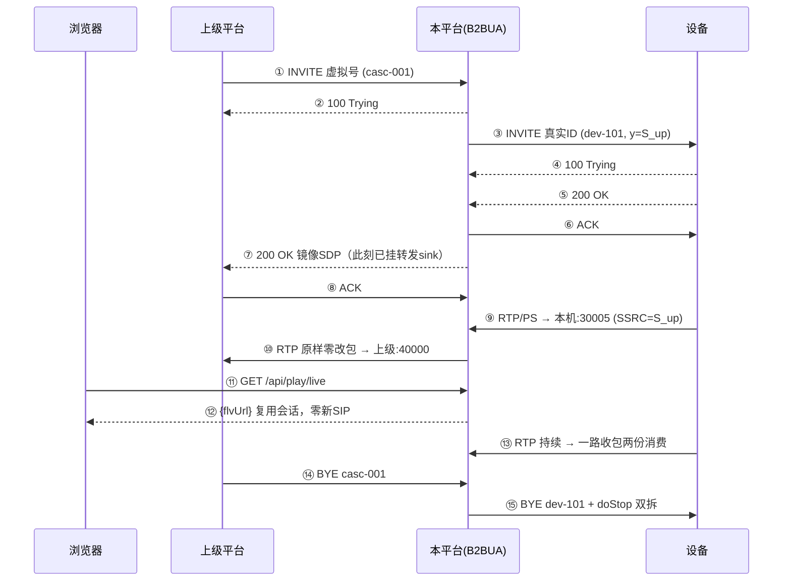
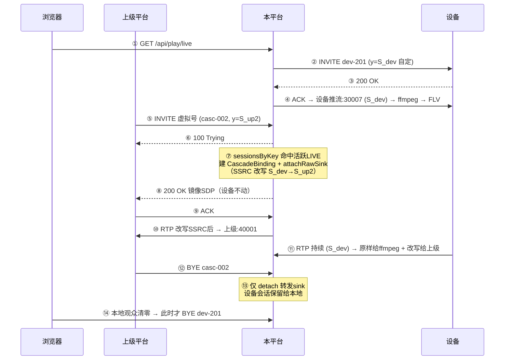

# GB/T 28181 级联实现技术方案（CASCADE-DESIGN）

> 状态：**设计定稿，未实施**。协议层"是什么/为什么/差异在哪"的完整推演见《协议参考手册》第五部分；本文档是其工程落地版——锚定到现有代码的具体类/方法/行号，可按里程碑直接开工。
>
> 前置结论（引自推演，不再重复论证）：级联与设备交互是**同一套协议**（SIP + MANSCDP + Digest），本项目已具备 UAC+UAS 双角色底座；缺的是注册客户端状态机、对端管理、虚拟编号映射、B2BUA 会话绑定与媒体中转四块。

---

## 0. 范围决策

| 决策点 | 结论 | 依据 |
|---|---|---|
| 角色范围 | **一期只做下级平台**（向上级注册 + 响应上级点播中转） | 推演 §8：公安/企业主路径；上级角色按需二期 |
| 媒体模式 | **中转模式**（RTP 直转，不转码） | 设备 IP 不暴露、NAT 兼容；直推模式不实现 |
| 上级类型 | 国标上级（收 RTP/PS）；流媒体上级（双 Sink ffmpeg 推 RTMP）二期 | FLV 发不给国标平台；双 Sink 方案推演 §5.5 已备 |
| 承载协议 | 上级收流仅 UDP | TCP(RFC4571) 透传复杂化，二期评估 |
| 立项前提 | 仅当需对接不受己方控制的上级平台（政府/集团既有平台，对方只收国标） | 内部摄像头直采无需级联 |

## 1. 架构：B2BUA 双 Dialog + 一次收包多路分发



三条铁律：

1. **不转发原 INVITE**：SDP `c=` 是上级收流地址，B2BUA 必须建新 Call-ID（新 Dialog）向设备发起，两侧 Dialog 由绑定表桥接。
2. **零改包**：给设备的 INVITE SDP `y=` 写上级同款 SSRC，两侧一致则转发纯零拷贝；设备不按 `y=` 时再启用 4 字节 SSRC 改写开关（§8）。
3. **拆除单点收敛**：无论上级 BYE / 设备断流 / 平台停机，全部落现有 `releaseSession` 清理链——资源不泄漏的保证。

## 2. 模块清单

### 2.1 新增（7 个类）

| 类 | 包 | 职责 |
|---|---|---|
| `CascadeProperties` | `config` | `@ConfigurationProperties("sip.cascade")`：`Map<String, CascadePeer>` 多上级；字段仿 `SipServerProperties`（`serverId/domain/ip/port/password` + `keepaliveIntervalSeconds/注册重试参数/devicePrefix`） |
| `CascadeRegistry` | `service.cascade` | 对端状态（在线/离线/lastKeepalive/注册事务）+ **双向编号映射** `virtualNo ↔ deviceId:channelId`（ConcurrentHashMap）+ `bindings: Map<上级CallID, CascadeBinding>` |
| `CascadeRegisterService` | `service.cascade` | 注册客户端状态机：发 REGISTER → 收 401 → 算 Digest 重发 → 200 OK；周期重注册 + `MESSAGE Keepalive`；事务超时指数退避。nonce 事务缓存模式抄 `RegisterHandler.nonces`（`RegisterHandler.java:42`） |
| `CascadePeerHandler` | `handler` | 上级来令统一入口：Catalog/DeviceInfo 查询应答、上级 INVITE→映射真实设备→调 `MediaService` 现有启动链、BYE→拆绑 |
| `CascadeSdpBuilder` | `sip` | 三类构造：给设备的 SDP（c=本机/m=端口池/y=上级SSRC）、回上级的 200 OK SDP、Catalog 应答 XML |
| `CascadeRtpForwarder` | `service.cascade` | `OutputStream` 适配器：`write() → DatagramSocket.send(target)`；含 `sent/failures` 计数、`closed` volatile 标志——**作为 SinkWriter 的下游挂靠** |
| `CascadeBinding` | `model` | 上级 Call-ID、上级收流地址（来自其 INVITE 的 SDP c=/m=）、设备侧会话 callId、peerSdp 快照、toTag/branch（UAS 侧应答所需 Dialog 数据） |

### 2.2 修改（4 处，侵入点全部很小）

| 类 | 位置 | 改动 |
|---|---|---|
| `SipDigestAuth` | `sip/SipDigestAuth.java`（现有 API：`ha1/ha2/response/responseWithQop/matches`，L35-75，均为服务端校验原语） | 新增 `buildAuthorization(username, realm, password, nonce, uri, method, qop, nc, cnonce)` 客户端组装——纯增量，返回完整 `Digest ...` 头值 |
| `RtpReceiver` | `service/media/RtpReceiver.java`：`forward` L288 现交下游的是裁头 PS payload | **+10 行**：`SinkWriter` 加 `raw` 标志、`forward` 按标志写完整包（`p.getOffset()/p.getLength()`）、新增 `attachRawSink` 重载——收包核心 `run`/`dispatch` 不动（详见 §2.3） |
| `SipRequestHandler` | `handler/SipRequestHandler.java`：方法分发 switch L102-131 | INVITE/MESSAGE/BYE 三分支入口前置一步：`From` 编号命中 `CascadeRegistry.isPeer()` 则路由 `CascadePeerHandler`（各 +2 行） |
| `StreamSession` | `model/StreamSession.java`（现有字段无任何级联概念） | 加 `volatile CascadeBinding cascadeBinding`（null=普通会话）；`doStop`/`releaseSession` 清理链尾部：非空则向级联对端发 BYE——设备断流看门狗触发时自动双向拆 |
| `MediaService.stopIfNoClients` | `MediaService.java:383`（现语义：本地最后观众断开 → 直播立即停） | **生命周期判定改双信号**：本地观众 == 0 **且** `cascadeBinding == null` 才真正停流——否则本地关页面会误拆上级正在看的级联流；反之上级 BYE 时本地观众保留（见 §3.3.1） |
| `DeviceController`（可选） | — | `/api/cascade/peers` 状态查询：对端在线状态、注册事务、转发统计 |

### 2.3 媒体面最小改动（`RtpReceiver` +10 行，本方案核心插桩点）

**关键事实**：现有 `forward` 交给 sink 的是**裁掉 RTP 头的纯 PS payload**（`RtpReceiver.java:288` `w.write(p.getData(), h[0], h[1])`，`h` 来自 L274 `{off+hdrLen, len-hdrLen}`）——ffmpeg 吃裸 PS 没问题，但上级要完整 RTP 包，序号/时间戳/SSRC 均在被裁的头里，**payload 层无法重组 RTP 头，必须在收包点插桩**。

改动（收包核心 `run`/`dispatch` 不动，队列与丢帧机制白拿）：

```java
// ① SinkWriter +1 字段：final boolean raw;   // true=完整RTP包（级联），false=PS payload（现状）
// ② 新增 attachRawSink(callId, out)：SinkWriter 以 raw=true 入 sinks
// ③ forward 改 1 行：
w.write(p.getData(), w.raw ? p.getOffset() : h[0], w.raw ? p.getLength() : h[1]);
```

`CascadeRtpForwarder` 实现 `OutputStream` 挂入 `attachRawSink`：`write` → 场景 A 原样 `send`；场景 B 先 `copyOf` 改 RTP 头 offset 8-11 四字节 SSRC 再 `send`（写线程内 copy，不碰收包线程、不污染并行 sink 原数组）。

- `SinkWriter` 既有语义（512 块有界队列、满丢最旧、独立写线程，L535-613）正是上级收流抖动时想要的——丢帧优于阻塞收包线程。
- `RtpPortPool.acquire()`（L59，耗尽返回 -1）每级联点播占 1 收流端口；转发用独立 ephemeral 发送 socket，不占监听端口。

#### 2.3.1 转发插桩最终版（双路径 + 场景 A/B 判断）

**双路径数据流**——裁头服务本地，raw 服务级联：

```
设备 RTP 包 [RTP头12B | PS payload]
   ├─ w.raw=false（现状·本地）: w.write(data, h[0], h[1])        → PS payload → ffmpeg
   └─ w.raw=true （新增·级联）: w.write(data, p.getOffset(), p.getLength()) → 完整包 → Forwarder
                                                          ├─ 场景A: 原样 send（零改包）
                                                          └─ 场景B: 改 offset 8-11 SSRC → send
```

`RtpReceiver` 4 处改动（~12 行；① 字段 `final boolean raw`；② 构造器加参、原签名委托；③ forward L288 按标志选坐标；④ `attachRawSink` 重载）。

**场景判断只在 CascadePeerHandler 一处**（依据 = sessionsByKey 命中与否）：

```java
StreamSession s = mediaService.getSession(deviceId, channelId);
if (s != null && s.getState() != STOPPED && s.getType() == LIVE) {
    // 场景 B 复用：设备已推 S_dev → forwarder 带 targetSsrc 改写
    f = new CascadeRtpForwarder(upstreamAddr, upstreamSsrc);
    rtpReceiver.attachRawSink(s.getCallId(), f);
} else {
    // 场景 A 新建：设备 INVITE y= 上级同款 → forwarder 零改包
    s = mediaService.startLiveForCascade(deviceId, channelId, upstreamSsrc);
    f = new CascadeRtpForwarder(upstreamAddr);
    rtpReceiver.attachRawSink(s.getCallId(), f);
}
// 回上级 200 OK 镜像 SDP（挂载后发出）
```

**补充改动项**（本节新增明确）：场景 A 需 `MediaService.sendInvite` 支持 SSRC 覆盖参数（`startLiveForCascade` 变体，缺省自定 SSRC、现有调用零影响）。

#### 2.3.2 `CascadeRtpForwarder` 最终实现（定稿，M3 直接抄写）

三个实现决策均来自 `SinkWriter` 源码实证：

| 决策 | 依据 |
|---|---|
| `write` 内**无需 copyOf**，场景 B 原地改 4 字节 | `SinkWriter.write` 入队前已 `Arrays.copyOfRange` 拷贝独立副本（`RtpReceiver.java:564`），改副本不污染其他 sink |
| 只覆盖三参 `write(byte[],int,int)` | 写线程走单参 `out.write(d)`（L579），OutputStream 默认委托三参 |
| **IOException 绝不抛出**，只计数 | 抛出 → `SinkWriter.failed=true`（L583-586）→ `forward` 永久摘除（L284-287）；瞬时 UDP 抖动不应终止整条转发 |

```java
package com.example.sip.service.cascade;

/**
 * 级联 RTP 转发器：RtpReceiver.attachRawSink 的下游。
 * SinkWriter 写线程逐包回调 write（每元素 = 一个完整 RTP 包，且已是独立副本，
 * 见 RtpReceiver.java:564 的入队拷贝）；本类仅做 SSRC 改写（场景 B）后向上级 send。
 *
 * 线程模型：write 全部来自单个 SinkWriter 写线程，串行无锁。
 * 生命周期：上级 200 OK 应答前 attachRawSink 挂载；releaseSession 链尾部 close。
 */
public final class CascadeRtpForwarder extends OutputStream {

    private final InetSocketAddress upstream;   // 上级收流地址（其 INVITE SDP 的 c=/m=）
    private final boolean rewriteSsrc;          // 场景 B 才 true
    private final int targetSsrc;               // 上级 y= 的 SSRC
    private final DatagramSocket socket;        // ephemeral 出口，不占 30000-30099 监听池

    private volatile boolean closed;
    private final AtomicLong sent = new AtomicLong();
    private final AtomicLong failures = new AtomicLong();

    /** 场景 A：设备 y= 上级同款，零改包 */
    public CascadeRtpForwarder(InetSocketAddress upstream) throws SocketException {
        this(upstream, 0, false);
    }

    /** 场景 B：复用本地点播会话，转发时改写 RTP 头 SSRC 为上级要求值 */
    public CascadeRtpForwarder(InetSocketAddress upstream, int targetSsrc) throws SocketException {
        this(upstream, targetSsrc, true);
    }

    private CascadeRtpForwarder(InetSocketAddress upstream, int targetSsrc, boolean rewrite)
            throws SocketException {
        this.upstream = upstream;
        this.targetSsrc = targetSsrc;
        this.rewriteSsrc = rewrite;
        this.socket = new DatagramSocket();
    }

    /** d 是本包独立副本：场景 A 原样 send；场景 B 原地改头 offset 8-11（不污染其他 sink） */
    @Override
    public void write(byte[] b, int off, int len) {
        if (closed || len < 12) {
            return;                              // closed 后队列残留静默丢弃；<12 非法包
        }
        if (rewriteSsrc) {
            b[off + 8]  = (byte) (targetSsrc >>> 24);
            b[off + 9]  = (byte) (targetSsrc >>> 16);
            b[off + 10] = (byte) (targetSsrc >>> 8);
            b[off + 11] = (byte) targetSsrc;
        }
        try {
            socket.send(new DatagramPacket(b, off, len, upstream));
            sent.incrementAndGet();
        } catch (IOException e) {
            // 不抛：抛出会置 SinkWriter.failed → forward 永久摘除本下游；
            // 瞬时 UDP 抖动不应终止转发。持续失败由 failures 计数在 /api/cascade/peers 暴露
            failures.incrementAndGet();
        }
    }

    @Override
    public void write(int b) {
        // SinkWriter 只走单参 write(byte[]) → 默认委托三参，防御性空实现
    }

    /** releaseSession 清理链尾部调用；幂等，close 后 SinkWriter 残留包静默丢弃 */
    @Override
    public void close() {
        if (closed) {
            return;
        }
        closed = true;
        socket.close();
    }

    public long sentCount()     { return sent.get(); }
    public long failureCount()  { return failures.get(); }
}
```

**三个对接点**（挂载/摘除/收尾，`detachSink` 按引用 `w.out == out` 匹配 L307-311，精确摘级联不动 ffmpeg）：

```java
// ① 挂载：上级 200 OK 应答前（保证 ACK 后流立达）——构造按 §2.3.1 场景判断选 A/B 构造器
rtpReceiver.attachRawSink(deviceCallId, forwarder);

// ② 摘除：上级 BYE
rtpReceiver.detachSink(deviceCallId, forwarder);
forwarder.close();

// ③ 看门狗/平台停机：releaseSession 清理链尾部统一 forwarder.close()（幂等）
```

**M3 单测要点**：本地 `DatagramSocket` bind 临时端口作假上级——场景 A 断言收发字节一致；场景 B 断言 offset 8-11 等于目标 SSRC 且其余字节不变；`close()` 后 `write` 静默不抛（模拟 detach 后队列残留）；目标不可达时 `failureCount` 增长。

## 3. 关键信令流程

### 3.1 注册保活（下级→上级）

```
REGISTER (Expires=3600) ──> 401 + WWW-Authenticate(nonce)
REGISTER + Authorization ──> 200 OK
每 keepaliveInterval（默认 60s）：MESSAGE Keepalive（SN 递增）
事务 5s 超时重试 ×3 → 标记离线 → 30s 退避重注册
```

Digest 客户端计算复用现有原语：`ha1(user, realm, pwd)` + `ha2("REGISTER", uri)` + `responseWithQop(...)`，仅差组装头字符串（`SipDigestAuth.buildAuthorization`）。

### 3.2 目录（虚拟号映射）

- 设备注册/目录变化时生成虚拟号 = `peer.devicePrefix`（20 位，含 GB/T 2260 行政区划段）+ 4 位序号，入 `CascadeRegistry` 双向 Map。
- 上级 `MESSAGE Catalog` → 200 OK + Catalog 应答（`SumNum`/`DeviceList.Item`：虚拟号、Name、Manufacturer、Status）。
- 一期设备 ≤200 全量单包；`SumNum` 分批分页（SN 续查）二期。

### 3.3 上级点播中转（核心）

```
上级 INVITE 虚拟号（SDP: c=上级收流IP, m=上级端口, y=上级SSRC）
  → 100 Trying
  → 查映射得真实 deviceId:channelId
  → RtpPortPool.acquire()（-1 则回 503，设备直采无感）
  → 走现有 MediaService UAC 链路 INVITE 设备（SDP: c=本机IP, m=分配端口, y=上级同款SSRC）
     —— Dialog 管理/重试/看门狗全部复用，无新代码
  → 设备 200 OK → 我方 ACK
  → 回上级 200 OK（带 SDP；buildOkWithSdp 可仿语音广播反向 INVITE 的 SDP 应答先例）
  → attachSink(设备callId, CascadeRtpForwarder(上级地址))
  → 上级 ACK → RTP 开始转发
```

### 3.3.1 级联与本地点播并发（一次收流，多路分发）

中转模式下，上级点播在本平台内部就是**一次普通点播会话 + 一个级联转发下游**，因此本地与上级可同时点播同一路设备，设备只推 1 路 RTP：

```
场景 A：上级先点播 → 本地 getOrStartLive（MediaService.java:214，幂等复用不重发 INVITE）
        → attachSink 再挂一路 FLV → 设备 1 路推流，双消费
场景 B：本地先在看 → 上级 INVITE 到达 → sessionsByKey 命中活跃 LIVE 会话
        → 不动设备，直接建 CascadeBinding + 挂转发下游 → 回上级 200 OK
```

约束与要点：

- **复用仅限 LIVE↔LIVE**：`sessionsByKey` 单槽（同通道直播/回放互斥，L301-304 现语义"后到先停"）；上级点播遇本地回放同一路 → 按现有先停后建执行（上级优先），日志记录。
- **SSRC 改写在场景 B 必备**：复用已有会话时设备 SSRC 是本平台自定的 ≠ 上级 `y=` 要求 → 走 4 字节改写（§8）；场景 A（级联先建会话）保持零改包。
- **停止语义对称**：本地观众清零且有级联绑定 → 仅 detach FLV sink，会话保留；上级 BYE 时本地观众保留；两者都无消费者才走 `doStop` 双向拆。

### 3.3.2 场景 A/B 报文级时序

约定：`S_up`/`S_up2` = 上级 SSRC（GB28181 10 位数字，实时点播首位 0）；`S_dev` = 本平台自定 SSRC。

#### 场景 A：上级先点播，本地后点同一路



**SIP 命令明细（场景 A）**：

| # | 方向 | 报文内容 |
|---|---|---|
| ① | 上级→本 | `INVITE sip:<虚拟号>@<domain> SIP/2.0`，`Call-ID: casc-001`，`CSeq: 1 INVITE`，`From: <上级serverId>;tag=u1`，`Contact: <上级>`，SDP 见 A-1 |
| ② | 本→上级 | `SIP/2.0 100 Trying`（Call-ID/From/To/CSeq 原样回带） |
| ③ | 本→设备 | `INVITE sip:<真实deviceId>@<domain> SIP/2.0`，**新建** `Call-ID: dev-101`，`CSeq: 20 INVITE`，`From: <本平台id>;tag=p1`，SDP 见 A-2 |
| ④ | 设备→本 | `SIP/2.0 100 Trying` |
| ⑤ | 设备→本 | `SIP/2.0 200 OK`，`To: ...;tag=d1`，SDP 确认 `m=video 30005`、`y=S_up` |
| ⑥ | 本→设备 | `ACK`（Call-ID=dev-101，CSeq=20 ACK，不携带 SDP） |
| ⑦ | 本→上级 | `SIP/2.0 200 OK`（Call-ID=casc-001，`To` 回带 tag=u1），SDP **镜像上级请求**（c=/m=/y= 原样），见 A-3；**发出前**已 `attachRawSink(dev-101, forwarder)` |
| ⑧ | 上级→本 | `ACK`（casc-001，CSeq=1 ACK） |
| ⑭ | 上级→本 | `BYE`（casc-001）→ 触发 `releaseSession` 链：⑮ `BYE`（dev-101）+ 端口归还 + forwarder `close()` |

**SDP 报文实例**：

```text
A-1 上级 INVITE 请求体（上级描述"我要收"）
v=0
o=34020000002000000002 0 0 IN IP4 10.1.0.5     ← 上级serverId / 上级收流IP
s=Play
c=IN IP4 10.1.0.5
t=0 0
m=video 40000 RTP/AVP 96 98 97                 ← 上级收流端口
a=recvonly
a=rtpmap:96 PS/90000
y=0100005678                                    ← S_up（0=实时点播）

A-2 本平台 → 设备 INVITE 请求体
v=0
o=34020000002000000001 0 0 IN IP4 <本机通告IP>
s=Play
c=IN IP4 <本机通告IP>
t=0 0
m=video 30005 RTP/AVP 96 98 97                 ← RtpPortPool.acquire()
a=recvonly
a=rtpmap:96 PS/90000
y=0100005678                                    ← 写上级同款 SSRC → 零改包

A-3 本平台 → 上级 200 OK 响应体（镜像 A-1 的 c=/m=/y=）
v=0
o=34020000002000000001 0 0 IN IP4 10.1.0.5
s=Play
c=IN IP4 10.1.0.5
t=0 0
m=video 40000 RTP/AVP 96 98 97
a=sendonly
a=rtpmap:96 PS/90000
y=0100005678
```

#### 场景 B：本地先在看，上级后点同一路



**SIP 命令明细（场景 B）**：

| # | 方向 | 报文内容 |
|---|---|---|
| ① | 浏览器→本 | `GET /api/play/live` → 200 `{flvUrl}`（常规点播入口） |
| ② | 本→设备 | `INVITE`（dev-201），SDP `y=<S_dev>` 为**本平台自定**（与级联无关的常规点播，`m=video 30007`） |
| ③ | 设备→本 | `200 OK`（SDP 确认端口 30007 / `y=S_dev`） |
| ④ | 本→设备 | `ACK` → 设备推流：`RTP/PS → 本机:30007 (SSRC=S_dev)` → ffmpeg → FLV |
| ⑤ | 上级→本 | `INVITE sip:<虚拟号>@<domain>`（casc-002），SDP `c=<上级IP> m=video 40001 y=<S_up2>` |
| ⑥ | 本→上级 | `100 Trying` |
| ⑦ | 内部 | **无 SIP 报文**：映射 → `sessionsByKey` 命中活跃 LIVE（`MediaService.java:214` 复用语义）→ 建 `CascadeBinding{casc-002 ↔ dev-201, 上级:40001, S_up2}` → `attachRawSink` 挂改写转发器 |
| ⑧ | 本→上级 | `200 OK` 镜像 SDP（c=上级IP m=40001 y=S_up2） |
| ⑨ | 上级→本 | `ACK` |
| ⑩ | 本→上级 | RTP 改写后转发 → 上级:40001 |
| ⑫ | 上级→本 | `BYE`（casc-002）→ **只拆绑定**：`detachSink(callId, forwarder)` + `forwarder.close()`，设备会话/端口/ffmpeg 全部保留 |

#### SDP 关键行对照（其余 v=0/s=Play/t=0 0/a=rtpmap:96 PS/90000 常规）

| 报文 | c= | m= | y= |
|---|---|---|---|
| 上级 INVITE 请求 | 上级收流 IP | `video 40000` | `S_up`（0 开头=实时） |
| 本→设备 INVITE（场景 A） | 本机通告 IP | `video 30005` | `S_up` 同款（零改包） |
| 本→上级 200 OK | 上级收流 IP（镜像） | `video 40000` | `S_up`（场景 B 时 `S_up2`） |
| 本→设备 INVITE（场景 B） | 本机通告 IP | `video 30007` | `S_dev`（常规点播） |

#### RTP 上行方案（双场景对照）

| 环节 | 场景 A（级联先建） | 场景 B（复用本地点播） |
|---|---|---|
| 设备推流目标 | `设备 → 本机:30005`，SSRC=`S_up`（按 `y=` 推） | `设备 → 本机:30007`，SSRC=`S_dev` |
| 收包定位 | `RtpReceiver.run` 每会话独立守护线程，按**目的端口归属**定位会话（L162） | 同左 |
| 分发 | `dispatch → parseRtpHeader → forward` 遍历 `Session.sinks`（L185/278） | 同左 |
| 下游 1：本地面 | 原样包 → ffmpeg stdin → FLV（级联前已挂或复用时挂） | 原样包 → ffmpeg → FLV（原有链路不动） |
| 下游 2：级联转发 | **原样包零改包** → `SinkWriter` 队列（512 满丢最旧）→ 写线程 → `CascadeRtpForwarder.write` → `DatagramSocket.send(上级:40000)` | **改写后转发**：RTP 头 `offset 8-11` 四字节大端替换 `S_dev → S_up2`（§2.3.2 实现中为原地改副本）→ 同上 send |
| SSRC 关系 | 设备/上级两侧一致（`y=` 同款），零改包 | 两侧不一致，改写为必备路径 |
| 出口端口 | 独立 ephemeral socket 发送，**不占 30000-30099 监听池** | 同左 |
| 慢下游策略 | `SinkWriter` 有界队列满丢最旧——上级收流抖动时丢帧，绝不阻塞设备收包线程 | 同左 |
| 统计 | `CascadeRtpForwarder.sent/failures` 计数，`/api/cascade/peers` 暴露 | 同左 |

两条拆除语义（对照 §3.3.1 停止对称原则）：**场景 A** 上级 BYE 是主消费者离开 → 全拆；本地后来只是搭车，无独立生命周期。**场景 B** 上级 BYE 只 detach 转发 sink；设备会话的生命周期仍由本地观众数 + 看门狗主导。

### 3.4 BYE 三方向

| 事件源 | 动作 |
|---|---|
| 上级 BYE | 拆设备 Dialog + 停转发（`releaseSession` 现有链路顺带关 forwarder socket） |
| 设备断流（看门狗 `watchdogTick` 命中） | `StreamSession.cascadeBinding` 非空 → 主动 BYE 上级 + 拆设备 Dialog |
| 平台停机 | 两侧 Dialog 全部 BYE |

### 3.5 上级 MESSAGE 的分发隔离

上级与设备的 MESSAGE 天然隔离：`SipRequestHandler` 入口按 `From` 编号/来源命中 `CascadeRegistry.isPeer()` 分流，**不新增任何分支到 `DeviceMessageHandler`** 的 CmdType switch（L91-114）——上级消息由 `CascadePeerHandler` 自行解析，未来上级角色复用同一路由。

## 4. 边界与语义

| 项 | 处理 |
|---|---|
| 端口池耗尽 | `acquire()` == -1 → 对上级回 503 |
| UDP send 黑洞 | 不依赖 send 异常判上级存活（Java 无 ICMP 感知）；上级收不到流自有其超时 → 会 BYE；本级只管设备侧看门狗 |
| 带宽评估 | 上级路数 × 码率；`/api/cascade/peers` 暴露 `sent` 统计供容量巡检 |
| SSRC 一致性 | 场景 A（级联先建会话）`y=` 零改包；场景 B（复用本地点播会话）设备 SSRC ≠ 上级要求 → **4 字节改写为必备路径**（仅动 RTP 头 offset 8-11，CC=0 前提，国标设备均满足），在 `CascadeRtpForwarder` 内实现并按 binding 标记启停 |
| 时延 | 增加一跳转发，局域网 <1ms 可忽略 |
| 安全 | 上级收流地址来自已过 Digest 鉴权对端的 SIP 信令，无需额外校验 |

## 5. 配置样例

```yaml
sip:
  cascade:
    peers:
      city-bureau:
        server-id: 34020000002000000002   # 上级平台国标编号
        domain: 3402000000
        ip: 10.1.0.5
        port: 5060
        password: ${CASCADE_PEER_PASSWORD}
        device-prefix: "3402000000132"    # 虚拟号前缀(13位) + 7位序号
        keepalive-interval-seconds: 60
        profile-version: "2016"           # 2022 平台对接差异按此定参（§8）
```

凭据同样走环境变量（`CASCADE_PEER_PASSWORD`），纳入 `/opt/sip/sip.env` 管理。

## 6. 里程碑

| 里程碑 | 内容 | 验收 |
|---|---|---|
| **M1**（1 周） | CascadeProperties/Registry + 客户端 Digest + 注册保活状态机 | 真实/WVP 上级平台显示"在线" |
| **M2**（1 周） | 虚拟号映射 + Catalog/DeviceInfo 应答 | 上级可浏览完整目录树 |
| **M3**（1~1.5 周） | B2BUA 点播中转 + BYE 三方向 + 看门狗联动 + 本地/级联并发复用（§3.3.1） | 上级能看流；上级 BYE / 设备断流均干净双拆（抓包无残留 socket、端口归还）；本地+上级同时点播同一路，设备侧仅 1 路 INVITE |
| **M4**（0.5 周） | `/api/cascade/peers` 观测、边界用例、文档 | 回归矩阵全绿 |
| 二期 | 上级角色、RTMP 出口（双 Sink 独立 ffmpeg）、Catalog 分批、报警 NOTIFY、TCP 承载 | 按需求立项 |

## 7. 测试计划

- **单测**（进现有 `src/test`，当前 19 用例基础上扩展）：
  - `SipDigestAuth.buildAuthorization` 对照 RFC 2617 示例值；
  - Catalog XML 组装（SumNum/Item 结构、SN 一致性）；
  - 虚拟号双向映射（生成规则、冲突、删除回收）；
  - `CascadeRtpForwarder`：本地 socket 收发自测 + closed 后写入静默丢弃。
- **联调**：WVP-pro（开源上级）先通全流程 → 真实平台（公安平台注意 2016/2022 版差异）→ GB28181 测试仪兜底。
- **异常矩阵**：断网重注册、注册密码错误退避、上级点播 8 路并发、上级中途 BYE、设备推流中断（看门狗双向拆）、端口池耗尽 503、平台重启后上级侧重注册；**并发专项**——本地先点播上级后点同一路（复用不重发 INVITE，抓包验证）、上级先点播本地后点（`getOrStartLive` 复用）、本地关页上级仍在看（会话保留）、上级 BYE 本地仍在看（会话保留）。

## 8. 风险与预留

| 风险 | 缓解 |
|---|---|
| 设备不按 `y=` 使用指定 SSRC | 收流按端口归属（本项目既有设计，SSRC 不敏感）；预留 4 字节 SSRC 改写开关 |
| 上级 2016/2022 版协议差异（A/B 面、XML 格式细节） | `CascadePeer.profileVersion` 配置项，M2 按对接平台实测定参 |
| 大目录（>200 设备）单包应答失败 | 二期 SumNum 分批；一期在 M2 验收时用设备数上限把关 |
| switch 硬编码维护性 | 本方案零侵入现有 CmdType switch，上级消息独立 handler |

---

*实施顺序建议照搬推演 §8：先下级角色跑通，上级角色与 RTMP 出口按需再上。开工前无需再做代码调研——本文档 §2 的行号锚点即改动地图。*
