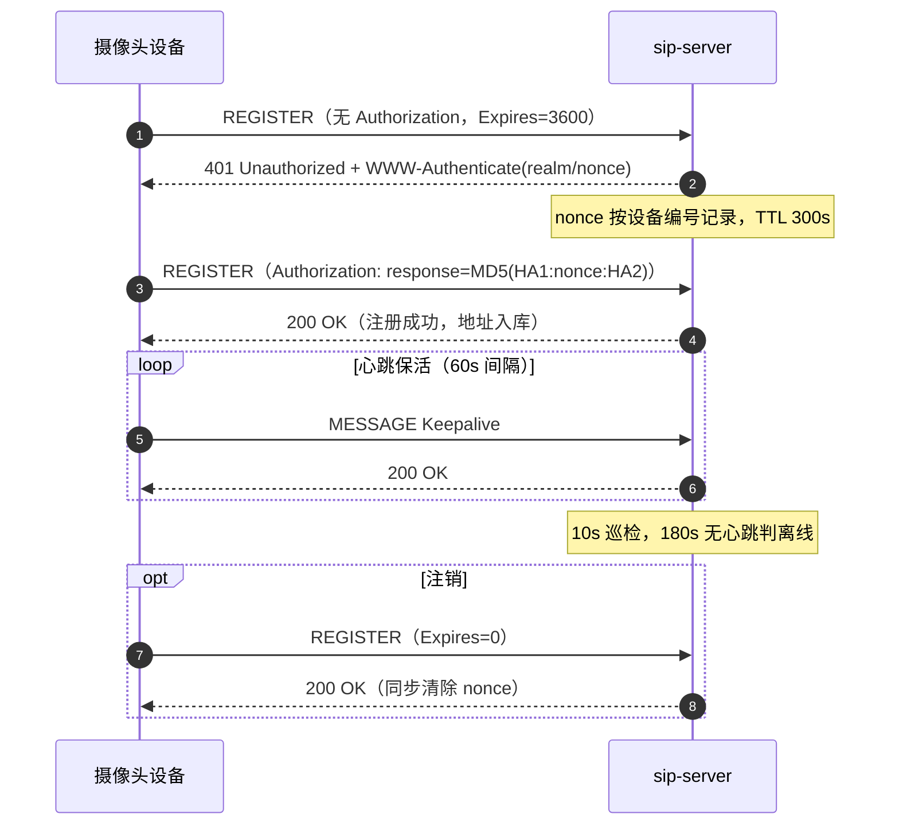
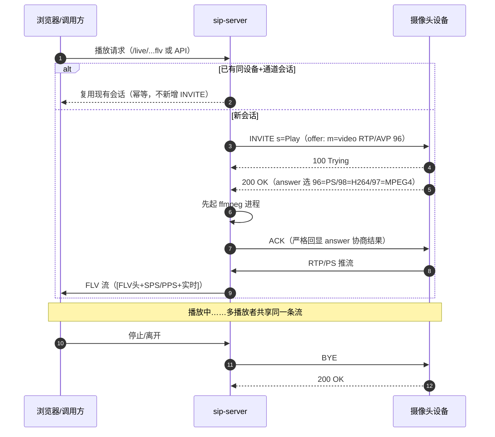
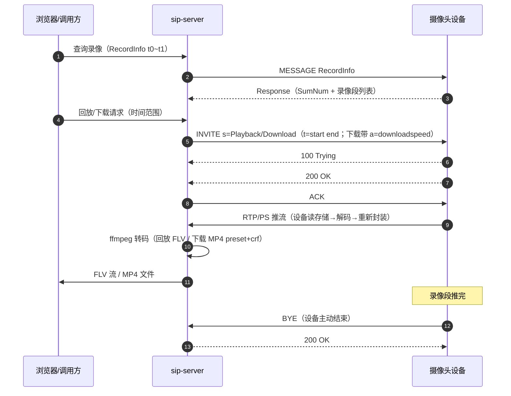
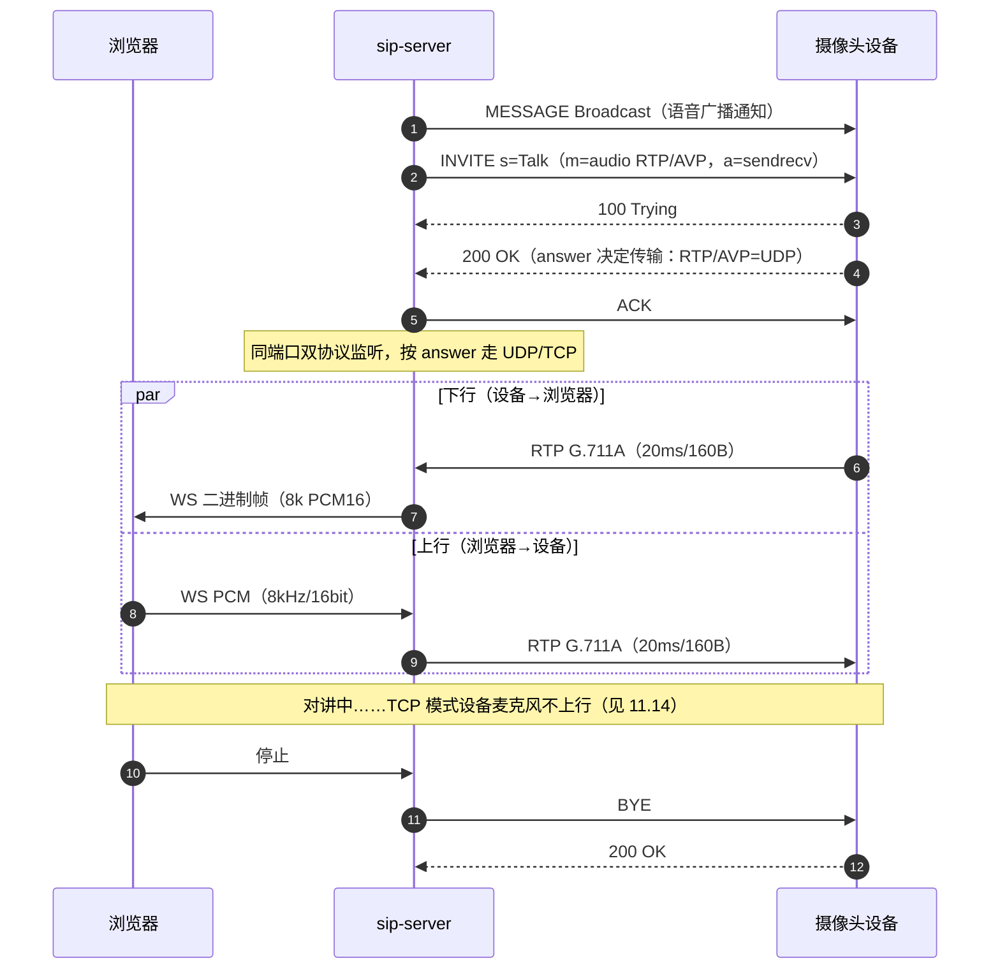
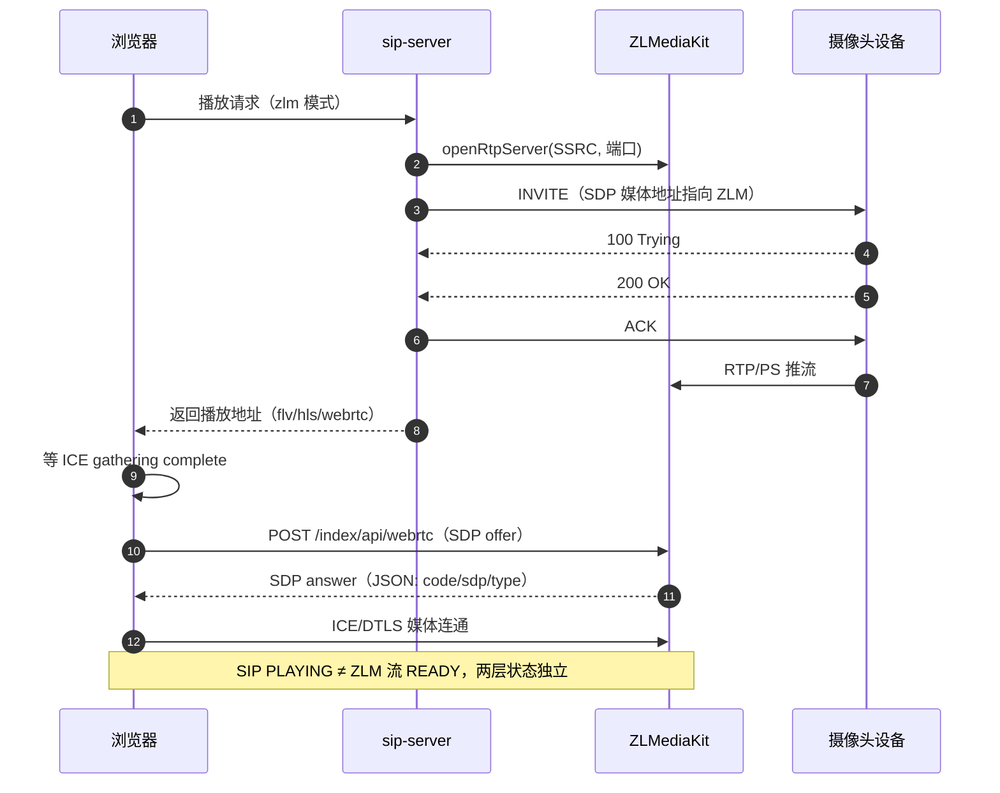

# GB28181 技术分享与培训手册

> **用途**：项目 GB28181 相关知识的**留存 + 内部培训**（新人上手、跨团队同步、现场排障速查）
> **受众**：GB28181 平台开发/运维、调用方（业务平台）开发与测试
> **素材来源**：由项目全部 13 份 md 文档整理而成；细节以源文档为准（索引见第 12 章）
> **版本**：v1（2026-10-16）

---

## 0. 培训指南

| 用法 | 路径 |
|------|------|
| **自学**（约 2 小时） | 第 1→12 章顺序读 |
| **集中培训 45 min** | 第 1 章（协议概念，10min）→ 第 3 章（路数模型，10min）→ 第 5 章（治理方案，10min）→ 第 7 章（案例，10min）→ 第 9 章（速查卡，5min） |
| **集中培训 90 min** | 全过一遍，第 7 章案例挑 2 个深讲，加第 11 章自测题互动 |
| **现场排障** | 第 9 章速查卡 + 第 10 章高频 FAQ + 第 7 章案例索引，按图索骥到源文档 |

**贯穿全文的三个心智模型**（培训目标）：

1. **一次 INVITE = 一路**——会话是设备侧物理资源，代价持续到 BYE
2. **倍速是时间轴倍速，不是文件压缩率**
3. **根因跨方案**——压垮摄像机的是"使用方式"（倍速/并发/拆建/时间窗），不是某一家平台实现

---

## 1. GB28181 协议基础

### 1.1 定位与版本

- 全称《公共安全视频监控联网系统信息传输、交换、控制技术要求》，解决**不同厂商设备互联互通**
- 现行 **GB/T 28181-2022**（替代 2016 版）
- 两层结构：**SIP 信令** + **RTP/RTCP 媒体**，信令与媒体分离
- 2022 相对 2016 的主要变化：视频正式支持 H.265/AVS3；音频新增 AAC、G.722.1、Opus；TCP 明确 `a=setup:active/passive`；安全强化 TLS1.2+/SRTP/国密；新增 AI 元数据、OTA 升级、标准化抓拍

### 1.2 网络架构与角色

| 角色 | 说明 | 本项目对应 |
|------|------|-----------|
| 前端编码设备 | IPC（摄像机）/ NVR | 被接入的摄像头 |
| SIP 信令服务器 | 注册/心跳/目录/会话控制 | **sip-server**（UDP 5060） |
| 媒体服务器 | RTP 收流/转封装/分发 | local 模式=自研链路；zlm 模式=ZLMediaKit |
| 存储 | 录像存储与回放提供 | NVR / CVR / IPC 本地 SD 卡 |
| 客户端 | 浏览/回放/对讲 | 浏览器页面 / 业务平台 API 调用 |

### 1.3 设备与通道模型

**20 位国标设备编号**：

```
行政区划码 6 位(GB/T 2260) + 行业/区域码 4 位 + 设备类型码 2 位(13=摄像机) + 设备编号 8 位
示例：34020000001320000001
SIP 服务器 ID：34020000002000000001（域 3402000000）
```

- **通道**：一台设备（尤其 NVR）下有多个通道，Catalog 查询得到"设备 → 通道 1/2/3…"
- Catalog Item 关键字段：DeviceID、Name、Manufacturer、Model、SerialNumber、FirmwareVersion、Status(ON/OFF/ERROR)、ParentalID（父级设备 ID）
- IPC/NVR 都是前端编码设备，NVR 兼存储；回放/下载的"路数"配额在设备侧（见第 3 章）

### 1.4 信令交互全景

| 信令 | 方向 | 要点 |
|------|------|------|
| REGISTER | 设备→服务器 | 401 Digest 挑战 → 设备带 Authorization 重发 → 200 OK；Expires=0 注销 |
| Keepalive | 设备→服务器 | MESSAGE，60s 间隔，3 次超时 ≈180s 判离线 |
| Catalog | 服务器→设备 | MESSAGE 查询 → Response(SumNum + DeviceList) |
| INVITE（点播） | 服务器→设备 | `s=Play`，offer `m=video <port> RTP/AVP 96` + `a=rtpmap:96 PS/90000` |
| INVITE（回放/下载） | 服务器→设备 | `s=Playback`/`s=Download`，`t=<start> <end>` 时间范围 |
| ACK / BYE | 双向 | ACK 必须回显设备 answer 的协商结果（11.2 的教训）；BYE 结束会话 |
| Broadcast/INVITE（对讲） | 服务器→设备 | `s=Talk`，音频 INVITE |

**点播五步时序**（Mermaid 完整时序图见 1.7）：

```
INVITE(s=Play, offer PS/96) → 100 Trying → 200 OK(answer) → ACK(最终 SDP) → RTP/PS 推流 … → BYE → 200 OK
```

**回放与点播的差异**：Subject/SDP 标识回放语义（`Playback:` 前缀、`s=Playback`）、SDP `t=` 携带起止时间、**SSRC 首位 1**（点播首位 0，末位偶数）、设备推完录像段后**主动 BYE**。

### 1.5 SDP 协商要点

- 载荷类型：offer 只发 `96`；answer 可能选 `96=PS / 98=H264 / 97=MPEG4`；ACK 按 answer 回显
- `y=`：10 位 SSRC；`f=`：附件参数；`a=recvonly/sendonly/setup` 方向与 TCP 角色
- **手册两条纠偏**：① SIP 认证密码不存在"海康统一默认值"，是设备侧配置的；② 不要机械复制示例字段，按 GB/T 28181-2022 和目标设备实际报文生成 SDP

### 1.6 会话内命令通道（INFO）

会话建立后，平台用 **SIP INFO** 在 Dialog 内下发控制命令，Call-ID/tags/SSRC 不变：

| 形式 | 内容 | 本项目 |
|------|------|--------|
| MANSCDP（XML） | 手册记载的 PlayControl/Pause 等 | 报警/目录等走 MANSCDP |
| MANSRTSP（RTSP 风格） | `PLAY range:npt="start-end"`、`SCALE n`、PAUSE、TEARDOWN | `SipRequestBuilder.mansrtspPlay()` / `MediaService.sendDownloadControl()` 已实现 |

用途：建会话时给"必须先收到 PLAY 才推流"的设备补发 PLAY（配置 `download-mansrtsp-play`）、ACK 后下发倍速 SCALE。**会话中途 seek 复用**是备选优化，见 5.5。

---

### 1.7 核心时序图

> Mermaid `sequenceDiagram` 格式，GitHub / VS Code（Markdown Preview Mermaid Support）/ Typora 均可直接渲染；纯文本编辑器下按代码块阅读不影响理解。

**① 注册与心跳（含 Digest 鉴权）**



**② 实时点播（local 模式，含会话复用）**



**③ 历史回放 / 下载**



**④ 语音对讲 / 广播**



**⑤ zlm 模式点播（WebRTC 播放）**



---

## 2. 媒体基础：RTP/RTCP 与 PS 封装

### 2.1 RTP 头（最小 12 字节，六要素）

| 字段 | 位置 | 要点 |
|------|------|------|
| V/P/X/CC | Byte0 | Version 必须=2；CC 计数 CSRC |
| M/PT | Byte1 | Marker；PT 7bit，96-127 为动态 |
| Sequence | Byte2-3 | 16bit，**会回绕**，不能直接相减 |
| Timestamp | Byte4-7 | 32bit，单位是时钟频率（视频 90000），**不是毫秒** |
| SSRC | Byte8-11 | 32bit 同步源标识，按 SSRC 维护会话 |
| Payload | 12 字节后 | 实际偏移 = `12 + CC*4 + Extension长度`；**写死 12 是常见 Bug** |

- **PT=96 不能直接断定 H.264**，须看 SDP `a=rtpmap:96 ...`
- M=1 对 H.264 一般表示帧结束，但"必须结合具体载荷格式"理解

### 2.2 RTCP 概要

- 端口约定 RTP 偶数、RTCP=RTP+1（可能复用同端口，不能绝对按奇偶判断）
- 报文：SR(200 发送端统计+NTP/RTP 时钟映射)、RR(201 接收报告)、SDES(202，CNAME 最重要)、BYE(203)
- RR 口径：Fraction Lost 为 8bit（`/256` 得比例）；Cumulative Lost 是**有符号 24-bit**；Jitter 单位与时钟率一致（900/90000=10ms）
- **本项目当前不处理 RTCP**（媒体仅 RTP/PS over UDP）

### 2.3 GB28181 媒体承载：RTP → PS → PES → 编码

```
SIP(注册/INVITE/BYE) → SDP(协商 IP/端口/编码) → RTP → PS → PS Header/PSM/PES → H264/H265/G711
```

| 起始码 | 含义 |
|--------|------|
| `00 00 01 BA` | MPEG-PS Pack Header（判 PS 的指纹） |
| `00 00 01 E0` | PES 视频（H.264；H.265 用 `0xBC`） |
| `00 00 01 C0` | PES 音频（G.711） |

- 本项目处理方式：**不解析 PS**——去掉 12 字节 RTP 头后整段交 ffmpeg（`-f mpeg` demux 自动重组）
- **PS vs TS**：PS 变长、可靠信道顺序传输（DVD、录像、GB28181 点播）；TS 固定 188 字节、有损信道（DVB/IPTV/HLS）
- 音频端口约定：音频 = 视频主端口 + 2（文档口径）

### 2.4 RTP 实战排坑（速查手册结论）

1. Java `byte` 有符号，取无符号必须 `&0xFF`
2. Timestamp 运算用 `long`
3. Sequence 会 65535→0 回绕，不能直接相减
4. UDP 不保证顺序（乱序/重复/丢包）
5. 一个 NALU 可能跨多个 RTP 包（FU-A 重组）
6. **NALU ≠ Frame**（一帧含 SPS/PPS/IDR 多个 NALU）

问题定位速查：无画面（UDP→Version→PT→Payload→PS→SPS/PPS→IDR 逐层查）/ 有声音没画面 / 花屏（丢包/乱序/FU-A 重组）/ 几秒后停止（回绕/超时）/ 开始黑屏（没拿到 SPS/PPS、没从关键帧开始）。

---

## 3. 摄像机关键概念与"路数"模型

> 本章是全套治理的认识基础，培训必讲。

### 3.1 摄像机的"几路" ≠ 软件并发

| 概念 | 含义 | 归属 |
|------|------|------|
| 摄像机规格的"N 路" | 设备侧**同时可建立的媒体流上限**；多数设备**预览与回放分开计数**（如"预览 4 路、回放/下载 2 路"，以厂家规格表为准） | 设备侧**硬配额** |
| 软件并发 | 服务端同时能发起多少会话 | 服务端资源 |

设备路数是**天花板**，软件并发是**需求**。NVR 占的、平台占的，都从设备同一个配额池里扣。

### 3.2 一次 INVITE = 一路

一次回放/下载会话 = 一个 Call-ID + 一个 SSRC + 设备侧一条解码/发送链路。

| 情况 | 算几路 |
|------|--------|
| 同一会话内 PLAY+RANGE 改片段（seek） | 一路（SSRC/Call-ID 不变） |
| INVITE 事务重传（同 Call-ID 重发） | 一路（设备按 Call-ID 匹配） |
| 多播放器看同一路（ZLM 流名命中复用） | 一路（不新增 INVITE） |
| **新 Call-ID 的 INVITE**（换片段、重新发起） | **新的一路**——旧的不 BYE 就泄漏一路 |
| 级联（WVP→NVR→IPC） | 两级各一路 |
| 语音对讲/广播 | 独立 INVITE，另算一路 |

**配额核算公式**：

```
同时存活（未 BYE、未超时回收）的 INVITE 会话数 ≤ 设备回放配额
```

### 3.3 倍速是"时间轴倍速"，不是"文件压缩率"

| | 1 倍速 | 4 倍速 |
|------|--------|--------|
| 传输耗时（1h 录像） | 60 分钟 | **15 分钟** |
| 收到的内容 | 完整 1h 录像 | 完整 1h 录像（**内容一样**） |
| 文件大小 | 码率 × 3600s | 码率 × 3600s（**基本不变**） |

文件体积 = 设备编码码率 × 录像时长，倍速不参与。**文件没变小、设备先垮了**——低端机上倍速下载是纯亏。减小体积靠转码参数（见 5.4），不靠倍速。

### 3.4 一路的代价持续到 BYE

- 一路的代价从 INVITE 成功**持续到 BYE**（或设备侧超时回收）
- 调用方只关页面不发 BYE → 代价累积 → 泄漏。低端 IPC 只支持 1~2 路回放抽取，泄漏 2 条即满载
- WVP 场景的 BYE 链路四环，任何一环断裂即泄漏：
  ```
  播放器离开 → ZLM 无人观看 hook → WVP 收 hook → WVP 发 BYE 给设备
  ```

### 3.5 两条"占满"路径（表象相同：INVITE 发出、200 OK 不回、SIP 超时）

| 路径 | 机理 | 曲线 |
|------|------|------|
| 配额拒绝型 | 回放流配额被存活 INVITE 占满，第 N+1 个 INVITE 设备直接不应答 | **固定次数必现** |
| 整体拖死型 | 路数未满，但 N 路回放（尤其倍速 4）把 CPU/IO/协议栈打满，连心跳都不回 | **越用越慢，直到设备判离线、全线超时** |

### 3.6 拓扑差异

- **IPC 直连平台**：平台自己消耗 IPC 配额
- **IPC 挂 NVR 下、平台从 NVR 取流**：平台只跟 NVR 通信，IPC 满不满对平台透明——表现为 NVR 不应答；核算要数**两级账**（NVR 对 IPC 的取流 + 平台对 NVR 的请求）
- 平台侧**无复用、无感知**：GB28181 没有"配额已满请排队"也没有"我要复用你那条流"的原语；配额满时设备行为由厂家定（不应答 / 踢旧流 / 486 Busy）。唯一可能"复用"的是同源播放命中 ZLM 已有流名（版本相关，以实测为准）；不同取流路径（NVR 一条 + 下载一条）永远不可能互相复用

### 3.7 为什么实时点播快、WVP 为什么能复用（FAQ）

**实时点播快的根因：设备侧零起流开销**

| | 实时点播 | 回放/下载 |
|------|------|------|
| 设备行为 | 编码器**本来就在跑**，INVITE 只是"把当前流复制一份发给你" | 打开存储 → seek → 读 SD 卡 → 解封装 → 解码 → 重新封 RTP |
| 前置信令 | INVITE → 200 OK → ACK，一次往返 | 先 RecordInfo 查询（MESSAGE 往返 + 设备扫描存储），再 INVITE |
| 起流延迟 | 毫秒级 | 秒级（查录像 + 等设备起流） |
| 设备配额 | 占**预览**配额（通常更宽裕，如"预览 4 路"） | 占**回放**配额（通常更小，如"回放 2 路"） |

平台侧配合：**首帧到达即起播**——`FlvBroadcast` 的 bootstrap 机制（README 11.1 的修复）保证新客户端拿到 `[FLV 头 + SPS/PPS + 实时数据]`，mpegts.js 第一字节就是 FLV 头，解码器直接起。

**WVP 复用的本质：流的生命周期与播放者数量解耦**

```
播放者 A 请求 → WVP 检查 ZLM 是否已有该设备的实时流
              ├─ 没有 → INVITE 建流，设备推流到 ZLM，注册流名（stream=SSRC 等）
              └─ 已有 → 直接返回播放地址，信令成本 0
播放者 B 请求 → 命中已有流 → 直接给地址，不再 INVITE
```

**一次 INVITE = 一条常驻流 = 多个播放者共享**——复用的前提是**不新增 INVITE**（呼应 3.2：新 Call-ID 才是新的一路）。WVP 通常还有"无人观看延时回收"（最后一个观众离开后不立即 BYE，等一段空闲期），避免"观众走了又来"反复拆建。

**自研链路的对应实现**：

| | local 模式 | zlm 模式 |
|------|------|------|
| 流标识 | 会话（设备+通道） | ZLM 流名 |
| 复用机制 | `getOrStartSession()` 幂等化：同设备+通道+时间范围的重复请求复用现有会话（手册 5.4），多个播放者共享同一条 ffmpeg 管道 + FLV 广播 | 同源播放命中 ZLM 已有流名即复用，不新增 INVITE |
| 成本 | 复用后 INVITE/BYE/ffmpeg 进程全部零新增 | 与 WVP 等价 |

**两个易混点**：

1. **复用只发生在同一直播流上**——换片段（新 Call-ID）、下载（媒体形态不同）都是新的一路
2. **回放为什么不能复用**：GB28181 没有"复用你那条流"的原语，回放每次 INVITE 都是设备侧一条新的取流链路；唯一理论上的复用是"会话内 INFO seek 换片段"，受四重约束未实施（见 5.5）

---

## 4. 本项目 sip-server 架构

### 4.1 技术栈与数据流

Java 17 + Spring Boot 3.3.5 + Netty（仅 UDP SIP）+ 原生 DatagramSocket（RTP）+ 外部 ffmpeg 进程 + **全内存态**（无数据库/无 Redis，重启即清空）。

```
摄像头 ──SIP(UDP 5060)──▶ UdpSipServer ──▶ SipRequestHandler ──▶ DeviceRegistry(注册/心跳)
   │                                                    └────────▶ PlayService(会话管理)
   └──RTP/PS(UDP 动态端口)──▶ RtpReceiver ──▶ ffmpeg 进程 ──▶ FlvBroadcast ──▶ Spring MVC(:8080) ──▶ 浏览器
```

zlm 模式下媒体面（RTP 收流/分发）转交 ZLMediaKit，**SIP 信令仍由本服务发往设备**。

### 4.2 模块地图（日志前缀即模块地图）

| 日志前缀 | 模块 |
|----------|------|
| `[28181]` | 信令链路（SipRequestHandler/SipResponder/各 Handler） |
| `[VOICE]` / `[VoiceWS]` | 语音服务 / 语音 WebSocket |
| `[ffmpeg-<callId>]` | 转码进程 |
| `[FLV]` | FLV 广播 |
| `[ZLM]` | ZLMediaKit 媒体面 |

大文件导航法：`MediaService`/`SipRequestBuilder`/`VoiceService`/`ZlmMediaService` 都是"一个公开方法 = 一个用例"——先 grep `public .*(` 列方法清单当目录；类注释即设计文档。

### 4.3 两种媒体模式

| | local（默认） | zlm |
|------|------|------|
| RTP 接收 | 自研 RtpReceiver（每点播 1 socket） | ZLM `openRtpServer` |
| 转码/分发 | ffmpeg → HTTP-FLV | ZLM 转协议分发 |
| 浏览器播放 | HTTP-FLV（mpegts.js） | **WebRTC**（RTCPeerConnection 直连 ZLM，亚秒级） |
| 下载 MP4 | ffmpeg 管道（转码参数可调，见 5.4） | 不适用（走 ZLM 录制或下载后二次压缩） |

zlm 快速接入 4 步：部署 ZLM 记录 secret/端口 → `application.yml` 置 `mode: zlm` 填 `zlm.*` → 点播时本服务调 `openRtpServer`、SDP 媒体地址指向 ZLM → 预览页直播/回放自动走 WebRTC。

### 4.4 关键流程与状态机

- **点播**：INVITE → 200 OK → **先起 ffmpeg 再发 ACK**（顺序有讲究，见 TECH 5.4）→ RTP → PLAYING → 设备 BYE 或 stop → STOPPED（资源释放顺序：BYE → 关广播 → detachSink → 关 stdin → ffmpeg 退出 → 停 RtpReceiver → 释放端口）
- **回放**：先 RecordInfo 查录像 → Playback INVITE → 设备推完主动 BYE；回放 FLV 每次强制重建会话
- **对讲**：Broadcast MESSAGE → 设备音频 INVITE → 200 OK → ACK → TALKING；上行 PCM 8kHz/16bit 经 WS → G.711A 编码 → RTP 20ms/160B 直发设备
- **状态机**：`INVITING`（重传 500ms~4s，10s Timer B 超时清理）→ `PLAYING` → `STOPPED`
- **端口池**：媒体 30000-30099（100 个）、语音 30100-30150；100 个只是**服务端容量**，设备侧无保护（这是 5.2 要补的闸）

### 4.5 配置速查（完整表见 README 第 4 章）

| 键 | 默认 | 说明 |
|----|------|------|
| `sip.server.ip` | 127.0.0.1 | **部署必改**：SDP/Contact 通告地址，设备必须可达 |
| `sip.server.heartbeat-timeout` | 180 | 心跳超时（秒），10s 巡检 |
| `sip.server.password` / `device-passwords` | 空 | 注册 Digest 鉴权；空=跳过 |
| `sip.media.mode` | local | local / zlm |
| `sip.media.local.download-speed` | 4→**目标 1** | 下载倍速（时间轴倍速≠压缩率） |
| `sip.media.local.download-idle-seconds` | 15→**目标 30** | RTP 空闲 BYE 阈值 |
| `sip.media.local.download-preset` / `-crf` | medium / 26 | 下载 MP4 转码参数（已实施） |
| `sip.media.local.max-sessions-per-device` | 无→**目标 1** | 每设备并发上限（P1 规划） |
| `sip.openapi.api-keys` | 空 | OpenAPI X-API-Key；空=放行，**生产务必配置** |

### 4.6 HTTP API 清单

| 分类 | 端点 |
|------|------|
| 管理 API（`/api/**`，无鉴权） | `/api/devices`、`/api/status`、`/api/media`、`/api/play/start|stop|sessions`、`/api/playback/start|stop|sessions`、`/api/records/query`、`/api/download/*`、`/api/voice/start|stop|sessions`、`/api/alarm/*` |
| OpenAPI（`/api/v1/**`，X-API-Key） | `/api/v1/live/start|stop`、`/api/v1/playback/start|stop`、`/api/v1/voice/broadcast|talk|stop`、`/api/v1/devices/{gbDeviceId}/status` |
| FLV 流 | `/live/<deviceId>/<channelId>.flv`（直播，按需自动 INVITE）、`/playback/<deviceId>/<channelId>/<start>/<end>.flv`（回放） |
| WebSocket | `/ws/voice?deviceId=&channelId=`（浏览器麦克风 PCM 上行） |

统一响应 `{code,message,data}`：0 成功 / 40000 参数错 / 40100 鉴权失败 / 40400 设备不存在 / 40900 会话冲突 / 50000 内部错误。

---

## 5. 专题：回放/下载设备压力治理

### 5.1 根因模型（跨方案）

摄像机执行回放时：**从 SD 卡/存储读录像 + 解封装/解码 + 重新 RTP 封包发送**——这是任何平台都逃不掉的固有负载。平台能控制的只是"怎么使用设备"：倍速、并发路数、信令拆建频率、查询时间窗。

> WVP+ZLM 压设备，根因同样在倍速/并发/信令行为（框架内部不可调，只能靠调用方纪律）；自研链路根因一样，但**所有使用参数都在自己代码里，能调到最保守**。自研的价值不是"压力更小"，而是"可控"。

### 5.2 自研链路的问题清单（按嫌疑排序）

| # | 问题 | 代码位置（历史锚点） |
|---|------|------|
| 1 | 下载默认 4 倍速（SDP `a=downloadspeed:4` + ACK 后 INFO `SCALE 4` 双通道） | `MediaProperties.downloadSpeed`、`MediaService.sendDownloadControl` |
| 2 | 会话拆建风暴：start 接口 force 新建（BYE 旧会话 + 新 INVITE），前端重复点击/重载即触发 | `DeviceController`（已由 5.4 幂等化修复） |
| 3 | INVITE 5 次重传（500ms~4s），对过载设备雪上加霜 | `INVITE_RETRY_DELAYS` |
| 4 | 无每设备并发上限（端口池 100 只是服务端容量） | —（P1 规划） |
| 5 | 录像查询无约束（时间窗自选、连点双倍扫描） | `RecordQueryHandler`（P1 规划） |
| 6 | 看门狗空闲 15s 偏激进 → 误 BYE → 重连 → 再 INVITE 压力循环 | `downloadIdleSeconds` |

### 5.3 分级方案（P0→P3）

| 级别 | 内容 | 成本 | 状态 |
|------|------|------|------|
| **P0** | 倍速 4→1、空闲阈值 15→30s（改 yml 重启） | 5 分钟 | 部署侧执行 |
| **P1** | 会话幂等化（**已实施**）、每设备并发上限、查询串行+限窗、代码默认值对齐 | ~1 天 | 5.1 已实施，其余规划 |
| **P2** | INVITE 重传收敛、SCALE 延迟下发（首包后）、前端防重入 | ~0.5 天 | 规划 |
| **P3** | README 11.17 排坑节、yml 注释 | 0.5 天 | 规划 |

**验证路径**：先只做 P0 在低端 IPC 上复现下载——若不再宕机，说明倍速是主因；若仍有，再上 P1（并发上限与幂等才是真正的设备保护闸）。

### 5.4 已实施：会话幂等化 + 转码优化

**幂等化**（管理 API / OpenAPI / FLV 三入口）：同设备 + 通道 + 时间范围的重复请求复用现有会话，不拆建。

- 复用条件：会话存活 + 时间范围一致 + **类型一致**（回放 FLV 与下载 MP4 媒体形态不同，DOWNLOAD 不能被 PLAYBACK 误复用）+ 非 LIVE/STOPPED
- 语义保证：时间范围不同仍正常拆建（用户主动切换片段不受影响）
- OpenAPI 保留 `force: true` 出口强制重建；管理 API 需先调 stop
- 效果：前端重复点击、页面重载、失败重试不再产生 BYE+INVITE 风暴

**转码优化**（下载文件体积，服务端零设备负担）：`-preset medium -crf 26 -profile:v high -g 50`，音频 32k；相比旧参数（CRF 23 + ultrafast）体积降 **40~55%**。CPU 账：medium 每路约 0.5~1 核，离线转码不成为瓶颈；多路并发可退 `veryfast`。

### 5.5 备选：会话内 seek 复用命令通道（未实施）

Dialog 存续期内用 INFO 发 `PLAY range:npt=<新start>-<新end>` 跳片段，设备不关旧流不开新流，信令成本为零。**默认不做的四约束**：设备支持度（不回 200 OK/假 200 OK/断流）、npt 语义各家不一（epoch vs 相对秒 vs clock= 格式）、下载场景文件连续性无解、时间戳跳变。若要实现：只做 PLAYBACK、配置开关默认关、200 OK + 首包时间戳双确认 + 失败回退拆建兜底。

### 5.6 与 WVP 场景措施映射

| 本清单（WVP 场景） | 自研方案（代码） |
|---------------------|---------------------------|
| 调用方显式 stop 兜底 | P1.1 会话幂等化，不拆建 |
| 同设备串行 | P1.2 每设备并发上限（409 拒绝） |
| 回放间隔 | P2.3 前端防重入 |
| 倍速 1 | P0 `download-speed: 1` |
| 批量错峰 | 调用方纪律（同） |

自研链路的价值正在于把这些"调用方纪律"固化进代码，不依赖使用者自觉。

---

## 6. 专题：WVP+ZLM 运维

### 6.1 现象判读（三条曲线）

| 特征 | 判读 |
|------|------|
| "多次后才超时"（前几次正常） | 累积性故障：回放流只增不减，或性能被拖垮未恢复 |
| 固定次数必现 | 资源耗尽实锤：设备回放流配额/内存被占满 |
| 越到后面越慢，最后整体无响应 | 设备 CPU/协议栈被拖垮，连心跳都不回 → WVP 判离线 |

### 6.2 排查六步（浓缩）

1. **重启摄像机重试**——恢复正常=泄漏/满载实锤；仍不行=查网络/NAT/配置
2. **WVP 日志核对 INVITE/BYE 配对**——只有 INVITE 没有 BYE = 泄漏实锤
3. **ZLM 残留流检查**——回放全部结束后是否残留 rtp 流、端口只增不减
4. **设备侧手动回放验证**——能手动回放=设备活着只是配额被占；不能=设备卡死
5. **记录复现规律**——固定 N 次必现？单设备还是多设备？间隔有无影响？
6. **配置核对**——ZLM hook 是否开启、SIP 超时参数、rtp 端口段、WVP 版本已知 bug

### 6.3 调用方纪律（立即生效，无需改框架）

1. **显式 stop 兜底**——所有离开路径（播放器离开/组件销毁/页面刷新/报错中断）都要调停止接口，别只关页面
2. **同设备串行**——同设备同时只允许 1 路，回放之间留 2~3s
3. **倍速 1**——下载接口设 1
4. **批量错峰**——串行 + 凌晨执行

### 6.4 性能调优（止血后提速）

五层定位：**设备（硬天花板）→ 网络 → ZLM（大头）→ WVP → 磁盘**。带宽估算：并发路数 × 设备码率 = 网卡入向流量（4Mbps/路时 1Gbps ≈ 250 路，实际按 100~150 规划）。

| ZLM 项 | 默认 | 建议 |
|--------|------|------|
| 文件描述符 | 1024 | `ulimit -n 1000000` + systemd `LimitNOFILE`（**最常见硬瓶颈**） |
| rtp 端口段 | 30000-30500 | 按并发扩（每路占 2 端口） |
| 协议开关 | 倾向全开 | 关掉不用的协议 |
| 回放播放协议 | WebRTC | **优先 HTTP-FLV**（WebRTC CPU 是 FLV 数倍，回放对延迟不敏感） |
| MP4 录制磁盘 | — | SSD（HDD 随机写先崩） |

容量参考（8 核 16G 单机，经验值）：HTTP-FLV 200~400 路 @4Mbps；WebRTC 50~100 路；MP4 录制 HDD ~50 路 / SSD 200+ 路。灰度验证阶梯加压（10→50→100），每档盯 CPU/fd/端口——**fd 和端口是先撞的墙，CPU 是最后的墙**。

---

## 7. 实战案例集（排坑经验）

> 五个真实案例，覆盖"前端时序、媒体封装、多路复用、会话生命周期、语音传输"五类问题。每个案例按【现象→根因→解法】组织，细节以源文档为准。

### 7.1 回放页面卡在"请求中"

- **现象**：点击"开始回放"按钮一直"请求中…"，但后端 ffmpeg 日志显示已在持续转码输出
- **排查方法论**：加前端阶段日志（before fetch → fetch returned → json returned → dialog closed → player opened）逐段定位；RecordInfo 165 条经 83 个 MESSAGE 完整到达（2×82+1=165），**排除"数据丢失"误判**
- **结论**：前端/后端启动时序问题；沉淀方法——**媒体链路三层独立判定**：SIP 层（INVITE 成功）、设备推流层（RtpReceiver 收到包）、播放层（ffmpeg/FLV 有字节），三层状态互不蕴含，排查时逐层确认

### 7.2 回放 FFmpeg `exit -22`

- **现象**：SIP/RTP 都正常，ffmpeg 识别 MPEG-PS 与 H.264，但 `Packet is missing PTS` → `Error submitting a packet` → 退出码 -22
- **根因**：摄像机回放 PS 数据时间戳不规范，`-c:v copy` 直通对 PTS/DTS 敏感，FLV muxer 无法封装
- **解法**：改重编码链路 `-fflags +genpts -c:v libx264 -preset ultrafast -tune zerolatency`（重编码重建规范时间戳）；后续演变为当前管道（视频 copy + 音频转 AAC，下载侧 preset/crf 可调）
- **教训**：copy 模式对输入时间戳零容忍；排查先用最小参数跑通再优化

### 7.3 ZLM 固定 30002 多路 WebRTC 播放失败

- **现象**：改固定 UDP 30002 收流后，SIP 协商成功但 WebRTC 播放失败，ZLM 返回 `code:-400 stream not found`
- **根因**：**三层标识混用**——RTP Server ID（`gb28181`）/ SIP SSRC（`0777716362`）/ ZLM 实际 MediaSource stream（`2E5B028A`，SSRC 的十六进制形式）被当成同一个值
- **解法**：固定端口必须用 `openRtpServerMultiplex`（SSRC 区分流）；Session 分存 `ssrc`/`zlmRequestStreamId`/`zlmStreamId` 三字段；WebRTC URL 用实际 MediaSource stream；单路停播只 `closeStreams` 对应 MediaSource，**平台关闭才关 30002**
- **附带澄清**：ICE gathering complete 后才 POST SDP（ZLM 不支持 trickle ICE）不是本次根因；`sessionJson` 每 5s 一条是前端轮询，不是重复点播

### 7.4 大华设备第二次启动后 INVITE 被静默丢弃

- **现象**：平台首次启动点播正常；**重启平台后**再点播，大华摄像头对 INVITE 不回任何响应（无 100/180/200/4xx），会话卡死 `INVITING`，FLV 等待 8s 超时报"点播未就绪"。海康不受影响
- **根因**（两条叠加，均已修复）：
  1. **平台关闭时未发 BYE**：旧进程退出前不对活动会话发 BYE，大华侧残留"半开"会话，SSRC/媒体资源仍被占用；新平台启动后的 INVITE 因会话/SSRC 冲突被设备**静默丢弃**（大华严格、海康宽容会自动覆盖旧会话——所以海康不复现）
  2. **SSRC 固定 + INVITE 无重传**：原 SDP 写死 `y=0100000001`，与设备残留会话 SSRC 撞车概率极高；且 UDP 上 INVITE 只发一次，一旦丢包无重传、无超时清理，会话永久悬挂
- **解法**（已实现）：
  - **SSRC 随机化**（`SipRequestBuilder.newSsrc()`）：每次点播生成随机 10 位国标 SSRC（首位 `0`=实时点播、末位偶数）
  - **INVITE UDP 重传**（`PlayService.scheduleInviteRetransmit`）：按 RFC 3261 节奏 500ms/1s/2s/4s 重发（同一 branch）
  - **Timer B 超时清理**：INVITE 发出 10s 无响应自动 `cleanup()` 会话，不再永久卡死 `INVITING`
  - **平台关闭前统一 BYE**（`PlayService.onShutdownSendBye`，监听 `ContextClosedEvent`——它在 bean 销毁前触发、UDP 通道仍可用）——**这是解决"第二次启动必现"的关键**
- **验证**：重启平台 → 点播正常 → 关闭平台（日志出现 `平台关闭前发送 BYE`）→ 再启动 → 点播仍正常

### 7.5 语音对讲：TCP 秒 BYE 与 UDP 静默丢包

**案例 A：TCP 模式建链后 ~100ms 设备主动 BYE**

- 现象：信令全通（Broadcast → 设备音频 INVITE → 平台 200 OK → ACK → 设备 TCP 连入），但 TCP 接入后 ~100ms 内设备 BYE；空连接可存活 500ms+，一发送字节流就 BYE——设备能建链，一收数据就解帧失败
- 根因：GB/T 28181-2022 附录D 规定 TCP 承载 RTP 必须按 **RFC 4571** 封装（每包前 2 字节网络字节序长度前缀）；平台原实现裸写 TCP 字节流，按附录D 解帧的设备无法定界包边界，判非法流后百毫秒级 BYE
- 修复：`VoiceRtpEndpoint.send()` TCP 分支按 RFC 4571（`$` + 1 字节通道号 + 2 字节大端长度 + RTP 包）成帧；UDP 分支不变

**案例 B：UDP 模式海康静默丢包（~12s 无媒体超时 BYE）**

- 现象：信令全通、会话 TALKING，平台按 20ms 节奏正常发 RTP（目标 IP/端口、SSRC、PT 均正确），但设备侧始终"收不到"音频，约 12s 后设备主动 BYE
- 根因：UDP 发送 socket 源端口为 OS 随机分配的临时端口，海康按 200 OK answer 声明的 `IP:sendPort` **校验 RTP 源地址**——源端口不符的包被设备**静默丢弃**（无任何错误反馈）
- 修复：会话 `DatagramSocket` 与 TCP `ServerSocket` 均显式绑定 SDP 通告的同一会话端口，源端口与 answer 声明的五元组一致

**通用结论**：① SIP/SDP 协商成功 ≠ 媒体链路可用，包边界封装是独立于 SIP 的层，必须与设备按同一标准（国标附录D / RFC 4571）封解帧；② 国标设备按 SDP 声明的**五元组**校验收包，**目标地址和源地址都校验**。

---

## 8. 专题：语音对讲链路与音质改造

### 8.1 链路架构

- **信令**：Broadcast MESSAGE → 设备音频 INVITE → 平台 200 OK → ACK → TALKING
- **下行**：设备 RTP（G.711A 8k）→ 服务端解码 → WS 二进制帧（8k PCM16，20ms/帧）→ 浏览器播放
- **上行**：浏览器麦克风 PCM 8kHz/16bit 经 WS → 服务端 G.711A 编码 → RTP 20ms/160B 直发设备
- **传输模式**：由设备 200 OK 应答决定（RFC 3264）——设备答 `RTP/AVP` 走 UDP，答 `TCP/RTP/AVP` 走 TCP（`VoiceRtpEndpoint` 同端口双协议监听）

### 8.2 设备兼容结论（海康 IPC 实测）

- **海康 IPC 对讲必须走 UDP**：TCP 模式下下行能建连、能播放，但**设备麦克风音频永不上行**
- **TCP 模式故障特征**（曾长期误判为平台侧问题）：
  - 设备 200 OK 常回**双 `m=audio`**（`a=recvonly` + `a=sendonly`，均带 `a=setup:active a=connection:new`），按 RFC 4145 设备应各建一条连接，实际只建 **1 条**
  - 该连接上设备只发 **~1 包/10s、45 字节、pt=11** 的异常小包（RTP 首字节 `0x00`、seq 不变、SSRC 每包都变）——不是 PCMA 音频流，是设备未启动麦克风发送的中间态残留
  - 按 G.711A 盲解这些包会得到"非零峰值"的假象，无诊断意义；**判定设备是否真实上行要看包率/包长/pt 三要素**（20ms PCMA ≈ 50 包/s、≈172B、pt=8）
- **修复**：`SipRequestBuilder.buildTalkSdp` 对讲 INVITE SDP 由 `TCP/RTP/AVP + a=setup:passive + a=connection:new` 改回 `RTP/AVP`，保留 `a=sendrecv` / `a=rtpmap:8 PCMA/8000` / `y=ssrc` / `f=v/////a/1/8/1`
- **通用结论**：国标 IPC 语音对讲存在"建连成功 ≠ 音频流启动"的中间态——只看"收包数 > 0"会掉进 pt=11 小包陷阱，必须核对包率/包长/pt

### 8.3 音质改造方案（纯前端，服务端零改动）

**背景**：WVP+ZLM 语音"降噪特别好、很清晰"，自研 local 链路对讲相对发闷、有底噪、偶发断续。差距**不在传输层，在浏览器端音频处理链**——WVP+ZLM 走浏览器原生 WebRTC（NetEq 抖动缓冲 + APM：NS/AGC/AEC + Opus 宽带），自研是「WS 裸 PCM → 每帧直接 BufferSource 起播」，无抖动缓冲、无降噪、无增益控制。

| 环节 | WVP+ZLM（WebRTC） | 自研现状 |
|------|------|------|
| 抖动缓冲 | NetEq 自适应 | **无**：每帧到达即 `createBufferSource().start()` |
| 降噪 NS | WebRTC NS | 下行无任何处理 |
| AGC | WebRTC AGC | 下行无；上行浏览器 AGC 因削顶爆音被禁 |
| 重采样 | 多相滤波+抗混叠 | **线性插值**，48k→8k 无低通，高频折叠成噪声 |
| 编解码 | Opus 宽带 | G.711 A-law 8k 窄带（**协议定死，不在本方案范围**） |
| 处理线程 | 专用实时线程 | `ScriptProcessor` 在主线程（已废弃，后台标签页被 1Hz 节流） |

**改造三要点**（按收益排序）：① 下行无抖动缓冲（断续/爆音主因）→ ② 下行无降噪/限幅（底噪主因）→ ③ 上行无抗混叠重采样（毛糙主因）。

**目标链路**：

```
【下行】设备 RTP → 服务端 G711a 解码 → WS 二进制帧(8k PCM16, 20ms/帧)
        → postMessage ─▶ [PcmPlayerWorklet] 环形缓冲(~1s)
                        → 按 128 样本/量子 时钟驱动消费
                        → 噪声门限(降噪) → tanh 软限幅(替代 AGC)
                        → AudioContext.destination（48k context，浏览器高质量重采样）

【上行】getUserMedia(48k, EC/NS 开、AGC 关)
        → [MicProcessorWorklet] 攒 1024 样本
        → 31 抽头 FIR 低通(截止 3.4k) + 6 倍抽取 → 8k
        → 自研 AGC(目标 -18dBFS, 限幅 0.7) → postMessage
        → 主线程 sendPcm() → WS → 服务端 G711a 编码 → RTP → 设备
```

**关键设计决策**：

- **AudioContext 固定 48kHz**（`new AudioContext({sampleRate: 48000})`）——系统默认可能 44.1k（44.1/8 非整数，抽取难做）；固定 48k 后上下行重采样比例都是整数 6，浏览器负责把 worklet 输出高质量重采样到硬件率
- **起播门限**：ring 内样本 ≥ 80ms 才置 `playing=true`，会话建立后前几帧只攒缓冲，解决起播爆音
- **噪声门限**（谱减的轻量替代）：500ms 滑动窗口最小能量估计噪声底，`gate = noiseFloor * 4`（约 +6dB），低于门限增益 0.15（-16dB，不完全静音避免断续感）；attack 10ms / release 250ms 逐样本插值，**消除"呼吸效应"**
- **tanh 软限幅替代 AGC**：`y = x > 0.7 ? 0.7 + (1-0.7)*Math.tanh((x-0.7)/(1-0.7)) : x`（阈值 0.7 留 3dB 动态余量）
- **回滚**：保留 `?legacyAudio=1` 开关秒回退旧链路；`addModule` 失败（老 Safari < 14.1）自动回落 legacy 路径
- **诊断面板**：播放缓冲 xx ms、underrun x / overrun y、采样率 48000→8000

**验收清单**（节选）：功能回归（双向通、停止后无残留、广播页无回归）→ 音质（连续 5 分钟无累积爆音/变调、对比 legacy 底噪明显降低、无削顶爆音）→ 弱网（200kbps 或 5% 丢包 2 分钟，缓冲 40~200ms 波动、underrun ≤ 1 次/分钟）→ 兼容（Edge/Chrome 各一轮）。

### 8.4 后续方向

- **P2：语音也走 ZLM 媒体面**（`VoiceService` INVITE 的 SDP 指向 ZLM `openRtpServer`，浏览器 WebRTC 播放）——直接获得 Opus 宽带 + WebRTC APM 全链路，与视频 zlm 模式架构一致；代价是语音依赖 ZLM 在线，local 保留为降级。约 2-3 天，待前端改造效果验证后再决定
- 若门限降噪效果不够：升级 **MCRA 谱减** 或引入 **RNNoise WASM**（worklet 内加载，CPU 开销可接受）
- 设备侧若确认支持 G.722 可重新协商（海康该型号大概率不支持，优先级低）

---

## 9. 现场排障速查卡

### 9.1 第一性方法：三层独立判定

媒体链路三层状态**互不蕴含**，排查时逐层确认，别一层不通就猜另一层：

| 层 | 判定点 | 手段 |
|----|--------|------|
| SIP 层 | INVITE 是否成功（200 OK + ACK） | 日志 `[28181]`、UDP 5060 抓包 |
| 设备推流层 | RTP 包是否到达平台 | RtpReceiver 收包计数、`[FLV] Bootstrap` |
| 播放层 | ffmpeg/FLV 是否有字节产出 | ffmpeg 日志、FLV 拉流 |

推论：三层全通仍可能播不了（时间戳问题，见 7.2）；SIP 通 + 收包 = 0 是设备没推流（查设备/防火墙）；ffmpeg 有输出但播放器黑屏是封装问题。

### 9.2 症状 → 根因 → 解法速查表（README 第 11 章浓缩）

| # | 症状 | 根因一句话 | 解法一句话 |
|---|------|-----------|-----------|
| 11.1 | FLV 黑屏/起播失败 | bootstrap 从未 append + subscribe 竞态，新客户端从流中间开始，首字节不是 FLV 头、缺 SPS/PPS | readLoop 先 appendBootstrap（前 64KB 判定就绪）+ broadcastLock 原子投递，队列恒为 [Bootstrap..., 实时...] |
| 11.2 | 200 OK 后 8ms 设备 BYE | ACK 未按 answer 协商结果回显（设备选 98=H264，ACK 写死 96=PS） | handleResponse 记 peerPayload，buildNegotiatedSdp 按 answer 映射（96→PS/98→H264/97→MPEG4） |
| 11.3 | FLV 流夹杂文本 | ffmpeg stderr 合并进 stdout，日志污染 FLV 二进制 | 保持 redirectErrorStream(false)，stdout 专送 FLV，stderr 单独线程读 |
| 11.4 | Windows ffmpeg 进程残留占端口 | shim 派生子进程，只 destroy 父进程留孤儿 | descendants().forEach(destroyForcibly) 先杀子进程 + 关 stdin（detachSink）让 EOF 自然退出 |
| 11.5 | 一个慢客户端拖垮全链路 | 无界背压扩散甚至 UDP 丢包 | 两级有界队列丢最旧：RtpReceiver 512 块≈700KB（收包线程永不阻塞）、FlvBroadcast 300 块≈2.4MB |
| 11.6 | 重启后设备只发心跳不 REGISTER | 内存态注册表清空但设备不知情 | keepalive() 对未知设备自动登记并刷新地址 |
| 11.7 | 点播会话悬挂 | 设备无响应或设备先 BYE 后未清理 | INVITE 10s 未 PLAYING 自动重建；handleDeviceBye 同步清理会话/ffmpeg/端口 |
| 11.8 | 心跳超时假在线 | 无巡检机制 | 10s 巡检，超过 180s 无心跳标记离线，前端状态同步刷新 |
| 11.9 | XML 解析安全 | XXE 风险 | 目录查询等启用 disallow-doctype-decl；Catalog 响应 GB2312 |
| 11.10 | 前端播放健壮性 | 关闭预览把后端会话也关了/没关的混乱 | 关闭预览只关播放器，会话在会话面板单独停止 |
| 11.11 | 重启平台后大华 INVITE 无响应 | 关闭未 BYE 残留半开会话 + SSRC 写死 + 无重传 | SSRC 随机化 + 500ms/1s/2s/4s 重传 + Timer B 10s 清理 + 关闭前统一 BYE |
| 11.12 | 语音 TCP 建链 ~100ms BYE | TCP 承载 RTP 未按 RFC 4571 封帧（国标附录D） | send() TCP 分支加 2 字节大端长度前缀成帧 |
| 11.13 | 语音 UDP 海康静默丢包 | 源端口是 OS 随机端口，设备按 answer 校验五元组 | DatagramSocket/ServerSocket 显式绑定 SDP 通告的同一端口 |
| 11.14 | 海康 TCP 对讲麦克风不上行 | 设备特性：TCP 下不上行 + 双 m=audio 假象 + pt=11 假上行 | buildTalkSdp 改回 RTP/AVP；按包率/包长/pt 判定真实上行 |
| 11.15 | zlm WebRTC 建连失败 | 不等 ICE complete / SIP PLAYING≠ZLM READY / 端口不可达 | waitIceGatheringComplete 再 POST；轮询 /api/playback/status 等 ready=true；ZLM 开 RTC + rtc.externIP |
| 11.16 | 设备注册 401 | Digest 鉴权配置或密码不一致 | 401+WWW-Authenticate(nonce, TTL 300s) → 设备重算 response → 平台校验（uri 以设备回带为准） |

### 9.3 日志前缀速查

| 前缀 | 模块 |
|------|------|
| `[28181]` | 信令链路（SipRequestHandler/SipResponder/各 Handler） |
| `[VOICE]` / `[VoiceWS]` | 语音服务 / 语音 WebSocket |
| `[ffmpeg-<callId>]` | 转码进程 |
| `[FLV]` | FLV 广播 |
| `[ZLM]` | ZLMediaKit 媒体面 |

关键诊断埋点：200 OK 完整 SDP 原文与 ACK 全文（核对协商一致性）、`INVITE 重传第 N 次`、`平台关闭前发送 BYE`。

### 9.4 抓包与验证要点

- **信令层**（UDP 5060）：核对 INVITE/200 OK/ACK 的 branch、From/To tag、Contact 一致性
- **媒体层下行**（设备→平台 RTP）：核对源 IP/端口与 SDP 通告一致
- **媒体层上行**（平台→设备 RTP，对讲）：核对**源端口 = SDP 通告端口**（海康按五元组校验，源端口不符直接静默丢弃）
- **设备侧抓包**是唯一能确认"设备到底收没收到"的手段——静默丢弃无任何反馈时，平台侧日志全绿也没用

---

## 10. 高频问题 FAQ（现场版）

> 培训与现场被问得最多的问题。每条只给结论和定位路径，细节按引用跳转（x.x=本手册章节，11.x=README 已知问题）。

### 10.1 注册与在线

**Q1：设备注册不上，平台收不到 REGISTER？**
先查连通性：`ping` 设备 IP；确认设备配的 SIP 服务器 IP 是平台 `sip.server.ip`（**不能是 127.0.0.1**）、端口 5060；再看平台日志有无收到报文。设备侧密码/ID 配错不会导致"收不到"，只会 401 循环。

**Q2：设备注册报 401？**
Digest 鉴权：平台 `sip.server.password` 或 `device-passwords` 必须与设备端"注册密码"一致（海康：网络-高级配置-GB28181-密码）。nonce TTL 300s，过期时平台回 `stale=true`，设备免二次挑战自动重试（11.16）。

**Q3：重启服务后设备列表空？**
正常现象+已兼容：注册表是全内存态，重启即清空；设备仍按周期发心跳，`keepalive()` 对未知设备**自动登记**（11.6），等一个心跳周期（≤60s）即恢复。

**Q4：设备显示在线但点播失败？**
用三层判定法拆（9.1）：SIP 层看 INVITE 有无 200 OK；推流层看 RtpReceiver 计数；播放层看 ffmpeg/FLV。"在线"只代表心跳通，不代表媒体链路通。

### 10.2 直播播放

**Q5：FLV 黑屏/起播失败？**
先确认日志有 `[FLV] Bootstrap`（新客户端必须拿到 `[FLV头+SPS/PPS+实时]` 才能起播，11.1）；仍黑屏查设备推的载荷（96 PS / 98 H264）与 ffmpeg 管道是否匹配。

**Q6：200 OK 后 8ms 内设备 BYE？**
ACK 未按 answer 回显：设备选 98=H264 而 ACK 写死 96=PS，设备判协议错误直接终话。核对日志里 200 OK 完整 SDP 与 ACK 全文（11.2）。若发生在网络闪断后且软重启无效，倾向**设备断电重启**；仍复现则查防火墙是否拦截动态 UDP 推流端口。

**Q7：重启平台后点播无响应（大华必现、海康不复现）？**
旧进程关闭未 BYE，大华残留半开会话 + SSRC 撞车被静默丢弃。已修复：SSRC 随机化 + INVITE 重传 + Timer B 清理 + 关闭前统一 BYE。验证方法见 7.4（11.11）。

### 10.3 回放与下载

**Q8：查不到录像？**
大华设备 RecordInfo 的 DeviceID 必须填**通道编号**，填摄像机设备编号查不到（README 末尾"大华设备录像查询注意事项"）。其他厂家先核对时间范围格式（+8 时区）。

**Q9：4 倍速下载，文件没变小、设备还卡了？**
倍速是**时间轴倍速**不是压缩率：文件 = 码率 × 时长，倍速不参与（3.3）。下载务必设 `download-speed: 1`；要减小体积用 `download-preset/-crf` 转码参数（5.4，体积已降 40~55%）。

**Q10：ffmpeg `exit -22`？**
摄像机回放 PS 时间戳不规范，copy 直通无法封装。已改为重编码重建时间戳（7.2）；再遇先看 ffmpeg 日志是 `missing PTS` 还是管道断裂，后者查 RTP 是否中断。

### 10.4 语音对讲

**Q11：能听到设备，设备听不到我？**
海康 IPC 已知特性：TCP 模式下设备麦克风不上行。确认对讲 INVITE 是 `RTP/AVP`（UDP）；若设备答 `TCP/RTP/AVP` 被自动回退 TCP，需设备侧配合（11.14）。判定真实上行看**包率/包长/pt** 三要素（50 包/s、≈172B、pt=8），别看"收包数 > 0"——pt=11 异常小包是假象。

**Q12：对讲建连后秒断 / 约 12s 被 BYE？**
TCP：RTP 未按 RFC 4571 封帧（国标附录D），设备解帧失败百毫秒级 BYE（11.12）；UDP：发送源端口是 OS 随机端口，设备按 answer 声明的五元组校验后静默丢包，12s 无媒体超时 BYE（11.13）。均已修复。

### 10.5 运维与性能

**Q13：ffmpeg 进程残留、端口被占？**
Windows 上包管理器安装的 ffmpeg 是 shim，会派生子进程；释放逻辑已改为先杀全部 descendants 再杀父进程 + 关 stdin 让 EOF 自然退出（11.4）。

**Q14：一个播放卡顿，全体卡？**
背压扩散。已有两级有界队列丢最旧保护：RtpReceiver 512 块（收包线程永不阻塞）、FlvBroadcast 300 块（单播放者不拖死广播）（11.5）。仍卡先查服务端 CPU/带宽，再查慢客户端网络。

**Q15：zlm 模式 WebRTC 播不了？**
三层独立判定（9.1）：SIP 层 INVITE 成功？ZLM 流层 READY（轮询 `/api/playback/status`）？WebRTC 层 ICE 连通（浏览器可达 ZLM UDP 端口、ZLM 开 RTC、配 `rtc.externIP`）？高频错误：不等 ICE gathering complete 就 POST（ZLM 不支持 trickle ICE）、把 SIP SSRC 当 ZLM 流名用（7.3）（11.15）。

**Q16：有画面没声音 / 有声音没画面？**
设备端音视频编码配置：已在摄像机 Web 端将音频设为 AAC 44.1kHz（README 第 15 章）。回放音频写死 8kHz 是已知限制；"有声音没画面"查视频轨协商（96/98/97），"有画面没声音"查设备音频配置 + 浏览器 autoplay 策略。

---

## 11. 培训自测题

1. **一次 INVITE 算几路？代价持续到什么？** 一路；持续到 BYE 或设备侧超时回收。换片段的新 Call-ID 是新的一路，旧的不 BYE 就泄漏
2. **4 倍速下载 1 小时录像，文件会变小吗？** 不会。倍速是时间轴倍速，文件 = 码率 × 时长。想变小用转码参数（preset/crf），而且省的是服务端磁盘，设备负担一点没少
3. **摄像机规格"回放 2 路"是什么意思？** 设备侧同时可建立的回放媒体流上限，与软件并发无关；预览/回放多分开计数
4. **NVR 场景平台看不到 IPC 满载，为什么？** 平台只跟 NVR 通信，IPC 满不满对平台透明——表现为 NVR 不应答；核算要数两级账
5. **GB28181 有"复用你那条流"的协商机制吗？** 没有。唯一可能复用是同源播放命中 ZLM 已有流名；不同取流路径永不互复用
6. **PS 和 TS 的区别？** PS 变长、可靠信道顺序传输（GB28181 点播/录像/DVD）；TS 固定 188 字节、有损信道（DVB/IPTV/HLS）
7. **ACK 为什么必须回显 answer？** 设备严格校验协商一致性（answer 选 98=H264 而 ACK 写 96=PS，会被判协议错误直接 BYE）
8. **平台重启后大华点播无响应，根因？** 旧进程关闭未 BYE，大华残留半开会话 + SSRC 写死撞车；大华严格（静默丢弃），海康宽容（自动覆盖）
9. **海康对讲必须走什么传输？** UDP。TCP 下设备麦克风不上行；判定真实上行看包率/包长/pt（50 包/s、≈172B、pt=8），pt=11 小包是假象
10. **对讲音质差怎么改？** 不动服务端和协议（G.711 8k 窄带定死），纯前端：AudioWorklet 下行环形缓冲 + 噪声门限 + tanh 限幅、上行 FIR 低通 + 6 倍抽取 + 自研 AGC，48k context；`?legacyAudio=1` 秒回退

---

## 12. 文档索引（13 份源文档）

| 文档 | 内容 | 什么时候查它 |
|------|------|-------------|
| `README.md` | 项目总入口：架构/配置/API/已知问题 16 条/日志排查/边界/规划 | 日常开发第一站；排障先翻第 11、12 章 |
| `README2.0.md` | README 的另一版本（早期重写稿） | 对照阅读；与 README 冲突时以 README.md 为准 |
| `TECH.md` | 深度技术文档：设计决策/时序/语音专题（第 19 章对讲排障） | 理解"为什么这样设计"；深挖某条链路 |
| `代码阅读指南.md` | 新人上手路径：包职责/阅读顺序/大文件导航法 | 新人第一周 |
| `GB-T28181技术参考手册.md` | 国标协议参考：架构/设备编号/信令/媒体 | 查协议细节、字段格式 |
| `GB28181-2022_信令格式与常用信令简易手册.md` | 2022 信令格式速查 | 写 SIP 报文时对照 |
| `RTP_RTCP_实际开发速查手册.md` | RTP/RTCP 头/PS 封装/实战排坑 | 媒体层开发与排障 |
| `GB28181回放下载摄像机压力优化方案.md` | 回放/下载设备压力根因与 P0~P3 治理（1.3 路数配额模型） | 治理设备压力、写调用方规范 |
| `WVP回放下载超时排查清单.md` | WVP+ZLM 现场排查清单 | WVP 场景排障第一站 |
| `GB28181 回放页面卡在“请求中”问题排查记录.md` | 案例：前端时序问题 | 前端"卡住"类问题 |
| `GBT 28181 回放失败及 FFmpeg 调整问题记录.md` | 案例：ffmpeg exit -22 | 转码/封装类问题 |
| `ZLM固定30002多路GB28181_WEBRTC问题排查与修复.md` | 案例：三层标识混用 | ZLM 多路/固定端口场景 |
| `语音链路音质改造方案.md` | 对讲链路差距分析与前端改造 | 语音音质优化 |

> 本文是这些文档的**培训入口与索引**，不是替代品——细节、命令、代码锚点一律以源文档为准。
