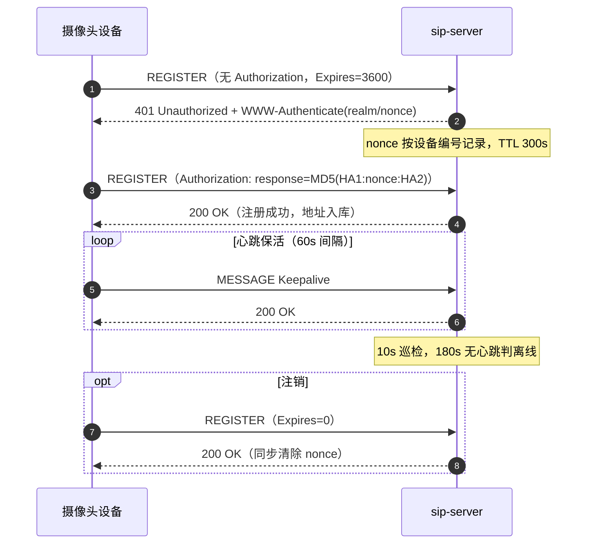
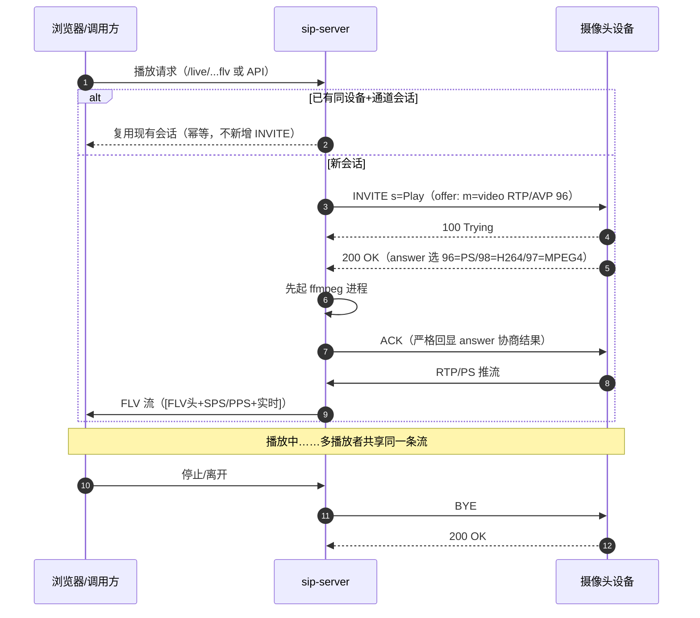
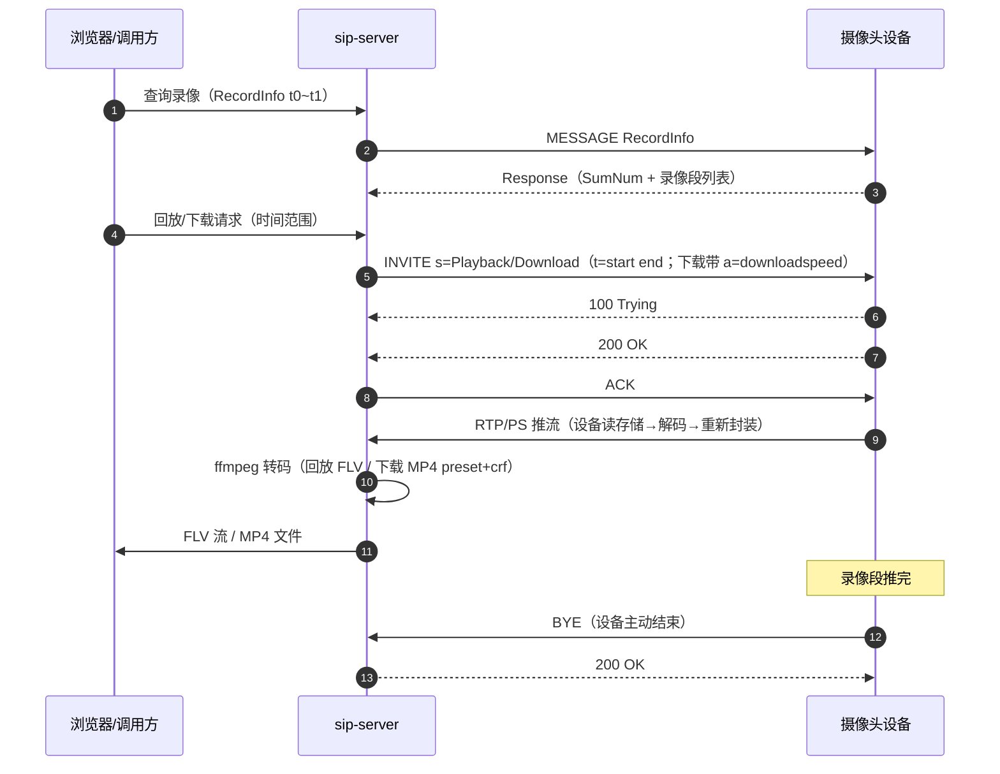
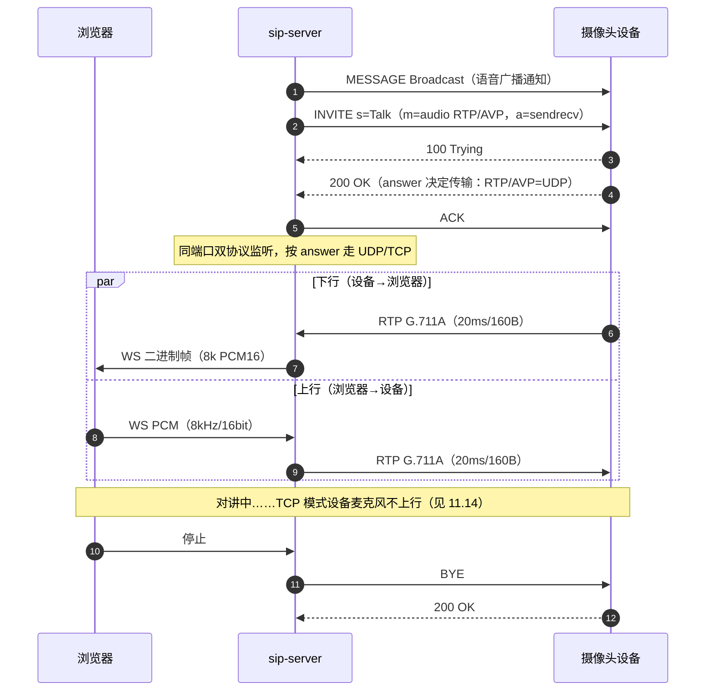
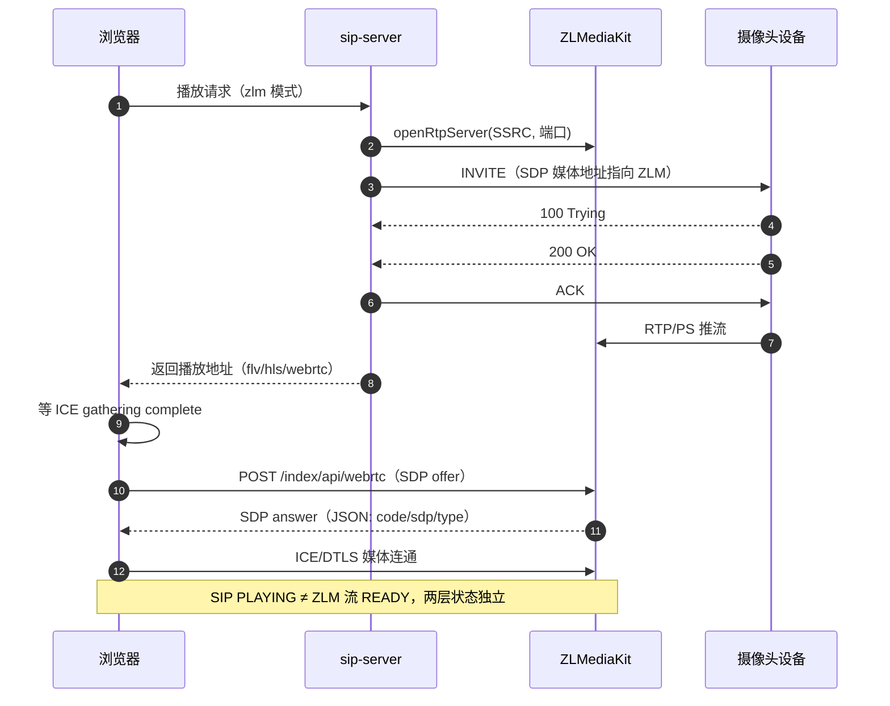

# sip-server — GB/T 28181-2022 摄像头接入与实时预览/历史回放服务器

一个基于 **Spring Boot 3 + Netty** 的国标（GB/T 28181-2022）摄像头接入服务器。
完成从 **SIP 信令接入（注册 / 心跳 / 目录 / 实时点播 / 报警订阅 / 历史回放 / 语音广播对讲）→ RTP/PS 媒体接收 → ffmpeg 转码 → 浏览器 HTTP-FLV 实时预览与录像回放** 的完整闭环；`zlm` 模式下媒体面由 ZLMediaKit 托管，**直播与回放的浏览器播放均走 WebRTC**（RTCPeerConnection 直连 ZLM，延迟亚秒级）。

定位：轻量级单机接入/联调服务器，无数据库、无中间件，适用于摄像头接入验证、信令联调、小型预览场景。

> **深度技术文档**：模块内部实现细节（时序图、并发设计、锁分析、线程模型、设计决策与边界）见 [TECH.md](TECH.md)。拉流（点播/媒体）模块详解见 TECH.md 第 5 章。

> **版本历史**：1.0 为早期验证版（单端口 RTP 按 SSRC 匹配会话、PlayService/PlaybackService 双服务并行、无注册/录像/语音能力、依赖 ZLMediaKit）。2.0 大重构后形成当前架构：媒体面重组为 `service/media`（MediaService 门面 + RtpReceiver + RtpPortPool，每会话独占 UDP 端口）/ `service/local`（FlvBroadcast）/ `service/voice` / `service/zlm` 四个包，SIP 处理器拆分为 `handler/` 下 10 个类由 `SipRequestHandler` 统一分发，并补齐注册鉴权、目录、录像查询/回放/下载、语音对讲/广播、告警订阅、Open API（`/api/v1/**`）。1.0 的端口抖动、无生命周期管理、线程无隔离等遗留问题均在 2.0 修复（端口级会话隔离、SinkWriter 有界队列、统一收尾路径，详见第 11 章与 TECH.md）。

---

## 目录

1. [技术栈与环境要求](#1-技术栈与环境要求)
2. [目录结构](#2-目录结构)
3. [快速开始](#3-快速开始)
4. [配置说明](#4-配置说明)
5. [系统架构](#5-系统架构)
6. [数据模型](#6-数据模型)
7. [协议（GB/T 28181）](#7-协议gbt-28181)
8. [媒体链路与播放](#8-媒体链路与播放)
9. [HTTP API](#9-http-api)
10. [浏览器预览页面](#10-浏览器预览页面)
11. [已知问题与解决方案](#11-已知问题与解决方案)
    1. [11.1 FLV 无法播放（黑屏 / 起播失败）](#111-flv-无法播放黑屏--起播失败)
    2. [11.2 设备 200 OK 后立即 BYE（海康等严格校验设备）](#112-设备-200-ok-后立即-bye海康等严格校验设备)
    3. [11.3 stdout 日志污染导致 FLV 损坏](#113-stdout-日志污染导致-flv-损坏)
    4. [11.4 Windows 下 ffmpeg 进程残留](#114-windows-下-ffmpeg-进程残留)
    5. [11.5 慢客户端 / 慢下游拖垮全链路](#115-慢客户端--慢下游拖垮全链路)
    6. [11.6 服务器重启后摄像头只发心跳不再 REGISTER](#116-服务器重启后摄像头只发心跳不再-register)
    7. [11.7 点播会话悬挂（设备无响应 / 设备先 BYE）](#117-点播会话悬挂设备无响应--设备先-bye)
    8. [11.8 心跳超时假在线](#118-心跳超时假在线)
    9. [11.9 XML/安全](#119-xml安全)
    10. [11.10 前端播放健壮性](#1110-前端播放健壮性)
    11. [11.11 大华设备第二次启动后点播无响应（INVITE 被静默丢弃）](#1111-大华设备第二次启动后点播无响应invite-被静默丢弃)
    12. [11.12 语音对讲 TCP 模式设备建链后秒 BYE（RFC 4571 封装）](#1112-语音对讲-tcp-模式设备建链后秒-byerfc-4571-封装)
    13. [11.13 语音对讲 UDP 模式海康静默丢包（~12s 无媒体超时 BYE）](#1113-语音对讲-udp-模式海康静默丢包12s-无媒体超时-bye)
    14. [11.14 语音对讲传输模式结论：海康 IPC 必须走 UDP（TCP 下设备麦克风不上行）](#1114-语音对讲传输模式结论海康-ipc-必须走-udptcp-下设备麦克风不上行)
    15. [11.15 zlm 模式 WebRTC 播放（直播/回放）要点与排查](#1115-zlm-模式-webrtc-播放直播回放要点与排查)
    16. [11.16 SIP 注册鉴权（Digest）](#1116-sip-注册鉴权digest)
    17. [11.17 PTZ 云台指令设备无响应（控制字位定义错位 / 速度位语义）](#1117-ptz-云台指令设备无响应控制字位定义错位--速度位语义)
    18. [11.18 回放/下载卡住不动（设备静默停推，看门狗兜底）](#1118-回放下载卡住不动设备静默停推看门狗兜底)
12. [日志与排查指南](#12-日志与排查指南)
13. [边界与限制](#13-边界与限制)
14. [后续规划](#14-后续规划)
15. [设备端配置备注](#15-设备端配置备注)
16. [相关文档](#16-相关文档)
17. [GB28181 技术分享与培训](#17-gb28181-技术分享与培训)
    1. [17.0 培训指南](#170-培训指南)
    2. [17.1 GB28181 协议基础](#171-gb28181-协议基础)
    3. [17.2 媒体基础：RTP/RTCP 与 PS 封装](#172-媒体基础rtprtcp-与-ps-封装)
    4. [17.3 摄像机关键概念与"路数"模型](#173-摄像机关键概念与路数模型)
    5. [17.4 本项目 sip-server 架构](#174-本项目-sip-server-架构)
    6. [17.5 专题：回放/下载设备压力治理](#175-专题回放下载设备压力治理)
    7. [17.6 专题：WVP+ZLM 运维](#176-专题wvpzlm-运维)
    8. [17.7 实战案例集（排坑经验）](#177-实战案例集排坑经验)
    9. [17.8 专题：语音对讲链路与音质改造](#178-专题语音对讲链路与音质改造)
    10. [17.9 现场排障速查卡](#179-现场排障速查卡)
    11. [17.10 高频问题 FAQ（现场版）](#1710-高频问题-faq现场版)
    12. [17.11 培训自测题](#1711-培训自测题)
    13. [17.12 文档索引](#1712-文档索引)
- [大华设备录像查询注意事项](#大华设备录像查询注意事项)

---

## 1. 技术栈与环境要求

| 类别 | 选型 | 说明 |
|------|------|------|
| 语言 / 运行时 | **Java 17**（Spring Boot 3 要求；若必须 JDK 8，请将 `pom.xml` parent 改为 `2.7.18`） | |
| Web 框架 | Spring Boot **3.3.5**（`spring-boot-starter-web`，内嵌 Tomcat） | HTTP/API/静态资源 |
| 信令网络 | Netty **4.1.115.Final**（`netty-all`） | 仅 UDP SIP 收发（`NioDatagramChannel`） |
| 媒体网络 | JDK `DatagramSocket`（原生 UDP） | RTP/PS 接收 |
| 转码 | 系统 PATH 中的 **ffmpeg**（外部进程） | PS → FLV（H.264 直封 + G.711→AAC） |
| 前端 | 原生 JS + `hls.min.js` + `mpegts.min.js`（打进 jar） | 浏览器播放 |
| 存储 | 全部**内存态**（`ConcurrentHashMap`），无数据库 / 无 Redis | 重启即清空 |

**运行依赖**

- JDK 17+（`java -version` 验证）
- Maven 3.6+（仅构建需要）
- ffmpeg 可执行文件，且必须在 `PATH` 中（或提供完整路径的启动脚本），版本建议 ≥ 4.x
- 摄像头：支持 GB/T 28181 的设备（海康/大华/宇视等）或国标模拟器，与服务器网络互通
- 浏览器：Chrome / Edge / Firefox（FLV 播放依赖 MSE，即 mpegts.js 的 `isSupported()`）

---

## 2. 目录结构

```
sip-server/
├── pom.xml                        # Maven 构建（Spring Boot 3.3.5 + Netty）
├── start.ps1                      # Windows 启动脚本（自动停旧进程、重定向日志）
├── README.md                      # 项目总览：功能/API/部署/已知问题 + 培训篇（第 17 章）
├── TECH.md                        # 技术全解：模块实现/时序/并发/代码阅读指南/四大功能调用关系/ZLM 模式/语音/压力治理（第 1-27 章）
├── 协议参考手册.md                 # 协议标准知识：GB/T 28181 / RTP/RTCP / G.711 / Digest 鉴权 / 国标级联设计
├── OPERATIONS.md                  # 运维手册：部署（Linux/Windows）/安全策略/日常运维/故障排查/监控/投产检查清单
├── CASCADE-DESIGN.md              # 级联立项与实施：下级角色/B2BUA 中转/虚拟号映射/里程碑 M1-M4/媒体插桩实现
├── src/main/java/com/example/sip/
│   ├── SipServerApplication.java      # 启动入口
│   ├── config/                        # 配置绑定（SipServer/Media/Voice/OpenApi…）+ 页面鉴权过滤器
│   ├── controller/                    # 管理页 API
│   │   ├── DeviceController.java      # 设备/点播/回放/语音广播对讲/录像查询 API
│   │   ├── FlvController.java         # HTTP-FLV 端点（直播按需拉流 + 回放/下载）
│   │   └── LoginController.java       # 页面登录
│   ├── api/                           # 对外 Open API（/api/v1，X-API-Key 鉴权）
│   │   ├── controller/OpenApiController.java      # 设备状态/直播/回放/语音端点
│   │   ├── auth/OpenApiAuthInterceptor.java       # API Key 拦截器（常量时间比较）
│   │   ├── config/（OpenApiProperties / OpenApiWebConfig）
│   │   ├── dto/（OpenApiResult / DeviceChannelRequest / PlaybackStartRequest）
│   │   └── exception/（OpenApiExceptionHandler / DeviceNotFoundException）
│   ├── handler/                       # SIP 信令分发层
│   │   ├── SipRequestHandler.java     # 报文分发总枢纽（按方法/CSeq 路由 + 兜底响应）
│   │   ├── SipChannelHolder.java      # 当前 Netty Channel（UDP 无连接，每包更新）
│   │   ├── SipResponder.java          # 响应发送辅助（回显 Via/From/To/Call-ID/CSeq）
│   │   ├── SipUtil.java               # 报文解析/构造工具函数
│   │   ├── RegisterHandler.java       # 注册鉴权 → DeviceRegistry
│   │   ├── DeviceMessageHandler.java  # MANSCDP MESSAGE（心跳/目录/告警）
│   │   ├── AlarmSubscribeHandler.java # SUBSCRIBE/NOTIFY 告警订阅
│   │   ├── RecordQueryHandler.java    # 录像查询（RecordInfo 多包聚合）
│   │   ├── MediaSignalHandler.java    # 视频媒体信令薄转发 → MediaService
│   │   └── VoiceSignalHandler.java    # 语音信令薄转发 → VoiceService
│   ├── model/                         # Device / Channel / SipMessage / StreamSession / VoiceSession / RecordInfo
│   ├── netty/
│   │   └── UdpSipServer.java          # Netty UDP 信令收发（5060）
│   ├── parser/
│   │   └── RecordInfoParser.java      # RecordInfo XML 解析
│   ├── service/
│   │   ├── DeviceRegistry.java        # 设备注册表（内存 Map + 心跳保活）
│   │   ├── CatalogService.java        # 目录(Catalog)响应 XML 生成
│   │   ├── AuthService.java           # 页面登录 token 鉴权
│   │   ├── media/                     # 视频媒体
│   │   │   ├── MediaService.java      # 直播/回放/下载总入口（INVITE 协商 + ffmpeg 生命周期）
│   │   │   ├── RtpReceiver.java       # 设备 RTP 接收、统计、多下游分发
│   │   │   └── RtpPortPool.java       # 媒体 UDP 端口池
│   │   ├── local/
│   │   │   └── FlvBroadcast.java      # FLV 实时广播（local 模式分发）
│   │   ├── voice/
│   │   │   ├── VoiceService.java      # 语音广播/对讲/设备直呼总入口
│   │   │   └── VoiceRtpEndpoint.java  # 语音 RTP UDP/TCP 收发（RFC 4571 成帧）
│   │   ├── audio/
│   │   │   └── G711a.java             # G.711 A-law 编解码
│   │   └── zlm/
│   │       ├── ZlmMediaService.java   # ZLMediaKit 媒体面托管（zlm 模式）
│   │       └── ZlmApiClient.java      # ZLM HTTP API 客户端
│   ├── sip/
│   │   ├── SipRequestBuilder.java     # UAC 请求构造（INVITE/ACK/BYE/MESSAGE…）
│   │   ├── SipResponseBuilder.java    # SIP 响应构造（200 OK 等）
│   │   └── SdpParser.java             # SDP 关键字段解析
│   └── websocket/
│       └── VoiceWebSocketHandler.java # 语音上下行 WebSocket（/ws/voice）
├── src/main/resources/
│   ├── application.yml                # 全部配置
│   └── static/
│       ├── index.html                 # 监控 + 直播/回放预览页面
│       ├── live.html / playback.html  # 直播 / 回放播放页
│       ├── voice.html / voice-talk.html  # 语音广播 / 对讲页面
│       ├── login.html
│       ├── css/
│       └── js/（auth.js / common.js / hls.min.js / mpegts.min.js）
├── downloads/                         # 录像下载产物（*.mp4）
├── hls/                               # zlm 模式 HLS 缓存目录
├── target/sip-server-1.0.0.jar        # 可执行 fat jar（含依赖）
└── logs/server.{out,err}.log          # 启动脚本运行日志
```

---

## 3. 快速开始

```bash
# 1. 构建（跳过测试）
mvn -DskipTests package

# 2. 运行
java -jar target/sip-server-1.0.0.jar

# 或使用 Windows 启动脚本（自动杀掉旧实例并记录日志）
.\start.ps1            # 默认使用 C:\Program Files\Java\jdk-17
.\start.ps1 -JavaHome "C:\path\to\jdk-17"
```

启动成功的标志（日志）：

```
[28181] SIP 信令服务器已启动: udp://0.0.0.0:5060 (serverId=34020000002000000001)
Tomcat started on port 8080
```

启动后暴露的端口：

| 端口 | 协议 | 用途 |
|------|------|------|
| 5060 | UDP | SIP 信令（摄像头注册 / 心跳 / 点播） |
| 8080 | TCP/HTTP | API、预览页面、HTTP-FLV 流 |
| 动态（1024+） | UDP | 每次点播动态分配的 RTP/PS 媒体接收端口 |

> 部署到真实服务器时，**务必把 `application.yml` 中 `sip.server.ip` 改为摄像头可达的本机 IP**，
> 否则注册响应 Contact 与点播 SDP 中的媒体地址指向错误，摄像头无法推流。

**配置外部化**（Spring Boot 原生能力，按优先级从高到低）：

```bash
# 1. 命令行参数（最高优先）
java -jar target/sip-server-1.0.0.jar --sip.server.ip=192.168.1.10 --sip.server.password=secret

# 2. 环境变量（大写、点/连字符转下划线；start.ps1 场景友好）
$env:SIP_SERVER_IP="192.168.1.10"; java -jar target/sip-server-1.0.0.jar

# 3. 外置配置文件（jar 同目录或指定位置，覆盖打包内的 application.yml）
java -jar target/sip-server-1.0.0.jar --spring.config.location=file:./config/
java -jar target/sip-server-1.0.0.jar --spring.config.additional-location=file:./config/application.yml

# 4. Profile 拆分（如 application-prod.yml，配合 --spring.profiles.active=prod）
```

摄像头（GB28181 平台接入）侧配置：

- SIP 服务器 ID：`34020000002000000001`
- SIP 服务器 IP：运行本服务的机器 IP
- SIP 服务器端口：`5060`
- 注册有效期：`3600`
- 密码：平台配置了 `sip.server.password`（或 `device-passwords` 中该设备编号/"*"的密码）时须填成一致，否则鉴权失败无法注册；平台未配密码时不鉴权，可任意填（详见 11.16）

---

## 4. 配置说明

`src/main/resources/application.yml`：

```yaml
server:
  port: 8080                    # HTTP 端口

sip:
  server:
    id: 34020000002000000001    # SIP 服务器 20 位国标编码
    host: 0.0.0.0               # 信令 UDP 监听地址
    port: 5060                  # 信令 UDP 端口
    ip: 192.168.1.100           # 对外通告 IP（注册 Contact / 点播 SDP），须摄像头可达
    heartbeat-timeout: 180      # 设备心跳超时（秒），超时标记离线
    domain: 3402000000          # SIP 域名（401 挑战 realm / 注册摘要域），须与设备侧一致

    # ===== SIP 注册鉴权（Digest，RFC 2617 / GB/T 28181）=====
    # 留空则任何设备均可注册（跳过鉴权，默认行为）
    password: ""
    # 按设备编号单独指定密码，优先级高于全局 password；"*" 为通配默认密码
    # device-passwords:
    #   34020000001320000002: "your-device-pwd"
    #   "*": "your-default-pwd"
    # 鉴权开关（可选）：不配则按 password 是否为空自动判断
    # auth-enabled: true
    # Digest nonce 有效期（秒），超时以 stale=true 重新挑战，默认 300
    # nonce-ttl-seconds: 300

  openapi:                      # 对外 Open API（/api/v1）安全配置
    enabled: true               # 是否启用 X-API-Key 鉴权（false 或 api-keys 为空时放行）
    api-keys:                   # 合法密钥列表（多接入方各配一把，生产环境务必配置）
      - 9f2c7a51e4b84d0f8a3c6d5e2f1b0a99

  media:                        # 媒体面配置
    mode: local                 # local=自研链路（RtpReceiver+ffmpeg+FLV）；zlm=ZLMediaKit 接管
    local:
      port-pool-start: 30000    # RTP 接收端口池起（并发媒体会话上限=池大小）
      port-pool-end: 30099      # 不得与语音端口池（默认 30100 起）重叠
      ffmpeg-path: ffmpeg       # PATH 中的命令名或绝对路径
      download-dir: ./downloads  # 录像下载（MP4）产物目录
      download-speed: 2         # 下载倍速：时间轴倍速≠文件压缩率，低端 IPC 建议 1~2
      download-preset: medium   # MP4 转码 x264 preset（离线转码 medium 体积最优）
      download-crf: 26          # MP4 转码 CRF（0~51，越小越清晰体积越大）

app:
  hls-dir: ./hls                # HLS 切片输出目录（/hls/** 访问）

  auth:                         # 页面登录鉴权（仅保护管理页面，不影响 /api/** 与 /api/v1/**）
    username: admin             # 登录用户名
    password: "change-me"       # 登录密码（生产建议环境变量 APP_AUTH_PASSWORD 覆盖）
    token-ttl-hours: 12         # 登录 token 有效期（小时），过期需重新登录

logging:
  level:
    com.example.sip: info       # 信令调试日志级别
```

配置说明：

| 键 | 默认 | 说明 |
|----|------|------|
| `sip.server.id` | `34020000002000000001` | 服务器国标编码，前 10 位域编码 + 后 10 位编码 |
| `sip.server.host` | `0.0.0.0` | UDP 监听地址 |
| `sip.server.port` | `5060` | SIP UDP 端口 |
| `sip.server.ip` | `127.0.0.1` | **部署必改项**：SDP 中通告给摄像头的本机地址 |
| `sip.server.heartbeat-timeout` | `180` | 心跳超时（秒），`DeviceRegistry` 每 10s 巡检一次 |
| `sip.server.domain` | `3402000000` | SIP 域名：401 挑战 `WWW-Authenticate` 的 realm 与注册摘要计算所用域，须与设备侧显示的域名一致 |
| `sip.server.password` | 空 | 设备密码（注册 Digest 鉴权）；**为空则跳过鉴权** |
| `sip.server.device-passwords` | 空 | 按设备编号的密码 Map（key=20 位国标编码，`*`=通配），优先于 `password` |
| `sip.server.auth-enabled` | 自动 | 鉴权开关；不配则按 `password` 非空自动判断 |
| `sip.server.nonce-ttl-seconds` | `300` | Digest nonce 有效期（秒），超时平台以 `stale=true` 重新挑战 |
| `sip.server.session-keepalive-enabled` | `false` | 直播会话保活开关：对 local 模式直播会话周期发会话内空 INFO 刷新 Dialog（设备侧会话超时会中断长直播）；zlm 模式由 ZLM 兜底不生效；失败仅记日志不拆会话 |
| `sip.server.session-keepalive-seconds` | `60` | 保活 INFO 间隔（秒），应显著小于设备侧会话超时（常见 300s+）；过小会放大设备信令负载 |
| `sip.server.alarm-webhook-enabled` | `false` | 告警 HTTP 外发开关：设备告警（MESSAGE 上报与 NOTIFY 订阅事件）以 JSON POST 异步推送；有界队列，队列满丢弃最旧并告警，SIP 信令线程永不阻塞 |
| `sip.server.alarm-webhook-url` | `""` | 告警推送目标 URL（如 `http://ops.example.com/api/gb28181/alarm`） |
| `sip.server.alarm-webhook-timeout-ms` | `3000` | 告警推送连接/读取超时（毫秒） |
| `app.hls-dir` | `./hls` | （遗留）HLS 目录静态映射根目录，当前转码仅 FLV 输出 |
| `app.auth.username` | `admin` | 页面登录用户名；仅保护管理页面（index/live/playback/voice.html），不影响 `/api/**` 与 `/api/v1/**` |
| `app.auth.password` | 内置默认值 | 页面登录密码；生产建议用环境变量 `APP_AUTH_PASSWORD` 覆盖 |
| `app.auth.token-ttl-hours` | `12` | 登录 token 有效期（小时），过期后需重新登录 |
| `sip.media.mode` | `local` | 媒体面模式：`local`=自研链路（RtpReceiver+ffmpeg+FLV 广播）；`zlm`=ZLMediaKit 接管媒体面 |
| `sip.media.local.port-pool-start` / `port-pool-end` | `30000` / `30099` | 本地 RTP 接收端口池，池大小=最大并发媒体会话数（默认 100）；不得与语音端口池（默认 30100 起）重叠 |
| `sip.media.local.ffmpeg-path` | `ffmpeg` | ffmpeg 可执行文件（PATH 中的命令名或绝对路径），local 媒体链路依赖 |
| `sip.media.local.download-dir` | `./downloads` | 录像下载（MP4）输出目录（`.part` 为下载中临时文件，完成后改名去后缀） |
| `sip.media.local.download-speed` | `4` | 录像下载倍速（**时间轴倍速≠文件压缩率**：收到仍是完整录像，仅传输耗时缩短为 1/N，设备侧代价线性上升，低端 IPC 建议 1~2） |
| `sip.media.local.download-preset` | `medium` | 下载 MP4 转码 preset（x264 速度档，离线转码下 medium 体积最优；多路并发可退 `veryfast`/`faster`） |
| `sip.media.local.download-crf` | `26` | 下载 MP4 转码 CRF（0~51，越小越清晰体积越大；26 对监控内容比旧默认小 40~55%） |
| `sip.media.zlm.api-base` | `http://127.0.0.1:9092` | ZLM HTTP API 基地址（`/index/api/...`） |
| `sip.media.zlm.secret` | - | ZLM API secret（ZLM `config.ini` 中 `api.secret`） |
| `sip.media.zlm.media-ip` | - | SDP 通告 IP：摄像头把 RTP 推到该 ZLM 地址（须摄像头可达） |
| `sip.media.zlm.http-port` | `9092` | ZLM HTTP API / 播放端口（WebRTC SDP 信令 `/index/api/webrtc`、FLV / HLS / WebSocket 分发） |
| `sip.media.zlm.play-host` | api-base 的 host | 浏览器播放地址主机（可按网络拓扑覆盖） |
| `sip.media.zlm.rtp-app` | `rtp` | ZLM `openRtpServer` 收流应用名 |
| `sip.openapi.enabled` | `true` | 对外 Open API（/api/v1/**）X-API-Key 鉴权开关；关闭后直接放行（仅建议内网隔离环境） |
| `sip.openapi.api-keys` | 空 | 合法 X-API-Key 列表（请求头 `X-API-Key` 需匹配其一）；**为空时鉴权自动放行（向后兼容），生产环境务必配置** |
| `management.endpoints.web.exposure.include` | `health` | Actuator 暴露白名单（本项目配 `health,info,metrics`）；**绝不加入 `shutdown`**（可被直接调用终止服务） |
| `management.server.port` | 同 `server.port` | 可选：监控独立端口（防火墙只放行业务口时，监控走内网另一口） |

> **ZLM（zlm 模式）快速接入**：
> 1. 部署 [ZLMediaKit](https://github.com/ZLMediaKit/ZLMediaKit)，记录 `config.ini` 中 `api.secret` 与 HTTP 端口；
> 2. `application.yml` 置 `sip.media.mode: zlm` 并按上表填好 `zlm.*`；
> 3. 点播时本服务调用 ZLM `openRtpServer` 分配收流端口，INVITE 的 SDP 媒体地址指向 ZLM，设备 RTP 直推 ZLM，由 ZLM 统一转协议分发（**WebRTC（前端主链路）** / HTTP-FLV / WS-FLV / HLS），不再依赖本机 ffmpeg；
> 4. 预览页在 zlm 模式下**直播与回放均以 WebRTC 播放**（`RTCPeerConnection` 经 ZLM `/index/api/webrtc` 信令建连，见 11.14），`/api/status` 的 `mediaMode` 自动感知。

---

## 5. 系统架构

### 5.1 总体架构图

```
                        摄像头 / 国标设备 (GB/T 28181)
                              │
                 ┌────────────┴────────────┐
             SIP 信令 (UDP 5060)       RTP/PS 媒体 (UDP 动态端口)
                 │                            │
                 ▼                            ▼
        ┌─────────────────┐          ┌─────────────────────┐
        │  UdpSipServer   │          │    RtpReceiver      │
        │  (Netty UDP)    │          │ 每个点播 1 个 socket │
        └────────┬────────┘          │ 解析 RTP 头 + 统计   │
                 │                   │ 多下游 SinkWriter    │
                 ▼                   └──────────┬──────────┘
        ┌─────────────────┐                    │ RTP 载荷(PS)写入 stdin
        │SipRequestHandler│                    ▼
        │  方法分发/响应   │        ┌─────────────────────┐
        └────┬───┬────────┘        │   ffmpeg 进程        │
             │   │                 │ -f mpeg -i pipe:0    │
             ▼   ▼                 │  └─ FLV stdout       │──▶ FlvBroadcast (pipe:1)
  │DeviceRegistry│ │PlayService│    └─────────────────────┘
  │ 注册表/心跳  │ │ 会话管理   │
  └─────────────┘ └─────┬─────┘
                        │ 点播控制(INVITE/ACK/BYE) 经 UdpSipServer.send()
                        ▼
        ┌─────────────────────────────────────────┐
        │        Spring MVC (HTTP :8080)          │
        │  /api/*        /live/*.flv      /hls/**(遗留)│
        └─────────────────────────────────────────┘
                             ▲
                             │
                   浏览器页面 (hls.js / mpegts.js)
```

### 5.2 模块职责

| 模块 | 职责 | 关键点 |
|------|------|--------|
| `UdpSipServer` | UDP 信令监听（5060）与主动发送 | Netty `NioDatagramChannel`；`send()` 供 INVITE/ACK/BYE 使用 |
| `SipRequestHandler` | SIP 报文解析分发（UAS 侧） | 支持 REGISTER/MESSAGE/INVITE/ACK/BYE/OPTIONS；响应分发给 `PlayService`；BYE 打印完整报文用于诊断 |
| `DeviceRegistry` | 设备在线表 | 心跳刷新、10s 定时巡检、超时标记离线；**仅心跳不注册的设备会自动登记**（兼容服务器重启后设备只发心跳） |
| `CatalogService` | 目录查询响应 XML | GB2312 编码，回填 SN |
| `PlayService` | 点播核心（UAC 侧） | `startPlay/stopPlay`、INVITE UDP 重传（500ms/1s/2s/4s）+ 超时自动清理、设备主动 BYE 同步清理、平台关闭前统一 BYE、ffmpeg 进程全生命周期管理 |
| `PlaybackService` | 历史回放核心（UAC 侧） | `startPlayback/stopPlayback`；回放 INVITE（Subject 前缀 Playback、SDP `s=Playback`、`t=`/`u=` 起止时间、SSRC 首位为 1）；200 OK 后 ACK + ffmpeg 转码；设备推完历史流主动 BYE 时同步清理；FLV 等待式广播 |
| `RtpReceiver` | RTP/PS 媒体接收 | 每次点播分配一个 UDP 端口；解析版本/PT/seq/timestamp/ssrc；估算丢包；`SinkWriter` 有界队列（512 块≈700KB）异步转发，**慢下游丢最旧但不阻塞 RTP 接收** |
| `FlvBroadcast` | HTTP-FLV 广播 | 单 ffmpeg stdout 多客户端共享；保存 bootstrap（FLV header/metadata/sequence header）供新客户端；慢客户端有界队列丢旧；加锁保证"Bootstrap 恒在实时数据前"（见 [11.1](#111-flv-无法播放黑屏)） |
| `SipRequestBuilder` | UAC 请求构造 | INVITE/ACK/BYE；ACK 携带**按设备 answer 协商的最终 SDP**（关键，见 11.2） |
| `SipResponseBuilder` | SIP 响应构造 | 回显 Via/From/To/Call-ID/CSeq；body 按 GB2312 |
| `SdpParser` | SDP 解析 | 提取会话 IP/端口/载荷格式列表/SSRC |
| `SipMessage` | SIP 消息模型 | body 以 ISO-8859-1 无损保存，避免 GB2312 中文 XML 失真 |
| `WebConfig` | 静态资源 | `hls-dir` 映射为 `/hls/**`，`Cache-Control: no-cache` |
| `DeviceController` | 状态/点播 API | 见 [HTTP API](#9-http-api) |
| `FlvController` | HTTP-FLV 直播 | 无会话时自动 `getOrStartSession()`，断开自动停转码 |
| `api` 包（`OpenApiController` 等，按 controller/auth/config/dto/exception 分子包） | 对外 Open API（/api/v1）：设备状态/直播/回放/语音 + X-API-Key 鉴权 | 仅做参数校验、调用同一批 Service（与内部接口同源，行为一致）；统一响应体 `{code,message,data}`；拦截器仅作用于 `/api/v1/**`，不影响内部接口 |

### 5.3 关键线程

| 线程 | 数量 | 职责 |
|------|------|------|
| Netty `nioEventLoopGroup` | 1 | 5060 信令收发 |
| `rtp-recv-<port>` | 每点播 1 个 | UDP 收包 → 统计 → 入队下游 |
| `sink-write-<port>` | 每下游 1 个 | 有界队列 → 写 ffmpeg stdin |
| `ffmpeg-<callId>` | 每点播 1 个 | 读 ffmpeg stderr 打印日志 |
| `flv-read-<callId>` | 每会话 1 个 | 读 ffmpeg stdout → 存 bootstrap + 广播 |
| HTTP 请求线程池 | Tomcat | `/live/*.flv` 长连接轮询拉取 |
| 调度线程 | 1 | 设备心跳超时巡检（10s） |
| `invite-retransmit` | 1 | INVITE UDP 重传与超时清理调度（守护线程，见 11.11） |

### 5.4 会话状态机（`StreamSession.State`）

```
                 startPlay() 发送 INVITE
                         │
                         ▼
                   ┌───────────┐
 INVITE重传500ms~4s│ INVITING  │──── 收到 200 OK → 发送 ACK
 10s超时自动清理  ◀──┤           │
                   └───────────┘
                         │
                         ▼
                   ┌───────────┐    stopPlay / 设备主动 BYE
                   │  PLAYING  │───────────────┐
                   └───────────┘               │
                         ▲                     ▼
                         │ 摄像头 RTP/PS 推流  ┌───────────┐
                         └────────────────────│  STOPPED  │
                                              └───────────┘
```

---

## 6. 数据模型

### 6.1 `Device`（国标设备）

| 字段 | 类型 | 说明 |
|------|------|------|
| `deviceId` | String | 20 位国标编码（设备 ID） |
| `name` | String | 设备名（预留，可能为空） |
| `host` | String | 设备源 IP（Contact 解析，回退发送方 IP） |
| `port` | int | 设备信令端口 |
| `transport` | String | 默认 `UDP` |
| `registerTime` | LocalDateTime | 首次注册时间 |
| `lastKeepaliveTime` | long | 最近心跳时间（epoch ms） |
| `online` | volatile boolean | 在线标记，心跳超时置 false |

### 6.2 `StreamSession`（点播会话）

| 字段 | 说明 |
|------|------|
| `callId` / `branch` / `fromTag` | 本次 INVITE 事务参数（ACK/BYE 回显） |
| `toTag` / `peerContact` / `peerSdp` | 200 OK 应答参数（ACK R-URI 优先用 Contact，RFC 3261） |
| `peerPayload` | 设备 answer 的媒体载荷列表（如 `96` 或 `96 98 97`），ACK 最终 SDP 使用 |
| `ssrc` / `invitePacket` / `inviteRetries` | 本次点播随机 SSRC、INVITE 原始报文缓存、重传计数（UDP 重传用，见 11.11） |
| `state` | 状态机：`INVITING → PLAYING → STOPPED` |
| `localPort` | 本地动态 RTP 接收端口 |
| `deviceHost/devicePort` | 设备地址（INVITE/BYE 目标） |
| `ffmpeg` | ffmpeg 进程句柄 |
| `hlsUrl` | `/hls/<callId>/play.m3u8` |
| `playback` | boolean：是否为回放会话 |
| `playbackStart` / `playbackEnd` | 秒级 epoch：回放起止时间（回放会话专用） |

会话以 `deviceId:channelId` 唯一约束——**同一通道同一时刻只允许一路点播**，再次点播先停止旧会话。

### 6.3 `RtpReceiver.Session`（媒体统计）

每点播一个，字段：`packets`、`bytes`、`version`、`payloadType`、`lastSeq`、`lastTimestamp`、`ssrc`、`lostPackets`（16 位 seq 做差、处理回绕、忽略乱序）、`sinks`（下游列表）。

### 6.4 `FlvBroadcast.Subscriber`

每个 HTTP-FLV 客户端一个：有界队列（300 块 ≈ 2.4MB），满时**丢最旧 chunk 再加最新**（慢客户端不拖死广播），断开即清空。

### 6.5 `SipMessage`

极简模型：`startLine`（请求行/状态行）+ 有序 headers（同名头只保留第一个）+ body（**ISO-8859-1 无损保存**）。提供 `method()`、`statusCode()`、`uri()`、`getHeader()`（忽略大小写）、`getBodyBytes()`。

---

## 7. 协议（GB/T 28181）

### 7.1 支持的 SIP 信令

**服务器作为 UAS（处理设备→服务器）：**

| 信令 | 说明 | 响应 |
|------|------|------|
| `REGISTER` | 注册（Expires=0 时注销）；平台配置密码时先回 401 Digest 挑战 | 200 OK（或 401 挑战） |
| `MESSAGE (Keepalive)` | 心跳，刷新在线状态 | 200 OK |
| `MESSAGE (Catalog)` | 目录查询 | 200 OK + MANSCDP+xml（GB2312） |
| `INVITE` | 设备侧发起的点播（设备邀请服务器收流） | 200 OK + SDP（PS/96），开启 RTP 接收 |
| `ACK` | 会话确认 | （记录日志） |
| `BYE` | 结束点播；**若是服务器发起点播的会话，触发 `PlayService.handleDeviceBye` 同步清理** | 200 OK |
| `OPTIONS` | 存活探测 | 200 OK |

**服务器作为 UAC（服务器→设备，实时点播 / 历史回放）：**

| 信令 | 构造方 | 说明 |
|------|--------|------|
| `INVITE`（点播） | `SipRequestBuilder.invite` | Subject: `channelId:serverId,channelId:0`；offer SDP `m=video <本地RTP端口> RTP/AVP 96` + `a=rtpmap:96 PS/90000`；SSRC 首位 `0` |
| `INVITE`（回放） | `SipRequestBuilder.playbackInvite` | Subject: `Playback:<channelId>:<serverId>,<channelId>:0`；SDP `s=Playback`、`t=<start> <end>`（秒级 epoch）；SSRC 首位 `1`（`newPlaybackSsrc`） |
| `ACK` | `SipRequestBuilder.ack` | 携带**最终协商 SDP**，载荷回显设备 answer（96=PS / 98=H264 / 97=MPEG4），端口为本端 RTP 端口 |
| `BYE` | `SipRequestBuilder.bye` | CSeq 递增为 2，新 branch |

### 7.2 实时点播时序（核心）

```
PlayService.startPlay              摄像头(海康等)
      │ ① INVITE (offer SDP: PS/96)   │
      │──────────────────────────────▶│
      │                               │
      │ ② 200 OK (answer SDP:         │
      │     m=video <port> RTP/AVP 98 │   ← 设备选择 98=H264 或 96/97
      │◀──────────────────────────────│
      │   （记录 toTag/Contact/SDP）   │
      │ ③ ACK (携带最终 SDP，          │
      │    载荷=设备选择的类型)         │
      │──────────────────────────────▶│
      │                               │
      │ ④ RTP/PS 推流 ───────────────▶  RtpReceiver(<动态端口>)
      │                                    │ 转发载荷到 ffmpeg stdin
      │                                    ▼
      │                            ffmpeg → HLS 切片 / FLV stdout
      │ ⑤ BYE（停止）
```

### 7.2.1 历史回放时序

```
PlaybackService.startPlayback        摄像头(海康/大华等)
      │ ① INVITE (Subject: Playback:...)
      │    SDP: s=Playback, t=<start> <end>,
      │         SSRC 首位 1 ──────────▶│
      │                               │ 设备检索本地录像
      │ ② 200 OK (answer SDP)        │
      │◀──────────────────────────────│ 无录像时段可能不回/立即 BYE
      │ ③ ACK (最终协商 SDP)          │
      │──────────────────────────────▶│
      │                               │
      │ ④ RTP/PS 历史流推流 ──────────▶  RtpReceiver → ffmpeg → FLV
      │    （推完录像段后设备主动 BYE）
      │ ⑤ BYE（设备推完/用户停止）     │
      │◀──────────────────────────────│
```

- 与点播的关键差异：Subject 与 SDP 标识回放语义（`s=Playback`、`t=` 起止时间）、SSRC 首位为 `1`（国标：0=实时 1=回放）、推流结束后由**设备侧主动 BYE**。
- 回放 FLV 每次请求强制重建会话（同一直播流可共享，回放必须从头播）。


### 7.3 SDP 关键字段

服务器 offer（INVITE，`SipRequestBuilder.buildSdp`）：

```
v=0
o=34020000002000000001 0 0 IN IP4 <sip.server.ip>
s=Play
c=IN IP4 <sip.server.ip>
t=0 0
m=video <动态端口> RTP/AVP 96
a=sendrecv
a=rtpmap:96 PS/90000
y=<10位随机SSRC>
f=v/2/5/25/1/2/1
```

> `y=` 为 10 位国标 SSRC：每次点播随机生成（首位 `0` 表示实时点播、末位偶数），避免与设备残留会话 SSRC 冲突（见 11.11）。

ACK 最终 SDP（`buildNegotiatedSdp`）按设备 answer 首载荷映射：

| 设备选择的载荷 | ACK rtpmap |
|----------------|------------|
| `96`（默认） | `96 PS/90000` |
| `98` | `98 H264/90000` |
| `97` | `97 MPEG4/90000` |

> 部分国标设备（尤其海康）会严格校验 ACK 携带的 SDP 是否与协商结果一致；不一致时会在收到 ACK 后**立即回 BYE**。实现要点：ACK 载荷必须回显 answer、端口必须是本端接收端口、R-URI 优先取 200 OK 的 Contact（见 [11.2](#112-200-ok-后设备立即-bye)）。

---

## 8. 媒体链路与播放

### 8.1 什么是 PS 流（摄像机返回的媒体载荷）

摄像机在点播建立后通过 RTP 推给服务器的载荷是 **PS（Program Stream，节目流）**——GB/T 28181 国标默认的媒体封装格式：设备把一路 H.264（+ 可选 G.711 音频）编码封装成 PS 流，按 RTP/AVP 96 切包推送（时间戳频率 90000 Hz）。

**PS 与 TS 对比：**

| | PS（Program Stream，节目流） | TS（Transport Stream，传输流） |
|------|------|------|
| 包长 | 变长，以 `00 00 01 BA`（pack start code）标记包边界 | 固定 188 字节 |
| 适用 | 可靠信道、顺序传输（存储 / 本地 / 国标信令直连） | 有损信道（广播 / 网络），抗丢包 |
| 典型用途 | DVD、录像文件、GB28181 点播 | DVB、IPTV、HLS 切片 |

**PS 包内部结构**（收流报文 hex 前几字节常以 `00 00 01 BA` 开头，可作为"设备是否在推 PS 流"的判别依据）：

```
00 00 01 BA  pack_header          ← PS 包边界
00 00 01 BB  system_header（可选）
00 00 01 E0  PES (H.264 视频，I 帧前常带 SPS/PPS)
00 00 01 C0  PES (G.711 音频，可选)
```

**与解码/播放的关系**：本服务不解析 PS 内容（也不关心设备实际用 H.264 还是其他编码），把 RTP 载荷去掉 12 字节 RTP 头后整段交给 ffmpeg，由 ffmpeg 的 PS demuxer（`-f mpeg`）解封装。设备可能把一个大 PS 包分在多个 RTP 里，也可能把多个小 PS 包合成一个 RTP，PS demuxer 都能自动重组。"视频编码（H.264）+ 容器（PS）+ 传输（RTP/UDP）"三者解耦，正是国标"信令面只协商编码与端口、设备内部编码自定"的设计——服务器无需关心具体编码也能先把流收下来再转封装。

对应代码：

- `SipRequestBuilder.buildSdp()`：offer 声明收 96 号载荷（`a=rtpmap:96 PS/90000`）
- `SipRequestBuilder.buildNegotiatedSdp()`：ACK 协商时若设备 answer 选 96，rtpmap 仍为 `96 PS/90000`
- `RtpReceiver`：收到的每个 UDP 包载荷即 PS 数据块（记录首包 hex 供判别），转发给 ffmpeg stdin
- `PlayService.startFfmpeg()`：`-f mpeg -i pipe:0`（`mpeg` = MPEG-Program Stream（PS）demuxer）

### 8.2 载荷类型协商：96 PS / 98 H264 / 97 MPEG4（实际以 96 为运行主线）

信令层对国标的 96/98/97 三种载荷做了**三态协商兼容**，但媒体消费侧固定按 PS（96）处理：

**① INVITE offer（服务器发起）— 只发 96：**

```
m=video <动态端口> RTP/AVP 96
a=rtpmap:96 PS/90000
```

设备主动 INVITE（被叫侧应答，`SipRequestHandler`）同样固定 `96 PS`。offer 永远不会主动声明 98/97。

**② 设备 answer — 全量解析：** `SdpParser` 把 answer `m=` 行第 4 段起的载荷整串保存（如 `96 98 97` → `peerPayload="96 98 97"`）。

**③ ACK 最终 SDP — 按 answer 首载荷映射（`buildNegotiatedSdp`）：**

| 设备 answer 首载荷 | ACK rtpmap | 状态 |
|------|------|------|
| `96`（默认） | `96 PS/90000` | 运行主线 |
| `98` | `98 H264/90000` | 仅协商兼容 |
| `97` | `97 MPEG4/90000` | 仅协商兼容 |
| 其他 / 空 | 回落 `96 PS/90000` | 兜底 |

**④ 媒体侧固定 PS 假设（潜在不一致点）：** `RtpReceiver` 只解析并统计 `payloadType`（`d[off+1] & 0x7F`），**不按 PT 校验或分流**，载荷原样转给 ffmpeg；`PlayService.startFfmpeg()` 固定 `-f mpeg -i pipe:0`（PS demuxer）+ `-c:v copy`。

因此若设备 answer 真选了 `98` 并按**裸 H.264 RTP**（无 PS 封装）推流，ffmpeg 的 `-f mpeg` 会解不出来——代码对 98/97 的支持目前只到"信令层 ACK 协商正确回显"（解决 11.2 海康"协商不一致立即 BYE"），媒体层仍按 PS 处理。实测能打通的设备最终都推 PS（PT 写 96 或按国标惯例 PS 封装）。

**结论：** 项目实际工作载荷为 **96 = PS**（offer 只发 96、ffmpeg 只按 PS 解、接收侧不区分），98/97 是为通过严格设备 ACK 校验而保留的协商兼容。

### 8.3 RTP/PS 接收（`RtpReceiver`）

- 每次 `startPlay` 通过 `new DatagramSocket(0)` 分配一个**动态 UDP 端口**。
- 收包线程解析 RTP 固定头：version / PT / sequence / timestamp / SSRC；前 3 包打印十六进制（用于判断设备是否推流、推的什么）。
- 丢包估算：16 位 seq 差 `(cur - last) & 0xFFFF`，落在 `(1, 32768)` 视为丢包计数，正确处理回绕、忽略乱序。
- 载荷经 `SinkWriter`（有界队列 512 块 + 独立写线程）写入下游 stdin。下游消费慢时**丢最旧**，绝不阻塞 RTP 接收线程（否则 UDP 内核缓冲溢出丢包更严重）。

### 8.4 ffmpeg 转码（`PlayService.startFfmpeg`）

单 ffmpeg 进程，stdin 吃 RTP 载荷（PS），stdout 产 FLV：

```bash
ffmpeg -loglevel info \
  -f mpeg -i pipe:0 \
  -map 0:v:0 -map 0:a:0? \
  -c:v copy -c:a aac -b:a 64k \
  -flvflags no_duration_filesize \
  -f flv pipe:1
```

| 输出 | 格式 | 说明 |
|------|------|------|
| FLV（stdout） | 视频 H264 copy（零 CPU 开销）；**音频转 AAC**（国标 G711A/G722 等原编码浏览器 MSE 不可解，必须转码才能出声；FLV 支持 AAC，mpegts.js 可解码） |

> 音频采用可选映射 `0:a:0?`：PS 流内无音频轨时该映射自动跳过，输出退化为纯视频，不影响转码启动与视频播放。

进程管理要点：

- **stdout 与 stderr 必须分离**（`redirectErrorStream(false)`）：stdout 是 FLV 二进制，合并会导致日志污染 FLV 无法播放。
- stderr 由守护线程逐行转发到日志 `[ffmpeg-<callId>]`。
- Windows 上 chocolatey shim 会派生子进程，释放时用 `ffmpeg.descendants().forEach(ProcessHandle::destroyForcibly)` **连同子进程一起销毁**，避免残留（见 11.4）。

### 8.5 播放链路

| 方式 | 访问地址 | 延迟 | 播放器 | 特性 |
|------|----------|------|--------|------|
| HTTP-FLV（直播） | `/live/<deviceId>/<channelId>.flv` | ~1s | mpegts.js（`isLive:true`） | **无需先点播**，按需自动 INVITE，最后一个播放者断开自动停流；含 AAC 音频 |
| HTTP-FLV（回放） | `/playback/<deviceId>/<channelId>/<startTime>/<endTime>.flv` | 取决于设备 | mpegts.js（`isLive:false`） | 每次请求**强制重建回放会话**保证从头播放；设备推完历史流主动 BYE，FLV 广播自然关闭 |

> **声音**：浏览器自动播放策略禁止带声 autoplay，video 初始 `muted`，且**每次新开/切换播放都会重置为静音**；点画面右上「🔊 声音:关」按钮（用户手势）取消静音并重新 play。设备无音频轨时按钮开启后仍无声属正常。

> **回放与直播的行为差异**：
> - 回放 FLV 请求**每次强制重建会话**（保证从指定起始时间播放），直播 FLV 无会话时按需 INVITE、多客户端共享；
> - 回放**最后一个客户端断开即自动停止**（`stopIfNoClients`，BYE + 释放资源），与直播一致；
> - 推流结束时直播由服务器端检测，回放由**设备主动 BYE**（推完录像段）触发清理；
> - 平台关闭前点播与回放会话**均统一发 BYE**（`ContextClosedEvent` 监听），避免设备侧半开会话。

**FLV 依赖 bootstrap 才能起播**（FLV 是单字节流，必须从 `FLV` 头 → onMetaData → AVC sequence header 顺序解析，中途加入的客户端必须拿到这部分数据初始化，否则探测失败/解码器起不来；详见 [11.1](#111-flv-无法播放黑屏)）。

### 8.6 FlvBroadcast 内部机制

```
            ffmpeg stdout (pipe:1)
                  │
       FlvBroadcast.readLoop 线程
       ├─ ① appendBootstrap(chunk)   前 64KB 存为 bootstrap（上限 2MB）
       └─ ② synchronized(broadcastLock) 广播给所有 subscribers

  新客户端 subscribe():
       ① 等待 bootstrap 就绪（≤3s，由 readLoop notifyAll 唤醒）
       ② synchronized(broadcastLock) {
             subscribers.add(sub);
             投递 bootstrap 快照;        ← 与广播互斥，顺序恒为 [Bootstrap..., 实时...]
          }
       ③ 之后轮询队列写 HTTP 响应
```

### 8.7 点播接口与 FLV 拉流的分工（重复会话问题与结论）

`/api/play/start`（内部）与 `/api/v1/live/start`（Open API）共用同一处双模式判断（回放接口同构）：

```java
StreamSession s = mediaProps.isZlm()
        ? zlmMediaService.getOrStartSession(deviceId, channelId)  // 幂等复用
        : playService.startPlay(deviceId, channelId);             // 停旧建新
```

**会话获取三种语义**：`startPlay`/`startPlayback` = 停旧建新（每次调用重复 1 次 INVITE）；`getOrStartSession`/`getOrStartPlayback` = 幂等复用（有会话 0 次、无则 1 次）；`restartSession` = 强制重建（FlvController 旧方案，已弃用）。

**演进**：FlvController 已从 `restartSession`（拉流时拆会话重建，双 INVITE）改为 `getOrStartSession` 复用，拉流侧不再重复 INVITE。残留问题在接口侧——`startPlay` 停旧建新，每次调用点播接口仍重复 1 次会话，且会拆掉正被浏览器 FLV 消费的会话。

**结论（方案已定，代码暂未改）**：去掉 `playStart` / `playbackStart` 的三元判断，直接采用 zlm 分支的幂等复用语义——已有 PLAYING 会话复用、无则新建，接口与拉流操作同一会话，全程仅 1 次 INVITE，重复会话问题全部解决。

> 演进时序与方案价值详见 [TECH.md](TECH.md) 5.2.4。

---

## 9. HTTP API

| 方法 | 路径 | 说明 |
|------|------|------|
| GET | `/api/devices` | 已注册设备列表（含在线状态/地址） |
| GET | `/api/status` | 服务概览：serverId、sipPort、在线/总数、媒体会话数 |
| GET | `/api/media` | RTP 接收统计：`{端口: {packets, bytes}}`（持续增长 = 推流成功） |
| GET | `/api/play/sessions` | 点播会话列表：callId、state、peerSdp、rtp 统计（packets/bytes/PT/ssrc/lost） |
| POST | `/api/play/start?deviceId=&channelId=` | 开始点播（INVITE） |
| POST | `/api/play/stop?deviceId=&channelId=` | 停止点播（BYE + 释放资源） |
| POST | `/api/playback/start?deviceId=&channelId=&startTime=&endTime=` | 发起历史回放（时间支持 ISO `2024-01-01T00:00:00` / `yyyy-MM-dd HH:mm:ss` / 秒级 epoch，+8 时区） |
| POST | `/api/playback/stop?deviceId=&channelId=` | 停止回放（BYE + 释放资源） |
| GET | `/api/playback/sessions` | 回放会话列表（含 `playbackStart/playbackEnd` 秒级 epoch、RTP 统计、当前 `playbackScale`） |
| POST | `/api/playback/control` | 回放媒体控制（body JSON：`action=pause/resume/scale/seek`，`speed` 倍速 0.25~16，`startTime` 拖动目标；仅 local 模式回放会话，MANSRTSP over SIP INFO） |
| POST | `/api/devices/{deviceId}/catalog/query` | 主动查询设备目录（NVR 返回全部子通道，可能分页聚合；返回 `channels/channelCount/sumNum/complete`） |
| POST | `/api/devices/{deviceId}/info/query` | 主动查询设备信息（厂商/型号/固件/通道数） |
| POST | `/api/devices/{deviceId}/status/query` | 主动查询设备状态（Online/Status/Encode/Record/Alarm，排障用） |
| POST | `/api/devices/{deviceId}/channels/{channelId}/ptz` | 云台控制（body JSON：`action=up/down/left/right/zoomIn/zoomOut/focusNear/focusFar/stop`，`speed` 1~255 全字节缺省 100；控制字与速度位语义见 [11.17](#1117-ptz-云台指令设备无响应控制字位定义错位--速度位语义)；返回实际下发的 `ptzCmd` 十六进制） |
| POST | `/api/devices/{deviceId}/channels/{channelId}/preset` | 预置位（body JSON：`op=set/call/delete`，`presetId` 1~255） |
| POST | `/api/devices/{deviceId}/channels/{channelId}/ptz/custom` | 自定义 PTZCmd 透传（16 位十六进制，非标设备逃生口） |
| POST | `/api/voice/start?deviceId=&channelId=` | 发起语音广播/对讲（Broadcast MESSAGE → 设备反向音频 INVITE → 200 OK → ACK → TALKING） |
| POST | `/api/voice/stop?deviceId=&channelId=` | 停止语音对讲（BYE + 释放 TCP 连接/UDP socket/定时任务） |
| GET | `/api/voice/sessions` | 语音会话列表（状态/传输模式/SSRC 等） |
| WS | `/ws/voice?deviceId=&channelId=` | 浏览器麦克风 PCM 上行（8kHz/16bit/LE/单声道，G.711A 编码后 RTP 直发设备） |
| GET | `/hls/<callId>/play.m3u8` | HLS 播放清单（遗留静态映射，转码已无 HLS 输出） |
| GET | `/live/<deviceId>/<channelId>.flv` | HTTP-FLV 直播流（`video/x-flv`，长连接） |
| GET | `/playback/<deviceId>/<channelId>/<startTime>/<endTime>.flv` | HTTP-FLV 历史回放流（路径段时间 `-` 替代 `:`，每次请求强制重建回放会话从头播放） |
| GET | `/` | 监控与预览页面 |

**监控端点（Actuator，白名单 `health,info,metrics`）**：

| 路径 | 说明 |
|------|------|
| `/actuator/health` | 健康检查（本项目无外部依赖，恒 `UP`） |
| `/actuator/metrics` | 指标目录（含 `sip.*` 前缀自定义指标） |
| `/actuator/metrics/sip.devices.online` | 在线设备数（心跳未超时） |
| `/actuator/metrics/sip.devices.total` | 注册设备总数（含离线） |
| `/actuator/metrics/sip.sessions.active` | 活跃媒体会话数（点播/回放/下载） |
| `/actuator/metrics/sip.ffmpeg.processes` | 存活 ffmpeg 子进程数（local 链路；zlm 模式为 0） |
| `/actuator/metrics/sip.rtp.ports.available` | RTP 端口池可用数（**归零后新点播失败，最需告警的容量指标**） |
| `/actuator/metrics/sip.rtp.ports.capacity` | RTP 端口池容量 |

> `shutdown` 端点刻意不暴露（可被直接调用终止服务）；指标实现见 `com.example.sip.monitor.SipMetrics`，
> 均为内存状态只读视图，不介入信令/媒体逻辑。

常用调试命令：

```bash
curl http://localhost:8080/api/devices
curl http://localhost:8080/api/status
curl http://localhost:8080/api/media
curl http://localhost:8080/api/play/sessions
curl http://localhost:8080/api/playback/sessions

# 监控指标（Actuator）
curl http://localhost:8080/actuator/health
curl http://localhost:8080/actuator/metrics/sip.rtp.ports.available

# 直接拉 FLV（验证推流链路，Ctrl+C 停止）
curl -N http://localhost:8080/live/34020000001320000001/34020000001320000001.flv -o out.flv

# 发起历史回放（时间参数需 URL 编码，+8 时区）
curl -X POST "http://localhost:8080/api/playback/start?deviceId=34020000001310000001&channelId=34020000001310000001&startTime=2024-01-01T00:00:00&endTime=2024-01-01T01:00:00"

# 停止回放
curl -X POST "http://localhost:8080/api/playback/stop?deviceId=34020000001310000001&channelId=34020000001310000001"

# 回放媒体控制（MANSRTSP over SIP INFO，仅 local 模式回放会话）
curl -X POST http://localhost:8080/api/playback/control -H "Content-Type: application/json" -d "{\"deviceId\":\"34020000001310000001\",\"channelId\":\"34020000001310000001\",\"action\":\"scale\",\"speed\":2.0}"
curl -X POST http://localhost:8080/api/playback/control -H "Content-Type: application/json" -d "{\"deviceId\":\"34020000001310000001\",\"channelId\":\"34020000001310000001\",\"action\":\"pause\"}"

# 主动查询 NVR 目录 / 设备信息 / 设备状态
curl -X POST http://localhost:8080/api/devices/34020000001310000001/catalog/query
curl -X POST http://localhost:8080/api/devices/34020000001310000001/info/query
curl -X POST http://localhost:8080/api/devices/34020000001310000001/status/query

# 云台控制（返回实际下发的 PTZCmd 十六进制）与预置位
curl -X POST http://localhost:8080/api/devices/34020000001310000001/channels/34020000001320000002/ptz -H "Content-Type: application/json" -d "{\"action\":\"up\",\"speed\":100}"
curl -X POST http://localhost:8080/api/devices/34020000001310000001/channels/34020000001320000002/preset -H "Content-Type: application/json" -d "{\"op\":\"call\",\"presetId\":1}"

# 直接拉回放 FLV（路径段时间 '-' 替代 ':'，Ctrl+C 停止）
curl -N "http://localhost:8080/playback/34020000001310000001/34020000001310000001/2024-01-01T00-00-00/2024-01-01T01-00-00.flv" -o pb.flv
```

### 9.1 对外 Open API（/api/v1）

对外轻量级接入入口，供外部系统集成。**与内部接口（/api/**）同源**：只做参数校验、调用同一批 Service（`PlayService` / `PlaybackService` / `VoiceService` / `ZlmMediaService`），行为完全一致；SIP/RTP/ZLM/媒体逻辑全部复用现有实现。

**鉴权（X-API-Key）**：所有 `/api/v1/**` 请求须携带请求头 `X-API-Key`（CORS 预检 OPTIONS 除外），与 `sip.openapi.api-keys` 列表之一匹配；密钥比对使用常量时间算法（防时序侧信道）。`sip.openapi.enabled: false` 或密钥列表为空时放行（向后兼容）。鉴权失败返回 `401` + `code=40100`。

| 方法 | 路径 | 请求体 / 参数 | 说明 |
|------|------|--------------|------|
| GET | `/api/v1/devices/{gbDeviceId}/status` | - | 设备在线状态（未注册返回 404/40400） |
| POST | `/api/v1/live/start` | `{"gbDeviceId","channelId"}` | 发起直播（`channelId` 缺省取 `gbDeviceId`；返回 sessionId=Call-ID 与播放地址） |
| POST | `/api/v1/live/stop` | `{"gbDeviceId","channelId"}` | 停止直播 |
| POST | `/api/v1/playback/start` | `{"gbDeviceId","channelId","startTime","endTime"}` | 发起历史回放（时间支持 ISO / 空格分隔 / 秒级 epoch，+8 时区，与内部接口解析语义一致） |
| POST | `/api/v1/playback/stop` | `{"gbDeviceId","channelId"}` | 停止回放 |
| POST | `/api/v1/voice/broadcast` | `{"gbDeviceId","channelId"}` | 发起语音广播/对讲（sessionId 为 `deviceId:channelId` 会话键） |
| POST | `/api/v1/voice/talk` | query：`gbDeviceId`、可选 `channelId`；body：8kHz/16bit/LE PCM（`application/octet-stream`） | 推送对讲音频（须先 `voice/broadcast` 建立会话，否则 409/40900） |
| POST | `/api/v1/voice/stop` | `{"gbDeviceId","channelId"}` | 停止语音对讲/广播 |

统一响应体 `{code, message, data}`，错误码与 HTTP 状态一一对应：

| code | HTTP | 含义 |
|------|------|------|
| 0 | 200 | 成功 |
| 40000 | 400 | 参数校验失败 / 请求格式错误 |
| 40100 | 401 | 鉴权失败（缺少或无效 X-API-Key） |
| 40400 | 404 | 设备不存在 |
| 40900 | 409 | 会话状态冲突（设备离线、会话不存在或状态不允许） |
| 50000 | 500 | 服务内部错误 |

```bash
# 发起直播（zlm 模式返回 flv/hls/webrtc 绝对播放地址；local 模式返回相对路径）
curl -H "X-API-Key: <你的密钥>" -X POST http://localhost:8080/api/v1/live/start \
     -H "Content-Type: application/json" \
     -d '{"gbDeviceId":"34020000001310000001","channelId":"34020000001310000001"}'

# 设备在线状态
curl -H "X-API-Key: <你的密钥>" http://localhost:8080/api/v1/devices/34020000001310000001/status

# 鉴权失败示例（无 key 或 key 错误）
# → HTTP 401 {"code":40100,"message":"缺少 X-API-Key 请求头","data":null}
```

> CORS：`/api/v1/**` 已开放跨域（GET/POST/OPTIONS，预检缓存 1h）供外部系统调用；鉴权拦截器仅注册在 `/api/v1/**`，内部接口与预览页面不受影响。生产环境请将 `application.yml` 中的示例密钥替换为随机值（如 `openssl rand -hex 16`）。

---

## 10. 浏览器预览页面

`http://localhost:8080` 打开自带的监控页：

- 顶部状态卡：服务器国标 ID、SIP 端口、在线设备数、点播会话数、回放会话数（5s 自动刷新）。
- 在线设备列表：每行提供「HLS 点播」「FLV 直播」「历史回放」按钮。
- 播放面板：
  - 直播：HLS 用 hls.js，FLV 用 mpegts.js（`type:'flv', isLive:true`）；**zlm 模式下直播与回放均自动改走 WebRTC**（`RTCPeerConnection` 经 ZLM `/index/api/webrtc` 信令建连，回放先轮询 `ready` 再起播）；
  - 历史回放：点「历史回放」弹窗选择起止时间（默认最近 1 小时，含秒），mpegts.js 以 `isLive:false` 拉起，支持进度拖动；「停止回放」按钮调用回放停止 API；回放中点「停止点播」会自动改走回放停止接口。
- 会话面板：点播会话与回放会话分表展示，回放会话含回放时段与独立停止按钮。
- **主动设备查询**（总览页设备行）：「查目录」「查信息」「查状态」三个按钮，后端为「发送 → 聚合 → 最多等 10s → 返回」的同步语义；目录结果渲染为通道表（通道 ID/名称/父节点/厂商/型号/状态），信息/状态渲染为键值表；`complete=false`（分包未收全或超时）时按已收到部分展示并标注。
- **云台控制**（`live.html` 播放器卡片下方）：3×3 方向键盘（按住持续转动、松开自动补发停止）+ 变倍/聚焦四键 + 速度滑块（1~255 全字节，方向与光学指令共用）+ 预置位设置/调用/删除；目标设备/通道与页面预览选择联动，PTZCmd 实际下发的十六进制回显在面板提示行。
- **回放媒体控制**（`playback.html` 播放器下方控制条）：暂停/继续、倍速（0.5/1/2/4/8，以服务端 `playbackScale` 回显）、拖动跳转（`datetime-local`，前端 + 后端双重范围校验）；zlm 模式下按钮自动禁用并提示（Dialog 由 ZLMediaKit 托管，后端不支持）。
- 健壮性设计：
  - `waitForHlsReady()`：轮询探测 m3u8 真正可读后才拉起播放器，就绪前给出等待提示；
  - mpegts 播放器 `fatal` 错误 2 秒后自动 unload + reload + play 重连；
  - 播放器切换/关闭通过 `playerGeneration` 令牌使旧回调失效，防止串台；
  - 回放结束联动：`video.onended` 或轮询发现后端回放会话消失（设备推完历史流主动 BYE）时自动收起播放器；
  - 关闭预览只关播放器，**不停止后端 ffmpeg/点播**（会话在会话面板可单独停止）。

---

## 11. 已知问题与解决方案

### 11.1 FLV 无法播放（黑屏 / 起播失败）

**现象**：FLV 拉流在 mpegts.js 中无法起播或黑屏；日志表现无 `[FLV] Bootstrap` 记录；"加日志后偶然正常"。

**根因**（三个叠加）：
1. `FlvBroadcast.readLoop` 只广播、**从未调用 `appendBootstrap()`**——bootstrap 恒为空，`bootstrapReady` 恒为 false，新客户端等 3s 拿到 0 字节 bootstrap，队列从**流中间**开始：首字节不是 `FLV` 头 → probe 失败；即便解析也缺 AVC sequence header（SPS/PPS），解码器起不来。
2. `subscribe()` 中"入 subscribers 列表"与"取 bootstrap 入队"非原子，与广播线程存在竞态窗口：实时块可能排在 bootstrap 之前，同样导致首字节错位。
3. 加日志"变正常"是因为日志 IO 改变了线程相对调度，恰好规避了竞态——属偶然，不是修复。

**解决方案**（已修复于 `FlvBroadcast.java`）：
- `readLoop` 每个 chunk 先 `appendBootstrap()`（前 64KB 判定就绪，上限 2MB），达到就绪量即 `notifyAll` 唤醒等待的 subscribe；
- 引入一把 `broadcastLock`：`subscribe()` 的"入列表 + Bootstrap 快照投递"与 `readLoop` 的实时广播互斥，保证任意新客户端队列顺序**恒为 `[Bootstrap..., 实时...]`**，无空洞、无乱序。

### 11.2 设备 200 OK 后立即 BYE（海康等严格校验设备）

**现象**：服务器 INVITE → 设备 200 OK → 服务器 ACK → 设备 8ms 内立即 BYE，点播无法建立。

**根因**：ACK 未按协商结果回显。典型错误是 ACK 固定写 `m=video <port> RTP/AVP 96` + `a=rtpmap:96 PS/90000`，而设备 200 OK 的 answer 选择的是 `98 (H264)`——**ACK 的 SDP 与协商结果不一致**，设备判定协议错误直接终话。

**解决方案**（已实现）：
- `handleResponse` 解析设备 answer SDP，记录 `peerPayload`（如 `98`）；
- `buildNegotiatedSdp` 按 answer 首载荷映射 rtpmap（96→PS、98→H264、97→MPEG4），并确保端口为本端 RTP 接收端口；
- ACK/BYE 严格回显 INVITE 的 branch、From tag、200 OK 的 To tag；ACK R-URI 优先取 200 OK 的 Contact（RFC 3261）。
- 诊断埋点：200 OK 的完整 SDP 原文与关键头、ACK 全文均打印到日志，便于核对协商一致性。

> 2026-08 现场排查仍在推进：某海康设备网络闪断后出现"信令正常但 200 OK 后即 BYE"的僵死状态，软重启无法清除，倾向**设备断电重启**解决；若断电后仍复现，则排查防火墙对动态 UDP 推流端口的拦截（见 12 排查法）。

### 11.3 stdout 日志污染导致 FLV 损坏

**现象**：FLV 流里夹杂文本，播放器报错。

**根因**：`ProcessBuilder` 默认 `redirectErrorStream(false)` 被误改为合并，ffmpeg 日志混入 FLV 二进制流（stdout）。

**方案**：保持 `redirectErrorStream(false)`，stdout 专送 FLV，stderr 单独线程读走打印日志。

### 11.4 Windows 下 ffmpeg 进程残留

**现象**：停止点播后 ffmpeg 进程不退出，占住 RTP 端口。

**根因**：chocolatey/包管理器安装的 ffmpeg 是 shim，会派生子进程；只 `destroy()` 父进程会留下孤儿。

**方案**：释放时 `ffmpeg.descendants().forEach(ProcessHandle::destroyForcibly)` 先杀全部子进程，再 `destroyForcibly()`；同时关闭 stdin（`detachSink`）让 ffmpeg 读 EOF 自然退出。

### 11.5 慢客户端 / 慢下游拖垮全链路

**现象**：一个慢消费者导致卡顿扩散甚至 UDP 丢包。

**方案**（两级有界队列 + 丢最旧）：
- `RtpReceiver.SinkWriter`：512 块 ≈ 700KB，满时丢最旧，**RTP 收包线程永不阻塞**；
- `FlvBroadcast.Subscriber`：300 块 ≈ 2.4MB，满时丢最旧，单个 HTTP-FLV 播放者不拖死广播。

### 11.6 服务器重启后摄像头只发心跳不再 REGISTER

**现象**：重启服务后设备列表空，但设备仍在发 Keepalive。

**方案**：`DeviceRegistry.keepalive()` 对未知设备**自动登记**并刷新地址，兼容该场景。

### 11.7 点播会话悬挂（设备无响应 / 设备先 BYE）

**方案**：
- `getOrStartSession()`：INVITE 发出 10s 仍未 PLAYING → 停止并重建会话重新 INVITE；INVITE 自身的 UDP 重传/超时清理见 11.11；
- `handleDeviceBye()`：服务器主动发起的点播被设备 BYE 时，同步清理会话、关闭 ffmpeg、释放端口，**避免悬挂导致后续拉流不再发起 INVITE**。

### 11.8 心跳超时假在线

**方案**：`DeviceRegistry` 每 10s 巡检，超过 `heartbeat-timeout`（默认 180s）无心跳的在线设备标记离线，前端状态同步刷新。

### 11.9 XML/安全

**方案**：目录查询等 XML 解析启用 `disallow-doctype-decl`（防 XXE）；Catalog 响应字符集 GB2312。

### 11.10 前端播放健壮性

**方案**：HLS 就绪探测 + 重试；mpegts fatal 2s 自动重连；generation 令牌防回调串台。

### 11.11 大华设备第二次启动后点播无响应（INVITE 被静默丢弃）

**现象**：平台首次启动点播正常；**重启平台后**再点播，大华摄像头对 INVITE 不回任何响应（无 100/180/200/4xx），会话卡死 `INVITING`，FLV 等待 8s 超时报"点播未就绪"。海康不受影响。

**根因**（两条叠加，均已修复）：

1. **平台关闭时未发 BYE**：旧进程退出前不对活动会话发 BYE，大华侧残留"半开"会话，SSRC/媒体资源仍被占用；新平台启动后的 INVITE 因会话/SSRC 冲突被设备**静默丢弃**（大华严格、海康宽容会自动覆盖旧会话——所以海康不复现）。
2. **SSRC 固定 + INVITE 无重传**：原 SDP 写死 `y=0100000001`，与设备残留会话 SSRC 撞车概率极高；且 UDP 上 INVITE 只发一次，一旦丢包无重传、无超时清理，会话永久悬挂。

**解决方案**（已实现）：

- **SSRC 随机化**（`SipRequestBuilder.newSsrc()`）：每次点播生成随机 10 位国标 SSRC（首位 `0`=实时点播、末位偶数），不与设备残留会话冲突；
- **INVITE UDP 重传**（`PlayService.scheduleInviteRetransmit`）：按 RFC 3261 节奏 500ms/1s/2s/4s 重发（同一 branch），单次丢包可被重传补救；
- **Timer B 超时清理**：INVITE 发出 10s 无响应自动 `cleanup()` 会话，不再永久卡死 `INVITING`，下次请求正常重建；
- **平台关闭前统一 BYE**（`PlayService.onShutdownSendBye`，监听 `ContextClosedEvent`——它在 bean 销毁前触发、UDP 通道仍可用）：对所有活动会话发 BYE，大华正常释放旧会话。**这是解决"第二次启动必现"的关键**。

**验证**：重启平台 → 点播正常 → 关闭平台（日志出现 `平台关闭前发送 BYE`）→ 再启动 → 点播仍正常。若异常，抓包看大华是否回 INVITE 响应、重传日志（`INVITE 重传第 N 次`）是否触发。

### 11.12 语音对讲 TCP 模式设备建链后秒 BYE（RFC 4571 封装）

**现象**：海康设备语音对讲信令全通（Broadcast → 设备音频 INVITE → 平台 200 OK → ACK → 设备 TCP 连入平台监听端口），但 TCP 接入后 **~100ms 内设备主动 BYE**；UDP 模式（大华）同链路正常。

**关键时序特征**：空连接（不发数据）可存活 500ms+，一旦发送字节流 ~100ms 内必 BYE —— 设备能正常协商建链，一收到数据就解帧失败。

**根因**：GB/T 28181-2022 附录D 规定 TCP 承载 RTP 必须按 **RFC 4571** 封装——每个 RTP 包前加 **2 字节网络字节序长度前缀**。平台原实现将 RTP 包裸写 TCP 字节流，按附录D 解帧的海康无法定界包边界，判非法流后百毫秒级 BYE。

**修复**（现 `VoiceRtpEndpoint.send()` TCP 分支）：按 RFC 4571（`$` + 1 字节通道号 + 2 字节大端长度 + RTP 包）成帧；UDP 分支不变。

> 注：本条为历史记录，类名随重构变更为 `VoiceService` / `VoiceRtpEndpoint`；对讲传输模式的最终结论见 11.14。

**同链路其余排查结论**（详见 `TECH.md` 第 19 章）：

| 排查项 | 结论 |
|--------|------|
| answer SDP（IP/端口/PT/setup 角色互补） | 正确，非根因 |
| SSRC 必须用设备 INVITE 的 `y=`（海康按其过滤收包） | 已修正，非根因 |
| TCP 空闲期发 G.711A 静音帧（防设备 ~600ms 无音频看门狗 BYE） | 必要防御 |
| TCP 封包格式（RFC 4571） | **根因，已修复** |

**通用结论**：SIP/SDP 协商成功 ≠ 媒体链路可用；TCP 承载 RTP 时包边界封装是独立于 SIP 的层，必须与设备按同一标准（国标附录D / RFC 4571）封解帧。

### 11.13 语音对讲 UDP 模式海康静默丢包（~12s 无媒体超时 BYE）

**现象**：海康关 TCP 走 UDP（INVITE `m=audio ... RTP/AVP`）时，信令全通、会话 TALKING，平台按 20ms 节奏正常发 RTP（目标 IP/端口、SSRC、PT 均正确），但设备侧始终"收不到"音频，约 **12s 后设备主动 BYE**（无媒体超时）。

**根因**：UDP 发送 socket 源端口为操作系统随机分配的临时端口，而海康按 200 OK answer 声明的 `IP:sendPort` **校验 RTP 源地址**——源端口不符的包被设备**静默丢弃**（不回任何错误）。此类问题无信令侧反馈，纯靠设备侧抓包或对比 answer 声明与实际发包源端口定位。

**修复**（现 `VoiceRtpEndpoint.acquire()`）：会话 `DatagramSocket` 与 TCP `ServerSocket` 均显式绑定 SDP 通告的同一会话端口，源端口与 answer 声明的五元组一致；同端口双协议监听，传输模式由设备 200 OK 应答决定（见 11.14）。

**通用结论**：国标设备按 SDP 声明的五元组校验 RTP 收包，不仅校验目标地址，**也校验源地址**。平台直发 RTP 时 UDP 必须绑定 answer 声明的端口作为源端口，不能用随机临时端口。

### 11.14 语音对讲传输模式结论：海康 IPC 必须走 UDP（TCP 下设备麦克风不上行）

**设备**：海康 IPC `34020000001320000002 @ 192.168.8.65:5060`（`User-Agent: SIP UAS V3.0.0.2300339`）。

**结论**：该设备语音对讲（`startTalk`，平台 INVITE `s=Talk`）必须走 **UDP（`m=audio RTP/AVP`）**；TCP 模式下下行能建连、能播放，但**设备麦克风音频永不上行**。

| 传输 | 下行（设备→平台→浏览器） | 上行（平台→设备扬声器） |
|------|------|------|
| UDP（`RTP/AVP`） | 通（~50 包/s、≈172B、pt=8） | 通 |
| TCP（`TCP/RTP/AVP` + `a=setup:passive`） | 通（设备主动建连） | **不通** |

**TCP 模式故障特征**（曾长期误判为平台侧问题）：

- 设备 200 OK 常回**双 `m=audio`**（`a=recvonly` + `a=sendonly`，均带 `a=setup:active a=connection:new`），按 RFC 4145 语义设备应为每条 m-line 各建一条连接，但该设备实际只建 **1 条**；
- 该连接上设备只发 **~1 包/10s、45 字节、pt=11** 的异常小包（RTP 首字节 `0x00`、seq 不变、SSRC 每包都变）——不是 PCMA 音频流，属于设备未启动麦克风发送的中间态残留；
- 平台若按 G.711A 盲解这些包会得到"非零峰值"的假象，无诊断意义；判定设备是否真实上行要看**包率 / 包长 / pt** 三要素（20ms PCMA ≈ 50 包/s、≈172B、pt=8）。

**修复**（`SipRequestBuilder.buildTalkSdp`）：对讲 INVITE SDP 由 `TCP/RTP/AVP + a=setup:passive + a=connection:new` 改回 `RTP/AVP`，保留 `a=sendrecv` / `a=rtpmap:8 PCMA/8000` / `y=ssrc` / `f=v/////a/1/8/1`。

**兼容保留**：`VoiceService.handleInviteResponse` 仍按 RFC 3264 以设备 200 OK 应答为准——设备答 `TCP/RTP/AVP` 时自动回退 TCP（`VoiceRtpEndpoint` 对同一端口同时监听 UDP 与 TCP），答 `RTP/AVP` 走 UDP；对讲与广播两条路径均如此。对传输类型未知的设备可先以 UDP 试探，失败再让设备强制 TCP。

**通用结论**：国标 IPC 的语音对讲存在"建连成功 ≠ 音频流启动"的中间态——TCP 建连只证明设备接受了连接，**麦克风上行流是否启动与传输模式强相关**。只看"收包数 > 0"会掉进 pt=11 小包的陷阱，必须核对包率/包长/pt。

### 11.15 zlm 模式 WebRTC 播放（直播/回放）要点与排查

zlm 模式下浏览器直播与回放统一走 WebRTC：`RTCPeerConnection` → ZLM `/index/api/webrtc?app=rtp&stream=<ssrc>&type=play`（POST SDP offer，响应 JSON `{code, sdp, type}`）→ `ontrack` 播放。全链路要点与排查：

| 要点 | 说明 | 违反时现象 |
|------|------|-----------|
| **等 ICE gathering complete 再 POST** | ZLM 不支持 trickle ICE，offer 必须含完整 candidates（前端 `waitIceGatheringComplete`） | SDP 无候选，建连失败 |
| **回放先等 ZLM 流 READY** | SIP PLAYING ≠ ZLM 流 READY；前端轮询 `/api/playback/status`（20 × 300ms）等 `ready=true` 再建连 | ZLM 返回 code≠0（流不存在） |
| **浏览器可达 ZLM UDP 端口** | WebRTC 媒体走 ICE host candidates，浏览器与 ZLM 同网段或 ZLM 配置 `rtc.externIP` | ICE 连接失败（`iceConnectionState: failed`） |
| **ZLM 启用 RTC** | ZLM 编译含 webrtc、rtc 端口段开放 | `/index/api/webrtc` 404 或无响应 |
| 音频 | 设备 G.711A 由 ZLM 自动转 Opus 封装进 WebRTC | 正常可出声，前端 `video.muted` 控制开关 |

**通用结论**：WebRTC 建连是"信令（HTTP SDP）+ 媒体（ICE/UDP）"两层，信令成功不代表媒体连通；SIP 层（INVITE 成功）、ZLM 流层（流注册）、WebRTC 层（ICE 连通）三层状态各自独立，排查时逐层确认。

### 11.16 SIP 注册鉴权（Digest）

**配置**（`application.yml`，见第 4 章）：

```yaml
sip:
  server:
    password: ""                    # 全局设备密码；留空=跳过鉴权
    device-passwords:               # 可选：按设备编号覆盖，"*" 为通配
      34020000001320000002: "your-device-pwd"
    auth-enabled: true              # 可选：不配则按 password 是否为空自动判断
    nonce-ttl-seconds: 300
```

**交互流程**（`RegisterHandler` + `SipDigestAuth`）：

1. 设备首次 REGISTER（无 Authorization）→ 平台回 **401 + WWW-Authenticate**（`realm`/`nonce`/`stale=false`），nonce 按设备编号记录（TTL 默认 300s）；
2. 设备计算摘要重试 REGISTER：`HA1=MD5(username:realm:password)`、`HA2=MD5("REGISTER":uri)`、`response=MD5(HA1:nonce:HA2)`（带 `qop=auth` 时用 `MD5(HA1:nonce:nc:cnonce:qop:HA2)`）；
3. 平台校验：nonce 须由本平台发出且未过期 → 用**设备回带的 uri/realm** 重算并常量时间比对 → 通过则 200 OK 进入正常注册流程，失败回 401（nonce 过期时 `stale=true`，设备免二次挑战直接重试）。

**要点**：

- **uri 以设备回带值为准**（常见 `sip:平台ID@域名`），平台不自行假设格式；
- 设备侧须把摄像头「注册密码/密码」配成与平台一致（海康：网络-高级配置-GB28181-密码；大华同位置）；
- 多设备场景推荐 `device-passwords` 按编号分别配置，避免一改全改；
- 注销（`Expires=0`）会同时清除该设备 nonce 记录。

**排障**：鉴权失败时 `log.warn` 会打印失败原因与 `expect/actual/user/realm/uri`——「摘要不匹配」先查密码是否一致、realm 是否与设备侧显示一致；「nonce 非本平台发出/已过期」多为平台重启后设备持旧 nonce 重试，等设备下一轮注册即可自愈。

### 11.17 PTZ 云台指令设备无响应（控制字位定义错位 / 速度位语义）

**现象**：页面按「变倍−」「聚焦」等光学按钮，日志显示指令已正常下发（如 `设备控制 PTZ:zoomOut ... ptzCmd=A50F01206464F08D`），摄像头**画面无任何变化**（或变化与按键语义不符，如变倍实际只在调节光圈）。

**根因**（三层叠加，`DeviceControlHandler`）：

1. **控制字位定义与 GB/T 28181 错位**（主因）：原映射 `right=0x01 / left=0x02 / down=0x04 / up=0x08 / zoomIn=0x10 / zoomOut=0x20 / focusNear=0x40 / focusFar=0x80` 与国标控制字定义完全不同。设备按国标解读 `0x20` = **光圈大**（变倍小应为 `0x80`），于是"变倍−"被执行成开光圈——画面仅轻微变亮，观感即"没有作用"；方向键同理整体错位（按"上"实际发的是"右"）。
2. **变倍速度用 nibble 语义**（`z<<4`，速度 15 写成 `0xF0`）：部分大华固件按**低 4 位**解读该字节，得到速度 0 而整条丢弃；国标定义数据3 为全字节 0~255。
3. **速度位未按动作类别归属**：原实现方向与光学指令都同时填满水平/垂直/变倍三个速度字节，无关位非零会被严格固件判为脏数据丢弃。

**国标 PTZ 控制字定义**（`A5 0F 01 [cmd] [水平速度] [垂直速度] [变倍速度] [校验]`，共 8 字节）：

| cmd 位 | 值 | 功能 |
|--------|-----|------|
| bit0 | `0x01` | 上仰 |
| bit1 | `0x02` | 下倾 |
| bit2 | `0x04` | 左移 |
| bit3 | `0x08` | 右移 |
| bit4 | `0x10` | 光圈小（国标无独立聚焦位，厂商复用为聚焦近） |
| bit5 | `0x20` | 光圈大（复用为聚焦远） |
| bit6 | `0x40` | 变倍大（拉近 / Tele） |
| bit7 | `0x80` | 变倍小（拉远 / Wide） |

**解决方案**（已修复）：

- 映射表按上表重排：`up=0x01, down=0x02, left=0x04, right=0x08, focusNear=0x10, focusFar=0x20, zoomIn=0x40, zoomOut=0x80`；
- 速度位按动作类别归属：方向类（bit0-3）填水平/垂直速度、变倍位清零；光学类（bit4-7）填变倍速度、水平/垂直清零；stop 全零；
- 变倍速度改**全字节**（`z` 不再 `<<4`）：整字节 / 高 4 位 / 低 4 位三种固件解读下均非零，避免零速丢弃。

修复后字节示例（speed=100，校验位略）：

| 动作 | PTZCmd |
|------|--------|
| `up` | `A50F01646400xx`（cmd=0x01，水平/垂直=0x64，变倍=0） |
| `zoomOut` | `A50F0180000064xx`（cmd=0x80，水平/垂直=0，变倍=0x64） |
| `stop` | `A50F0100000000B5`（全零 + 校验） |

**验证**：页面按住「变倍−」→ 日志 `ptzCmd` 第 4 字节应为 `0x80`、第 7 字节非零 → 画面视野变广；「上」→ 第 4 字节 `0x01` → 镜头上仰。持续指令松开时前端自动补发 stop（全零速度）。

**通用结论**：GB/T 28181 的 PTZ 控制字是厂商差异最小的"必须严格对齐"字段——位定义错位不会报错，只会静默执行成另一功能；无信令回执的云台指令排障只能靠"下发字节 ↔ 国标定义"逐位核对，无法依赖设备日志。

### 11.18 回放/下载卡住不动（设备静默停推，看门狗兜底）

**现象**：回放/下载发起后前端进度条停在估算上限不再前进；服务端 ffmpeg 刷大量 `h264 concealing / corrupt decoded frame` 后长时间无新数据；下载目录残留 `.part` 文件（缺 moov 无法播放）；设备侧不发 BYE、会话悬挂（实测 2688x1520 长录像下载即此现象）。

**根因**：GB/T 28181 约定设备推流结束应发 BYE，但**部分设备静默停止推流**——RTP 直接断流而信令无任何动作。会话因此永不结束：ffmpeg 不退出、端口池不回收、`.part` 不落定。平台不能假设设备守信令约定，必须以自身收包状态作为最终判断。

**解决方案：媒体流看门狗**（`MediaService.scheduleStreamWatchdog` / `watchdogTick`）：回放/下载会话就绪时注册，仅 `isPlayback()` 启用（直播无预期结束时间，不启用）。每 3s 一次，以 `RtpReceiver.lastPacketAt(callId)` 为数据源，三段判定：

| # | 判定 | 条件 | 默认值 |
|---|---|---|---|
| ① | 首包超时 | `lastPacketAt<=0` 且启动超过 | `max(60, 4×idle)` = 60s |
| ② | 推流中断 | 距末包 ≥ `download-idle-seconds` | 15s |
| ③ | 灌流超限 | 运行超过 | `max(1800, 10×预期时长)` |

设计细节：

- **首包宽限 4 倍于空闲阈值**：200OK 后设备要读卡+解码+起推，15s 不够，60s 不到首包才可判设备异常
- **灌流上限取 10 倍而非 3 倍**：设备可能无视 `a=downloadspeed` 协商按 1x 重推——1 小时录像倍速 4 预估 900s，1x 实际 3600s，3 倍预估（2700s）会误杀；10 倍只防真正的无限灌流。`预期时长 = 区间时长 / download-speed`
- **每次 tick 先做会话有效性双保险**（实例比对 + `PLAYING` 状态），防止收尾已停/已替换会话
- **整体 try-catch**：单次异常只记日志，绝不允许逃逸杀死调度线程（否则后续会话全部失去监控）

**触发后链路**：`doStop` → 取消 `timeoutTasks`/`monitorTasks`（看门狗任务自取消）→ 发 BYE → `RtpReceiver` 注销路由 → ffmpeg `SIGTERM` 优雅退出（最多等 60s 写 moov+faststart，超时强杀）→ `finalizeDownload` 把 `.part` 改名 `.mp4`，**已传部分仍可播放**。

**相关但不同的机制**（勿混淆）：

| 机制 | 层级 | 方向 | 触发条件 |
|---|---|---|---|
| 看门狗 | 媒体会话 | 拆会话 | RTP 收包异常（仅回放/下载） |
| 会话保活 INFO | SIP Dialog | 保会话 | 定时空 INFO 防设备清理 7×24 直播 Dialog |
| 心跳超时 180s | 设备 | 判离线 | 设备级 MESSAGE 心跳丢失 |

注意：回放会话"暂停"会让设备停推 RTP，15s 后即被判定 ② 拆会话——所以**下载会话不支持暂停**。

**排障日志**：

```text
设备迟迟未推流(60s 无RTP首包)，收尾会话    → ①：查设备点播响应、媒体端口防火墙
设备推流中断(15s 无RTP)，主动BYE收尾       → ②：正常兜底，或网络真的断了
推流超过预期上限(Ns)，强制收尾              → ③：设备无视倍速协商，查 downloadspeed 支持
看门狗执行异常                              → 调度层异常（Rare，出现即 Bug）
```

**调参**：弱网/跨公网场景把 `download-idle-seconds` 提到 30~60 防抖动误杀；局域网低时延维持 15。`download-speed` 不仅影响传输耗时，还参与灌流上限计算——调大倍速会同步放大上限容忍度。机制详解另见 TECH.md 12.3.1。

---

## 12. 日志与排查指南

### 12.1 日志位置与格式

- 控制台直接输出；用 `start.ps1` 启动时写入 `logs/server.out.log` / `logs/server.err.log`。
- 统一前缀：`[28181]`（信令/媒体链路）、`[ffmpeg-<callId>]`（转码）、`[FLV]`（FLV 广播）、`[PLAYER]`/`[HLS]`（前端 console）。

### 12.2 各环节"打通"判定

| 环节 | 看什么 |
|------|--------|
| 注册 | `设备注册成功: 34020000... @ ip:5060` |
| 心跳 | `心跳 Keepalive: device=... sn=1` 持续出现 |
| 点播协商 | `点播协商成功 200 OK，已发送 ACK ... peerSdp=ip:port fmt=...` |
| 回放协商 | `回放 INVITE 已发送 ... 区间=[...]` → `回放建立成功: channel=... 区间=[...]`；无客户端超时自动停止、设备推完主动 BYE 均有对应日志；回放时段无录像时设备可能不回 200 或立即 BYE |
| 推流 | `收到RTP首包: port=... len=... pt=... hex=...` + `/api/media` 的 packets/bytes 持续增长 |
| 转码 | `ffmpeg 已启动转 HLS+FLV`；hls 目录出现 `seg_*.ts` 持续更新 |
| FLV | `[FLV] Bootstrap 已准备完成` + `[FLV] stdout收到数据` 字节递增 |
| 语音对讲 | `200OK传输协商: tcp=?` → `RTP实际发送目标(TCP): conns=?`（TCP）或 `RTP实际发送目标: target=ip:port`（UDP）→ `RTP统计: ... tcp=?`；设备上行看 `会话端口收到首个UDP包` / `会话端口收到首个TCP媒体包` 与统计中的收包数递增 |

### 12.3 关键诊断埋点（代码内）

- BYE 完整报文打印（含 Reason 头），定位设备主动终话原因；
- 200 OK 的 Via/Record-Route/Contact/To/Expires 与 **answer SDP 原文**；
- ACK 全文（核对协商一致性）；
- RTP 前 3 包 hex dump（确认推流与载荷类型）；
- FLV stdout 启动期字节日志；
- 语音对讲诊断埋点：`TCP媒体包#1..#40`（前 40 个 TCP 包的 len/pt/seq/ts/ssrc/间隔/hex）、`上行音频电平` / `下行设备音频统计`（2s 周期峰值，判定数字静音）、`设备TCP媒体连接已建立/断开`（带当前连接数）。

### 12.4 海康设备"200 OK 后 BYE"现场排查清单

1. 核对日志中 ACK 载荷是否回显设备 answer（98→H264 等）；
2. 确认 `sip.server.ip` 是摄像头可达地址且与设备同网段（双网卡机器注意媒体地址通告）；
3. `netstat -an | findstr <媒体端口>` 确认端口已监听；
4. 确认无其他平台占用同摄像头通道；
5. 摄像头经历网络闪断后出现僵死：**彻底断电 30s 以上重启**（软重启/重注册无效）；
6. 仍复现则排查防火墙对动态 UDP 端口的放行。

---

## 13. 边界与限制

- **SIP 侧鉴权按需启用**：REGISTER 已支持 Digest 401 挑战/摘要校验，但默认不配置密码即放行（配置见第 4 章、排障见 11.16）。HTTP 侧：内部接口（`/api/**`、`/live/**`、`/playback/**`）无鉴权；对外 Open API（`/api/v1/**`）已启用 X-API-Key 鉴权（见 [9.1](#91-对外-open-api-apiv1)）。
- **信令仅 UDP**：不支持 TCP 信令、TLS。
- **媒体仅 RTP/PS over UDP**：视频收流暂不处理 RTCP、TCP 被动模式拉流；语音对讲 INVITE 默认 UDP（`RTP/AVP`），设备 200 OK 应答 `TCP/RTP/AVP` 时自动回退 TCP（RFC 4571 封装），传输模式按设备应答自动判别（结论见 11.14）。
- **编码**：视频 H.264 直封（copy）、**H.265 无预览能力**；音频统一转 AAC（国标 G711A/G722 等浏览器不可解，转码后 HLS/FLV 均可出声），无音频轨的设备输出纯视频。
- **单通道单会话**：同 `deviceId:channelId` 同时只允许一路点播 / 一路回放（重复发起先停旧会话）。
- **历史回放依赖设备端录像**：回放由设备本地存储提供录像文件流；无录像的时段回放无法建立；不支持平台侧录像与倍速/单帧控制（Pause/Scale/Seek 等 INFO 控制）。
- **无状态存储**：设备注册表与会话全部在内存，重启即失效（靠设备重注册/心跳恢复）。
- **设备侧 INVITE（UAS 收流）**：仅开端口收 RTP 并统计，未接转码播放。
- 未实现：布防/报警联动录像、级联、H.265 转码、回放下载等 GB/T 28181 高级能力（云台控制/预置位已支持，见 9 章）。

---

## 14. 后续规划

> 勾选状态随代码演进维护（本轮已据代码逐项核对）；已完成项保留作能力索引。

**已完成：**

- [x] REGISTER 鉴权（摘要认证 401）——见 11.16
- [x] Catalog 分页聚合（多包目录按 `deviceId#SN` 累计、收齐 SumNum 整体落地，TTL 超时按部分落地）——`DeviceMessageHandler.mergeCatalog`
- [x] 回放录像查询（RecordInfo 多包聚合）与前端时间范围选择——`POST /api/records/query` + `RecordQueryHandler` + `playback.html`
- [x] 配置外部化（命令行 / 环境变量 / 外置配置文件 / Profile）——见第 3 章「配置外部化」
- [x] 点播直播会话保活（默认关闭：`sip.server.session-keepalive-enabled`，local 模式周期 INFO 刷新 Dialog；回放侧另有看门狗三段兜底）——`MediaService.scheduleSessionKeepalive`
- [x] 设备主动查询（NVR 接入）：目录 / 设备信息 / 设备状态三类 MANSCDP 查询，按设备维度单在途 + 超时聚合——`DeviceQueryHandler`
- [x] 云台控制与预置位（PTZCmd 8 字节协议，含校验位；自定义 PTZCmd 透传）——`DeviceControlHandler`
- [x] 回放媒体控制（MANSRTSP over SIP INFO：暂停/继续/倍速/拖动；会话内 CSeq 逐次递增）——`MediaService.playbackControl` + `StreamSession.nextInfoCseq`
- [x] 告警 HTTP 外发（Webhook，异步有界队列，默认关闭）——`AlarmWebhookPush`

**待办：**

- [ ] TCP 信令与媒体
- [ ] H.265 转码（HLS 用 hls.js 需转 H.264）
- [ ] 前端补 FLV 自动断线重连保活
- [ ] 跨设备目录查询透传与设备模型完善
- [ ] zlm 模式回放控制（当前 Dialog 由 ZlmMediaService 托管，`playbackControl` 明确拒绝）

---

## 15. 设备端配置备注

> **2026-09-17**：为使视频前端播放器正常出声，已在**摄像机设备端**（Web 管理界面 → 音视频编码）将音频编码格式设置为 **AAC**（建议采样率 44.1kHz）。**服务端代码未改动**，各链路行为如下：
>
> | 链路 | 行为 |
> |------|------|
> | 实时点播（local 模式） | ffmpeg 未指定输出采样率，**跟随设备端 AAC 源**（44.1kHz 进 44.1kHz 出），前端 mpegts.js 可正常解码 |
> | 历史回放（local 模式） | ffmpeg 写死 `-ar 8000`，回放音频仍为 8kHz AAC——已知限制（部分浏览器无声），本轮未改代码 |
> | zlm 模式 | ZLMediaKit 直接处理 AAC 音轨，无需本机 ffmpeg |
> | 信令层 | INVITE SDP 仅协商视频轨，设备端音频编码变更对 SIP 完全透明；老 G.711a 设备混接不受影响（服务端 `-c:a aac` 统一转码） |
>
> 详细分析见 `TECH.md`《附录：设备端音频配置备注》。

---

## 16. 相关文档

项目文档已收敛为 5 份，按读者角色划分：

| 文档 | 定位 | 内容 | 什么时候查 |
|------|------|------|-----------|
| [`README.md`](README.md) | 项目总入口 | 架构 / 配置 / API / 已知问题排障（第 11 章）/ 设备压力治理 / **培训篇（第 17 章，含协议基础、路数模型、实战案例、FAQ、自测题）** | 日常第一站；新人从第 17 章开始 |
| [`TECH.md`](TECH.md) | 技术全解（开发者） | 第 1-20 章：模块实现 / 时序 / 并发 / 设计决策 / 语音专题；第 21-27 章：代码阅读指南 / 四大功能调用关系 / 摄像机压力优化 / ZLM 模式架构与排障 / 语音对讲原理 / 音质改造 | 理解"为什么这样设计"；改某条链路前建立全局视角 |
| [`协议参考手册.md`](协议参考手册.md) | 协议标准知识 | 第一部分 GB/T 28181 协议与信令；第二部分 RTP/RTCP；第三部分 G.711 A-law；第四部分 Digest 鉴权；第五部分 国标级联设计（未实现，工程落地方案见 [`CASCADE-DESIGN.md`](CASCADE-DESIGN.md)） | 查协议规定、字段格式、算法标准 |
| [`OPERATIONS.md`](OPERATIONS.md) | 运维手册（运维/实施） | 部署（Linux systemd 主方案 + Windows nssm）/ 三层安全策略与防火墙白名单 / 日常运维与升级 / 故障排查速查 10 条 / 监控建议 / 投产检查清单 | 装机、排障、投产验收、日常巡检 |
| [`CASCADE-DESIGN.md`](CASCADE-DESIGN.md) | 级联立项与实施 | 范围决策 / B2BUA 双 Dialog 架构 / 模块清单（含行号锚点与可直接抄写的媒体插桩实现）/ 报文级时序 / 边界语义 / 里程碑 M1-M4 / 测试计划 | 决定是否立项级联；级联开工时的改动地图 |

> 排障索引：已知问题在 README 第 11 章（约 20 条）；ZLM 场景排障在 TECH 第 25 章；调用方纪律与设备压力在 TECH 第 23 章。

## 大华设备录像查询注意事项

### 录像查询必须使用通道编号

大华设备通过 GB/T 28181 查询录像（`RecordInfo`）时，`DeviceID` 必须填写**通道编号**，不能直接填写摄像机设备编号。

例如：

```xml
<Query>
    <CmdType>RecordInfo</CmdType>
    <SN>1</SN>
    <DeviceID>通道编号</DeviceID>
    <StartTime>2026-09-17T12:55:00</StartTime>
    <EndTime>2026-09-17T14:55:00</EndTime>
    <Type>time</Type>
</Query>
```

大华设备如果使用摄像机编号进行录像查询，可能无法正常返回录像记录。

因此，平台进行大华录像查询时，应使用：

```text
摄像机
  └── 通道编号
        └── RecordInfo 查询
```

而不是：

```text
摄像机编号
  └── RecordInfo 查询
```

> **注意：** 大华设备与海康设备在录像查询的 `DeviceID` 使用方式上可能存在差异，平台应根据设备类型选择对应的通道 ID。

---

## 17. GB28181 技术分享与培训


> **用途**：项目 GB28181 相关知识的**留存 + 内部培训**（新人上手、跨团队同步、现场排障速查）
> **受众**：GB28181 平台开发/运维、调用方（业务平台）开发与测试
> **素材来源**：由项目三份文档（`README.md` / `TECH.md` / `协议参考手册.md`）整理而成；细节以对应章节为准（索引见 17.12）
> **版本**：v1（2026-10-16）

---

### 0. 培训指南

| 用法 | 路径 |
|------|------|
| **自学**（约 2 小时） | 17.1→17.12 顺序读 |
| **集中培训 45 min** | 17.1（协议概念，10min）→ 17.3（路数模型，10min）→ 17.5（治理方案，10min）→ 17.7（案例，10min）→ 17.9（速查卡，5min） |
| **集中培训 90 min** | 全过一遍，17.7 案例挑 2 个深讲，加 17.11 自测题互动 |
| **现场排障** | 17.9 速查卡 + 17.10 高频 FAQ + 17.7 案例索引，按图索骥到对应章节 |

**贯穿全文的三个心智模型**（培训目标）：

1. **一次 INVITE = 一路**——会话是设备侧物理资源，代价持续到 BYE
2. **倍速是时间轴倍速，不是文件压缩率**
3. **根因跨方案**——压垮摄像机的是"使用方式"（倍速/并发/拆建/时间窗），不是某一家平台实现

---

### 1. GB28181 协议基础

#### 1.1 定位与版本

- 全称《公共安全视频监控联网系统信息传输、交换、控制技术要求》，解决**不同厂商设备互联互通**
- 现行 **GB/T 28181-2022**（替代 2016 版）
- 两层结构：**SIP 信令** + **RTP/RTCP 媒体**，信令与媒体分离
- 2022 相对 2016 的主要变化：视频正式支持 H.265/AVS3；音频新增 AAC、G.722.1、Opus；TCP 明确 `a=setup:active/passive`；安全强化 TLS1.2+/SRTP/国密；新增 AI 元数据、OTA 升级、标准化抓拍

#### 1.2 网络架构与角色

| 角色 | 说明 | 本项目对应 |
|------|------|-----------|
| 前端编码设备 | IPC（摄像机）/ NVR | 被接入的摄像头 |
| SIP 信令服务器 | 注册/心跳/目录/会话控制 | **sip-server**（UDP 5060） |
| 媒体服务器 | RTP 收流/转封装/分发 | local 模式=自研链路；zlm 模式=ZLMediaKit |
| 存储 | 录像存储与回放提供 | NVR / CVR / IPC 本地 SD 卡 |
| 客户端 | 浏览/回放/对讲 | 浏览器页面 / 业务平台 API 调用 |

#### 1.3 设备与通道模型

**20 位国标设备编号**：

```
行政区划码 6 位(GB/T 2260) + 行业/区域码 4 位 + 设备类型码 2 位(13=摄像机) + 设备编号 8 位
示例：34020000001320000001
SIP 服务器 ID：34020000002000000001（域 3402000000）
```

- **通道**：一台设备（尤其 NVR）下有多个通道，Catalog 查询得到"设备 → 通道 1/2/3…"
- Catalog Item 关键字段：DeviceID、Name、Manufacturer、Model、SerialNumber、FirmwareVersion、Status(ON/OFF/ERROR)、ParentalID（父级设备 ID）
- IPC/NVR 都是前端编码设备，NVR 兼存储；回放/下载的"路数"配额在设备侧（见 17.3）

#### 1.4 信令交互全景

| 信令 | 方向 | 要点 |
|------|------|------|
| REGISTER | 设备→服务器 | 401 Digest 挑战 → 设备带 Authorization 重发 → 200 OK；Expires=0 注销 |
| Keepalive | 设备→服务器 | MESSAGE，60s 间隔，3 次超时 ≈180s 判离线 |
| Catalog | 服务器→设备 | MESSAGE 查询 → Response(SumNum + DeviceList) |
| INVITE（点播） | 服务器→设备 | `s=Play`，offer `m=video <port> RTP/AVP 96` + `a=rtpmap:96 PS/90000` |
| INVITE（回放/下载） | 服务器→设备 | `s=Playback`/`s=Download`，`t=<start> <end>` 时间范围 |
| ACK / BYE | 双向 | ACK 必须回显设备 answer 的协商结果（11.2 的教训）；BYE 结束会话 |
| Broadcast/INVITE（对讲） | 服务器→设备 | `s=Talk`，音频 INVITE |

**点播五步时序**（Mermaid 完整时序图见 1.7）：

```
INVITE(s=Play, offer PS/96) → 100 Trying → 200 OK(answer) → ACK(最终 SDP) → RTP/PS 推流 … → BYE → 200 OK
```

**回放与点播的差异**：Subject/SDP 标识回放语义（`Playback:` 前缀、`s=Playback`）、SDP `t=` 携带起止时间、**SSRC 首位 1**（点播首位 0，末位偶数）、设备推完录像段后**主动 BYE**。

#### 1.5 SDP 协商要点

- 载荷类型：offer 只发 `96`；answer 可能选 `96=PS / 98=H264 / 97=MPEG4`；ACK 按 answer 回显
- `y=`：10 位 SSRC；`f=`：附件参数；`a=recvonly/sendonly/setup` 方向与 TCP 角色
- **手册两条纠偏**：① SIP 认证密码不存在"海康统一默认值"，是设备侧配置的；② 不要机械复制示例字段，按 GB/T 28181-2022 和目标设备实际报文生成 SDP

#### 1.6 会话内命令通道（INFO）

会话建立后，平台用 **SIP INFO** 在 Dialog 内下发控制命令，Call-ID/tags/SSRC 不变：

| 形式 | 内容 | 本项目 |
|------|------|--------|
| MANSCDP（XML） | 手册记载的 PlayControl/Pause 等 | 报警/目录等走 MANSCDP |
| MANSRTSP（RTSP 风格） | `PLAY range:npt="start-end"`、`SCALE n`、PAUSE、TEARDOWN | `SipRequestBuilder.mansrtspPlay()` / `MediaService.sendDownloadControl()` 已实现 |

用途：建会话时给"必须先收到 PLAY 才推流"的设备补发 PLAY（配置 `download-mansrtsp-play`）、ACK 后下发倍速 SCALE。**会话中途 seek 复用**是备选优化，见 5.5。

---

#### 1.7 核心时序图

> Mermaid `sequenceDiagram` 格式，GitHub / VS Code（Markdown Preview Mermaid Support）/ Typora 均可直接渲染；纯文本编辑器下按代码块阅读不影响理解。

**① 注册与心跳（含 Digest 鉴权）**



**② 实时点播（local 模式，含会话复用）**



**③ 历史回放 / 下载**



**④ 语音对讲 / 广播**



**⑤ zlm 模式点播（WebRTC 播放）**



---

### 2. 媒体基础：RTP/RTCP 与 PS 封装

#### 2.1 RTP 头（最小 12 字节，六要素）

| 字段 | 位置 | 要点 |
|------|------|------|
| V/P/X/CC | Byte0 | Version 必须=2；CC 计数 CSRC |
| M/PT | Byte1 | Marker；PT 7bit，96-127 为动态 |
| Sequence | Byte2-3 | 16bit，**会回绕**，不能直接相减 |
| Timestamp | Byte4-7 | 32bit，单位是时钟频率（视频 90000），**不是毫秒** |
| SSRC | Byte8-11 | 32bit 同步源标识，按 SSRC 维护会话 |
| Payload | 12 字节后 | 实际偏移 = `12 + CC*4 + Extension长度`；**写死 12 是常见 Bug** |

- **PT=96 不能直接断定 H.264**，须看 SDP `a=rtpmap:96 ...`
- M=1 对 H.264 一般表示帧结束，但"必须结合具体载荷格式"理解

#### 2.2 RTCP 概要

- 端口约定 RTP 偶数、RTCP=RTP+1（可能复用同端口，不能绝对按奇偶判断）
- 报文：SR(200 发送端统计+NTP/RTP 时钟映射)、RR(201 接收报告)、SDES(202，CNAME 最重要)、BYE(203)
- RR 口径：Fraction Lost 为 8bit（`/256` 得比例）；Cumulative Lost 是**有符号 24-bit**；Jitter 单位与时钟率一致（900/90000=10ms）
- **本项目当前不处理 RTCP**（媒体仅 RTP/PS over UDP）

#### 2.3 GB28181 媒体承载：RTP → PS → PES → 编码

```
SIP(注册/INVITE/BYE) → SDP(协商 IP/端口/编码) → RTP → PS → PS Header/PSM/PES → H264/H265/G711
```

| 起始码 | 含义 |
|--------|------|
| `00 00 01 BA` | MPEG-PS Pack Header（判 PS 的指纹） |
| `00 00 01 E0` | PES 视频（H.264；H.265 用 `0xBC`） |
| `00 00 01 C0` | PES 音频（G.711） |

- 本项目处理方式：**不解析 PS**——去掉 12 字节 RTP 头后整段交 ffmpeg（`-f mpeg` demux 自动重组）
- **PS vs TS**：PS 变长、可靠信道顺序传输（DVD、录像、GB28181 点播）；TS 固定 188 字节、有损信道（DVB/IPTV/HLS）
- 音频端口约定：音频 = 视频主端口 + 2（文档口径）

#### 2.4 RTP 实战排坑（速查手册结论）

1. Java `byte` 有符号，取无符号必须 `&0xFF`
2. Timestamp 运算用 `long`
3. Sequence 会 65535→0 回绕，不能直接相减
4. UDP 不保证顺序（乱序/重复/丢包）
5. 一个 NALU 可能跨多个 RTP 包（FU-A 重组）
6. **NALU ≠ Frame**（一帧含 SPS/PPS/IDR 多个 NALU）

问题定位速查：无画面（UDP→Version→PT→Payload→PS→SPS/PPS→IDR 逐层查）/ 有声音没画面 / 花屏（丢包/乱序/FU-A 重组）/ 几秒后停止（回绕/超时）/ 开始黑屏（没拿到 SPS/PPS、没从关键帧开始）。

---

### 3. 摄像机关键概念与"路数"模型

> 本章是全套治理的认识基础，培训必讲。

#### 3.1 摄像机的"几路" ≠ 软件并发

| 概念 | 含义 | 归属 |
|------|------|------|
| 摄像机规格的"N 路" | 设备侧**同时可建立的媒体流上限**；多数设备**预览与回放分开计数**（如"预览 4 路、回放/下载 2 路"，以厂家规格表为准） | 设备侧**硬配额** |
| 软件并发 | 服务端同时能发起多少会话 | 服务端资源 |

设备路数是**天花板**，软件并发是**需求**。NVR 占的、平台占的，都从设备同一个配额池里扣。

#### 3.2 一次 INVITE = 一路

一次回放/下载会话 = 一个 Call-ID + 一个 SSRC + 设备侧一条解码/发送链路。

| 情况 | 算几路 |
|------|--------|
| 同一会话内 PLAY+RANGE 改片段（seek） | 一路（SSRC/Call-ID 不变） |
| INVITE 事务重传（同 Call-ID 重发） | 一路（设备按 Call-ID 匹配） |
| 多播放器看同一路（ZLM 流名命中复用） | 一路（不新增 INVITE） |
| **新 Call-ID 的 INVITE**（换片段、重新发起） | **新的一路**——旧的不 BYE 就泄漏一路 |
| 级联（WVP→NVR→IPC） | 两级各一路 |
| 语音对讲/广播 | 独立 INVITE，另算一路 |

**配额核算公式**：

```
同时存活（未 BYE、未超时回收）的 INVITE 会话数 ≤ 设备回放配额
```

#### 3.3 倍速是"时间轴倍速"，不是"文件压缩率"

| | 1 倍速 | 4 倍速 |
|------|--------|--------|
| 传输耗时（1h 录像） | 60 分钟 | **15 分钟** |
| 收到的内容 | 完整 1h 录像 | 完整 1h 录像（**内容一样**） |
| 文件大小 | 码率 × 3600s | 码率 × 3600s（**基本不变**） |

文件体积 = 设备编码码率 × 录像时长，倍速不参与。**文件没变小、设备先垮了**——低端机上倍速下载是纯亏。减小体积靠转码参数（见 5.4），不靠倍速。

#### 3.4 一路的代价持续到 BYE

- 一路的代价从 INVITE 成功**持续到 BYE**（或设备侧超时回收）
- 调用方只关页面不发 BYE → 代价累积 → 泄漏。低端 IPC 只支持 1~2 路回放抽取，泄漏 2 条即满载
- WVP 场景的 BYE 链路四环，任何一环断裂即泄漏：
  ```
  播放器离开 → ZLM 无人观看 hook → WVP 收 hook → WVP 发 BYE 给设备
  ```

#### 3.5 两条"占满"路径（表象相同：INVITE 发出、200 OK 不回、SIP 超时）

| 路径 | 机理 | 曲线 |
|------|------|------|
| 配额拒绝型 | 回放流配额被存活 INVITE 占满，第 N+1 个 INVITE 设备直接不应答 | **固定次数必现** |
| 整体拖死型 | 路数未满，但 N 路回放（尤其倍速 4）把 CPU/IO/协议栈打满，连心跳都不回 | **越用越慢，直到设备判离线、全线超时** |

#### 3.6 拓扑差异

- **IPC 直连平台**：平台自己消耗 IPC 配额
- **IPC 挂 NVR 下、平台从 NVR 取流**：平台只跟 NVR 通信，IPC 满不满对平台透明——表现为 NVR 不应答；核算要数**两级账**（NVR 对 IPC 的取流 + 平台对 NVR 的请求）
- 平台侧**无复用、无感知**：GB28181 没有"配额已满请排队"也没有"我要复用你那条流"的原语；配额满时设备行为由厂家定（不应答 / 踢旧流 / 486 Busy）。唯一可能"复用"的是同源播放命中 ZLM 已有流名（版本相关，以实测为准）；不同取流路径（NVR 一条 + 下载一条）永远不可能互相复用

#### 3.7 为什么实时点播快、WVP 为什么能复用（FAQ）

**实时点播快的根因：设备侧零起流开销**

| | 实时点播 | 回放/下载 |
|------|------|------|
| 设备行为 | 编码器**本来就在跑**，INVITE 只是"把当前流复制一份发给你" | 打开存储 → seek → 读 SD 卡 → 解封装 → 解码 → 重新封 RTP |
| 前置信令 | INVITE → 200 OK → ACK，一次往返 | 先 RecordInfo 查询（MESSAGE 往返 + 设备扫描存储），再 INVITE |
| 起流延迟 | 毫秒级 | 秒级（查录像 + 等设备起流） |
| 设备配额 | 占**预览**配额（通常更宽裕，如"预览 4 路"） | 占**回放**配额（通常更小，如"回放 2 路"） |

平台侧配合：**首帧到达即起播**——`FlvBroadcast` 的 bootstrap 机制（README 11.1 的修复）保证新客户端拿到 `[FLV 头 + SPS/PPS + 实时数据]`，mpegts.js 第一字节就是 FLV 头，解码器直接起。

**WVP 复用的本质：流的生命周期与播放者数量解耦**

```
播放者 A 请求 → WVP 检查 ZLM 是否已有该设备的实时流
              ├─ 没有 → INVITE 建流，设备推流到 ZLM，注册流名（stream=SSRC 等）
              └─ 已有 → 直接返回播放地址，信令成本 0
播放者 B 请求 → 命中已有流 → 直接给地址，不再 INVITE
```

**一次 INVITE = 一条常驻流 = 多个播放者共享**——复用的前提是**不新增 INVITE**（呼应 3.2：新 Call-ID 才是新的一路）。WVP 通常还有"无人观看延时回收"（最后一个观众离开后不立即 BYE，等一段空闲期），避免"观众走了又来"反复拆建。

**自研链路的对应实现**：

| | local 模式 | zlm 模式 |
|------|------|------|
| 流标识 | 会话（设备+通道） | ZLM 流名 |
| 复用机制 | `getOrStartSession()` 幂等化：同设备+通道+时间范围的重复请求复用现有会话（手册 5.4），多个播放者共享同一条 ffmpeg 管道 + FLV 广播 | 同源播放命中 ZLM 已有流名即复用，不新增 INVITE |
| 成本 | 复用后 INVITE/BYE/ffmpeg 进程全部零新增 | 与 WVP 等价 |

**两个易混点**：

1. **复用只发生在同一直播流上**——换片段（新 Call-ID）、下载（媒体形态不同）都是新的一路
2. **回放为什么不能复用**：GB28181 没有"复用你那条流"的原语，回放每次 INVITE 都是设备侧一条新的取流链路；唯一理论上的复用是"会话内 INFO seek 换片段"，受四重约束未实施（见 5.5）

---

### 4. 本项目 sip-server 架构

#### 4.1 技术栈与数据流

Java 17 + Spring Boot 3.3.5 + Netty（仅 UDP SIP）+ 原生 DatagramSocket（RTP）+ 外部 ffmpeg 进程 + **全内存态**（无数据库/无 Redis，重启即清空）。

```
摄像头 ──SIP(UDP 5060)──▶ UdpSipServer ──▶ SipRequestHandler ──▶ DeviceRegistry(注册/心跳)
   │                                                    └────────▶ PlayService(会话管理)
   └──RTP/PS(UDP 动态端口)──▶ RtpReceiver ──▶ ffmpeg 进程 ──▶ FlvBroadcast ──▶ Spring MVC(:8080) ──▶ 浏览器
```

zlm 模式下媒体面（RTP 收流/分发）转交 ZLMediaKit，**SIP 信令仍由本服务发往设备**。

#### 4.2 模块地图（日志前缀即模块地图）

| 日志前缀 | 模块 |
|----------|------|
| `[28181]` | 信令链路（SipRequestHandler/SipResponder/各 Handler） |
| `[VOICE]` / `[VoiceWS]` | 语音服务 / 语音 WebSocket |
| `[ffmpeg-<callId>]` | 转码进程 |
| `[FLV]` | FLV 广播 |
| `[ZLM]` | ZLMediaKit 媒体面 |

大文件导航法：`MediaService`/`SipRequestBuilder`/`VoiceService`/`ZlmMediaService` 都是"一个公开方法 = 一个用例"——先 grep `public .*(` 列方法清单当目录；类注释即设计文档。

#### 4.3 两种媒体模式

| | local（默认） | zlm |
|------|------|------|
| RTP 接收 | 自研 RtpReceiver（每点播 1 socket） | ZLM `openRtpServer` |
| 转码/分发 | ffmpeg → HTTP-FLV | ZLM 转协议分发 |
| 浏览器播放 | HTTP-FLV（mpegts.js） | **WebRTC**（RTCPeerConnection 直连 ZLM，亚秒级） |
| 下载 MP4 | ffmpeg 管道（转码参数可调，见 5.4） | 不适用（走 ZLM 录制或下载后二次压缩） |

zlm 快速接入 4 步：部署 ZLM 记录 secret/端口 → `application.yml` 置 `mode: zlm` 填 `zlm.*` → 点播时本服务调 `openRtpServer`、SDP 媒体地址指向 ZLM → 预览页直播/回放自动走 WebRTC。

#### 4.4 关键流程与状态机

- **点播**：INVITE → 200 OK → **先起 ffmpeg 再发 ACK**（顺序有讲究，见 TECH 5.4）→ RTP → PLAYING → 设备 BYE 或 stop → STOPPED（资源释放顺序：BYE → 关广播 → detachSink → 关 stdin → ffmpeg 退出 → 停 RtpReceiver → 释放端口）
- **回放**：先 RecordInfo 查录像 → Playback INVITE → 设备推完主动 BYE；回放 FLV 每次强制重建会话
- **对讲**：Broadcast MESSAGE → 设备音频 INVITE → 200 OK → ACK → TALKING；上行 PCM 8kHz/16bit 经 WS → G.711A 编码 → RTP 20ms/160B 直发设备
- **状态机**：`INVITING`（重传 500ms~4s，10s Timer B 超时清理）→ `PLAYING` → `STOPPED`
- **端口池**：媒体 30000-30099（100 个）、语音 30100-30150；100 个只是**服务端容量**，设备侧无保护（这是 5.2 要补的闸）

#### 4.5 配置速查（完整表见 README 第 4 章）

| 键 | 默认 | 说明 |
|----|------|------|
| `sip.server.ip` | 127.0.0.1 | **部署必改**：SDP/Contact 通告地址，设备必须可达 |
| `sip.server.heartbeat-timeout` | 180 | 心跳超时（秒），10s 巡检 |
| `sip.server.password` / `device-passwords` | 空 | 注册 Digest 鉴权；空=跳过 |
| `sip.media.mode` | local | local / zlm |
| `sip.media.local.download-speed` | 4→**目标 1** | 下载倍速（时间轴倍速≠压缩率） |
| `sip.media.local.download-idle-seconds` | 15→**目标 30** | RTP 空闲 BYE 阈值 |
| `sip.media.local.download-preset` / `-crf` | medium / 26 | 下载 MP4 转码参数（已实施） |
| `sip.media.local.max-sessions-per-device` | 无→**目标 1** | 每设备并发上限（P1 规划） |
| `sip.openapi.api-keys` | 空 | OpenAPI X-API-Key；空=放行，**生产务必配置** |

#### 4.6 HTTP API 清单

| 分类 | 端点 |
|------|------|
| 管理 API（`/api/**`，无鉴权） | `/api/devices`、`/api/status`、`/api/media`、`/api/play/start|stop|sessions`、`/api/playback/start|stop|sessions`、`/api/records/query`、`/api/download/*`、`/api/voice/start|stop|sessions`、`/api/alarm/*` |
| OpenAPI（`/api/v1/**`，X-API-Key） | `/api/v1/live/start|stop`、`/api/v1/playback/start|stop`、`/api/v1/voice/broadcast|talk|stop`、`/api/v1/devices/{gbDeviceId}/status` |
| FLV 流 | `/live/<deviceId>/<channelId>.flv`（直播，按需自动 INVITE）、`/playback/<deviceId>/<channelId>/<start>/<end>.flv`（回放） |
| WebSocket | `/ws/voice?deviceId=&channelId=`（浏览器麦克风 PCM 上行） |

统一响应 `{code,message,data}`：0 成功 / 40000 参数错 / 40100 鉴权失败 / 40400 设备不存在 / 40900 会话冲突 / 50000 内部错误。

---

### 5. 专题：回放/下载设备压力治理

#### 5.1 根因模型（跨方案）

摄像机执行回放时：**从 SD 卡/存储读录像 + 解封装/解码 + 重新 RTP 封包发送**——这是任何平台都逃不掉的固有负载。平台能控制的只是"怎么使用设备"：倍速、并发路数、信令拆建频率、查询时间窗。

> WVP+ZLM 压设备，根因同样在倍速/并发/信令行为（框架内部不可调，只能靠调用方纪律）；自研链路根因一样，但**所有使用参数都在自己代码里，能调到最保守**。自研的价值不是"压力更小"，而是"可控"。

#### 5.2 自研链路的问题清单（按嫌疑排序）

| # | 问题 | 代码位置（历史锚点） |
|---|------|------|
| 1 | 下载默认 4 倍速（SDP `a=downloadspeed:4` + ACK 后 INFO `SCALE 4` 双通道） | `MediaProperties.downloadSpeed`、`MediaService.sendDownloadControl` |
| 2 | 会话拆建风暴：start 接口 force 新建（BYE 旧会话 + 新 INVITE），前端重复点击/重载即触发 | `DeviceController`（已由 5.4 幂等化修复） |
| 3 | INVITE 5 次重传（500ms~4s），对过载设备雪上加霜 | `INVITE_RETRY_DELAYS` |
| 4 | 无每设备并发上限（端口池 100 只是服务端容量） | —（P1 规划） |
| 5 | 录像查询无约束（时间窗自选、连点双倍扫描） | `RecordQueryHandler`（P1 规划） |
| 6 | 看门狗空闲 15s 偏激进 → 误 BYE → 重连 → 再 INVITE 压力循环 | `downloadIdleSeconds` |

#### 5.3 分级方案（P0→P3）

| 级别 | 内容 | 成本 | 状态 |
|------|------|------|------|
| **P0** | 倍速 4→1、空闲阈值 15→30s（改 yml 重启） | 5 分钟 | 部署侧执行 |
| **P1** | 会话幂等化（**已实施**）、每设备并发上限、查询串行+限窗、代码默认值对齐 | ~1 天 | 5.1 已实施，其余规划 |
| **P2** | INVITE 重传收敛、SCALE 延迟下发（首包后）、前端防重入 | ~0.5 天 | 规划 |
| **P3** | README 11.17 排坑节、yml 注释 | 0.5 天 | 规划 |

**验证路径**：先只做 P0 在低端 IPC 上复现下载——若不再宕机，说明倍速是主因；若仍有，再上 P1（并发上限与幂等才是真正的设备保护闸）。

#### 5.4 已实施：会话幂等化 + 转码优化

**幂等化**（管理 API / OpenAPI / FLV 三入口）：同设备 + 通道 + 时间范围的重复请求复用现有会话，不拆建。

- 复用条件：会话存活 + 时间范围一致 + **类型一致**（回放 FLV 与下载 MP4 媒体形态不同，DOWNLOAD 不能被 PLAYBACK 误复用）+ 非 LIVE/STOPPED
- 语义保证：时间范围不同仍正常拆建（用户主动切换片段不受影响）
- OpenAPI 保留 `force: true` 出口强制重建；管理 API 需先调 stop
- 效果：前端重复点击、页面重载、失败重试不再产生 BYE+INVITE 风暴

**转码优化**（下载文件体积，服务端零设备负担）：`-preset medium -crf 26 -profile:v high -g 50`，音频 32k；相比旧参数（CRF 23 + ultrafast）体积降 **40~55%**。CPU 账：medium 每路约 0.5~1 核，离线转码不成为瓶颈；多路并发可退 `veryfast`。

#### 5.5 备选：会话内 seek 复用命令通道（未实施）

Dialog 存续期内用 INFO 发 `PLAY range:npt=<新start>-<新end>` 跳片段，设备不关旧流不开新流，信令成本为零。**默认不做的四约束**：设备支持度（不回 200 OK/假 200 OK/断流）、npt 语义各家不一（epoch vs 相对秒 vs clock= 格式）、下载场景文件连续性无解、时间戳跳变。若要实现：只做 PLAYBACK、配置开关默认关、200 OK + 首包时间戳双确认 + 失败回退拆建兜底。

#### 5.6 与 WVP 场景措施映射

| 本清单（WVP 场景） | 自研方案（代码） |
|---------------------|---------------------------|
| 调用方显式 stop 兜底 | P1.1 会话幂等化，不拆建 |
| 同设备串行 | P1.2 每设备并发上限（409 拒绝） |
| 回放间隔 | P2.3 前端防重入 |
| 倍速 1 | P0 `download-speed: 1` |
| 批量错峰 | 调用方纪律（同） |

自研链路的价值正在于把这些"调用方纪律"固化进代码，不依赖使用者自觉。

---

### 6. 专题：WVP+ZLM 运维

#### 6.1 现象判读（三条曲线）

| 特征 | 判读 |
|------|------|
| "多次后才超时"（前几次正常） | 累积性故障：回放流只增不减，或性能被拖垮未恢复 |
| 固定次数必现 | 资源耗尽实锤：设备回放流配额/内存被占满 |
| 越到后面越慢，最后整体无响应 | 设备 CPU/协议栈被拖垮，连心跳都不回 → WVP 判离线 |

#### 6.2 排查六步（浓缩）

1. **重启摄像机重试**——恢复正常=泄漏/满载实锤；仍不行=查网络/NAT/配置
2. **WVP 日志核对 INVITE/BYE 配对**——只有 INVITE 没有 BYE = 泄漏实锤
3. **ZLM 残留流检查**——回放全部结束后是否残留 rtp 流、端口只增不减
4. **设备侧手动回放验证**——能手动回放=设备活着只是配额被占；不能=设备卡死
5. **记录复现规律**——固定 N 次必现？单设备还是多设备？间隔有无影响？
6. **配置核对**——ZLM hook 是否开启、SIP 超时参数、rtp 端口段、WVP 版本已知 bug

#### 6.3 调用方纪律（立即生效，无需改框架）

1. **显式 stop 兜底**——所有离开路径（播放器离开/组件销毁/页面刷新/报错中断）都要调停止接口，别只关页面
2. **同设备串行**——同设备同时只允许 1 路，回放之间留 2~3s
3. **倍速 1**——下载接口设 1
4. **批量错峰**——串行 + 凌晨执行

#### 6.4 性能调优（止血后提速）

五层定位：**设备（硬天花板）→ 网络 → ZLM（大头）→ WVP → 磁盘**。带宽估算：并发路数 × 设备码率 = 网卡入向流量（4Mbps/路时 1Gbps ≈ 250 路，实际按 100~150 规划）。

| ZLM 项 | 默认 | 建议 |
|--------|------|------|
| 文件描述符 | 1024 | `ulimit -n 1000000` + systemd `LimitNOFILE`（**最常见硬瓶颈**） |
| rtp 端口段 | 30000-30500 | 按并发扩（每路占 2 端口） |
| 协议开关 | 倾向全开 | 关掉不用的协议 |
| 回放播放协议 | WebRTC | **优先 HTTP-FLV**（WebRTC CPU 是 FLV 数倍，回放对延迟不敏感） |
| MP4 录制磁盘 | — | SSD（HDD 随机写先崩） |

容量参考（8 核 16G 单机，经验值）：HTTP-FLV 200~400 路 @4Mbps；WebRTC 50~100 路；MP4 录制 HDD ~50 路 / SSD 200+ 路。灰度验证阶梯加压（10→50→100），每档盯 CPU/fd/端口——**fd 和端口是先撞的墙，CPU 是最后的墙**。

---

### 7. 实战案例集（排坑经验）

> 五个真实案例，覆盖"前端时序、媒体封装、多路复用、会话生命周期、语音传输"五类问题。每个案例按【现象→根因→解法】组织，细节以对应章节为准。

#### 7.1 回放页面卡在"请求中"

- **现象**：点击"开始回放"按钮一直"请求中…"，但后端 ffmpeg 日志显示已在持续转码输出
- **排查方法论**：加前端阶段日志（before fetch → fetch returned → json returned → dialog closed → player opened）逐段定位；RecordInfo 165 条经 83 个 MESSAGE 完整到达（2×82+1=165），**排除"数据丢失"误判**
- **结论**：前端/后端启动时序问题；沉淀方法——**媒体链路三层独立判定**：SIP 层（INVITE 成功）、设备推流层（RtpReceiver 收到包）、播放层（ffmpeg/FLV 有字节），三层状态互不蕴含，排查时逐层确认

#### 7.2 回放 FFmpeg `exit -22`

- **现象**：SIP/RTP 都正常，ffmpeg 识别 MPEG-PS 与 H.264，但 `Packet is missing PTS` → `Error submitting a packet` → 退出码 -22
- **根因**：摄像机回放 PS 数据时间戳不规范，`-c:v copy` 直通对 PTS/DTS 敏感，FLV muxer 无法封装
- **解法**：改重编码链路 `-fflags +genpts -c:v libx264 -preset ultrafast -tune zerolatency`（重编码重建规范时间戳）；后续演变为当前管道（视频 copy + 音频转 AAC，下载侧 preset/crf 可调）
- **教训**：copy 模式对输入时间戳零容忍；排查先用最小参数跑通再优化

#### 7.3 ZLM 固定 30002 多路 WebRTC 播放失败

- **现象**：改固定 UDP 30002 收流后，SIP 协商成功但 WebRTC 播放失败，ZLM 返回 `code:-400 stream not found`
- **根因**：**三层标识混用**——RTP Server ID（`gb28181`）/ SIP SSRC（`0777716362`）/ ZLM 实际 MediaSource stream（`2E5B028A`，SSRC 的十六进制形式）被当成同一个值
- **解法**：固定端口必须用 `openRtpServerMultiplex`（SSRC 区分流）；Session 分存 `ssrc`/`zlmRequestStreamId`/`zlmStreamId` 三字段；WebRTC URL 用实际 MediaSource stream；单路停播只 `closeStreams` 对应 MediaSource，**平台关闭才关 30002**
- **附带澄清**：ICE gathering complete 后才 POST SDP（ZLM 不支持 trickle ICE）不是本次根因；`sessionJson` 每 5s 一条是前端轮询，不是重复点播

#### 7.4 大华设备第二次启动后 INVITE 被静默丢弃

- **现象**：平台首次启动点播正常；**重启平台后**再点播，大华摄像头对 INVITE 不回任何响应（无 100/180/200/4xx），会话卡死 `INVITING`，FLV 等待 8s 超时报"点播未就绪"。海康不受影响
- **根因**（两条叠加，均已修复）：
  1. **平台关闭时未发 BYE**：旧进程退出前不对活动会话发 BYE，大华侧残留"半开"会话，SSRC/媒体资源仍被占用；新平台启动后的 INVITE 因会话/SSRC 冲突被设备**静默丢弃**（大华严格、海康宽容会自动覆盖旧会话——所以海康不复现）
  2. **SSRC 固定 + INVITE 无重传**：原 SDP 写死 `y=0100000001`，与设备残留会话 SSRC 撞车概率极高；且 UDP 上 INVITE 只发一次，一旦丢包无重传、无超时清理，会话永久悬挂
- **解法**（已实现）：
  - **SSRC 随机化**（`SipRequestBuilder.newSsrc()`）：每次点播生成随机 10 位国标 SSRC（首位 `0`=实时点播、末位偶数）
  - **INVITE UDP 重传**（`PlayService.scheduleInviteRetransmit`）：按 RFC 3261 节奏 500ms/1s/2s/4s 重发（同一 branch）
  - **Timer B 超时清理**：INVITE 发出 10s 无响应自动 `cleanup()` 会话，不再永久卡死 `INVITING`
  - **平台关闭前统一 BYE**（`PlayService.onShutdownSendBye`，监听 `ContextClosedEvent`——它在 bean 销毁前触发、UDP 通道仍可用）——**这是解决"第二次启动必现"的关键**
- **验证**：重启平台 → 点播正常 → 关闭平台（日志出现 `平台关闭前发送 BYE`）→ 再启动 → 点播仍正常

#### 7.5 语音对讲：TCP 秒 BYE 与 UDP 静默丢包

**案例 A：TCP 模式建链后 ~100ms 设备主动 BYE**

- 现象：信令全通（Broadcast → 设备音频 INVITE → 平台 200 OK → ACK → 设备 TCP 连入），但 TCP 接入后 ~100ms 内设备 BYE；空连接可存活 500ms+，一发送字节流就 BYE——设备能建链，一收数据就解帧失败
- 根因：GB/T 28181-2022 附录D 规定 TCP 承载 RTP 必须按 **RFC 4571** 封装（每包前 2 字节网络字节序长度前缀）；平台原实现裸写 TCP 字节流，按附录D 解帧的设备无法定界包边界，判非法流后百毫秒级 BYE
- 修复：`VoiceRtpEndpoint.send()` TCP 分支按 RFC 4571（`$` + 1 字节通道号 + 2 字节大端长度 + RTP 包）成帧；UDP 分支不变

**案例 B：UDP 模式海康静默丢包（~12s 无媒体超时 BYE）**

- 现象：信令全通、会话 TALKING，平台按 20ms 节奏正常发 RTP（目标 IP/端口、SSRC、PT 均正确），但设备侧始终"收不到"音频，约 12s 后设备主动 BYE
- 根因：UDP 发送 socket 源端口为 OS 随机分配的临时端口，海康按 200 OK answer 声明的 `IP:sendPort` **校验 RTP 源地址**——源端口不符的包被设备**静默丢弃**（无任何错误反馈）
- 修复：会话 `DatagramSocket` 与 TCP `ServerSocket` 均显式绑定 SDP 通告的同一会话端口，源端口与 answer 声明的五元组一致

**通用结论**：① SIP/SDP 协商成功 ≠ 媒体链路可用，包边界封装是独立于 SIP 的层，必须与设备按同一标准（国标附录D / RFC 4571）封解帧；② 国标设备按 SDP 声明的**五元组**校验收包，**目标地址和源地址都校验**。

---

### 8. 专题：语音对讲链路与音质改造

#### 8.1 链路架构

- **信令**：Broadcast MESSAGE → 设备音频 INVITE → 平台 200 OK → ACK → TALKING
- **下行**：设备 RTP（G.711A 8k）→ 服务端解码 → WS 二进制帧（8k PCM16，20ms/帧）→ 浏览器播放
- **上行**：浏览器麦克风 PCM 8kHz/16bit 经 WS → 服务端 G.711A 编码 → RTP 20ms/160B 直发设备
- **传输模式**：由设备 200 OK 应答决定（RFC 3264）——设备答 `RTP/AVP` 走 UDP，答 `TCP/RTP/AVP` 走 TCP（`VoiceRtpEndpoint` 同端口双协议监听）

#### 8.2 设备兼容结论（海康 IPC 实测）

- **海康 IPC 对讲必须走 UDP**：TCP 模式下下行能建连、能播放，但**设备麦克风音频永不上行**
- **TCP 模式故障特征**（曾长期误判为平台侧问题）：
  - 设备 200 OK 常回**双 `m=audio`**（`a=recvonly` + `a=sendonly`，均带 `a=setup:active a=connection:new`），按 RFC 4145 设备应各建一条连接，实际只建 **1 条**
  - 该连接上设备只发 **~1 包/10s、45 字节、pt=11** 的异常小包（RTP 首字节 `0x00`、seq 不变、SSRC 每包都变）——不是 PCMA 音频流，是设备未启动麦克风发送的中间态残留
  - 按 G.711A 盲解这些包会得到"非零峰值"的假象，无诊断意义；**判定设备是否真实上行要看包率/包长/pt 三要素**（20ms PCMA ≈ 50 包/s、≈172B、pt=8）
- **修复**：`SipRequestBuilder.buildTalkSdp` 对讲 INVITE SDP 由 `TCP/RTP/AVP + a=setup:passive + a=connection:new` 改回 `RTP/AVP`，保留 `a=sendrecv` / `a=rtpmap:8 PCMA/8000` / `y=ssrc` / `f=v/////a/1/8/1`
- **通用结论**：国标 IPC 语音对讲存在"建连成功 ≠ 音频流启动"的中间态——只看"收包数 > 0"会掉进 pt=11 小包陷阱，必须核对包率/包长/pt

#### 8.3 音质改造方案（纯前端，服务端零改动）

**背景**：WVP+ZLM 语音"降噪特别好、很清晰"，自研 local 链路对讲相对发闷、有底噪、偶发断续。差距**不在传输层，在浏览器端音频处理链**——WVP+ZLM 走浏览器原生 WebRTC（NetEq 抖动缓冲 + APM：NS/AGC/AEC + Opus 宽带），自研是「WS 裸 PCM → 每帧直接 BufferSource 起播」，无抖动缓冲、无降噪、无增益控制。

| 环节 | WVP+ZLM（WebRTC） | 自研现状 |
|------|------|------|
| 抖动缓冲 | NetEq 自适应 | **无**：每帧到达即 `createBufferSource().start()` |
| 降噪 NS | WebRTC NS | 下行无任何处理 |
| AGC | WebRTC AGC | 下行无；上行浏览器 AGC 因削顶爆音被禁 |
| 重采样 | 多相滤波+抗混叠 | **线性插值**，48k→8k 无低通，高频折叠成噪声 |
| 编解码 | Opus 宽带 | G.711 A-law 8k 窄带（**协议定死，不在本方案范围**） |
| 处理线程 | 专用实时线程 | `ScriptProcessor` 在主线程（已废弃，后台标签页被 1Hz 节流） |

**改造三要点**（按收益排序）：① 下行无抖动缓冲（断续/爆音主因）→ ② 下行无降噪/限幅（底噪主因）→ ③ 上行无抗混叠重采样（毛糙主因）。

**目标链路**：

```
【下行】设备 RTP → 服务端 G711a 解码 → WS 二进制帧(8k PCM16, 20ms/帧)
        → postMessage ─▶ [PcmPlayerWorklet] 环形缓冲(~1s)
                        → 按 128 样本/量子 时钟驱动消费
                        → 噪声门限(降噪) → tanh 软限幅(替代 AGC)
                        → AudioContext.destination（48k context，浏览器高质量重采样）

【上行】getUserMedia(48k, EC/NS 开、AGC 关)
        → [MicProcessorWorklet] 攒 1024 样本
        → 31 抽头 FIR 低通(截止 3.4k) + 6 倍抽取 → 8k
        → 自研 AGC(目标 -18dBFS, 限幅 0.7) → postMessage
        → 主线程 sendPcm() → WS → 服务端 G711a 编码 → RTP → 设备
```

**关键设计决策**：

- **AudioContext 固定 48kHz**（`new AudioContext({sampleRate: 48000})`）——系统默认可能 44.1k（44.1/8 非整数，抽取难做）；固定 48k 后上下行重采样比例都是整数 6，浏览器负责把 worklet 输出高质量重采样到硬件率
- **起播门限**：ring 内样本 ≥ 80ms 才置 `playing=true`，会话建立后前几帧只攒缓冲，解决起播爆音
- **噪声门限**（谱减的轻量替代）：500ms 滑动窗口最小能量估计噪声底，`gate = noiseFloor * 4`（约 +6dB），低于门限增益 0.15（-16dB，不完全静音避免断续感）；attack 10ms / release 250ms 逐样本插值，**消除"呼吸效应"**
- **tanh 软限幅替代 AGC**：`y = x > 0.7 ? 0.7 + (1-0.7)*Math.tanh((x-0.7)/(1-0.7)) : x`（阈值 0.7 留 3dB 动态余量）
- **回滚**：保留 `?legacyAudio=1` 开关秒回退旧链路；`addModule` 失败（老 Safari < 14.1）自动回落 legacy 路径
- **诊断面板**：播放缓冲 xx ms、underrun x / overrun y、采样率 48000→8000

**验收清单**（节选）：功能回归（双向通、停止后无残留、广播页无回归）→ 音质（连续 5 分钟无累积爆音/变调、对比 legacy 底噪明显降低、无削顶爆音）→ 弱网（200kbps 或 5% 丢包 2 分钟，缓冲 40~200ms 波动、underrun ≤ 1 次/分钟）→ 兼容（Edge/Chrome 各一轮）。

#### 8.4 后续方向

- **P2：语音也走 ZLM 媒体面**（`VoiceService` INVITE 的 SDP 指向 ZLM `openRtpServer`，浏览器 WebRTC 播放）——直接获得 Opus 宽带 + WebRTC APM 全链路，与视频 zlm 模式架构一致；代价是语音依赖 ZLM 在线，local 保留为降级。约 2-3 天，待前端改造效果验证后再决定
- 若门限降噪效果不够：升级 **MCRA 谱减** 或引入 **RNNoise WASM**（worklet 内加载，CPU 开销可接受）
- 设备侧若确认支持 G.722 可重新协商（海康该型号大概率不支持，优先级低）

---

### 9. 现场排障速查卡

#### 9.1 第一性方法：三层独立判定

媒体链路三层状态**互不蕴含**，排查时逐层确认，别一层不通就猜另一层：

| 层 | 判定点 | 手段 |
|----|--------|------|
| SIP 层 | INVITE 是否成功（200 OK + ACK） | 日志 `[28181]`、UDP 5060 抓包 |
| 设备推流层 | RTP 包是否到达平台 | RtpReceiver 收包计数、`[FLV] Bootstrap` |
| 播放层 | ffmpeg/FLV 是否有字节产出 | ffmpeg 日志、FLV 拉流 |

推论：三层全通仍可能播不了（时间戳问题，见 7.2）；SIP 通 + 收包 = 0 是设备没推流（查设备/防火墙）；ffmpeg 有输出但播放器黑屏是封装问题。

#### 9.2 症状 → 根因 → 解法速查表（README 第 11 章浓缩）

| # | 症状 | 根因一句话 | 解法一句话 |
|---|------|-----------|-----------|
| 11.1 | FLV 黑屏/起播失败 | bootstrap 从未 append + subscribe 竞态，新客户端从流中间开始，首字节不是 FLV 头、缺 SPS/PPS | readLoop 先 appendBootstrap（前 64KB 判定就绪）+ broadcastLock 原子投递，队列恒为 [Bootstrap..., 实时...] |
| 11.2 | 200 OK 后 8ms 设备 BYE | ACK 未按 answer 协商结果回显（设备选 98=H264，ACK 写死 96=PS） | handleResponse 记 peerPayload，buildNegotiatedSdp 按 answer 映射（96→PS/98→H264/97→MPEG4） |
| 11.3 | FLV 流夹杂文本 | ffmpeg stderr 合并进 stdout，日志污染 FLV 二进制 | 保持 redirectErrorStream(false)，stdout 专送 FLV，stderr 单独线程读 |
| 11.4 | Windows ffmpeg 进程残留占端口 | shim 派生子进程，只 destroy 父进程留孤儿 | descendants().forEach(destroyForcibly) 先杀子进程 + 关 stdin（detachSink）让 EOF 自然退出 |
| 11.5 | 一个慢客户端拖垮全链路 | 无界背压扩散甚至 UDP 丢包 | 两级有界队列丢最旧：RtpReceiver 512 块≈700KB（收包线程永不阻塞）、FlvBroadcast 300 块≈2.4MB |
| 11.6 | 重启后设备只发心跳不 REGISTER | 内存态注册表清空但设备不知情 | keepalive() 对未知设备自动登记并刷新地址 |
| 11.7 | 点播会话悬挂 | 设备无响应或设备先 BYE 后未清理 | INVITE 10s 未 PLAYING 自动重建；handleDeviceBye 同步清理会话/ffmpeg/端口 |
| 11.8 | 心跳超时假在线 | 无巡检机制 | 10s 巡检，超过 180s 无心跳标记离线，前端状态同步刷新 |
| 11.9 | XML 解析安全 | XXE 风险 | 目录查询等启用 disallow-doctype-decl；Catalog 响应 GB2312 |
| 11.10 | 前端播放健壮性 | 关闭预览把后端会话也关了/没关的混乱 | 关闭预览只关播放器，会话在会话面板单独停止 |
| 11.11 | 重启平台后大华 INVITE 无响应 | 关闭未 BYE 残留半开会话 + SSRC 写死 + 无重传 | SSRC 随机化 + 500ms/1s/2s/4s 重传 + Timer B 10s 清理 + 关闭前统一 BYE |
| 11.12 | 语音 TCP 建链 ~100ms BYE | TCP 承载 RTP 未按 RFC 4571 封帧（国标附录D） | send() TCP 分支加 2 字节大端长度前缀成帧 |
| 11.13 | 语音 UDP 海康静默丢包 | 源端口是 OS 随机端口，设备按 answer 校验五元组 | DatagramSocket/ServerSocket 显式绑定 SDP 通告的同一端口 |
| 11.14 | 海康 TCP 对讲麦克风不上行 | 设备特性：TCP 下不上行 + 双 m=audio 假象 + pt=11 假上行 | buildTalkSdp 改回 RTP/AVP；按包率/包长/pt 判定真实上行 |
| 11.15 | zlm WebRTC 建连失败 | 不等 ICE complete / SIP PLAYING≠ZLM READY / 端口不可达 | waitIceGatheringComplete 再 POST；轮询 /api/playback/status 等 ready=true；ZLM 开 RTC + rtc.externIP |
| 11.16 | 设备注册 401 | Digest 鉴权配置或密码不一致 | 401+WWW-Authenticate(nonce, TTL 300s) → 设备重算 response → 平台校验（uri 以设备回带为准） |

#### 9.3 日志前缀速查

| 前缀 | 模块 |
|------|------|
| `[28181]` | 信令链路（SipRequestHandler/SipResponder/各 Handler） |
| `[VOICE]` / `[VoiceWS]` | 语音服务 / 语音 WebSocket |
| `[ffmpeg-<callId>]` | 转码进程 |
| `[FLV]` | FLV 广播 |
| `[ZLM]` | ZLMediaKit 媒体面 |

关键诊断埋点：200 OK 完整 SDP 原文与 ACK 全文（核对协商一致性）、`INVITE 重传第 N 次`、`平台关闭前发送 BYE`。

#### 9.4 抓包与验证要点

- **信令层**（UDP 5060）：核对 INVITE/200 OK/ACK 的 branch、From/To tag、Contact 一致性
- **媒体层下行**（设备→平台 RTP）：核对源 IP/端口与 SDP 通告一致
- **媒体层上行**（平台→设备 RTP，对讲）：核对**源端口 = SDP 通告端口**（海康按五元组校验，源端口不符直接静默丢弃）
- **设备侧抓包**是唯一能确认"设备到底收没收到"的手段——静默丢弃无任何反馈时，平台侧日志全绿也没用

---

### 10. 高频问题 FAQ（现场版）

> 培训与现场被问得最多的问题。每条只给结论和定位路径，细节按引用跳转（x.x=本手册章节，11.x=README 已知问题）。

#### 10.1 注册与在线

**Q1：设备注册不上，平台收不到 REGISTER？**
先查连通性：`ping` 设备 IP；确认设备配的 SIP 服务器 IP 是平台 `sip.server.ip`（**不能是 127.0.0.1**）、端口 5060；再看平台日志有无收到报文。设备侧密码/ID 配错不会导致"收不到"，只会 401 循环。

**Q2：设备注册报 401？**
Digest 鉴权：平台 `sip.server.password` 或 `device-passwords` 必须与设备端"注册密码"一致（海康：网络-高级配置-GB28181-密码）。nonce TTL 300s，过期时平台回 `stale=true`，设备免二次挑战自动重试（11.16）。

**Q3：重启服务后设备列表空？**
正常现象+已兼容：注册表是全内存态，重启即清空；设备仍按周期发心跳，`keepalive()` 对未知设备**自动登记**（11.6），等一个心跳周期（≤60s）即恢复。

**Q4：设备显示在线但点播失败？**
用三层判定法拆（9.1）：SIP 层看 INVITE 有无 200 OK；推流层看 RtpReceiver 计数；播放层看 ffmpeg/FLV。"在线"只代表心跳通，不代表媒体链路通。

#### 10.2 直播播放

**Q5：FLV 黑屏/起播失败？**
先确认日志有 `[FLV] Bootstrap`（新客户端必须拿到 `[FLV头+SPS/PPS+实时]` 才能起播，11.1）；仍黑屏查设备推的载荷（96 PS / 98 H264）与 ffmpeg 管道是否匹配。

**Q6：200 OK 后 8ms 内设备 BYE？**
ACK 未按 answer 回显：设备选 98=H264 而 ACK 写死 96=PS，设备判协议错误直接终话。核对日志里 200 OK 完整 SDP 与 ACK 全文（11.2）。若发生在网络闪断后且软重启无效，倾向**设备断电重启**；仍复现则查防火墙是否拦截动态 UDP 推流端口。

**Q7：重启平台后点播无响应（大华必现、海康不复现）？**
旧进程关闭未 BYE，大华残留半开会话 + SSRC 撞车被静默丢弃。已修复：SSRC 随机化 + INVITE 重传 + Timer B 清理 + 关闭前统一 BYE。验证方法见 7.4（11.11）。

#### 10.3 回放与下载

**Q8：查不到录像？**
大华设备 RecordInfo 的 DeviceID 必须填**通道编号**，填摄像机设备编号查不到（README 末尾"大华设备录像查询注意事项"）。其他厂家先核对时间范围格式（+8 时区）。

**Q9：4 倍速下载，文件没变小、设备还卡了？**
倍速是**时间轴倍速**不是压缩率：文件 = 码率 × 时长，倍速不参与（3.3）。下载务必设 `download-speed: 1`；要减小体积用 `download-preset/-crf` 转码参数（5.4，体积已降 40~55%）。

**Q10：ffmpeg `exit -22`？**
摄像机回放 PS 时间戳不规范，copy 直通无法封装。已改为重编码重建时间戳（7.2）；再遇先看 ffmpeg 日志是 `missing PTS` 还是管道断裂，后者查 RTP 是否中断。

#### 10.4 语音对讲

**Q11：能听到设备，设备听不到我？**
海康 IPC 已知特性：TCP 模式下设备麦克风不上行。确认对讲 INVITE 是 `RTP/AVP`（UDP）；若设备答 `TCP/RTP/AVP` 被自动回退 TCP，需设备侧配合（11.14）。判定真实上行看**包率/包长/pt** 三要素（50 包/s、≈172B、pt=8），别看"收包数 > 0"——pt=11 异常小包是假象。

**Q12：对讲建连后秒断 / 约 12s 被 BYE？**
TCP：RTP 未按 RFC 4571 封帧（国标附录D），设备解帧失败百毫秒级 BYE（11.12）；UDP：发送源端口是 OS 随机端口，设备按 answer 声明的五元组校验后静默丢包，12s 无媒体超时 BYE（11.13）。均已修复。

#### 10.5 运维与性能

**Q13：ffmpeg 进程残留、端口被占？**
Windows 上包管理器安装的 ffmpeg 是 shim，会派生子进程；释放逻辑已改为先杀全部 descendants 再杀父进程 + 关 stdin 让 EOF 自然退出（11.4）。

**Q14：一个播放卡顿，全体卡？**
背压扩散。已有两级有界队列丢最旧保护：RtpReceiver 512 块（收包线程永不阻塞）、FlvBroadcast 300 块（单播放者不拖死广播）（11.5）。仍卡先查服务端 CPU/带宽，再查慢客户端网络。

**Q15：zlm 模式 WebRTC 播不了？**
三层独立判定（9.1）：SIP 层 INVITE 成功？ZLM 流层 READY（轮询 `/api/playback/status`）？WebRTC 层 ICE 连通（浏览器可达 ZLM UDP 端口、ZLM 开 RTC、配 `rtc.externIP`）？高频错误：不等 ICE gathering complete 就 POST（ZLM 不支持 trickle ICE）、把 SIP SSRC 当 ZLM 流名用（7.3）（11.15）。

**Q16：有画面没声音 / 有声音没画面？**
设备端音视频编码配置：已在摄像机 Web 端将音频设为 AAC 44.1kHz（README 第 15 章）。回放音频写死 8kHz 是已知限制；"有声音没画面"查视频轨协商（96/98/97），"有画面没声音"查设备音频配置 + 浏览器 autoplay 策略。

---

### 11. 培训自测题

1. **一次 INVITE 算几路？代价持续到什么？** 一路；持续到 BYE 或设备侧超时回收。换片段的新 Call-ID 是新的一路，旧的不 BYE 就泄漏
2. **4 倍速下载 1 小时录像，文件会变小吗？** 不会。倍速是时间轴倍速，文件 = 码率 × 时长。想变小用转码参数（preset/crf），而且省的是服务端磁盘，设备负担一点没少
3. **摄像机规格"回放 2 路"是什么意思？** 设备侧同时可建立的回放媒体流上限，与软件并发无关；预览/回放多分开计数
4. **NVR 场景平台看不到 IPC 满载，为什么？** 平台只跟 NVR 通信，IPC 满不满对平台透明——表现为 NVR 不应答；核算要数两级账
5. **GB28181 有"复用你那条流"的协商机制吗？** 没有。唯一可能复用是同源播放命中 ZLM 已有流名；不同取流路径永不互复用
6. **PS 和 TS 的区别？** PS 变长、可靠信道顺序传输（GB28181 点播/录像/DVD）；TS 固定 188 字节、有损信道（DVB/IPTV/HLS）
7. **ACK 为什么必须回显 answer？** 设备严格校验协商一致性（answer 选 98=H264 而 ACK 写 96=PS，会被判协议错误直接 BYE）
8. **平台重启后大华点播无响应，根因？** 旧进程关闭未 BYE，大华残留半开会话 + SSRC 写死撞车；大华严格（静默丢弃），海康宽容（自动覆盖）
9. **海康对讲必须走什么传输？** UDP。TCP 下设备麦克风不上行；判定真实上行看包率/包长/pt（50 包/s、≈172B、pt=8），pt=11 小包是假象
10. **对讲音质差怎么改？** 不动服务端和协议（G.711 8k 窄带定死），纯前端：AudioWorklet 下行环形缓冲 + 噪声门限 + tanh 限幅、上行 FIR 低通 + 6 倍抽取 + 自研 AGC，48k context；`?legacyAudio=1` 秒回退

---

### 12. 文档索引

项目文档共 5 份（原 16 份已按主题合并），本手册是它们的**培训入口与浓缩**，细节、命令、代码锚点一律以对应章节为准：

| 文档 | 内容 | 什么时候查它 |
|------|------|-------------|
| `README.md`（本手册所在） | 项目总入口：架构/配置/API/已知问题排障/边界/规划；第 17 章即培训篇 | 日常第一站；排障先翻第 11、12 章 |
| `TECH.md` | 技术全解：设计决策/时序/并发（第 1-20 章）；代码阅读指南（21）/四大功能调用关系（22）/摄像机压力优化（23）/ZLM 架构与排障（24-25）/语音对讲与音质（26-27） | 理解"为什么这样设计"；深挖某条链路 |
| `协议参考手册.md` | GB/T 28181 协议与信令（第一部分）；RTP/RTCP（第二部分）；G.711 A-law（第三部分）；Digest 鉴权（第四部分）；国标级联设计（第五部分，未实现，工程落地见 `CASCADE-DESIGN.md`） | 查协议规定、字段格式、算法标准 |
| `OPERATIONS.md` | 运维手册：部署/安全策略/日常运维/故障排查速查/监控/投产检查清单 | 装机、排障、投产验收 |
| `CASCADE-DESIGN.md` | 级联立项与实施：范围/架构/模块清单与插桩实现/时序/里程碑 M1-M4 | 级联立项决策与开工 |
