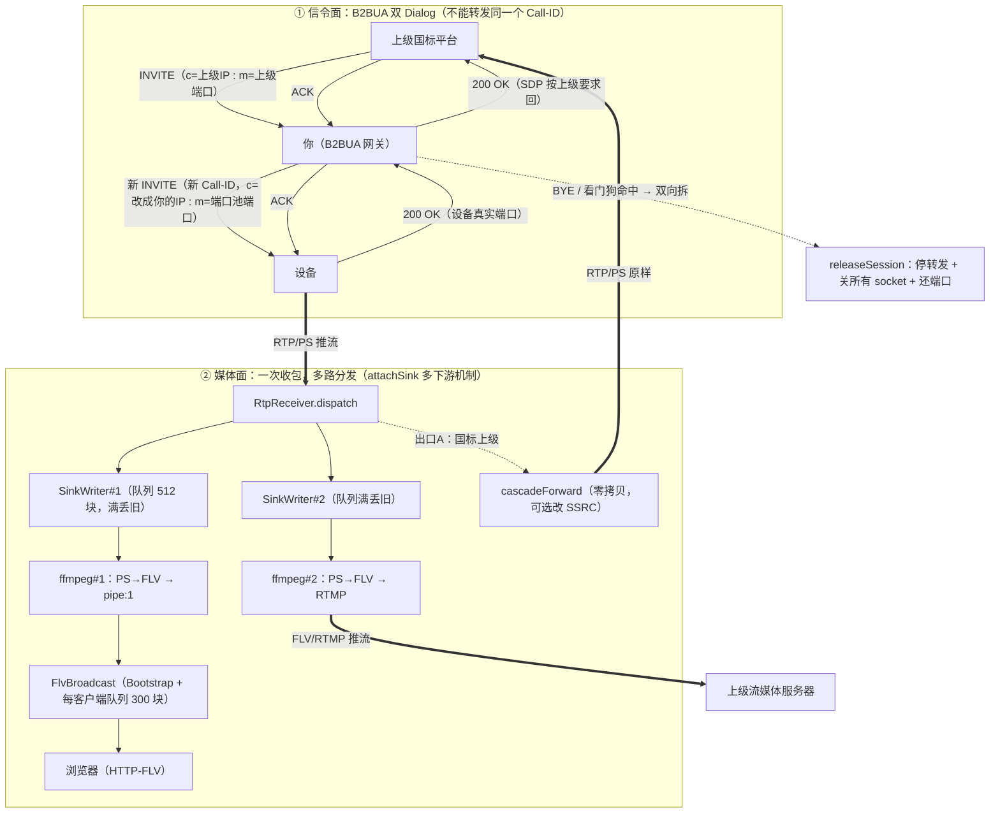

# 协议参考手册

> GB/T 28181 及相关协议的标准知识参考，与项目代码解耦——查协议规定、字段格式、算法标准时用本文；查项目实现时去 README.md / TECH.md。
>
> **结构**：第一部分 GB/T 28181 协议与信令；第二部分 RTP/RTCP；第三部分 G.711 A-law；第四部分 Digest 鉴权；第五部分 国标级联设计（未实现，设计推演）。
>
> **示例 IP 约定**：全文档 SIP/SDP 示例中，`192.168.1.100` 为**服务端**（GB28181 平台/SIP 服务器，平台 ID `34020000002000000001`），`192.168.1.200` 为**设备端**（IPC/NVR，设备 ID `34020000001320000001`）；个别头域示例中的 `192.168.1.64` 同样表示设备端。示例报文内已用行尾注释逐行标明收发方。

# 第一部分：GB/T 28181 协议与信令

## 1. GB/T 28181 基础概念

GB/T 28181 是中国视频监控领域的核心国家标准，全称为《公共安全视频监控联网系统信息传输、交换、控制技术要求》。该标准旨在解决不同厂商、不同系统之间的互联互通问题，目前最新版本为 GB/T 28181-2022（替代2016版）。

在架构设计上，GB/T 28181 采用**信令与媒体分离**的架构：信令层基于 SIP（Session Initiation Protocol）协议，负责会话的建立、修改和终止；媒体层基于 RTP/RTCP 协议，负责音视频数据的实时传输。

### 2022版相比2016版的关键升级

| 特性 | 2016版 | 2022版 |
| :--- | :--- | :--- |
| 视频编码 | H.264（H.265 为私有扩展） | 正式支持 H.265、AVS3 |
| 音频编码 | G.711、G.723.1 | 新增 AAC、G.722.1、Opus |
| TCP 传输 | 主被动模式模糊 | 明确 a=setup:active/passive |
| 安全性 | MD5 认证 | 强制 TLS 1.2+、SRTP、国密算法 |
| AI 元数据 | 不支持 | 支持 AI 事件元数据传输 |
| 远程升级 | 不支持 | 支持设备 OTA 升级指令 |
| 图像抓拍 | 无标准流程 | 标准化抓拍信令 |

### 系统组成

系统通常由以下组件构成：

- **前端编码设备**：网络摄像机（IPC）、网络硬盘录像机（NVR）等
- **传输网络**：IP 网络（局域网/专网/互联网）
- **SIP 信令服务器**：处理 SIP 信令的中间件或平台
- **媒体服务器**：负责 RTP/RTCP 媒体流的转发、存储和分发
- **存储设备**：NVR、CVR 等录像存储设备
- **客户端**：视频管理平台、PC 客户端、移动客户端等

### 设备编号规则

所有设备必须遵循严格的 20 位数字编码规则：

| 编码段 | 长度 | 说明 |
| :--- | :--- | :--- |
| 行政区划码 | 6 位 | GB/T 2260 规定的行政区划代码 |
| 行业/区域码 | 4 位 | 行业标识或区域标识 |
| 设备类型码 | 2 位 | 设备类型标识（如 13=摄像机） |
| 设备编号 | 8 位 | 厂商自定义编号 |

示例：`34020000001320000001` 表示安徽省芜湖市某区域的第 13 号摄像机。

---

## 2. SIP 协议

SIP（Session Initiation Protocol）是基于 RFC 3261 的文本型信令协议，设计灵感源自 HTTP，采用请求-响应模型。SIP 消息使用纯文本格式，便于调试和扩展。

### 消息格式

SIP 消息由四部分组成：

| 组成部分 | 说明 | 示例 |
| :--- | :--- | :--- |
| **起始行** | 请求行或状态行，表明消息类型 | `REGISTER sip:3402000000@192.168.1.100 SIP/2.0` |
| **消息头** | 携带路由、认证、会话标识等控制信息 | `Call-ID: abcdef1234567890` |
| **空行** | 强制要求，表示消息头结束 | （空行） |
| **消息体** | 可选，由 Content-Type 决定内容 | XML 或 SDP |

- **请求消息**：`方法名 + 请求URI + SIP/2.0`
- **响应消息**：`SIP/2.0 + 状态码 + 状态描述`

### 核心头字段详解

| 头字段 | 作用 | 注意事项 |
| :--- | :--- | :--- |
| Via | 记录请求路径，防止环路 | 必须带 branch 参数 |
| From / To | 标识发送方与接收方 | 必须带 tag 参数 |
| Call-ID | 会话全局唯一标识 | 同一会话的所有包保持一致 |
| CSeq | 序列号 | 同一 Call-ID 下严格递增 |
| Contact | 设备实际通信地址 | 必须包含 IP 和端口 |
| Max-Forwards | 最大跳数 | 国标一般设置为 70 |
| Expires | 注册有效期 | 国标默认为 3600 秒 |
| Authorization | MD5 摘要认证 | 401 响应后必须携带 |
| Content-Type | 消息体类型 | application/MANSCDP+xml 或 application/sdp |
| Content-Length | 消息体长度 | 必须准确 |
| Subject | 仅在 INVITE 中使用 | 格式：通道ID:SSRC,流类型,0,0 |
| User-Agent | 设备或平台标识 | 建议带上设备型号 |

### 头域报文级示例

写 SIP 报文时逐字段对照（自《GB28181-2022 信令格式与常用信令简易手册》合并，原手册已废止）：

```text
Via: SIP/2.0/UDP 192.168.1.64:5060;branch=z9hG4bKxxxx  # 设备端发出；必须带 branch 防环路
From: <sip:34020000013200000001@340200000>;tag=xxxx        # 发送方，必须带 tag
To: <sip:34020000002000000001@340200000>                  # 目标（注册时可无 tag）
Call-ID: abc123@192.168.1.64  # 设备端；同一 Dialog 所有包保持一致
CSeq: 1 REGISTER                                          # 或 CSeq: 20 INVITE；同 Call-ID 下递增
Contact: <sip:34020000013200000001@192.168.1.64:5060>  # 设备端地址；设备实际通信地址（IP+端口）
Expires: 3600                                             # 注册有效期（秒）；Expires: 0 为注销
Content-Type: Application/MANSCDP+xml                     # XML 控制；SDP 协商时为 application/sdp
Content-Length: 0                                         # 无 Body 时；有 XML/SDP 必须准确计算
```

### 状态码分类

| 分类 | 说明 | 常用状态码 |
| :--- | :--- | :--- |
| 1xx | 临时响应 | 100 Trying, 180 Ringing |
| 2xx | 成功 | 200 OK |
| 3xx | 重定向 | 301 Moved, 302 Moved Temporarily |
| 4xx | 客户端错误 | 401 Unauthorized, 403 Forbidden, 404 Not Found, 486 Busy |
| 5xx | 服务器错误 | 500 Server Error, 503 Service Unavailable |
| 6xx | 全局失败 | 603 Declined |

---

## 3. SDP 协议

SDP（Session Description Protocol）用于描述多媒体会话参数，在 SIP 中通过 `Content-Type: application/sdp` 携带。

### 核心字段说明

| 字段 | 含义 | 说明 |
| :--- | :--- | :--- |
| v=0 | SDP 版本号 | 固定为 0 |
| o= | 会话发起者信息 | 格式：用户名 会话ID 版本 IN IP4 地址 |
| s= | 会话名称/业务类型 | Play/Playback/Talk/Download |
| u= | 资源位置（可选） | 通常为 DeviceID:SSRC |
| c= | 连接信息 | IN IP4 地址 |
| t=0 0 | 会话时间 | 0 0 表示永久会话 |
| m= | 媒体描述 | 媒体类型 端口 传输协议 payload type |
| a= | 属性 | 各种附加属性 |

### s= 字段业务类型

| 取值 | 含义 | 说明 |
| :--- | :--- | :--- |
| s=Play | 实时视频点播 | 平台请求设备实时推送视频流 |
| s=Playback | 历史录像回放 | 请求回放指定时间段的历史录像 |
| s=Talk | 语音对讲 | 双向语音通信 |
| s=Download | 录像下载 | 下载指定录像文件 |

### a= 属性详解

| 属性 | 取值 | 说明 |
| :--- | :--- | :--- |
| a=recvonly | 仅接收 | 本端只接收媒体流 |
| a=sendonly | 仅发送 | 本端只发送媒体流 |
| a=recvsend | 收发 | 本端既发送也接收 |
| a=rtpmap | 编码映射 | 如 PS/90000（H.264）、H265/90000（H.265）、AAC/90000 |
| a=setup | TCP 模式 | passive（被动）/ active（主动），2022版明确区分 |
| a=connection | 连接方式 | new（新建）/ existing（复用） |

### SDP 完整示例（实时点播）

**请求 SDP：**

```sip
v=0
o=34020000002000000001 0 0 IN IP4 192.168.1.100  # 服务端
s=Play
c=IN IP4 192.168.1.100  # 服务端
t=0 0
m=video 5060 TCP/RTP/AVP 96
a=recvonly
a=rtpmap:96 PS/90000
a=setup:passive
a=connection:new
```

**响应 SDP：**

```sip
v=0
o=34020000001320000001 0 0 IN IP4 192.168.1.200  # 设备端
s=Play
c=IN IP4 192.168.1.200  # 设备端
t=0 0
m=video 6000 TCP/RTP/AVP 96
a=sendonly
a=rtpmap:96 PS/90000
a=setup:active
a=connection:new
```

---

## 4. RTP / RTCP 协议

### RTP（Real-time Transport Protocol）

RTP 负责音视频流的实时传输，通常使用 UDP 端口。在 GB/T 28181 中，RTP 载荷类型通常为 **96**（动态 Payload），其载荷内容为 **MPEG-2 PS 封装流**。

### RTCP（RTP Control Protocol）

RTCP 提供传输质量监控，包括丢包率、抖动、延迟等指标。RTCP 端口通常为 RTP 端口 + 1。

### RTP 报文结构

| 字段 | 位数 | 说明 |
| :--- | :--- | :--- |
| 版本号 (V) | 2 bit | 固定为 2 |
| 填充位 (P) | 1 bit | 1 表示尾部有填充 |
| 扩展位 (X) | 1 bit | 1 表示有扩展头 |
| CSRC 计数 (CC) | 4 bit | CSRC 列表的长度 |
| 标记位 (M) | 1 bit | 应用定义，通常标识帧边界 |
| 序列号 (Seq) | 16 bit | 每发送一个 RTP 包递增 1 |
| 时间戳 (Timestamp) | 32 bit | 采样时间戳 |
| SSRC | 32 bit | 同步源标识符 |
| CSRC 列表 | 可变 | 参与混音的中继器 SSRC |
| 载荷数据 | 可变 | 实际的音视频数据 |

### RTP / RTCP 端口分配

- 视频流和音频流分别使用不同的 RTP/RTCP 端口对
- 通常视频流使用主端口，音频流使用主端口 + 2

---

## 5. PS 封装

PS（Program Stream）是 MPEG-2 系统标准（ISO/IEC 13818-1）中定义的节目流封装格式。GB/T 28181 选择 PS 而非 TS（Transport Stream），是因为 PS 更适合单路音视频流的复用封装，且在局域网/专网传输中效率更高。

### 封装结构

PS 封装的层次结构为：

**PS 流 → 节目复用段 → PS Pack → PES 包 → 音视频数据**

| 层级 | 说明 |
| :--- | :--- |
| PS 流 | 最高层，包含一个或多个节目 |
| 节目复用段 | 将 PES 包复用为固定长度的包 |
| PS Pack 头 | 包含系统时钟参考（SCR）和复用速率 |
| PES 包 | 包含视频、音频或私有数据 |
| 音视频数据 | 实际的编码数据（H.264/H.265 NALU） |

### PS Pack 头结构

| 字段 | 位数 | 说明 |
| :--- | :--- | :--- |
| start_code | 24 bit | 固定值 0x000001 |
| pack_header_code | 3 bit | 包头代码 |
| mpeg2_mixed | 1 bit | 是否混合模式 |
| copyright | 1 bit | 版权标识 |
| original_or_copy | 1 bit | 原始/拷贝标识 |
| PTS_DTS_flags | 2 bit | 时间戳标志 |
| SCR_flags | 2 bit | 系统时钟参考标志 |
| P-STD_buffer | 16 bit | 解复用缓冲区 |
| stuffing_bytes | 可变 | 填充字节 |

### PES 包结构

| 字段 | 说明 |
| :--- | :--- |
| PES Packet Start Code Prefix | 3 字节，固定值 0x000001 |
| Stream ID | 标识数据流类型（E0=视频，C0=音频，0xBD=私有） |
| PES Packet Length | 包长度 |
| PTS/DTS Flags | 时间戳标志 |
| PES Header Data | 时间戳、DTS 等 |
| PES Packet Data | 实际的音视频数据 |

### 2022版 H.265 适配

在支持 H.265 时，PS 封装内部携带 H.265 NALU，并在 PES 头部或私有数据段中携带相应的流标识信息（Stream ID 使用 0xBC 或私有数据段标识）。

---

## 6. 常用 SIP 信令

> **示例 IP 约定**：`192.168.1.100` = 服务端（平台），`192.168.1.200` = 设备端（IPC/NVR）。报文内已用行尾注释标明每行的收发方。

### 6.1 REGISTER（设备注册）

用于设备向平台注册，完成身份认证并上线。消息体为空（Content-Length: 0）。

**401 Unauthorized 响应示例：**

```sip
SIP/2.0 401 Unauthorized
Via: SIP/2.0/UDP 192.168.1.200:5060;branch=z9hG4bK12345678  # 设备端发出
From: <sip:34020000001320000001@3402000000>;tag=1234
To: <sip:34020000001320000001@3402000000>;tag=5678
Call-ID: abcdef1234567890
CSeq: 1 REGISTER
WWW-Authenticate: Digest realm="3402000000", nonce="a1b2c3d4", algorithm=MD5
Content-Length: 0
```

**REGISTER 请求报文示例（含认证）：**

```sip
REGISTER sip:3402000000@192.168.1.100 SIP/2.0  # 发往服务端
Via: SIP/2.0/UDP 192.168.1.200:5060;branch=z9hG4bK12345679  # 设备端发出
From: <sip:34020000001320000001@3402000000>;tag=1234
To: <sip:34020000001320000001@3402000000>;tag=5678
Call-ID: abcdef1234567890
CSeq: 2 REGISTER
Contact: <sip:34020000001320000001@192.168.1.200:5060>  # 设备端地址
Expires: 3600
Authorization: Digest username="34020000001320000001", realm="3402000000", nonce="a1b2c3d4", uri="sip:3402000000@192.168.1.100", response="md5hashvalue", algorithm=MD5  # 认证 uri=注册目标（服务端）
Content-Length: 0
```

**200 OK 响应示例：**

```sip
SIP/2.0 200 OK
Via: SIP/2.0/UDP 192.168.1.200:5060;branch=z9hG4bK12345679  # 设备端发出
From: <sip:34020000001320000001@3402000000>;tag=1234
To: <sip:34020000001320000001@3402000000>;tag=5678
Call-ID: abcdef1234567890
CSeq: 2 REGISTER
Contact: <sip:34020000001320000001@192.168.1.200:5060>  # 设备端地址
Expires: 3600
Content-Length: 0
```

**注销：** 将 Expires 设为 0 即可注销。

### 6.2 INVITE（媒体会话发起）

用于发起实时点播、历史回放、语音对讲等媒体流传输请求。携带 SDP 消息体（Content-Type: application/sdp）。

**实时点播请求报文示例：**

```sip
INVITE sip:34020000001320000001@192.168.1.200:5060 SIP/2.0  # 发往设备端
Via: SIP/2.0/UDP 192.168.1.100:5060;branch=z9hG4bK98765432  # 服务端发出
From: <sip:34020000002000000001@3402000000>;tag=1111
To: <sip:34020000001320000001@3402000000>
Call-ID: invite1234567890
CSeq: 1 INVITE
Contact: <sip:34020000002000000001@192.168.1.100:5060>  # 服务端地址
Subject: 34020000001310000001:0100000001,34020000002000000001,1,0
Content-Type: application/sdp
Content-Length: 158

v=0
o=34020000002000000001 0 0 IN IP4 192.168.1.100  # 服务端
s=Play
c=IN IP4 192.168.1.100  # 服务端
t=0 0
m=video 5060 TCP/RTP/AVP 96
a=recvonly
a=rtpmap:96 PS/90000
a=setup:passive
a=connection:new
```

**200 OK 响应示例（设备返回 SDP）：**

```sip
SIP/2.0 200 OK
Via: SIP/2.0/UDP 192.168.1.200:5060;branch=z9hG4bK98765432  # 设备端发出
From: <sip:34020000002000000001@3402000000>;tag=1111
To: <sip:34020000001320000001@3402000000>
Call-ID: invite1234567890
CSeq: 1 INVITE
Content-Type: application/sdp
Content-Length: 158

v=0
o=34020000001320000001 0 0 IN IP4 192.168.1.200  # 设备端
s=Play
c=IN IP4 192.168.1.200  # 设备端
t=0 0
m=video 6000 TCP/RTP/AVP 96
a=sendonly
a=rtpmap:96 PS/90000
a=setup:active
a=connection:new
```

**2022版 TCP 传输模式变化：** 2022版明确了 `a=setup:active`（设备主动连接平台）和 `a=setup:passive`（设备被动等待平台连接）两种模式，替代了 2016 版中模糊的 TCP 传输描述。

### 6.3 ACK（确认）

用于对 INVITE 的 200 OK 进行最终确认，完成 SIP 三次握手，建立媒体通道。消息体为空。

**ACK 报文示例：**

```sip
ACK sip:34020000001320000001@192.168.1.200:5060 SIP/2.0  # 发往设备端
Via: SIP/2.0/UDP 192.168.1.100:5060;branch=z9hG4bK98765432  # 服务端发出
From: <sip:34020000002000000001@3402000000>;tag=1111
To: <sip:34020000001320000001@3402000000>;tag=2222
Call-ID: invite1234567890
CSeq: 1 ACK
Content-Length: 0
```

### 6.4 BYE（结束会话）

用于终止正在进行的媒体会话，释放 RTP 端口资源。消息体为空。

**BYE 报文示例：**

```sip
BYE sip:34020000001320000001@192.168.1.200:5060 SIP/2.0  # 发往设备端
Via: SIP/2.0/UDP 192.168.1.100:5060;branch=z9hG4bK98765433  # 服务端发出
From: <sip:34020000002000000001@3402000000>;tag=1111
To: <sip:34020000001320000001@3402000000>;tag=2222
Call-ID: invite1234567890
CSeq: 2 BYE
Content-Length: 0
```

### 6.5 MESSAGE（控制与状态交互）

用于承载 MANSCDP 协议（XML 格式），实现设备管理、控制、报警等。消息体为 XML（Content-Type: application/MANSCDP+xml）。

**目录查询请求报文示例：**

```sip
MESSAGE sip:34020000001320000001@192.168.1.200:5060 SIP/2.0  # 发往设备端
Via: SIP/2.0/UDP 192.168.1.100:5060;branch=z9hG4bKmsg12345  # 服务端发出
From: <sip:34020000002000000001@3402000000>;tag=3333
To: <sip:34020000001320000001@3402000000>
Call-ID: msg1234567890
CSeq: 1 MESSAGE
Content-Type: Application/MANSCDP+xml
Content-Length: 165

<?xml version="1.0" encoding="GB2312"?>
<Query>
  <CmdType>Catalog</CmdType>
  <SN>100</SN>
  <DeviceID>34020000001320000001</DeviceID>
</Query>
```

**心跳保活请求报文示例：**

```sip
MESSAGE sip:34020000002000000001@192.168.1.100:5060 SIP/2.0  # 发往服务端
Via: SIP/2.0/UDP 192.168.1.200:5060;branch=z9hG4bKkeep1234  # 设备端发出
From: <sip:34020000001320000001@3402000000>;tag=4444
To: <sip:34020000002000000001@3402000000>
Call-ID: keep1234567890
CSeq: 10 MESSAGE
Content-Type: Application/MANSCDP+xml
Content-Length: 135

<?xml version="1.0" encoding="GB2312"?>
<Notify>
  <CmdType>Keepalive</CmdType>
  <SN>101</SN>
  <DeviceID>34020000001320000001</DeviceID>
  <Status>OK</Status>
</Notify>
```

**云台控制请求报文示例：**

```sip
MESSAGE sip:34020000001320000001@192.168.1.200:5060 SIP/2.0  # 发往设备端
Via: SIP/2.0/UDP 192.168.1.100:5060;branch=z9hG4bKptz12345  # 服务端发出
From: <sip:34020000002000000001@3402000000>;tag=5555
To: <sip:34020000001320000001@3402000000>
Call-ID: ptz1234567890
CSeq: 2 MESSAGE
Content-Type: Application/MANSCDP+xml
Content-Length: 180

<?xml version="1.0" encoding="GB2312"?>
<Control>
  <CmdType>DeviceControl</CmdType>
  <SN>102</SN>
  <DeviceID>34020000001310000001</DeviceID>
  <PTZCmd>A50F010800FF8C</PTZCmd>
</Control>
```

**XML 根元素类型说明：**

| 根元素 | 方向 | 说明 |
| :--- | :--- | :--- |
| Query | 平台 → 设备 | 查询类指令（目录、状态、录像检索等） |
| Notify | 设备 → 平台 | 设备主动上报（心跳、报警等） |
| Control | 平台 → 设备 | 控制类指令（云台、预置位等） |
| Response | 设备 → 平台 | 对查询/控制的响应 |

### 6.6 INFO（会话内控制）

用于在 INVITE 建立的媒体会话期间发送控制指令（回放暂停、拖拽等）。消息体为 MANSCDP XML。

**历史回放暂停报文示例：**

```sip
INFO sip:34020000001320000001@192.168.1.200:5060 SIP/2.0  # 发往设备端
Via: SIP/2.0/UDP 192.168.1.100:5060;branch=z9hG4bKinfo1234  # 服务端发出
From: <sip:34020000002000000001@3402000000>;tag=1111
To: <sip:34020000001320000001@3402000000>;tag=2222
Call-ID: invite1234567890
CSeq: 3 INFO
Content-Type: Application/MANSCDP+xml
Content-Length: 160

<?xml version="1.0" encoding="GB2312"?>
<Control>
  <CmdType>PlayControl</CmdType>
  <SN>103</SN>
  <DeviceID>34020000001310000001</DeviceID>
  <ControlType>Pause</ControlType>
</Control>
```

### 6.7 200 OK（成功响应）

200 OK 是 SIP 协议中通用的成功响应码，在不同信令中的响应格式有所差异：

**携带 SDP 的 200 OK（INVITE 响应）：**

```sip
SIP/2.0 200 OK
Via: SIP/2.0/UDP 192.168.1.200:5060;branch=z9hG4bK98765432  # 设备端发出
From: <sip:34020000002000000001@3402000000>;tag=1111
To: <sip:34020000001320000001@3402000000>;tag=2222
Call-ID: invite1234567890
CSeq: 1 INVITE
Content-Type: application/sdp
Content-Length: 158

v=0
o=34020000001320000001 0 0 IN IP4 192.168.1.200  # 设备端
s=Play
c=IN IP4 192.168.1.200  # 设备端
t=0 0
m=video 6000 TCP/RTP/AVP 96
a=sendonly
a=rtpmap:96 PS/90000
a=setup:active
a=connection:new
```

**携带 XML 的 200 OK（MESSAGE 响应）：**

```sip
SIP/2.0 200 OK
Via: SIP/2.0/UDP 192.168.1.200:5060;branch=z9hG4bKmsg12345  # 设备端发出
From: <sip:34020000002000000001@3402000000>;tag=3333
To: <sip:34020000001320000001@3402000000>
Call-ID: msg1234567890
CSeq: 1 MESSAGE
Content-Type: Application/MANSCDP+xml
Content-Length: 250

<?xml version="1.0" encoding="GB2312"?>
<Response>
  <CmdType>Catalog</CmdType>
  <SN>100</SN>
  <DeviceID>34020000001320000001</DeviceID>
  <SumNum>2</SumNum>
  <DeviceList Num="2">
    <Item>
      <DeviceID>34020000001310000001</DeviceID>
      <Name>Camera 01</Name>
      <Manufacturer>Hikvision</Manufacturer>
      <Status>ON</Status>
    </Item>
    <Item>
      <DeviceID>34020000001310000002</DeviceID>
      <Name>Camera 02</Name>
      <Manufacturer>Hikvision</Manufacturer>
      <Status>ON</Status>
    </Item>
  </DeviceList>
</Response>
```

---

## 7. 设备注册流程

### 交互流程

```
设备 192.168.1.200            平台 192.168.1.100
 |                              |
 |--- REGISTER (首次注册) ----->|
 |                              |
 |<-- 401 Unauthorized ---------|  (携带 Nonce 挑战)
 |                              |
 |--- REGISTER (含认证) ------->|
 |                              |
 |<-- 200 OK -------------------|  (注册成功)
 |                              |
 |--- MESSAGE (Keepalive) ----->|  (每60秒)
 |<-- 200 OK -------------------|
 |                              |
```

### MD5 认证计算方式

```
response = MD5( MD5(username:realm:password) : nonce : uri )
```

其中：
- `username`：设备 ID
- `realm`：认证域（通常为平台 ID）
- `password`：设备密码（明文）
- `nonce`：平台生成的随机数
- `uri`：请求的 URI

### 注册失败排查

| 问题 | 排查要点 |
| :--- | :--- |
| 持续返回 401 | 检查 username、realm、password 是否正确，nonce 是否过期 |
| 注册成功但离线 | 检查 Contact 中的 IP 地址是否可达，NAT 穿透配置 |
| Expires 不生效 | 检查平台是否强制覆盖 Expires 值 |
| 重复注册 | 检查设备是否配置了多个 SIP 账号 |

---

## 8. 实时点播流程

### 交互流程

```
平台 192.168.1.100            设备 192.168.1.200
 |                              |
 |--- INVITE (s=Play) -------->|  (SDP: 接收端口, 编码)
 |                              |
 |<-- 100 Trying ---------------|
 |                              |
 |<-- 200 OK -------------------|  (SDP: 发送端口, 编码)
 |                              |
 |--- ACK --------------------->|
 |                              |
 |<-- RTP 视频流 ---------------|
 |                              |
 |--- BYE --------------------->|  (停止预览)
 |<-- 200 OK -------------------|
```

### 每个步骤的完整信令报文

**步骤 1：平台 → 设备 INVITE**

```sip
INVITE sip:34020000001320000001@192.168.1.200:5060 SIP/2.0  # 发往设备端
Via: SIP/2.0/UDP 192.168.1.100:5060;branch=z9hG4bK98765432  # 服务端发出
From: <sip:34020000002000000001@3402000000>;tag=1111
To: <sip:34020000001320000001@3402000000>
Call-ID: invite1234567890
CSeq: 1 INVITE
Contact: <sip:34020000002000000001@192.168.1.100:5060>  # 服务端地址
Subject: 34020000001310000001:0100000001,34020000002000000001,1,0
Content-Type: application/sdp
Content-Length: 158

v=0
o=34020000002000000001 0 0 IN IP4 192.168.1.100  # 服务端
s=Play
c=IN IP4 192.168.1.100  # 服务端
t=0 0
m=video 5060 TCP/RTP/AVP 96
a=recvonly
a=rtpmap:96 PS/90000
a=setup:passive
a=connection:new
```

**步骤 3：设备 → 平台 200 OK**

```sip
SIP/2.0 200 OK
Via: SIP/2.0/UDP 192.168.1.200:5060;branch=z9hG4bK98765432  # 设备端发出
From: <sip:34020000002000000001@3402000000>;tag=1111
To: <sip:34020000001320000001@3402000000>
Call-ID: invite1234567890
CSeq: 1 INVITE
Content-Type: application/sdp
Content-Length: 158

v=0
o=34020000001320000001 0 0 IN IP4 192.168.1.200  # 设备端
s=Play
c=IN IP4 192.168.1.200  # 设备端
t=0 0
m=video 6000 TCP/RTP/AVP 96
a=sendonly
a=rtpmap:96 PS/90000
a=setup:active
a=connection:new
```

**步骤 4：平台 → 设备 ACK**

```sip
ACK sip:34020000001320000001@192.168.1.200:5060 SIP/2.0  # 发往设备端
Via: SIP/2.0/UDP 192.168.1.100:5060;branch=z9hG4bK98765432  # 服务端发出
From: <sip:34020000002000000001@3402000000>;tag=1111
To: <sip:34020000001320000001@3402000000>;tag=2222
Call-ID: invite1234567890
CSeq: 1 ACK
Content-Length: 0
```

### SDP 协商关键参数

| 参数 | 平台侧（INVITE） | 设备侧（200 OK） | 说明 |
| :--- | :--- | :--- | :--- |
| c= | 平台 IP（示例 192.168.1.100） | 设备 IP（示例 192.168.1.200） | 媒体流发送方 IP |
| m=video 端口 | 平台监听端口 | 设备发送端口 | RTP 传输端口 |
| a=recvonly | recvonly | sendonly | 传输方向 |
| a=setup | passive | active | TCP 连接模式 |
| a=rtpmap | PS/90000 | PS/90000 | 编码格式 |

---

## 9. 停止播放流程

### 交互流程

```
平台 192.168.1.100            设备 192.168.1.200
 |                              |
 |--- BYE --------------------->|
 |<-- 200 OK -------------------|
```

**BYE 报文示例：**

```sip
BYE sip:34020000001320000001@192.168.1.200:5060 SIP/2.0  # 发往设备端
Via: SIP/2.0/UDP 192.168.1.100:5060;branch=z9hG4bK98765433  # 服务端发出
From: <sip:34020000002000000001@3402000000>;tag=1111
To: <sip:34020000001320000001@3402000000>;tag=2222
Call-ID: invite1234567890
CSeq: 2 BYE
Content-Length: 0
```

**200 OK 响应示例：**

```sip
SIP/2.0 200 OK
Via: SIP/2.0/UDP 192.168.1.200:5060;branch=z9hG4bK98765433  # 设备端发出
From: <sip:34020000002000000001@3402000000>;tag=1111
To: <sip:34020000001320000001@3402000000>;tag=2222
Call-ID: invite1234567890
CSeq: 2 BYE
Content-Length: 0
```

### 资源释放说明

- **RTP 端口**：设备停止发送 RTP 流后，平台应关闭 RTP/RTCP 端口
- **SIP 会话状态**：双方应清除该 Call-ID 对应的会话状态机
- **媒体服务器**：通知媒体服务器停止转发/录制该流

### 异常处理

- 如果设备未收到 BYE（如网络中断），平台应在超时后（通常 30-60 秒）强制释放会话资源
- 设备侧也应实现会话超时机制，当检测到 RTP 流中断时自动释放资源

---

## 10. 云台控制 PTZ

### 控制方式

云台控制使用 MESSAGE 方法 + MANSCDP XML 实现。

### 完整控制报文示例

**云台控制请求：**

```sip
MESSAGE sip:34020000001320000001@192.168.1.200:5060 SIP/2.0  # 发往设备端
Via: SIP/2.0/UDP 192.168.1.100:5060;branch=z9hG4bKptz12345  # 服务端发出
From: <sip:34020000002000000001@3402000000>;tag=5555
To: <sip:34020000001320000001@3402000000>
Call-ID: ptz1234567890
CSeq: 2 MESSAGE
Content-Type: Application/MANSCDP+xml
Content-Length: 180

<?xml version="1.0" encoding="GB2312"?>
<Control>
  <CmdType>DeviceControl</CmdType>
  <SN>102</SN>
  <DeviceID>34020000001310000001</DeviceID>
  <PTZCmd>A50F010800FF8C</PTZCmd>
</Control>
```

**云台控制响应：**

```sip
SIP/2.0 200 OK
Via: SIP/2.0/UDP 192.168.1.200:5060;branch=z9hG4bKptz12345  # 设备端发出
From: <sip:34020000002000000001@3402000000>;tag=5555
To: <sip:34020000001320000001@3402000000>
Call-ID: ptz1234567890
CSeq: 2 MESSAGE
Content-Type: Application/MANSCDP+xml
Content-Length: 130

<?xml version="1.0" encoding="GB2312"?>
<Response>
  <CmdType>DeviceControl</CmdType>
  <SN>102</SN>
  <DeviceID>34020000001310000001</DeviceID>
  <Result>OK</Result>
</Response>
```

### PTZCmd 字段格式

PTZCmd 为 8 字节十六进制指令的字符串表示，常见指令码如下：

| 指令 | PTZCmd 示例 | 说明 |
| :--- | :--- | :--- |
| 上转 | A50F010208000000 | 云台向上转动 |
| 下转 | A50F010210000000 | 云台向下转动 |
| 左转 | A50F010201000000 | 云台向左转动 |
| 右转 | A50F010202000000 | 云台向右转动 |
| 放大 | A50F010800FF8C | 镜头放大（变倍） |
| 缩小 | A50F010801008C | 镜头缩小（变倍） |
| 聚焦近 | A50F010400000000 | 近焦聚焦 |
| 聚焦远 | A50F010401000000 | 远焦聚焦 |
| 光圈大 | A50F010600000000 | 光圈增大 |
| 光圈小 | A50F010601000000 | 光圈减小 |

### 预置位操作

| 操作 | XML 结构 |
| :--- | :--- |
| 设置预置位 | `<Control><CmdType>DeviceControl</CmdType><PresetID>1</PresetID><Action>Set</Action></Control>` |
| 调用预置位 | `<Control><CmdType>DeviceControl</CmdType><PresetID>1</PresetID><Action>Goto</Action></Control>` |
| 删除预置位 | `<Control><CmdType>DeviceControl</CmdType><PresetID>1</PresetID><Action>Delete</Action></Control>` |

---

## 11. 设备目录查询

### 查询请求报文

```sip
MESSAGE sip:34020000001320000001@192.168.1.200:5060 SIP/2.0  # 发往设备端
Via: SIP/2.0/UDP 192.168.1.100:5060;branch=z9hG4bKmsg12345  # 服务端发出
From: <sip:34020000002000000001@3402000000>;tag=3333
To: <sip:34020000001320000001@3402000000>
Call-ID: msg1234567890
CSeq: 1 MESSAGE
Content-Type: Application/MANSCDP+xml
Content-Length: 165

<?xml version="1.0" encoding="GB2312"?>
<Query>
  <CmdType>Catalog</CmdType>
  <SN>100</SN>
  <DeviceID>34020000001320000001</DeviceID>
</Query>
```

### 查询响应报文

```sip
SIP/2.0 200 OK
Via: SIP/2.0/UDP 192.168.1.200:5060;branch=z9hG4bKmsg12345  # 设备端发出
From: <sip:34020000002000000001@3402000000>;tag=3333
To: <sip:34020000001320000001@3402000000>
Call-ID: msg1234567890
CSeq: 1 MESSAGE
Content-Type: Application/MANSCDP+xml
Content-Length: 650

<?xml version="1.0" encoding="GB2312"?>
<Response>
  <CmdType>Catalog</CmdType>
  <SN>100</SN>
  <DeviceID>34020000001320000001</DeviceID>
  <SumNum>2</SumNum>
  <DeviceList Num="2">
    <Item>
      <DeviceID>34020000001310000001</DeviceID>
      <Name>Camera 01</Name>
      <Manufacturer>Hikvision</Manufacturer>
      <Model>DS-2CD2T46WD</Model>
      <SerialNumber>HE3456789012345</SerialNumber>
      <FirmwareVersion>V5.6.2</FirmwareVersion>
      <Status>ON</Status>
      <Owner>admin</Owner>
      <GeographicCode>3402000000</GeographicCode>
      <ParentalID>0</ParentalID>
      <ParentalAccessID>0</ParentalAccessID>
    </Item>
    <Item>
      <DeviceID>34020000001310000002</DeviceID>
      <Name>Camera 02</Name>
      <Manufacturer>Hikvision</Manufacturer>
      <Model>DS-2CD2T46WD</Model>
      <SerialNumber>HE3456789012346</SerialNumber>
      <FirmwareVersion>V5.6.2</FirmwareVersion>
      <Status>ON</Status>
      <Owner>admin</Owner>
      <GeographicCode>3402000000</GeographicCode>
      <ParentalID>0</ParentalID>
      <ParentalAccessID>0</ParentalAccessID>
    </Item>
  </DeviceList>
</Response>
```

### 设备信息字段说明

| 字段 | 说明 |
| :--- | :--- |
| DeviceID | 设备唯一标识（20位） |
| Name | 设备名称 |
| Manufacturer | 厂商名称 |
| Model | 设备型号 |
| SerialNumber | 设备序列号 |
| FirmwareVersion | 固件版本 |
| Status | 运行状态（ON/OFF/ERROR） |
| Owner | 设备所有者 |
| GeographicCode | 地理编码 |
| ParentalID | 父级设备 ID |
| ParentalAccessID | 父级访问 ID |

---

## 12. 心跳保活

### 心跳请求报文

```sip
MESSAGE sip:34020000002000000001@192.168.1.100:5060 SIP/2.0  # 发往服务端
Via: SIP/2.0/UDP 192.168.1.200:5060;branch=z9hG4bKkeep1234  # 设备端发出
From: <sip:34020000001320000001@3402000000>;tag=4444
To: <sip:34020000002000000001@3402000000>
Call-ID: keep1234567890
CSeq: 10 MESSAGE
Content-Type: Application/MANSCDP+xml
Content-Length: 135

<?xml version="1.0" encoding="GB2312"?>
<Notify>
  <CmdType>Keepalive</CmdType>
  <SN>101</SN>
  <DeviceID>34020000001320000001</DeviceID>
  <Status>OK</Status>
</Notify>
```

### 心跳响应报文

```sip
SIP/2.0 200 OK
Via: SIP/2.0/UDP 192.168.1.200:5060;branch=z9hG4bKkeep1234  # 设备端发出
From: <sip:34020000001320000001@3402000000>;tag=4444
To: <sip:34020000002000000001@3402000000>
Call-ID: keep1234567890
CSeq: 10 MESSAGE
Content-Type: Application/MANSCDP+xml
Content-Length: 135

<?xml version="1.0" encoding="GB2312"?>
<Response>
  <CmdType>Keepalive</CmdType>
  <SN>101</SN>
  <DeviceID>34020000001320000001</DeviceID>
  <Status>OK</Status>
</Response>
```

### 心跳配置参数

| 参数 | 推荐值 | 说明 |
| :--- | :--- | :--- |
| 心跳间隔 | 60 秒 | 设备定期发送心跳的时间间隔 |
| 超时次数 | 3 次 | 连续丢失心跳次数阈值 |
| 离线判定时间 | 180 秒 | 3 × 60s = 180s 后判定设备离线 |

### 心跳失败处理策略

1. 设备侧：心跳发送失败时，重试 3 次后重新发起 REGISTER 注册
2. 平台侧：连续 3 次未收到心跳，将设备标记为离线，通知相关客户端
3. 重连机制：设备重新注册成功后，恢复心跳保活

---

## 13. 报警上报

### 报警订阅流程

```
平台 192.168.1.100            设备 192.168.1.200
 |                              |
 |--- SUBSCRIBE (Alarm) ------->|  (订阅报警事件)
 |<-- 200 OK -------------------|
 |                              |
 |<-- NOTIFY (Alarm) -----------|  (设备上报报警)
 |--- 200 OK ------------------>|
 |                              |
```

### 报警通知报文示例

**SUBSCRIBE 请求：**

```sip
SUBSCRIBE sip:34020000001320000001@192.168.1.200:5060 SIP/2.0  # 发往设备端
Via: SIP/2.0/UDP 192.168.1.100:5060;branch=z9hG4bKsub12345  # 服务端发出
From: <sip:34020000002000000001@3402000000>;tag=6666
To: <sip:34020000001320000001@3402000000>
Call-ID: sub1234567890
CSeq: 1 SUBSCRIBE
Content-Type: Application/MANSCDP+xml
Expires: 3600
Content-Length: 150

<?xml version="1.0" encoding="GB2312"?>
<Subscribe>
  <CmdType>Alarm</CmdType>
  <SN>200</SN>
  <DeviceID>34020000001310000001</DeviceID>
  <AlarmType>4</AlarmType>
  <AlarmPriority>1</AlarmPriority>
</Subscribe>
```

**NOTIFY 报警通知：**

```sip
NOTIFY sip:34020000002000000001@192.168.1.100:5060 SIP/2.0  # 发往服务端
Via: SIP/2.0/UDP 192.168.1.200:5060;branch=z9hG4bKnotify1234  # 设备端发出
From: <sip:34020000001310000001@3402000000>;tag=7777
To: <sip:34020000002000000001@3402000000>;tag=8888
Call-ID: notify1234567890
CSeq: 1 NOTIFY
Content-Type: Application/MANSCDP+xml
Content-Length: 250

<?xml version="1.0" encoding="GB2312"?>
<Notify>
  <CmdType>Alarm</CmdType>
  <SN>201</SN>
  <DeviceID>34020000001310000001</DeviceID>
  <AlarmPriority>1</AlarmPriority>
  <AlarmMethod>4</AlarmMethod>
  <AlarmTime>2023-10-01T12:00:00</AlarmTime>
  <AlarmStatus>On</AlarmStatus>
  <AlarmChannel>1</AlarmChannel>
  <AlarmDescription>移动侦测报警</AlarmDescription>
</Notify>
```

### 报警字段说明

| 字段 | 说明 |
| :--- | :--- |
| AlarmPriority | 报警优先级（1=高，2=中，3=低） |
| AlarmMethod | 报警方式（4=移动侦测，5=视频丢失，6=遮挡，7=设备故障等） |
| AlarmTime | 报警时间 |
| AlarmStatus | 报警状态（On=触发，Off=恢复） |
| AlarmChannel | 报警通道号 |
| AlarmDescription | 报警描述信息 |

### 常见报警类型

| 报警方式值 | 报警类型 |
| :--- | :--- |
| 1 | 硬盘故障 |
| 2 | 视频丢失 |
| 3 | 遮挡报警 |
| 4 | 移动侦测 |
| 5 | 设备故障 |
| 6 | 存储异常 |
| 7 | 网络断开 |

---

## 14. 常见问题与抓包分析

### Wireshark 抓包过滤表达式

| 过滤表达式 | 说明 |
| :--- | :--- |
| `sip` | 过滤所有 SIP 消息 |
| `sip or rtp or rtcp` | 过滤 SIP 信令 + 媒体流 |
| `udp port 5060` | 过滤 SIP 信令端口 |
| `sip.Call-ID == "invite1234567890"` | 按会话 ID 过滤 |
| `sip.CSeq == "1 INVITE"` | 按序列号过滤 |
| `ip.addr == 192.168.1.100` | 按 IP 地址过滤（示例为服务端 IP；设备端为 192.168.1.200） |

### 常见问题排查表

| 问题现象 | 检查信令 | 排查要点 |
| :--- | :--- | :--- |
| 设备不在线 | REGISTER | 检查 401 认证、Expires、Contact 地址 |
| 心跳超时 | MESSAGE (Keepalive) | 检查 SN 递增、平台是否返回 200 OK |
| 无法出图 | INVITE | 检查 SDP 协商、a=setup 模式、RTP 端口连通性 |
| 云台无响应 | MESSAGE (DeviceControl) | 检查 PTZCmd 格式、设备是否返回 Response |
| 报警未上报 | SUBSCRIBE / NOTIFY | 检查订阅是否成功、报警 XML 格式 |
| 视频花屏 | RTP | 检查丢包率、MTU 大小、PS 封装解析 |
| 音频无声音 | RTP | 检查音频编码是否匹配、音频端口是否通 |

### 抓包分析步骤

1. **过滤 SIP 信令**：使用 `sip` 过滤器捕获所有 SIP 消息
2. **检查注册流程**：确认 REGISTER → 401 → REGISTER → 200 OK 流程完整
3. **检查 SDP 协商**：确认 INVITE 和 200 OK 中的 SDP 参数匹配
4. **检查 RTP 流**：使用 `rtp` 过滤器确认媒体流是否正常传输
5. **检查错误码**：关注 4xx/5xx 状态码，定位具体错误原因

### 常见错误码排查

| 错误码 | 含义 | 排查方法 |
| :--- | :--- | :--- |
| 401 Unauthorized | 认证失败 | 检查 username、realm、password、nonce |
| 403 Forbidden | 权限拒绝 | 检查设备是否被平台禁止接入 |
| 404 Not Found | 设备不存在 | 检查 DeviceID 是否正确 |
| 486 Busy | 设备忙 | 设备正在处理其他请求，稍后重试 |
| 500 Server Error | 服务器错误 | 检查平台服务状态 |
| 503 Service Unavailable | 服务不可用 | 平台过载，等待后重试 |

---

## 15. Java 实现注意事项

### SIP 协议栈选型

| 协议栈 | 特点 | 适用场景 |
| :--- | :--- | :--- |
| SIP Servlet API | Java EE 标准，容器支持好 | 企业级平台开发 |
| Jain-SIP | 纯 Java 实现，轻量 | 嵌入式设备、轻量级平台 |
| Doubango | 高性能 C/Java 混合实现 | 大规模并发场景 |
| RestComm | 开源 SIP 服务器 | 自建 SIP 服务器 |

### 网络编程注意事项

- **UDP/TCP 双栈支持**：2022 版明确要求支持 TCP 传输，需同时处理 UDP 和 TCP 两种传输方式
- **NAT 穿透**：使用 STUN/TURN/ICE 协议解决 NAT 穿透问题，Contact 头域中填写正确的公网 IP
- **端口管理**：RTP/RTCP 端口需动态分配并正确记录，避免端口冲突

### SDP 解析

- 使用正则表达式解析 SDP 字段，如 `^m=video\\s+(\\d+)\\s+` 提取媒体端口
- 或使用专用库如 `sdpj`、`jitsi/sdp` 进行解析
- 注意处理多行 SDP 字段的拼接（SDP 允许长字段跨行）

### XML 处理

- 使用 DOM 或 SAX 解析 MANSCDP XML，注意编码为 **GB2312**
- 推荐使用 `DocumentBuilder` 解析 XML，通过 `getElementsByTagName` 获取字段值
- 注意 XML 中的特殊字符转义（如 `<`、`>`、`&`）

### 线程模型

- **SIP 信令处理**：每个 SIP 请求应在独立线程中处理，避免阻塞
- **异步 I/O**：推荐使用 Netty 等异步框架处理高并发 SIP 信令
- **心跳定时任务**：使用 `ScheduledExecutorService` 实现心跳定时发送
- **会话状态机**：每个 SIP 会话使用独立的状态机对象，避免状态交叉

### 会话状态管理

- **Call-ID + CSeq 匹配**：使用 Call-ID 和 CSeq 组合精确匹配请求与响应
- **事务状态机**：实现 SIP 事务状态机（Trying、Ringing、Proceeding、Completed、Terminated）
- **超时处理**：为每个事务设置超时定时器，超时后重试或报错

### 性能优化

- **连接池**：复用 TCP 连接，减少握手开销
- **异步 I/O**：使用 Netty 的 NIO 模型处理大量并发连接
- **心跳定时任务**：使用 `ScheduledExecutorService` 管理设备心跳
- **缓存**：缓存设备目录信息，减少不必要的 Catalog 查询

### 安全考虑

- **TLS 传输**：2022 版强制要求 TLS 1.2+ 加密传输
- **SRTP 加密**：媒体流使用 SRTP 加密，防止窃听
- **MD5 认证**：正确实现 Digest 认证，防止未授权访问
- **国密算法**：2022 版支持国密 SM2/SM3/SM4 算法

### 日志规范

- **完整记录**：记录所有 SIP 请求和响应的完整报文（含头域和消息体）
- **会话关联**：日志中必须包含 Call-ID，便于按会话追踪
- **时间戳**：所有日志必须带精确时间戳，便于时序分析
- **分级记录**：DEBUG（信令详情）、INFO（状态变更）、WARN（异常恢复）、ERROR（致命错误）

### 常见异常处理

| 异常场景 | 处理策略 |
| :--- | :--- |
| 超时未收到响应 | 重试 3 次后返回错误，记录日志 |
| 网络断线重连 | 检测到连接断开后，重新 REGISTER 注册 |
| 地址解析异常 | 捕获 UnknownHostException，记录日志并告警 |
| XML 解析异常 | 捕获 SAXException，记录原始报文并丢弃 |
| 端口占用异常 | 捕获 BindException，更换端口重试 |
| 内存溢出 | 监控 RTP 缓冲区大小，设置最大连接数限制 |

---

# 第二部分：RTP/RTCP 实际开发速查


> 面向：Java 后端、GB28181、RTSP、视频网关、RTP 接收/转发、H.264/H.265 解码开发  
> 目标：能够根据协议格式直接编写 RTP/RTCP 收包、解析、重组、统计和反馈代码。  
> 标准重点：RTP/RTCP RFC 3550、RTP/AVP RFC 3551、H.264 over RTP RFC 6184、HEVC over RTP RFC 7798。

---

## 1. RTP / RTCP 是什么

RTP（Real-time Transport Protocol）用于传输实时媒体数据，例如：

- H.264
- H.265/HEVC
- G.711 PCMA/PCMU
- AAC
- Opus

RTCP（RTP Control Protocol）用于 RTP 会话的控制和统计，例如：

- 丢包统计
- 接收质量
- 网络抖动
- RTP 时间与 NTP 时间映射
- 发送/接收端报告
- 视频关键帧请求
- NACK 重传请求
- 会话参与者信息

最简单的理解：

```text
RTP  = 运货车，负责运视频/音频
RTCP = 运输监控，负责汇报丢包、延迟、抖动、同步、反馈
```

典型结构：

```text
                RTP / RTCP
                    |
          +---------+---------+
          |                   |
         RTP                 RTCP
          |                   |
       媒体数据             控制数据
          |                   |
     H264/H265/AAC       SR/RR/SDES/BYE
```

---

## 2. RTP 在网络协议栈中的位置

常见：

```text
Application
    |
   RTP
    |
   UDP
    |
   IP
    |
 Ethernet
```

因此 RTP 本身通常不负责：

- 建立 TCP 连接
- 用户认证
- 媒体会话协商
- NAT 穿透
- 视频解码

这些工作通常由其他协议完成。

例如：

```text
SIP / RTSP / SDP
       |
       | 协商媒体参数
       v
     RTP/UDP
       |
       v
    H264/H265
```

在 GB28181 中尤其常见：

```text
SIP
 |
 | 注册、INVITE、BYE、MESSAGE
 v
SDP
 |
 | 协商 IP、端口、编码
 v
RTP
 |
 v
PS
 |
 +-- PS Header
 +-- PSM
 +-- PES
       |
       +-- H264
       +-- H265
       +-- G711
```

---

## 3. RTP 基本报文格式

RTP Header 最小长度为 12 字节。

```text
0                   1                   2                   3
0 1 2 3 4 5 6 7 8 9 0 1 2 3 4 5 6 7 8 9 0 1 2 3 4 5 6 7
+-+-+-+-+-+-+-+-+-+-+-+-+-+-+-+-+-+-+-+-+-+-+-+-+-+-+-+-+-+-+-+-+
|V=2|P|X|  CC   |M|     PT      |       Sequence Number       |
+-+-+-+-+-+-+-+-+-+-+-+-+-+-+-+-+-+-+-+-+-+-+-+-+-+-+-+-+-+-+-+-+
|                           Timestamp                           |
+-+-+-+-+-+-+-+-+-+-+-+-+-+-+-+-+-+-+-+-+-+-+-+-+-+-+-+-+-+-+-+-+
|                              SSRC                             |
+-+-+-+-+-+-+-+-+-+-+-+-+-+-+-+-+-+-+-+-+-+-+-+-+-+-+-+-+-+-+-+-+
|                           CSRC list ...                       |
+-+-+-+-+-+-+-+-+-+-+-+-+-+-+-+-+-+-+-+-+-+-+-+-+-+-+-+-+-+-+-+-+
|                           Extension ...                       |
+-+-+-+-+-+-+-+-+-+-+-+-+-+-+-+-+-+-+-+-+-+-+-+-+-+-+-+-+-+-+-+-+
|                           Payload ...                         |
+-+-+-+-+-+-+-+-+-+-+-+-+-+-+-+-+-+-+-+-+-+-+-+-+-+-+-+-+-+-+-+-+
```

最常见的普通 RTP：

```text
12 字节 RTP Header
+
Payload
```

---

## 4. RTP Header 字段详解

## 4.1 Version（V）

长度：

```text
2 bit
```

目前使用：

```text
V = 2
```

因此第一个字节最高两位应该是：

```text
10
```

Java：

```java
int b0 = packet[0] & 0xFF;
int version = (b0 >>> 6) & 0x03;
```

检查：

```java
if (version != 2) {
    // 不是标准 RTP Version 2
}
```

---

## 4.2 Padding（P）

长度：

```text
1 bit
```

表示 RTP Payload 末尾是否存在 Padding。

通常：

```text
P = 0
```

如果：

```text
P = 1
```

则 RTP 数据最后一个字节表示 Padding 长度。

例如：

```text
... Payload ... 00 00 04
```

最后：

```text
04
```

表示最后 4 字节属于 Padding。

开发时：

```java
boolean padding = (b0 & 0x20) != 0;
```

如果存在 Padding：

```java
int paddingLength = packet[packet.length - 1] & 0xFF;
```

然后从 Payload 长度中扣除。

---

## 4.3 Extension（X）

长度：

```text
1 bit
```

表示 RTP Header 后是否存在扩展 Header。

通常：

```text
X = 0
```

如果：

```text
X = 1
```

结构：

```text
RTP Basic Header
       |
       v
Extension Header
       |
       v
Payload
```

扩展 Header 本身包含：

```text
Profile
Length
Extension Data
```

其中 Length 单位通常是 32-bit word。

因此：

```text
extensionBytes = length * 4
```

开发时不能简单写死 Payload 从 12 字节开始。

---

## 4.4 CSRC Count（CC）

长度：

```text
4 bit
```

表示后面存在多少个 CSRC 标识。

常见：

```text
CC = 0
```

如果：

```text
CC = 2
```

则 RTP Header 后面还有：

```text
2 * 4 = 8 字节
```

CSRC。

因此：

```text
RTP Header 实际长度
=
12
+
CC * 4
+
Extension Header 长度
```

---

## 5. Marker（M）

长度：

```text
1 bit
```

Marker 的含义由具体 RTP Payload Format 定义。

对于 H.264 RTP，通常：

```text
M = 1
```

表示当前 RTP 包携带的视频帧结束。

例如：

```text
Frame A

Seq 100  M=0
Seq 101  M=0
Seq 102  M=1

Frame B

Seq 103  M=0
Seq 104  M=1
```

可以利用 Marker 辅助判断：

```text
一帧 RTP 视频数据结束
```

但是不要认为：

```text
M=1 永远等于视频帧结束
```

必须结合具体 Payload Format。

Java：

```java
boolean marker = (b1 & 0x80) != 0;
```

---

## 6. Payload Type（PT）

长度：

```text
7 bit
```

Java：

```java
int payloadType = b1 & 0x7F;
```

常见静态 Payload Type：

| PT | 编码 |
|---:|---|
| 0 | PCMU |
| 3 | GSM |
| 4 | G723 |
| 5 | DVI4 |
| 6 | DVI4 |
| 7 | LPC |
| 8 | PCMA |
| 9 | G722 |
| 10 | L16 |
| 11 | L16 |
| 12 | QCELP |
| 13 | CN |
| 14 | MPA |
| 15 | G728 |
| 16 | DVI4 |
| 17 | DVI4 |
| 18 | G729 |
| 96-127 | 动态 Payload Type |

视频经常看到：

```text
PT = 96
```

但：

> PT=96 不能直接断定是 H.264。

必须查看 SDP，例如：

```text
m=video 10000 RTP/AVP 96
a=rtpmap:96 H264/90000
```

此时：

```text
96 -> H264
clock rate -> 90000
```

---

## 7. Sequence Number

长度：

```text
16 bit
```

范围：

```text
0 ~ 65535
```

每发送一个 RTP 包通常递增：

```text
100
101
102
103
104
```

主要用途：

1. 判断丢包
2. RTP 重排序
3. 判断 RTP 包连续性
4. 生成 RTCP Receiver Report

例如收到：

```text
100
101
103
104
```

说明：

```text
102 可能丢失
```

Java：

```java
int sequence =
        ((packet[2] & 0xFF) << 8)
        | (packet[3] & 0xFF);
```

注意：

```text
65535 -> 0
```

存在回绕。

---

## 8. Timestamp

长度：

```text
32 bit
```

RTP Timestamp 不一定等于系统毫秒时间。

它使用 Payload Format 定义的 Clock Rate。

视频 H.264/H.265 常见：

```text
clock rate = 90000
```

例如：

```text
Timestamp 90000
Timestamp 93000
Timestamp 96000
```

差：

```text
3000
```

时间：

```text
3000 / 90000
= 0.033333 秒
```

约：

```text
33.3 ms
```

也就是约：

```text
30 FPS
```

Java：

```java
long timestamp =
        ((packet[4] & 0xFFL) << 24)
        | ((packet[5] & 0xFFL) << 16)
        | ((packet[6] & 0xFFL) << 8)
        | (packet[7] & 0xFFL);
```

---

## 9. SSRC

SSRC：

```text
Synchronization Source
```

长度：

```text
32 bit
```

作用：

```text
标识一个 RTP 同步源
```

例如：

```text
SSRC = 0x12345678
```

同一个 RTP Session 中可能存在：

```text
视频 SSRC
音频 SSRC
```

因此服务端最好按：

```text
SSRC
```

维护媒体状态。

例如：

```java
Map<Long, RtpSession> sessions;
```

一个 RtpSession 可以保存：

```java
class RtpSession {

    long ssrc;

    int lastSequence;

    long lastTimestamp;

    long receivedPackets;

    long lostPackets;

    long lastReceiveTime;

}
```

---

## 10. CSRC

CSRC：

```text
Contributing Source
```

每个：

```text
32 bit
```

最多：

```text
15 个
```

普通摄像机 RTP 基本很少使用。

如果：

```text
CC = 0
```

直接跳过。

---

## 11. RTP Payload

RTP Header 后面的内容就是 Payload。

例如：

```text
RTP
 |
 +-- Header
 |
 +-- Payload
       |
       +-- H264
       +-- H265
       +-- AAC
       +-- G711
       +-- PS
```

因此：

> RTP 不等于 H.264。

RTP 是传输封装，Payload 才是媒体格式。

---

## 12. RTP Header 长度计算

基础 Header：

```text
12 Bytes
```

CSRC：

```text
CC * 4
```

如果有 Extension：

```text
Extension Header + Extension Data
```

因此：

```text
payloadOffset =
    12
    + CC * 4
    + extensionLength;
```

不能永远：

```java
payloadOffset = 12;
```

这是 RTP 解析中非常常见的 Bug。

---

## 13. RTP Java 基础解析器

推荐先定义：

```java
public class RtpPacket {

    private int version;

    private boolean padding;

    private boolean extension;

    private int csrcCount;

    private boolean marker;

    private int payloadType;

    private int sequenceNumber;

    private long timestamp;

    private long ssrc;

    private int headerLength;

    private byte[] payload;

}
```

基础解析：

```java
public RtpPacket parse(byte[] data, int length) {

    if (length < 12) {
        throw new IllegalArgumentException("RTP packet too short");
    }

    int b0 = data[0] & 0xFF;
    int b1 = data[1] & 0xFF;

    int version = (b0 >>> 6) & 0x03;

    if (version != 2) {
        throw new IllegalArgumentException("Invalid RTP version");
    }

    boolean padding = (b0 & 0x20) != 0;
    boolean extension = (b0 & 0x10) != 0;

    int csrcCount = b0 & 0x0F;

    boolean marker = (b1 & 0x80) != 0;
    int payloadType = b1 & 0x7F;

    int sequenceNumber =
            ((data[2] & 0xFF) << 8)
            | (data[3] & 0xFF);

    long timestamp =
            ((data[4] & 0xFFL) << 24)
            | ((data[5] & 0xFFL) << 16)
            | ((data[6] & 0xFFL) << 8)
            | (data[7] & 0xFFL);

    long ssrc =
            ((data[8] & 0xFFL) << 24)
            | ((data[9] & 0xFFL) << 16)
            | ((data[10] & 0xFFL) << 8)
            | (data[11] & 0xFFL);

    int offset = 12 + csrcCount * 4;

    if (offset > length) {
        throw new IllegalArgumentException("Invalid CSRC");
    }

    if (extension) {

        if (offset + 4 > length) {
            throw new IllegalArgumentException("Invalid RTP extension");
        }

        int extensionLength =
                ((data[offset + 2] & 0xFF) << 8)
                | (data[offset + 3] & 0xFF);

        offset += 4 + extensionLength * 4;

        if (offset > length) {
            throw new IllegalArgumentException("Invalid RTP extension length");
        }
    }

    int payloadLength = length - offset;

    if (padding && payloadLength > 0) {
        int paddingLength = data[length - 1] & 0xFF;

        if (paddingLength > payloadLength) {
            throw new IllegalArgumentException("Invalid RTP padding");
        }

        payloadLength -= paddingLength;
    }

    byte[] payload = new byte[payloadLength];

    System.arraycopy(
            data,
            offset,
            payload,
            0,
            payloadLength
    );

    RtpPacket packet = new RtpPacket();

    packet.setVersion(version);
    packet.setPadding(padding);
    packet.setExtension(extension);
    packet.setCsrcCount(csrcCount);
    packet.setMarker(marker);
    packet.setPayloadType(payloadType);
    packet.setSequenceNumber(sequenceNumber);
    packet.setTimestamp(timestamp);
    packet.setSsrc(ssrc);
    packet.setHeaderLength(offset);
    packet.setPayload(payload);

    return packet;
}
```

---

## 14. RTP 接收服务推荐结构

Java 服务端：

```text
UDP Socket
    |
    v
RtpReceiver
    |
    v
RtpPacketParser
    |
    v
RtpSessionManager
    |
    v
PayloadParser
    |
    +------ H264
    |
    +------ H265
    |
    +------ PS
    |
    +------ G711
```

推荐拆成：

```text
RtpReceiver
RtpPacketParser
RtpSession
RtpSessionManager
RtpStatistics
PayloadParser
```

不要把：

```text
UDP接收
RTP解析
H264重组
PS解析
FLV封装
```

全部写进一个类。

---

## 15. RTP Sequence 丢包判断

基本逻辑：

```java
int expected = (lastSequence + 1) & 0xFFFF;

if (sequence != expected) {
    // 可能存在丢包或乱序
}
```

但是实际开发不能简单：

```java
sequence - lastSequence
```

因为存在：

```text
65535 -> 0
```

同时还要考虑：

- UDP 乱序
- 重复包
- 网络延迟
- Sequence 回绕

因此生产环境建议使用：

```text
Sequence Window
+
Jitter Buffer
+
Extended Sequence Number
```

---

## 16. RTP 重排序

UDP 不保证顺序。

实际可能：

```text
100
102
101
103
```

不能立即认为：

```text
101 丢失
```

应该等待一个很短的：

```text
Jitter Buffer
```

例如：

```text
收到 100
收到 102
等待
收到 101
重新排序
```

最终：

```text
100
101
102
```

---

## 17. RTP Timestamp 与视频帧

通常同一视频帧的多个 RTP 包：

```text
Timestamp 相同
```

例如：

```text
Seq=100 TS=90000
Seq=101 TS=90000
Seq=102 TS=90000 M=1
```

下一帧：

```text
Seq=103 TS=93000
Seq=104 TS=93000 M=1
```

所以判断视频帧时可以综合：

```text
Timestamp
Marker
Sequence
NALU/FU-A
```

不要只依赖一个字段。

---

## 18. H.264 RTP

H.264 RTP 主要参考：

```text
RFC 6184
```

常见 RTP Payload：

```text
单 NALU
STAP-A
FU-A
```

实际监控摄像头最常见的是：

```text
单 NALU
FU-A
```

---

## 19. H.264 NALU Header

H.264 NAL Header：

```text
+---------------+
|F|NRI|  Type   |
+---------------+
 1  2     5 bit
```

字段：

```text
F
禁止位

NRI
NAL Reference IDC

Type
NAL Unit Type
```

Java：

```java
int nalHeader = payload[0] & 0xFF;

int forbiddenZeroBit =
        (nalHeader >>> 7) & 0x01;

int nalRefIdc =
        (nalHeader >>> 5) & 0x03;

int nalType =
        nalHeader & 0x1F;
```

---

## 20. H.264 NAL Type 速查

| Type | 含义 |
|---:|---|
| 1 | 非 IDR Slice |
| 2 | Slice 数据 A |
| 3 | Slice 数据 B |
| 4 | Slice 数据 C |
| 5 | IDR Slice |
| 6 | SEI |
| 7 | SPS |
| 8 | PPS |
| 9 | AUD |
| 10 | End of Sequence |
| 11 | End of Stream |
| 12 | Filler |
| 24 | STAP-A |
| 28 | FU-A |

重点：

```text
5  = IDR
7  = SPS
8  = PPS
28 = FU-A
```

---

## 21. H.264 单 NALU

如果：

```text
nalType >= 1
&& nalType <= 23
```

通常可以直接作为一个 NALU。

例如：

```text
RTP Payload:

67 ...
```

表示：

```text
NAL Type = 7
```

即 SPS。

再例如：

```text
65 ...
```

表示：

```text
NAL Type = 5
```

即 IDR。

---

## 22. H.264 FU-A

FU-A：

```text
NAL Type = 28
```

结构：

```text
+---------------+
| FU Indicator  |
+---------------+
| FU Header     |
+---------------+
| Fragment      |
+---------------+
```

FU Indicator：

```text
+---------------+
|F|NRI|   28    |
+---------------+
```

FU Header：

```text
+---------------+
|S|E|R|  Type   |
+---------------+
```

其中：

```text
S = Start
E = End
R = Reserved
Type = 原始 NAL Type
```

---

## 23. FU-A 重组

例如：

```text
RTP Seq=100
S=1 E=0 Type=5

RTP Seq=101
S=0 E=0 Type=5

RTP Seq=102
S=0 E=1 Type=5
```

表示一个完整：

```text
NAL Type = 5
```

重组：

```text
原始 NAL Header
+
Fragment 100
+
Fragment 101
+
Fragment 102
```

原始 NAL Header：

```java
int originalNalHeader =
        (fuIndicator & 0xE0)
        | (fuHeader & 0x1F);
```

---

## 24. FU-A Java 伪代码

```java
int fuIndicator = payload[0] & 0xFF;
int fuHeader = payload[1] & 0xFF;

boolean start = (fuHeader & 0x80) != 0;
boolean end = (fuHeader & 0x40) != 0;

int nalType = fuHeader & 0x1F;

if (start) {

    buffer.reset();

    int nalHeader =
            (fuIndicator & 0xE0)
            | nalType;

    buffer.write(nalHeader);

    buffer.write(
            payload,
            2,
            payload.length - 2
    );

} else {

    buffer.write(
            payload,
            2,
            payload.length - 2
    );
}

if (end) {

    byte[] nalu = buffer.toByteArray();

    // 一个完整 NALU
}
```

生产环境还必须检查：

```text
Sequence 是否连续
Timestamp 是否一致
SSRC 是否一致
是否超时
是否发生新的 Start
```

---

## 25. H.264 关键帧

通常：

```text
NAL Type = 5
```

即：

```text
IDR
```

但播放一个新的视频流，通常不能只拿 IDR。

通常还需要：

```text
SPS
PPS
IDR
```

典型：

```text
SPS
PPS
IDR
P
P
P
...
```

所以 FLV/播放器推流时：

```text
SPS + PPS + IDR
```

非常重要。

---

## 26. H.265 / HEVC RTP

H.265 RTP 参考：

```text
RFC 7798
```

H.265 NAL Header 为：

```text
2 Bytes
```

结构：

```text
+---------------+---------------+
|F| Type | Layer | TID           |
+---------------+---------------+
```

NAL Type：

```java
int nalType =
        (payload[0] >>> 1) & 0x3F;
```

常见：

| Type | 含义 |
|---:|---|
| 19 | IDR |
| 20 | IDR |
| 32 | VPS |
| 33 | SPS |
| 34 | PPS |
| 48 | Aggregation |
| 49 | Fragmentation Unit |

H.265 关键参数：

```text
VPS
SPS
PPS
```

因此：

```text
H264:
SPS + PPS + IDR

H265:
VPS + SPS + PPS + IDR
```

---

## 27. H.264 与 H.265 不要混解析

错误：

```java
int type = payload[0] & 0x1F;
```

这只适用于 H.264 NAL Header。

H.265 应：

```java
int type = (payload[0] >>> 1) & 0x3F;
```

开发中应该先根据：

```text
SDP
配置
Payload Type
GB28181 参数
```

确定编码格式，再调用：

```text
H264Parser
H265Parser
```

---

## 28. RTCP

RTCP 主要用于：

```text
质量统计
时间同步
参与者信息
反馈控制
```

RTCP 通常与 RTP 配套使用。

```text
RTP
 └── 媒体

RTCP
 └── 控制
```

---

## 29. RTCP Header

RTCP Header 固定部分：

```text
4 Bytes
```

格式：

```text
0                   1                   2                   3
0 1 2 3 4 5 6 7 8 9 0 1 2 3 4 5 6 7 8 9 0 1 2 3 4 5 6 7
+-+-+-+-+-+-+-+-+-+-+-+-+-+-+-+-+-+-+-+-+-+-+-+-+-+-+-+-+-+-+-+-+
|V=2|P|    RC   |      PT       |             Length            |
+-+-+-+-+-+-+-+-+-+-+-+-+-+-+-+-+-+-+-+-+-+-+-+-+-+-+-+-+-+-+-+-+
```

字段：

```text
V
Version

P
Padding

RC
Report Count

PT
Packet Type

Length
长度
```

---

## 30. RTCP Packet Type

常见：

| PT | 名称 | 用途 |
|---:|---|---|
| 200 | SR | Sender Report |
| 201 | RR | Receiver Report |
| 202 | SDES | Source Description |
| 203 | BYE | 离开会话 |
| 204 | APP | 应用扩展 |
| 205 | RTPFB | RTP Feedback |
| 206 | PSFB | Payload-specific Feedback |

实际视频开发最值得关注：

```text
200
201
205
206
```

---

## 31. RTCP Length

RTCP Length 字段不是简单的字节长度。

单位：

```text
32-bit words
```

并且：

```text
总长度 = (Length + 1) * 4
```

例如：

```text
Length = 6
```

则：

```text
Packet Length
=
(6 + 1) * 4
=
28 Bytes
```

这是 RTCP 解析最容易出错的地方之一。

---

## 32. RTCP SR

PT：

```text
200
```

Sender Report。

用于：

```text
发送端统计
时间同步
```

核心结构：

```text
RTCP Header
    |
    +-- SSRC
    |
    +-- NTP Timestamp
    |
    +-- RTP Timestamp
    |
    +-- Sender Packet Count
    |
    +-- Sender Octet Count
    |
    +-- Report Blocks
```

---

## 33. RTCP SR 关键字段

## SSRC

发送源。

```text
SSRC
```

## NTP Timestamp

绝对时间。

```text
NTP
```

## RTP Timestamp

媒体时间。

```text
RTP Timestamp
```

两者建立：

```text
NTP Time
   ↕
RTP Timestamp
```

用于音视频同步、媒体时钟转换。

---

## Sender Packet Count

发送 RTP 包数量。

---

## Sender Octet Count

发送 RTP Payload 字节数量。

---

## 34. RTCP RR

PT：

```text
201
```

Receiver Report。

接收端告诉发送端：

```text
我收到了多少
我丢了多少
网络抖动多少
```

常见字段：

```text
SSRC of source
Fraction Lost
Cumulative Number of Packets Lost
Extended Highest Sequence Number Received
Interarrival Jitter
LSR
DLSR
```

---

## 35. Fraction Lost

8 bit。

表示最近统计区间的丢包比例。

通常：

```text
fractionLost / 256
```

例如：

```text
fractionLost = 64
```

大约：

```text
64 / 256
= 25%
```

---

## 36. Cumulative Number of Packets Lost

累计丢包数量。

例如：

```text
100
```

表示累计丢失约：

```text
100 RTP packets
```

实际实现要注意该字段为有符号 24-bit 表示，不应简单按照普通 32-bit 无符号整数解析。

---

## 37. Extended Highest Sequence Number

表示扩展后的最高 RTP Sequence Number。

因为 RTP Sequence 只有：

```text
16 bit
```

但长期运行需要：

```text
Extended Sequence
```

例如：

```text
65534
65535
0
1
2
```

扩展后可以理解为：

```text
65534
65535
65536
65537
65538
```

---

## 38. Interarrival Jitter

表示 RTP 包到达时间的统计抖动。

单位与 RTP Timestamp Clock Rate 一致。

例如：

```text
clock rate = 90000
```

Jitter：

```text
900
```

约：

```text
900 / 90000
= 10ms
```

Jitter 越大：

```text
网络到达越不稳定
```

---

## 39. RTCP SDES

PT：

```text
202
```

Source Description。

常见信息：

```text
CNAME
NAME
EMAIL
PHONE
LOC
TOOL
NOTE
```

其中最重要的是：

```text
CNAME
```

CNAME 用于标识同步源。

---

## 40. RTCP BYE

PT：

```text
203
```

表示：

```text
参与者离开 RTP Session
```

服务端收到 BYE 后可以：

```text
释放 Session
关闭 RTP 接收
清理缓存
停止 FFmpeg
释放线程
```

---

## 41. RTCP APP

PT：

```text
204
```

Application-defined。

应用可以定义自己的 RTCP 数据。

解析时不要把：

```text
204
```

当成未知错误直接丢弃。

如果业务需要，可以单独处理。

---

## 42. RTPFB

PT：

```text
205
```

RTP Feedback。

常见：

```text
NACK
```

用于：

```text
请求丢失 RTP 包重传
```

典型：

```text
发送端
   |
   | RTP 100
   | RTP 101
   | RTP 102
   |
   X 102 丢失
   |
接收端
   |
   | RTCP NACK
   | Seq=102
   v
发送端
   |
   | RTP 102 重传
   v
接收端
```

---

## 43. PSFB

PT：

```text
206
```

Payload-specific Feedback。

视频中常见：

```text
PLI
FIR
```

---

## 44. PLI

PLI：

```text
Picture Loss Indication
```

意思：

```text
我的视频解码状态出现问题
请给我一个关键帧
```

典型：

```text
播放器
   |
   | RTCP PLI
   v
媒体服务器
   |
   | 请求关键帧
   v
摄像机/编码器
   |
   | IDR
   v
播放器恢复
```

直播系统中非常重要。

---

## 45. FIR

FIR：

```text
Full Intra Request
```

作用：

```text
请求发送完整的帧内编码图像
```

和 PLI 都与关键帧恢复有关，但语义和适用机制不同。

实际项目不要简单把：

```text
PLI = FIR
```

混为一谈。

---

## 46. RTP / RTCP 端口

传统 RTP/RTCP 约定：

```text
RTP  = 偶数端口
RTCP = RTP + 1
```

例如：

```text
RTP
10000

RTCP
10001
```

但现代协议栈也可能：

```text
RTP/RTCP Multiplex
```

即：

```text
RTP + RTCP
      |
      v
同一个 UDP 端口
```

因此开发时不能绝对认为：

```text
偶数 = RTP
奇数 = RTCP
```

最好根据：

```text
会话协商
SDP
Payload Type
协议上下文
```

综合判断。

---

## 47. 如何判断一个 UDP 包是不是 RTP

基本检查：

```text
长度 >= 12
Version == 2
```

然后进一步检查：

```text
PT
Sequence
Timestamp
SSRC
```

但是：

> 不能仅靠 Version=2 就百分百断定是 RTP。

因为 RTCP 同样使用：

```text
Version = 2
```

因此 RTP/RTCP 判断必须结合：

```text
端口
会话上下文
PT
协议协商
```

---

## 48. RTP / RTCP 判断思路

如果 RTP 和 RTCP 使用不同端口：

```text
RTP Port
    |
    +--> RTP Parser

RTCP Port
    |
    +--> RTCP Parser
```

如果复用端口：

```text
UDP
 |
 v
Packet
 |
 +-- 判断 RTP/RTCP
       |
       +-- RTP
       |
       +-- RTCP
```

不要直接：

```java
if (packet[1] >= 200) {
    // RTCP
}
```

因为 RTP PT 和 RTCP PT 的语义完全不同。

---

## 49. RTCP Compound Packet

一个 UDP 包中可以包含多个 RTCP Packet：

```text
UDP
 |
 +-- RTCP SR
 |
 +-- RTCP SDES
 |
 +-- RTCP BYE
```

因此 RTCP 接收不能：

```java
parse(packet);
```

然后认为整个 UDP Datagram 只有一个 RTCP。

应该：

```text
UDP Datagram
    |
    v
RTCP Packet 1
    |
    v
RTCP Packet 2
    |
    v
RTCP Packet 3
```

不断按照 Length 向后解析。

---

## 50. RTCP Java 基础解析

```java
public class RtcpPacket {

    private int version;

    private boolean padding;

    private int reportCount;

    private int packetType;

    private int length;

    private byte[] payload;
}
```

基础：

```java
int b0 = data[offset] & 0xFF;

int version = (b0 >>> 6) & 0x03;

boolean padding =
        (b0 & 0x20) != 0;

int reportCount =
        b0 & 0x1F;

int packetType =
        data[offset + 1] & 0xFF;

int length =
        ((data[offset + 2] & 0xFF) << 8)
        | (data[offset + 3] & 0xFF);

int packetLength =
        (length + 1) * 4;
```

然后：

```java
offset += packetLength;
```

直到：

```java
offset >= datagramLength
```

---

## 51. RTP 解析时必须注意的坑

## 坑 1：Byte 是有符号的

Java：

```java
byte
```

范围：

```text
-128 ~ 127
```

网络协议通常应该使用：

```java
data[i] & 0xFF
```

例如：

```java
int value = data[i] & 0xFF;
```

---

## 坑 2：Timestamp 必须用 long

错误：

```java
int timestamp;
```

虽然 RTP Timestamp 是 32 bit，但 Java int 是有符号。

推荐：

```java
long timestamp;
```

---

## 坑 3：Sequence 会回绕

```text
65535
    ↓
0
```

不能简单：

```java
current - previous
```

---

## 坑 4：UDP 不保证顺序

必须考虑：

```text
乱序
重复
丢包
```

---

## 坑 5：一个 NALU 可能跨多个 RTP

特别是：

```text
FU-A
```

不能：

```text
一个 RTP = 一个 H264 NALU
```

---

## 坑 6：一个视频帧可能包含多个 NALU

例如：

```text
SPS
PPS
IDR
```

所以：

```text
NALU != Frame
```

---

## 52. RTP 到 H264 的完整处理流程

```text
UDP
 |
 v
RTP Header Parse
 |
 +-- SSRC
 +-- Sequence
 +-- Timestamp
 +-- Marker
 +-- PT
 |
 v
H264 Payload
 |
 +-- NAL Type
 |
 +-- 1~23
 |     |
 |     +--> Single NALU
 |
 +-- 28
       |
       +--> FU-A
              |
              +--> Start
              +--> Middle
              +--> End
                    |
                    v
                 完整 NALU
```

---

## 53. RTP 到 PS 的 GB28181 流程

GB28181 视频常见：

```text
UDP
 |
 v
RTP
 |
 v
PS Packet
 |
 +-- PS Header
 |
 +-- System Header
 |
 +-- PSM
 |
 +-- PES
       |
       +-- H264
       +-- H265
       +-- G711
```

因此 GB28181 开发中：

```text
RTP Parser
```

通常并不直接进入：

```text
H264 Parser
```

而是：

```text
RTP
 ↓
PS Parser
 ↓
PES Parser
 ↓
H264/H265
```

---

## 54. GB28181 中 RTP Header 重点

如果当前项目是 GB28181：

最先关注：

```text
Sequence Number
Timestamp
SSRC
Payload
```

因为常见：

```text
RTP Payload
    |
    v
PS
```

因此 RTP 层主要负责：

```text
收包
校验
排序
丢包统计
提取 Payload
```

PS 层负责：

```text
PS 重组
PES 重组
```

编码层负责：

```text
H264/H265 NALU
```

---

## 55. 推荐 Java 项目结构

推荐：

```text
rtp/
├── RtpPacket.java
├── RtpHeader.java
├── RtpPacketParser.java
├── RtpSession.java
├── RtpSessionManager.java
├── RtpReceiver.java
├── RtpStatistics.java
│
├── rtcp/
│   ├── RtcpPacket.java
│   ├── RtcpPacketParser.java
│   ├── RtcpSenderReport.java
│   ├── RtcpReceiverReport.java
│   ├── RtcpSdes.java
│   ├── RtcpBye.java
│   ├── RtcpFeedback.java
│   └── RtcpParser.java
│
├── h264/
│   ├── H264PayloadParser.java
│   ├── H264FuAReassembler.java
│   └── H264NalUnit.java
│
├── h265/
│   ├── H265PayloadParser.java
│   └── H265FuReassembler.java
│
└── ps/
    ├── PsParser.java
    ├── PsHeader.java
    ├── Psm.java
    └── PesPacket.java
```

---

## 56. RTP Session 建议字段

```java
public class RtpSession {

    /**
     * RTP SSRC
     */
    private long ssrc;

    /**
     * Payload Type
     */
    private int payloadType;

    /**
     * 最近接收序列号
     */
    private int lastSequence;

    /**
     * 最近时间戳
     */
    private long lastTimestamp;

    /**
     * RTP 包数量
     */
    private long packetsReceived;

    /**
     * 丢包数量
     */
    private long packetsLost;

    /**
     * 最近接收时间
     */
    private long lastReceiveTime;

    /**
     * RTP Clock Rate
     */
    private int clockRate;

    /**
     * 编码格式
     */
    private String codec;

}
```

---

## 57. RTP 统计指标

生产系统建议统计：

```text
packetsReceived
packetsLost
bytesReceived
lastSequence
highestSequence
duplicatePackets
outOfOrderPackets
jitter
lastTimestamp
bitrate
fps
```

视频系统还建议：

```text
keyFrames
frames
decodeErrors
incompleteFrames
incompleteNalUnits
```

---

## 58. Bitrate 计算

例如：

```text
1 秒收到 500 KB
```

码率：

```text
500 * 8 KB/s
```

换算：

```text
4000 Kbit/s
```

实际建议采用滑动窗口：

```text
1s
5s
10s
```

避免瞬时统计波动太大。

---

## 59. FPS 计算

视频 Timestamp：

```text
TS1 = 90000
TS2 = 93000
```

差：

```text
3000
```

如果：

```text
clockRate = 90000
```

那么：

```text
frameInterval
=
3000 / 90000
=
0.0333s
```

FPS：

```text
1 / 0.0333
≈ 30
```

实际生产环境推荐根据：

```text
Marker
+
Timestamp
```

统计帧率，而不是按 RTP 包数量统计。

---

## 60. Jitter Buffer

网络可能：

```text
RTP 100
RTP 102
RTP 101
RTP 103
```

使用：

```text
Jitter Buffer
```

可以：

```text
100
101
102
103
```

再交给上层。

典型结构：

```text
UDP
 |
 v
RTP Parser
 |
 v
Jitter Buffer
 |
 v
Sequence Reorder
 |
 v
Payload Reassembly
 |
 v
Decoder / Muxer
```

---

## 61. RTP 丢包后的处理策略

不同系统策略不同。

## 实时监控

可以：

```text
丢了就丢
继续播放
```

适合：

```text
摄像头监控
```

## 支持 NACK 的系统

可以：

```text
发现丢包
   |
   v
RTCP NACK
   |
   v
发送端重传
```

## H264 FU-A 丢包

如果：

```text
FU-A
100 Start
101
102 丢失
103 End
```

通常这个 NALU 已经无法完整恢复。

可以：

```text
丢弃当前 NALU
等待下一个完整 NALU
```

如果已经严重影响解码：

```text
请求关键帧
```

---

## 62. 关键帧恢复流程

推荐：

```text
检测到解码异常
       |
       v
等待关键帧
       |
       v
PLI / FIR
       |
       v
发送端
       |
       v
SPS/PPS
       |
       v
IDR
       |
       v
恢复播放
```

对于 GB28181：

```text
PLI/FIR
```

并不一定能直接由摄像机按照 WebRTC 的方式处理。

GB28181 通常需要通过其自身的 SIP/控制机制请求关键帧，具体取决于设备能力和平台实现。

---

## 63. RTP 调试日志建议

不要每个 RTP 包都打 INFO。

建议：

```text
DEBUG:
RTP seq=100 ts=90000 ssrc=1234 pt=96 len=1400 marker=false

INFO:
RTP session created
RTP session closed
SSRC changed
大量丢包
关键帧恢复
```

统计：

```text
每 5 秒输出：

RTP packets=15000
lost=12
lossRate=0.08%
jitter=3.2ms
bitrate=4096kbps
fps=25
```

这样比：

```text
每个 RTP 包 INFO
```

实用得多。

---

## 64. Wireshark 抓包分析

开发 RTP/RTCP 时强烈建议使用 Wireshark。

重点观察：

```text
UDP
 |
 +-- RTP
 |    |
 |    +-- Sequence Number
 |    +-- Timestamp
 |    +-- Marker
 |    +-- SSRC
 |    +-- Payload Type
 |
 +-- RTCP
      |
      +-- SR
      +-- RR
      +-- SDES
      +-- BYE
```

排查问题时优先看：

```text
1. RTP 是否持续到达
2. Sequence 是否连续
3. Timestamp 是否正常
4. SSRC 是否变化
5. PT 是否正确
6. Marker 是否合理
7. Payload 是否符合编码格式
8. 是否存在大量乱序/丢包
```

---

## 65. 常见问题快速定位

## 问题：完全没有画面

检查：

```text
UDP 是否收到
↓
RTP Version 是否为 2
↓
PT 是否正确
↓
Payload 是否正确
↓
PS/H264/H265 是否解析成功
↓
是否拿到 SPS/PPS/VPS
↓
是否拿到 IDR
```

---

## 问题：有声音没画面

重点检查：

```text
视频 SSRC
视频 PT
H264/H265 Payload
SPS/PPS/VPS
IDR
```

---

## 问题：花屏

重点检查：

```text
RTP 丢包
RTP 乱序
FU-A 重组
NALU 拼接
SPS/PPS
Timestamp
```

---

## 问题：几秒后停止

检查：

```text
Sequence 回绕
Timestamp 回绕
Session 超时
UDP Socket
线程异常
FFmpeg Pipe
```

---

## 问题：刚开始黑屏，过一会儿才正常

常见原因：

```text
没有及时拿到 SPS/PPS
没有从关键帧开始
丢失了第一个 IDR
```

推荐：

```text
缓存 SPS/PPS
等待关键帧
SPS/PPS + IDR
```

---

## 66. RTP → FLV 开发重点

如果最终目标：

```text
GB28181
  ↓
RTP
  ↓
PS
  ↓
H264
  ↓
FLV
```

建议内部数据层次保持清晰：

```text
RTP Packet
     ↓
PS Packet
     ↓
PES Packet
     ↓
H264 NALU
     ↓
H264 Frame
     ↓
FLV Video Tag
```

不要：

```text
RTP Packet
     ↓
直接拼 FLV
```

这样后期很难维护。

---

## 67. RTP 数据对象建议

```text
RtpPacket
    |
    +-- header
    |    |
    |    +-- sequence
    |    +-- timestamp
    |    +-- ssrc
    |    +-- payloadType
    |    +-- marker
    |
    +-- payload
```

然后：

```text
RtpPacket
   ↓
PayloadParser
```

根据：

```text
codec
payloadType
```

决定：

```text
PsParser
H264Parser
H265Parser
G711Parser
```

---

## 68. RTP 与 RTCP 开发优先级

如果项目只是：

```text
GB28181 摄像头接入
```

第一阶段优先：

```text
★★★★★ RTP Header
★★★★★ Sequence
★★★★★ Timestamp
★★★★★ SSRC
★★★★★ Payload
★★★★★ PS
★★★★★ H264/H265
★★★★★ FU-A
```

第二阶段：

```text
★★★★☆ RTP 丢包
★★★★☆ RTP 乱序
★★★★☆ Jitter
★★★★☆ RTCP RR
```

第三阶段：

```text
★★★☆☆ RTCP SR
★★★☆☆ RTCP NACK
★★★☆☆ PLI/FIR
★★★☆☆ NTP/RTP 同步
```

---

## 69. 最重要的字段速查

## RTP

```text
Byte 0

V       = bits 7~6
P       = bit 5
X       = bit 4
CC      = bits 3~0

Byte 1

M       = bit 7
PT      = bits 6~0

Byte 2~3

Sequence Number

Byte 4~7

Timestamp

Byte 8~11

SSRC
```

---

## RTCP

```text
Byte 0

V       = bits 7~6
P       = bit 5
RC      = bits 4~0

Byte 1

PT

Byte 2~3

Length
```

RTCP：

```text
Packet Bytes
=
(Length + 1) * 4
```

---

## 70. RTP 常用检查代码

```java
int b0 = data[0] & 0xFF;
int b1 = data[1] & 0xFF;

int version = (b0 >>> 6) & 0x03;
boolean padding = (b0 & 0x20) != 0;
boolean extension = (b0 & 0x10) != 0;
int csrcCount = b0 & 0x0F;

boolean marker = (b1 & 0x80) != 0;
int payloadType = b1 & 0x7F;

int sequence =
        ((data[2] & 0xFF) << 8)
        | (data[3] & 0xFF);

long timestamp =
        ((data[4] & 0xFFL) << 24)
        | ((data[5] & 0xFFL) << 16)
        | ((data[6] & 0xFFL) << 8)
        | (data[7] & 0xFFL);

long ssrc =
        ((data[8] & 0xFFL) << 24)
        | ((data[9] & 0xFFL) << 16)
        | ((data[10] & 0xFFL) << 8)
        | (data[11] & 0xFFL);
```

---

## 71. 常用协议/标准对照

| 协议 | 作用 |
|---|---|
| RFC 3550 | RTP / RTCP |
| RFC 3551 | RTP Audio/Video Profile |
| RFC 6184 | H.264 over RTP |
| RFC 7798 | H.265/HEVC over RTP |
| RFC 4566 | SDP |
| GB/T 28181 | 视频监控联网 |
| SIP | 会话控制/信令 |
| SDP | 媒体参数协商 |

---

## 72. 一张图理解整个视频链路

```text
                    GB28181 / 视频系统
                             |
                    +--------+--------+
                    |                 |
                   SIP               RTP
                    |                 |
             注册/INVITE/BYE          |
                                      v
                                  RTP Header
                                      |
                 +--------------------+--------------------+
                 |                    |                    |
              Sequence            Timestamp             SSRC
                 |                    |                    |
                 +--------------------+--------------------+
                                      |
                                      v
                                   Payload
                                      |
                                      v
                                     PS
                                      |
                         +------------+------------+
                         |            |            |
                     PS Header       PSM           PES
                                                   |
                                  +----------------+----------------+
                                  |                                 |
                                H264                              H265
                                  |                                 |
                           SPS/PPS/IDR                      VPS/SPS/PPS/IDR
                                  |                                 |
                                  +----------------+----------------+
                                                   |
                                                   v
                                                 FLV
                                                   |
                                                   v
                                                播放器


                         RTCP
                           |
              +------------+------------+
              |            |            |
              SR           RR          Feedback
              |            |            |
            同步         丢包/Jitter     NACK/PLI/FIR
```

---

## 73. 实际开发建议

如果从零实现一个 RTP Server，建议按以下顺序：

```text
第 1 步
UDP 接收

第 2 步
RTP Header 解析

第 3 步
打印：
SSRC / Seq / Timestamp / PT / Marker

第 4 步
Sequence 连续性统计

第 5 步
Timestamp/FPS 统计

第 6 步
RTP Payload 提取

第 7 步
PS 重组（GB28181）

第 8 步
PES 重组

第 9 步
H264/H265 NALU 解析

第 10 步
FU-A 分片重组

第 11 步
SPS/PPS/VPS 缓存

第 12 步
关键帧检测

第 13 步
FLV/HLS/RTMP/WebRTC 封装

第 14 步
RTP 丢包/乱序/Jitter 优化

第 15 步
RTCP
```

不要一开始就把：

```text
RTP
RTCP
PS
PES
H264
H265
FLV
FFmpeg
```

全部混在一起实现。

---

## 74. 最终记忆版

开发 RTP 最重要的 6 个东西：

```text
Sequence
Timestamp
SSRC
PT
Marker
Payload
```

开发 H.264 RTP 最重要：

```text
NAL Type
SPS
PPS
IDR
FU-A
```

开发 H.265 RTP 最重要：

```text
NAL Type
VPS
SPS
PPS
IDR
FU
```

开发 RTCP 最重要：

```text
SR
RR
SDES
BYE
NACK
PLI
FIR
```

开发 GB28181 最重要：

```text
SIP
 ↓
SDP
 ↓
RTP
 ↓
PS
 ↓
PES
 ↓
H264/H265
 ↓
FLV/其他媒体封装
```

---

## 75. 一句话速查

```text
RTP：
"这个包是什么？属于谁？第几个？什么时间？里面是什么媒体？"

Sequence：
"第几个包？"

Timestamp：
"媒体时间是多少？"

SSRC：
"哪个流？"

PT：
"Payload 是什么编码？"

Marker：
"当前 RTP 帧/媒体单元是否结束？"

Payload：
"真正的媒体数据。"

RTCP：
"这个 RTP 会话现在网络怎么样？"

SR：
"我是发送端，这是我的发送和时间信息。"

RR：
"我是接收端，这是我的丢包和抖动信息。"

NACK：
"这个 RTP 包丢了，请重传。"

PLI：
"我需要关键帧。"

FIR：
"请发送完整帧内图像。"

H264 FU-A：
"一个太大的 NALU 被拆成多个 RTP 包了。"

GB28181：
"SIP 管信令，RTP 管媒体，PS 是媒体承载格式。"
```

---

# 第三部分：G.711 A-law（PCMA）编码基础与算法详解


> 本文讲清三件事：G.711 A-law 的**基础概念**、**标准算法**（编码/解码每一步在做什么）、以及**项目实现**（`service/audio/G711a.java`，159 行）与标准算法的逐行对应。
>
> 配套文档分工：
>
> | 文档 | 覆盖 |
> |------|------|
> | 本文（第三部分） | A-law 概念 + 编解码算法 + `G711a.java` 走读 |
> | 第二部分 | RTP 封装（pt=8、20ms/160B、时间戳递增规则） |
> | `TECH.md` 第 26 章 | 语音全链路（重采样、收发节奏、TCP/UDP） |

---

## 1. 三十秒结论

- **G.711** 是 ITU-T 1972 年制定的语音压缩标准：8kHz 采样、每样本 8 bit、码率 64 kbps，有两种压扩（companding）变体——**A-law**（中国/欧洲，RTP 载荷类型 pt=8，简称 PCMA）和 μ-law（北美/日本，pt=0，PCMU）。
- **A-law 的本质是对数压扩**：把 16 bit 线性 PCM 压成 8 bit。小信号细量化、大信号粗量化——因为语音能量集中在小幅度，这样比直接截断 16→8 bit 的 SNR 高得多。
- **全程整数运算**：找段（8 段）+ 段内取 4 bit，编码一次只需几次比较和移位，解码只需 3 个分支。这是它 1972 年就能用硬件实现、今天仍是 VoIP 默认编码的原因。
- **本项目**：`G711a.encode()`（浏览器 PCM → A-law，上行）和 `G711a.decode()`（设备 RTP → PCM，下行）就是标准参考实现的直译，可与任何 GB/T 28181 设备直接互操作。

---

## 2. 基础概念

### 2.1 从声波到 PCM

电话语音只传 300–3400Hz，采样率取 **8kHz**（满足奈奎斯特：2×4kHz）。每个采样点量化成 16 bit 有符号整数，按时间排列即线性 PCM。本项目浏览器侧拿到的是 **16 bit 小端序 PCM**（Web Audio `AudioContext` → `ScriptProcessor`/`AudioWorklet` 的 Float32 再转 16 bit）。

### 2.2 为什么不直接 16 bit 截断成 8 bit

语音幅度的统计分布极度偏向小值（安静时段占多数）。均匀量化下，8 bit（256 级）分摊到整个动态范围，小信号只能分到个位数个量化级，底噪直接淹掉语音。**对数压扩 ≈ 非均匀量化**：在小信号区用细步长、大信号区用粗步长，等效把小信号的量化 SNR 提升十几 dB——这就是 G.711 的设计目标（MOS ≈ 4.0 以上的 toll quality）。

### 2.3 压扩（Companding）= 压缩 + 扩张

- **压缩（编码侧）**：线性域 → 对数域，16 bit → 8 bit；
- **扩张（解码侧）**：对数域 → 线性域，8 bit → 16 bit。

A-law 用 **A=87.6** 的常数逼近对数曲线，连续形式为两段式（|x| 归一化到 [-1,1]）：

```
|x| ≤ 1/87.6 :  F(x) = sign(x) · |x| · 87.6 / (1 + ln 87.6)          （原点附近，近似线性、斜率大）
|x| > 1/87.6 :  F(x) = sign(x) · (1 + ln(87.6·|x|)) / (1 + ln 87.6)  （对数段）
```

数字实现不算浮点对数，而是用 **8 段折线**去逼近这条曲线（正负各 8 段，共 16 段，故称"十三折线法"——负侧第 1、2 段与正侧共用斜率，实际独立折线为 13 条）。每段内再均分 16 个量化级，合计 8 段 × 16 级 = 128 个正向码字。

### 2.4 A-law vs μ-law 速查

| | **A-law** | μ-law |
|---|---|---|
| 标准 | ITU-T G.711 | ITU-T G.711 |
| 使用地区 | 中国、欧洲 | 北美、日本 |
| 压缩常数 | A = 87.6 | μ = 255 |
| 折线段 | 正负各 8 段；**第 1、2 段斜率相同** | 正负各 8 段，斜率逐段翻倍 |
| RTP 载荷类型 | **pt = 8（PCMA）** | pt = 0（PCMU） |
| 码流取反 | **偶数位取反**（传输前 `^0x55`） | 所有位取反（`^0xFF`） |
| 静音/空闲码 | `0xD5` / `0x55` | `0xFF` |

**为什么传输前要取反**：连零的码流不利于时钟恢复（PCM 干线是同步链路）。A-law 把偶数位取反、μ-law 全取反，保证码流有足够的跳变沿。本项目 `G711a` 的输出即是**传输域字节**（已含取反），直接进 RTP 载荷。

---

## 3. A-law 码字结构

8 bit 码字（逻辑域）：

```
 bit:  7    6 5 4   3 2 1 0
       s    e e e   w x y z
       │    └─┬─┘   └─┬─┘
      符号   段号     段内量化级（0~15）
```

- **s（符号）**：1 = 正，0 = 负（传输域，偶数位取反不影响 bit 7）；
- **eee（段号）**：0~7，信号幅值落在哪一段；
- **wxyz（量化级）**：段内 16 级中的第几级。

**关键推论**：8 bit = 1 符号 + 3 段号 + 4 级号，所以每段恰好 16 级、步长逐段翻倍（第 1、2 段除外，见 4.2）。这决定了后面所有移位量。

**特殊码值**（传输域）：

| 码值 | 含义 |
|---|---|
| `0xD5` / `0x55` | 静音/空闲码（解码为 ±8，最小非零档）——本项目静音帧填充值（`VoiceSession.PCMA_SILENCE`，`VoiceSession.java:41`） |
| `0x7F` ^ mask | 满幅正/负（编码溢出钳位值） |

---

## 4. 编码算法：16 bit 线性 PCM → 8 bit A-law

### 4.1 五步流程（与 `G711a.java` 逐行对应）

```
输入：16 bit 有符号采样 pcmVal（-32768 ~ +32767）
输出：8 bit A-law 传输域字节
```

| 步骤 | 做什么 | 代码 |
|---|---|---|
| ① 定符号与掩码 | 正数掩码 `0xD5`，负数掩码 `0x55` 且幅值取 `-pcmVal - 8` | `G711a.java:78-85` |
| ② 查段 | 线性扫描段边界表 `SEG_END`，确定段号 0~7 | `G711a.java:25-28`、`:114-121` |
| ③ 取段内级 | seg<2 右移 4 位；seg≥2 右移 (seg+3) 位，取低 4 位 | `G711a.java:96-102` |
| ④ 拼码 | `段号 << 4 \| 量化级` | `G711a.java:95` |
| ⑤ 异或掩码 | `码字 ^ 掩码` = 偶数位取反 + 符号落位，得到传输域字节 | `G711a.java:105` |

**步骤①的两个细节**：

- **掩码 0xD5/0x55**：`0xD5 = 0b1101_0101`、`0x55 = 0b0101_0101`，两者只差 bit 7。码字 `aval` 的 bit 7 恒为 0（最大 0x7F），所以异或 `0xD5` 一定把符号位置 1（正）、异或 `0x55` 置 0（负）；同时低 7 位完成 `^0x55` 偶数位取反。**一步异或同时干了两件事**。
- **负值 `-pcmVal - 8`**：两个作用——(a) 取绝对值；(b) 减 8 的偏置与解码端正侧 `+8` 严格配对（见 5.2），使正负半轴量化级完全对称，否则 -32768 取反后会溢出 15 bit 幅值域。

**步骤②的段边界表**（`SEG_END`，16 bit 幅值域）：

```
{ 0xFF, 0x1FF, 0x3FF, 0x7FF, 0xFFF, 0x1FFF, 0x3FFF, 0x7FFF }
```

线性查找 8 次比较即可定位段号；超过 `0x7FFF` 返回 8，编码侧钳位到满幅码 `0x7F ^ mask`（`G711a.java:90-92`）。

### 4.2 分段参数表（16 bit 幅值域，本项目实现口径）

| 段号 | 幅值范围 | 段宽 | 步长 | 右移量 | 备注 |
|---|---|---|---|---|---|
| 0 | 0 – 255 | 256 | 16 | >>4 | 第 0、1 段斜率相同，统一 >>4 |
| 1 | 256 – 511 | 256 | 16 | >>4 | 同上（经典 13 折线的"平头"） |
| 2 | 512 – 1023 | 512 | 32 | >>5 | |
| 3 | 1024 – 2047 | 1024 | 64 | >>6 | |
| 4 | 2048 – 4095 | 2048 | 128 | >>7 | |
| 5 | 4096 – 8191 | 4096 | 256 | >>8 | |
| 6 | 8192 – 16383 | 8192 | 512 | >>9 | |
| 7 | 16384 – 32767 | 16384 | 1024 | >>10 | |

每段 16 级 × 步长 = 段宽，自洽；幅值上限 32767 即 16 bit 有符号正满幅。

> 注：文献中常见"13 位线性输入、段边界 {0x1F, 0x3F, …, 0xFFF}"的表述，与本文差一个 8 倍缩放（输入先 >>3），量化结构完全同构。本项目直接吃 16 bit 输入，无需预移位，自洽即可互操作（传输域字节与标准逐位一致）。

### 4.3 手工演算一例

pcmVal = 1000（正）：

1. 掩码 `0xD5`；
2. 查段：1000 ≤ 0x1FF? 否；≤ 0x3FF? 是 → **seg = 2**；
3. 段内级：`(1000 >> 5) & 0x0F = 31 & 15 = 15` → **level = 15`；
4. 拼码：`aval = 0x2F`；
5. 异或：`0x2F ^ 0xD5 = 0xFA` → 传输字节 `0xFA`。

（验证：seg 2 覆盖 512–1023，level 15 对应 992–1023 区间，正确。）

---

## 5. 解码算法：8 bit A-law → 16 bit 线性 PCM

### 5.1 四步流程（与 `G711a.java` 逐行对应）

| 步骤 | 做什么 | 代码 |
|---|---|---|
| ① 还原逻辑域 | `alaw ^= 0x55`（撤销偶数位取反） | `G711a.java:143` |
| ② 拆位 | `level = (alaw & 0x0F) << 4`；`seg = (alaw & 0x70) >> 4` | `G711a.java:145-146` |
| ③ 幅值重构 | seg=0：`t += 8`；seg=1：`t += 0x108`；seg≥2：`(t + 0x108) << (seg-1)` | `G711a.java:148-155` |
| ④ 应用符号 | bit 7 为 1 取正、为 0 取负 | `G711a.java:157` |

### 5.2 重构公式怎么读

以 `level << 4` 为基底（即段内偏移 × 16 = 段内步长整数倍），再按段号抬基座：

- **seg 0**：`(L<<4) + 8` → 输出 8 ~ 248。`+8` 是半步偏置（步长 16 的一半），即**区间中点重构**——把量化误差的期望从 +8 偏置拉回 0，消除量化直流分量（否则静音段会整体偏移，表现为"呼吸底噪"）。
- **seg 1**：`(L<<4) + 0x108` → 输出 264 ~ 504。`0x108 = 0x100 + 8` = 段 1 起点（256）+ 半步偏置（8）。
- **seg ≥ 2**：`((L<<4) + 0x108) << (seg-1)`。左移 `seg-1` 等效步长逐段翻倍（16→32→64…），与编码侧右移量 `seg+3` 精确互逆。

**中点重构是解码侧的暗疙瘩**：编码是"向下取整到级"，解码必须"回到级中点"，否则每一级都带 +半步的系统性误差。

### 5.3 解码是 O(1) 的

全程只有 3 个分支（seg 0 / seg 1 / 其它），无表查找——这就是它比 μ-law 某些表驱动实现还快的原因。

---

## 6. 项目实现走读（`service/audio/G711a.java`，159 行）

### 6.1 文件结构

```
G711a
├─ encode(byte[] pcmLe)          :39   批处理：小端序 PCM → A-law（长度减半）
│   └─ linearToAlaw(int)         :75   单样本编码核心（4.1 五步）
│       └─ search(int)           :114  段边界线性查找（8 次比较）
├─ decode(byte[] alaw)           :129  批处理：A-law → 小端序 PCM（长度翻倍）
│   └─ alawToLinear(int)         :142  单样本解码核心（5.1 四步）
└─ SEG_END                       :25   段边界表（4.2）
```

### 6.2 字节序处理

- 编码入口按**小端序**组装：`lo = pcm[2i] & 0xFF`、`hi = pcm[2i+1]`、`pcm = (hi << 8) | lo`（`G711a.java:43-47`）。
- 注意 `hi` **有意不做 `& 0xFF`**：Java `byte` 转 `int` 会符号扩展，`hi << 8` 后低 8 位必然为 0，直接 OR 低字节即得正确 16 bit 值（含符号）。这是安全且更快的写法，不是笔误。
- 解码出口同样按小端序拆回（`G711a.java:133-134`），与 Web Audio/WAV 生态一致。

### 6.3 关于"查表"的澄清

类注释和 `TECH.md 第 21 章` 说的"纯查表"指的是 **SEG_END 段边界表 + 分支量化**，不是 256/65536 项的全码表。为什么这样选：

- 编码一次 = 8 次比较 + 1~2 次移位；本项目每 20ms 处理 160 样本，一次 `encode(320B)` 总计约千次整数运算，**微秒级**，全表查表省不下什么；
- 全码表（解码 256 项 / 编码 65536 项）是嵌入式 C 的经典优化（AOSP 即如此），Java 侧还会带来静态初始化体积和类加载开销；
- 分支量化让每一步对应标准算法的一个概念，可读性优先——读码时能直接对着本文第 4/5 节的表验证。

### 6.4 与标准参考实现的关系

本实现与 CCITT/Sun `g711.c` 参考实现**逐行同构**（掩码 0xD5/0x55、`-pcm-8` 偏置、段表、`^0x55` 还原、`+8/+0x108` 重构），输出字节与 ITU-T G.711 标准**逐位一致**，可与任何 GB/T 28181 设备、ffmpeg、Wireshark 直接互操作。类注释中的"十三折线法""A=87.6""压缩比 2:1"等表述均为标准口径。

---

## 7. 在语音链路中的位置

```
上行（浏览器 → 设备）：
  AudioContext PCM(16bit LE, 48k) → 线性插值重采样至 8k（见《TECH.md》第 26 章4.2）
  → VoiceService.pushAudio (:516) G711a.encode(pcm) → s.offerAlaw(alaw)
  → 发送线程每 20ms 取 160 字节（pollAlawFrame(160)，:537）
  → 无数据时填静音帧（0xD5，VoiceSession.createSilenceFrame :486）
  → RTP pt=8 发出

下行（设备 → 浏览器）：
  设备 RTP(pt=8) → 剥 12 字节头取载荷（:648-649）
  → VoiceService.onDeviceAudio (:651) G711a.decode(alaw) → PCM
  → 峰值诊断/统计（:654-668）→ WebSocket 二进制帧 → 浏览器播放
```

**数量关系**：8kHz × 8bit = 64kbps；160 字节 = 160 样本 = 20ms，即 RTP 每包 160 字节载荷、时间戳每包 +160、包速率 50/s。

---

## 8. 工程要点与互操作坑

1. **μ/A-law 混用是最高发事故**：设备 SDP/协商 pt=0（PCMU）时不能拿 A-law 硬解，输出会是噪声。本项目目前固定 PCMA（`buildTalkSdp` 只通告 pt=8）；若接入答 pt=0 的设备，需要按协商结果切编码器。
2. **输入位宽**：`encode()` 直接吃 16 bit 线性 PCM（无 >>3 预移位）。从其它 13 bit 域实现搬数据时注意 8 倍缩放差；从 32 bit float（Web Audio 归一化 ±1.0）转换时先转 16 bit 整数并防削顶（`autoGainControl:false`，原因见《TECH.md》第 26 章）。
3. **传输域字节直接进 RTP**：`G711a` 输出已含偶数位取反，**不要**再 `^0x55`；Wireshark 按 "PCMA" 解析会自动还原。
4. **静音帧用 0xD5**：设备对连续静音的耐受远好于断流（静音保持 RTP 节奏，防设备侧 jitter buffer 欠速溢出）；本项目 20ms 节奏 + 0xD5 补帧是刻意设计。
5. **解码峰值 ≠ 有声音**：异常小包/错包盲解也有非零峰值（G711a 是单调映射，任何字节都有非零输出）。判断设备是否真上行要看包率/包长/pt 三要素，别信峰值——`TECH.md 第 26 章` 3.4 有实战结论。
6. **自测方法**：
   - 正弦自测：生成 1kHz/8k/16bit 正弦 → `encode` → `decode` → 与原始比 SNR（应 >30dB，误差包络随段号步长阶梯增长）；
   - 端到端：ffmpeg `-f s16le -ar 8000 -acodec pcm_alaw` 产 A-law 文件，字节流应与 `G711a.encode` 输出一致；
   - 抓包：Wireshark RTP 流 → 解码为 PCMA → 播放验证。

---

## 9. 速查

| 问题 | 答案 |
|---|---|
| 码率/帧长 | 64kbps；160 字节 = 20ms = 1 RTP 包；50 包/s |
| pt | A-law = 8（PCMA）；μ-law = 0（PCMU） |
| 码字布局 | `s eee wxyz`（1+3+4 bit），传输前偶数位取反 |
| 段数/每级数 | 正负各 8 段（第 0、1 段同斜率）；每段 16 级 |
| 步长序列（16bit 域） | 16, 16, 32, 64, 128, 256, 512, 1024 |
| 静音码 | 0xD5 / 0x55（本项目静音帧 0xD5） |
| 编码入口 | `G711a.encode`（`G711a.java:39`） |
| 解码入口 | `G711a.decode`（`G711a.java:129`） |
| 上行调用点 | `VoiceService.java:516`（pushAudio） |
| 下行调用点 | `VoiceService.java:651`（onDeviceAudio） |

---

# 第四部分：Digest 鉴权原理与实现（HTTP Digest / SIP 注册 Digest / GB/T 28181）


> 本文讲清 Digest 认证家族的来龙去脉：先介绍 **HTTP Digest（RFC 2617 / RFC 7616）** 的完整机制，再讲 **SIP 注册 Digest（RFC 3261 §22 + GB/T 28181）** 如何复用同一套公式，最后落到本项目的代码实现、配置与排坑。
>
> 阅读顺序建议：第 1 节建立框架 → 第 2 节 HTTP Digest（机制最完整的原型）→ 第 3 节异同对比 → 第 4 节起是本项目实现。

---

## 1. Digest 认证家族总览

Digest 认证的本质一句话：**挑战-应答（challenge-response）**。服务端先发一个随机挑战（`nonce`），客户端把"密码 + 挑战 + 请求信息"一起做 MD5 摘要回传；服务端用自己保存的密码重算同一摘要并比对。**密码本身从不在网络上传输**，抓包者拿到的是不可逆的摘要。

| 标准 | 场景 | 挑战头 | 应答头 | 本项目用途 |
|---|---|---|---|---|
| RFC 2617 / 7616 | HTTP | `WWW-Authenticate: Digest` | `Authorization: Digest` | 无直接使用（对照基准） |
| RFC 3261 §22 | SIP 请求（REGISTER 等） | `WWW-Authenticate`（401）/ `Proxy-Authenticate`（407） | `Authorization` / `Proxy-Authorization` | **设备注册鉴权（本文重点）** |
| GB/T 28181 | 国标设备 REGISTER | 同 SIP | 同 SIP | 与 RFC 3261 一致，设备侧普遍不用 `qop` |

三者共用同一套摘要公式，差异只在**参与计算的 `uri` 是什么**、**可选参数用不用**、**nonce 怎么管**。

---

## 2. HTTP Digest 认证（RFC 2617）完整介绍

### 2.1 交互流程

```text
① 客户端请求（无凭据）
   GET /protected HTTP/1.1

② 服务端挑战
   HTTP/1.1 401 Unauthorized
   WWW-Authenticate: Digest realm="Users@example.com",
                     qop="auth,auth-int",
                     nonce="dcd98b7102dd2f0e8b11d0f600bfb0c093",
                     opaque="5ccc069c403ebaf9f0171e9517f40e41",
                     algorithm=MD5, stale=FALSE

③ 客户端带凭据重试
   GET /protected HTTP/1.1
   Authorization: Digest username="Mufasa",
                  realm="Users@example.com",
                  nonce="dcd98b7102dd2f0e8b11d0f600bfb0c093",
                  uri="/protected",
                  response="6629fae49393a05397450978507c4ef1",
                  opaque="5ccc069c403ebaf9f0171e9517f40e41",
                  qop=auth, nc=00000001, cnonce="0a4f113b"

④ 服务端重算摘要并比对 → 通过则返回 200 + 内容
```

### 2.2 摘要公式（RFC 2617 §3.2.2）

```text
HA1 = MD5(username : realm : password)
      algorithm=MD5-sess 时：HA1 = MD5( HA1 : nonce : cnonce )

HA2 = MD5(method : digestURI)                    # qop=auth 或未指定 qop
      MD5(method : digestURI : H(entity-body))   # qop=auth-int（把请求体也纳入完整性保护）

response = MD5(HA1 : nonce : HA2)                              # 无 qop
response = MD5(HA1 : nonce : nc : cnonce : qop : HA2)          # 有 qop
```

### 2.3 参数速查

| 参数 | 方向 | 含义 | 要点 |
|---|---|---|---|
| `realm` | 双向 | 保护空间名称 | 必须原样回带；改了 realm 等于换密码空间 |
| `nonce` | 服务端发 | 挑战随机数 | 服务端自选格式（可嵌时间戳）；**服务端须校验它确实是自己发的** |
| `opaque` | 服务端发 | 不透明数据 | 客户端必须原样回带，服务端可借它传会话状态 |
| `uri` | 客户端发 | 本次请求的目标 URI | **服务端必须用客户端回带的这个值算 HA2**，不能拿实际路由到的 URI 替代（代理改写场景会不一致） |
| `qop` | 服务端选 | `auth`（只保护请求行）或 `auth-int`（额外保护请求体） | 客户端选一个回带 |
| `nc` | 客户端发 | nonce 计数器，十六进制 | 防重放：同一 nonce 下必须严格递增，服务端需记录已见值 |
| `cnonce` | 客户端发 | 客户端随机数 | qop 场景必填，防止服务端选到的 nonce 被预测 |
| `stale` | 服务端发 | nonce 过期标志 | `stale=true` 表示"用新 nonce 直接重试，别当认证失败" |
| `algorithm` | 服务端选 | `MD5`、`MD5-sess`、`SHA-256`、`SHA-256-sess`（RFC 7616 扩展） | 默认 MD5；`-sess` 后缀表示 HA1 再混入 nonce+cnonce |

### 2.4 HTTP Digest 的安全性结论（为什么线上越来越少用）

- **优点**：密码不明文传输；防重放有 `nc` 机制；无需 TLS 也能避免密码泄露。
- **缺点**：
  - **服务端必须存明文密码**（或等价的 HA1）才能重算摘要——数据库拖库即全员裸奔；
  - MD5 已被攻破，`algorithm=MD5` 形同虚设，RFC 7616 才补上 SHA-256；
  - `qop=auth` 只保护请求行，**头部、请求体完整性依赖 auth-int 或 TLS**；
  - 无会话管理、无注销、无多因子扩展，现代 Web 已全面转向 token/OAuth2。
- 现实定位：**仍活在"哑终端/嵌入式设备"场景**——IP 摄像头、打印机、NAS 的 Web 登录框。GB28181 摄像头管理面即是典型。

---

## 3. HTTP Digest vs SIP/GB28181 注册 Digest

SIP（RFC 3261 §22）几乎照搬 RFC 2617 的公式，差异集中在语义映射：

| 维度 | HTTP Digest | SIP 注册 Digest（GB/T 28181） |
|---|---|---|
| 挑战响应码 | 401 Unauthorized | 同为 401 Unauthorized（REGISTER 场景）；代理链上用 407 |
| `uri` 取值 | 请求的资源路径，如 `/protected` | **SIP Request-URI / AOR**，如 `sip:34020000002000000001@3402000000`——格式随设备而異，**必须以设备回带值为准** |
| `realm` 取值 | 服务端自定义 | 通常是 SIP 服务器域名/国标平台编码，如 `3402000000` |
| `qop` | 浏览器普遍使用 | **国标设备基本不用**（无 qop 的三段式是主流），实现必须两条公式都支持 |
| `nc`/`cnonce` | qop 场景必填 | 设备不带 qop 时一并消失 |
| nonce 管理 | 服务端自管，可嵌时间戳 | 本项目按设备编号记账 + TTL + `stale` 重挑战（见 5.2） |
| 触发时机 | 每次访问受保护资源 | 注册/续注册（设备周期 3600s）；注销（Expires=0）同链路 |
| 防重放 | `nc` 严格递增 | 靠 nonce 时效 + 归属校验（单次注册语义，天然一次性） |

**记忆锚点**：SIP Digest = HTTP Digest 的公式 + SIP 世界的 `uri`/`realm` 语义 + 国标设备"去 qop 化"的简化。

---

## 4. GB28181 设备注册 Digest 交互流程（本项目）

```text
设备 → 平台  REGISTER（首次，无 Authorization）
平台 → 设备  401 Unauthorized
             WWW-Authenticate: Digest realm="3402000000", nonce="<32位hex>", stale=false
             （nonce 按设备编号入账，TTL 默认 300s）

设备 → 平台  REGISTER（带 Authorization: Digest username=..., realm=..., nonce=..., uri=..., response=...）
             设备侧用登记密码重算：
               HA1 = MD5(username : realm : password)
               HA2 = MD5("REGISTER" : uri)
               response = MD5(HA1 : nonce : HA2)

平台 → 设备  200 OK（Date + Expires）——注册成功，DeviceRegistry 登记设备地址
```

平台校验链：**nonce 归属（防伪造挑战）→ nonce 时效 → 用设备回带的 `uri`/`realm` 重算 → 常量时间比对**。任何一步失败回 401；nonce 过期时带 `stale=true`，设备免等下一轮、立即用新 nonce 重试。

注销（`Expires=0`）与注册共用同一条链路，通过后走 `registry.unregister` 并清除该设备 nonce 记录。

---

## 5. 本项目代码实现（行号锚点）

### 5.1 文件地图

| 文件 | 职责 |
|---|---|
| `src/main/java/com/example/sip/sip/SipDigestAuth.java` | 纯计算：HA1/HA2/response/responseWithQop/matches，与 RFC 2617 公式一一对应 |
| `src/main/java/com/example/sip/handler/RegisterHandler.java` | 注册鉴权编排：挑战发放、摘要校验、nonce 账本、过期/注销清理 |
| `src/main/java/com/example/sip/sip/SipResponseBuilder.java` | 401（带 `WWW-Authenticate`）与 200 OK（带 `Date`/`Expires`）构造 |
| `src/main/java/com/example/sip/handler/SipUtil.java` | `extractAuthParam`：Authorization 头参数提取（带引号/裸值两种形态） |
| `src/main/java/com/example/sip/config/SipServerProperties.java` | 密码配置解析：`password`/`device-passwords`/`auth-enabled`/`nonce-ttl-seconds` |

### 5.2 关键锚点

**摘要计算（`SipDigestAuth.java`）**

```text
:35   HA1 = MD5(username:realm:password)
:40   HA2 = MD5(method:uri)                    注册场景 method 固定 "REGISTER"
:45   response = MD5(HA1:nonce:HA2)            无 qop（国标设备主流）
:50   response = MD5(HA1:nonce:nc:cnonce:qop:HA2)   qop=auth
:75   matches()：MessageDigest.isEqual 常量时间比对，null 安全
```

**挑战与校验（`RegisterHandler.java`）**

```text
:69    handle() 入口
:91    resolvePassword(deviceId) 返回 null → 未配置密码，直接放行注册（跳过鉴权）
:93-98 无 Authorization → buildUnauthorized + issueNonce，回 401 挑战
:147   verifyDigest()：提取 7 个参数 → 必要参数/algorithm 校验（仅 MD5）
:165-174 nonce 三重校验：记录存在 → 未过期(TTL) → 值匹配（equalsIgnoreCase）
:176   realm 缺省回落 props.getDomain()（设备不带 realm 时）
:180-187 按有无 qop 分流计算；qop 模式缺 nc/cnonce 判失败
:188   常量时间比对，失败原因带摘要前缀/user/realm/uri 便于排障（完整摘要仅 debug，防重放材料入日志）
:196-202 issueNonce：UUID 去横线 32 位 hex，同设备再次挑战覆盖旧记录
:205-208 cleanExpiredNonces：顺注册请求惰性清理，无需定时任务
:109/:115 鉴权通过/注销时清除 nonce 记录
```

**401 报文（`SipResponseBuilder.buildUnauthorized:156-171`）**

```text
WWW-Authenticate: Digest realm="<domain>",nonce="<nonce>",stale=<true|false>
```

**200 OK（`buildRegisterOk:120-135`）**：回显 `Date`（RFC 1123，国标设备依赖它校时）与 `Expires`，空 body。

### 5.3 设计要点（与 RFC 最小实现的差异）

| 要点 | 做法 | 原因 |
|---|---|---|
| nonce 按设备编号记账 | `ConcurrentHashMap<deviceId, NonceEntry>` | 校验设备回带 nonce 确由本平台发出，防伪造挑战/重放 |
| `stale=true` 重挑战 | nonce 过期/失效时回带 stale | 设备免二次往返立即重试，避免"平台重启后一轮注册空档" |
| `uri`/`realm` 以设备回带值为准 | 不自行拼装 | 国标设备 uri 形态不统一（`sip:平台ID@域名` 常见），自行假设必然摘要不匹配 |
| 仅支持 `algorithm=MD5` | 其余显式拒绝并回 401 | 国标设备无 MD5-sess/SHA-256；明确失败优于静默误算 |
| 常量时间比对 | `MessageDigest.isEqual` | 防时序侧信道（与页面登录、X-API-Key 同一约定） |
| 注销清 nonce | Expires=0 时 `nonces.remove` | 防设备换密码重注册时复用旧 nonce |

---

## 6. 配置（`application.yml` → `sip.server`）

```yaml
sip:
  server:
    password: 12345678        # 全局设备密码；留空=跳过鉴权（默认行为）
    # device-passwords:       # 按设备编号覆盖，key=20 位国标编码，"*"=通配默认
    #   34020000001320000002: "pwd-a"
    #   "*": "pwd-default"
    # auth-enabled: true      # 可选；不配则按 password 是否为空自动判断
    # nonce-ttl-seconds: 300  # nonce 有效期，超时以 stale=true 重新挑战
```

密码解析优先级（`SipServerProperties.resolvePassword:150`）：

```text
device-passwords[设备编号] → device-passwords["*"] → password
```

**设备侧**：把摄像头「注册密码」配成与平台一致（海康：网络 → 高级配置 → GB28181 → 密码；大华同位置）。多设备场景推荐 `device-passwords` 按编号分别配置，避免一改全改。

---

## 7. 排坑指南

| 日志关键词 | 含义 | 处置 |
|---|---|---|
| `摘要不匹配(expect=abc123..., actual=def456...)` | 公式重算结果与设备回带不同 | ① 两侧密码是否一致（注意大小写/首尾空格）；② realm 是否和设备侧显示一致；③ 极少见：设备 uri 形态特殊，把日志级别调到 DEBUG 拿到完整 `expect/actual`，再用抓包值手工 MD5 复核 |
| `nonce 非本平台发出（或已被清除）` | 平台重启后设备持旧 nonce 重试 | 自愈：等设备下一轮注册（周期 3600s）；或重启设备 |
| `nonce 已过期(ttl=300s)` | 设备应答超过 nonce TTL | 平台已带 `stale=true` 重挑战，设备下一包即恢复；持续出现可调大 `nonce-ttl-seconds` |
| `不支持的 algorithm=...` | 设备带了 MD5-sess/SHA-256 | 当前仅 MD5；让设备侧改用 MD5 后重注册 |
| `qop=... 模式缺少 nc/cnonce` | 设备声明 qop 但参数不全 | 设备侧兼容性问题，可让设备关掉 qop |
| 401 循环不断 | 设备密码始终不对 | 平台侧临时 `auth-enabled: false` 验证链路，再逐项核对密码/realm |

**抓包自证**（Wireshark 过滤器 `sip.Method == "REGISTER"`）：把 DEBUG 日志里的 `expect` 与抓到的 `Authorization` 中 `response=` 对比，再拿设备密码手工执行：

```powershell
# 三段式复核（PowerShell）：username/realm/password/uri/nonce 均填日志或抓包中的实际值
$username = "34020000001320000001"; $realm = "3402000000"; $password = "12345678"
$uri = "sip:34020000002000000001@3402000000"; $nonce = "<设备回带的 nonce>"
$md5 = { param($s) [System.BitConverter]::ToString([System.Security.Cryptography.MD5]::Create().ComputeHash([Text.Encoding]::UTF8.GetBytes($s))).Replace("-","").ToLower() }
$ha1 = & $md5 "$username`:$realm`:$password"
$ha2 = & $md5 "REGISTER`:$uri"
& $md5 "$ha1`:$nonce`:$ha2"   # 输出应与设备 Authorization 中的 response= 一致
```

---

## 8. 本项目鉴权体系全景（Digest 的坐标）

Digest 只是本项目四种鉴权手段之一，各自解决的问题不同：

| 场景 | 机制 | 实现 | 为何不用 Digest |
|---|---|---|---|
| 设备注册（SIP） | **Digest 401 挑战** | `RegisterHandler` + `SipDigestAuth`（本文） | — |
| 管理页面登录（HTTP） | 用户名密码换 token，Cookie 持有 | `AuthService`（token→过期时间内存 Map）、`LoginController` | 浏览器表单场景 token 更顺手；且页面密码本就经 HTTPS 之外的内网传输，服务端可安全比对 |
| 内部 API（`/api/**`、`/live/**`） | 无鉴权 | — | 内网部署假设，依赖网络隔离 |
| 对外 Open API（`/api/v1/**`） | `X-API-Key` 请求头，常量时间比对 | `OpenApiAuthInterceptor` | 机器对机器集成要的是可轮换的静态密钥，非交互挑战 |

**共同约定**：所有密钥/摘要比对一律 `MessageDigest.isEqual` 常量时间算法，防时序侧信道。

---

## 9. 相关文档

- `README.md` 第 4 章（配置项）与 11.16（SIP 注册鉴权 Digest，排障索引）
- `TECH.md 第 21 章` 4.1（设备注册与心跳，含 Digest 链行号锚点）
- 第一部分（国标信令格式背景）
- RFC 2617（HTTP Digest 原始规范）/ RFC 7616（SHA-256 扩展）/ RFC 3261 §22（SIP Digest）

---

# 第五部分：国标级联设计方案


> GB/T 28181 平台间互联（上级/下级）设计推演 — 基于本项目现状的能力差距分析
>
> 状态：**设计推演，未实现**。本文记录级联"是什么、协议差在哪、本项目要补什么、媒体面怎么走"的完整决策链，供后续立项参考。

---

## 1. 概述

### 1.1 是什么

国标级联是**平台与平台之间**的 GB/T 28181 对接——平台像"设备一样"接入更大的平台（作为下级），或把下属平台的设备纳入管理（作为上级）：

```text
派出所平台 ←→ 分局平台 ←→ 市局平台 ←→ 省厅平台
```

市局想看分局辖区的摄像头，不需要分局把设备"过户"，而是两个平台之间国标信令互通：下级平台向上级**注册**、上报辖区设备**目录**，上级直接点播下级管辖的设备。

### 1.2 一个准确的类比

级联与**短信网关**（SMGP/CMPP/SGIP）的上下级互联完全同构：

| 短信网关 | 国标级联 |
|---|---|
| SP 接入 SMG | 设备注册平台 |
| SMG ↔ SMG（SMGP 本就来联网） | 平台 ↔ 平台 |
| 企业代码/SP 编号虚拟映射 | 虚拟国标编号（20 位行政区划编码） |
| MT/MO 透传 + 状态报告回传 | 点播指令下发 + 报警事件上报 |
| 计费转发链路 | 心跳/校时/目录共享 |
| 平台流水号 ↔ 网关流水号映射 | 上级 Call-ID ↔ 设备 Call-ID 绑定 |

**协议同构、角色对偶**——一个网关既接收下级接入又向上级注册，同一套报文双向都会编解析。做过短信网关的人做级联，信令思维直接复用。

### 1.3 典型场景

- 公安"雪亮工程"/天网多级架构（派出所→分局→市局→省厅）
- 企业多园区联网，集团平台统一查看各分厂视频
- 与不受己方控制的政府/集团既有视频平台对接（对方只收国标）

---

## 2. 三种对接角色

| 角色 | 位置 | 行为 |
|---|---|---|
| **下级平台** | 我方平台做下级 | 主动向上级注册（周期 REGISTER + 401 挑战 + Digest 重试），上报目录，响应上级点播 |
| **上级平台** | 我方平台做上级 | 接收下级注册，管理下级虚拟设备，向下级发点播/云台指令 |
| **信令网关** | 两个外部平台之间做转发 | 纯 SIP 信令转译 + 媒体中转 |

---

## 3. 协议同一性：与设备交互用的是同一套协议

**级联不定义任何新协议**——平台间走的就是平台-设备那套 SIP + MANSCDP，这是 GB/T 28181 高明的设计。逐项对照：

| 交互 | 平台↔设备 | 平台↔平台（级联） | 差异 |
|---|---|---|---|
| 注册 | 设备 REGISTER + 401 挑战 + Digest | 下级平台 REGISTER + 401 + Digest | **零差异**，凭据换成级联密码 |
| 心跳 | MESSAGE keepalive | MESSAGE keepalive | 零差异 |
| 目录查询 | Catalog | Catalog | 响应结构相同，内容是**虚拟编号层级目录** |
| 点播 | INVITE + SDP + ACK | INVITE + SDP + ACK | 零差异，目标编号是虚拟号 |
| 停止 | BYE | BYE | 零差异 |
| 云台/查询/设备信息 | MANSCDP DeviceControl 等 | 同左 | 零差异，编号换虚拟号 |
| 回放/下载 | INVITE(带时间) + MANSRTSP | 同左 | 零差异 |
| 报警上报 | NOTIFY/Alarm | NOTIFY/Alarm | 零差异 |
| 语音广播/对讲 | ✅ | 一般不用 | 平台间不语音 |

### 3.1 真正有差异的只有三处

1. **编号规则**：级联设备用虚拟 20 位国标编号，按行政区划段（GB/T 2260）+ 嵌入下级平台编号生成；上级只认虚拟号，由网关维护"虚拟号 ↔ 真实设备"映射表
2. **目录组织**：级联 Catalog 可以很大，支持 SumNum 分批下发；层级是"行政区划/业务分组/虚拟目录/设备"，而设备直采是一级平铺
3. **SDP 收流地址归属**：上级点播时 SDP 的 `c=` 行写的是**上级平台的收流 IP**——下级要么重新 INVITE 真实设备后中转媒体，要么协商让设备直推上级（见第 5 章）

---

## 4. 本项目现状：底座已具备双角色 UA

实测代码确认：当前平台**既是服务端（UAS）也是客户端（UAC）**，不是纯 Server 形态。

| 角色 | 现有能力 | 位置 |
|---|---|---|
| **UAS** | 收 REGISTER → 401 挑战（WWW-Authenticate）→ 校验 Authorization → 200 OK | `RegisterHandler` / `SipResponseBuilder:138-165` |
| **UAS** | 收设备反向 INVITE（语音广播）→ 200 OK | `SipResponseBuilder.ok()` |
| **UAC** | 主动 INVITE（点播/对讲）、ACK、BYE、INFO（保活/PTZ/MANSRTSP）、MESSAGE（查询/广播）、SUBSCRIBE（报警订阅） | `SipRequestBuilder` |

语音广播场景"设备反向 INVITE → 平台应答"已把 UAS 侧最难的链路跑通。级联缺的**不是角色能力**。

### 4.1 级联要补的 4 块

| # | 缺口 | 与现状的关系 |
|---|---|---|
| 1 | **注册客户端状态机**：周期 REGISTER + 收 401 挑战 → 客户端算 Digest 摘要重试 | `SipRequestBuilder` 无 `register()` 构造器；`SipDigestAuth` 只做了服务端**校验**侧，没有客户端**计算**侧 |
| 2 | **对端管理**：上级/下级平台的地址、级联密码、编号前缀管理 | 现有 `DeviceRegistry` 是设备视角，没有"平台对端"实体 |
| 3 | **虚拟编号目录映射** + Catalog 按行政区划重组 | 现有目录是设备直采的一级平铺结构 |
| 4 | **上下游会话绑定 + 媒体中转** | 现有 `sessionsByCallId` 单级会话模型，不区分"这个会话的上游是谁"；`SipRequestBuilder` 无 `notify()`（报警上报要新增） |

---

## 5. 媒体面：两种模式与抉择

以下级平台收到上级点播为例。

### 5.1 全链路总览图

一张图看完整条调用链：**① 信令面**建双 Dialog → **② 媒体面**一次收包多路分发（本地播放 + 两种级联出口）→ **③ 拆除路径**全部落在现有清理代码上。



读图要点：

1. **出口A 与出口B 按上级类型二选一**：国标平台走 `cascadeForward` RTP 直转（ffmpeg 不参与）；流媒体服务器走 ffmpeg#2 推 FLV/RTMP。两条路都挂在 `RtpReceiver.dispatch` 这同一个分叉口上（详见 5.2 / 5.5）
2. **DEV 节点跨两个分区出现**：信令面里它是 Dialog 对端，媒体面里同一台设备把 RTP 推给 `RtpReceiver`——端口池分配的端口就是为此准备的
3. **CF 回到 UP 同一条边**：国标上级既是 INVITE 的发起方，也是 RTP 的收流方（SDP `c=` 行它自己声明的地址），无需另设节点
4. **拆除是单点收敛的**：无论哪侧触发（上级 BYE / 设备断流 / 会话关闭），最终都汇到 `releaseSession` 一条清理路径——这是资源不泄漏的保证

### 5.2 中转模式（默认选择）

```text
上级平台                    你（下级平台）                    设备
   |--INVITE(c=上级IP, m=上级端口)-->|                        |
   |                            |--新INVITE(新Call-ID)-------->|
   |                            |  SDP c=改成【你的IP】        |
   |                            |  m=用端口池分配的端口        |
   |<--200 OK(SDP按上级要求回)-----|                            |
   |                            |<----200 OK(设备真实端口)------|
   |                            |                            |--RTP 推到你
   |<===== RTP 转发（改目的地址） =====|<================|
   |--BYE---------------------->|--BYE------------------------>| + 停转发
```

要点：

1. **不能原封不动转发 INVITE**：SDP `c=` 行是上级的收流 IP，原样给设备，设备就直接推给上级、把你绕过了（这恰是直推模式，但对网络有要求）。走中转必须把 `c=` 改成自己的地址
2. **必须建新 Dialog（B2BUA），不是转发同一个 Call-ID**：设备的 200 OK 带的 Contact/To-tag/SDP 应答与上级 Dialog 协商结果不同（端口、SSRC 都不同），同一 Call-ID 会把两边会话状态搅在一起。上下级各一个 Dialog，平台在中间桥接，维护"上级 Call-ID ↔ 设备 Call-ID"绑定表
3. **给上级的 200 OK**：`c=` 仍按上级的要求回它的地址（上级只关心"我能在哪收"）

### 5.3 直推模式

给上级的 200 OK 透传设备真实 IP + 端口，让上级直连设备收流。

### 5.4 模式对比

| | **中转模式** | **直推模式** |
|---|---|---|
| 网络要求 | 设备可达你、你可达上级（**最容易满足**） | **设备 IP 必须对上级可达**（同网段/已打通路由，NAT 场景直接死） |
| 平台带宽 | 全量扛 | 零 |
| SSRC 冲突 | 中转时改 RTP 头 SSRC 即可控 | 多上级点播同一设备时 SSRC 冲突难管 |
| 适用 | 跨公网/跨安全域（**级联默认选择**） | 同机房、大流量下级→上级 |

公安/雪亮工程场景基本都用中转——跨域之间不可能让设备 IP 暴露给上级。

### 5.5 另一种出口：上级是流媒体服务器时（FLV/RTMP 推流）

先厘清一个常见误区：**FLV 发不给国标平台**。国标上级只收 RTP 封装的 PS 流（SDP `m=video port` 期待的是 RTP 包），收到 FLV 直接解析失败。上级分两种，FLV 只有一种能收：

| 上级类型 | 收什么 | FLV/RTMP 可用 |
|---|---|---|
| 国标 GB28181 平台 | RTP 封装的 PS 流 | ❌ |
| 流媒体服务器（ZLM/SRS/NVR/直播平台） | RTMP / HTTP-FLV / HLS | ✅ |

**推荐方案：双 Sink + 独立 ffmpeg 推流**——利用 `RtpReceiver.attachSink` 现成的"支持多个下游同时消费"机制（`RtpReceiver.java:292`）：

```text
设备 RTP/PS → RtpReceiver.dispatch
                ├─ SinkWriter#1 → ffmpeg#1 → pipe:1 → FlvBroadcast → 浏览器（现有链路原样）
                └─ SinkWriter#2 → ffmpeg#2 → -f flv rtmp://上级IP:1935/live/{callId}   ← 新增
```

代码落点（以现有代码为例）：

| 改动 | 位置 | 内容 |
|---|---|---|
| 注册第二下游 | `MediaService.startMediaPipeline`（`attachSink` 调用旁） | `rtpReceiver.attachSink(callId, p2.getOutputStream())`，机制现成一行接入 |
| ffmpeg#2 命令 | 仿 `buildFfmpeg`（`MediaService.java:1081-1131`） | 输入相同（`-f mpeg -i pipe:0`），输出改 `-f flv rtmp://上级IP:1935/live/xxx`，`-c:v copy -c:a aac` 透传不重编码 |
| 推流进程管理 | `StreamSession` 加第二 Process 引用 | `doStop`/`shutdown` 关闭清单加一项 |
| 上级地址 | 级联配置 | 按上级要求拼 RTMP(1935) / HTTP-FLV |

**为什么必须独立进程而不是 ffmpeg#1 双输出**（`-f flv pipe:1 -f flv rtmp://...` 一条命令俩输出）：ffmpeg 单进程多输出**共享写入线程**——RTMP 推流网络抖动时写阻塞会把 `pipe:1` 一起卡住，本地浏览器播放跟着卡。独立进程下 ffmpeg#2 挂了只拆它自己那路 sink，**本地播放零影响**——与 `SinkWriter` 队列"慢下游丢帧但不阻塞接收"（`RtpReceiver.java:32`）同一设计哲学。

**备选：FlvBroadcast 分路**（省一份转码）：`FlvBroadcast 订阅出口 → ffmpeg#2: -f flv -i pipe:0 -c copy -f flv rtmp://...`。代价是要在 `FlvBroadcast` 加"订阅级 OutputStream"出口（它现在是给 HTTP 响应写字节的），改造面更大；除非 CPU 紧张（多路推流时转码翻倍），否则优先双 Sink。

**为什么国标级联不能用 ffmpeg 转码后发**（三个坑）：

1. **格式陷阱**：ffmpeg 的 rtp muxer 输出**裸 H264 over RTP**，`rtp_mpegts` 输出 **TS over RTP**——都不是国标规定的 **PS 封装**，上级按 PS 解析直接失败
2. **无谓损耗**：本级收一份 PS → 解封装 → 重封装 → 发一份，编解码延迟和 GOP 边界问题全引进来，带宽还翻倍
3. **故障点叠加**：转码进程成了级联通路上的单点

---

## 6. B2BUA 实现设计（结合本项目底座）

### 6.1 会话绑定模型

```
sessionsByCallId 扩成上下游绑定：
  ┌────────────────────────────────────────┐
  │ 上游 Dialog: 上级 Call-ID + 上级地址    │
  │ 下游 Dialog: 设备 Call-ID + 设备会话    │
  │ 绑定键：虚拟国标编号 → 真实 deviceId:channelId │
  └────────────────────────────────────────┘
```

与短信网关"平台流水号 ↔ 网关流水号"映射同一思维。

### 6.2 RTP 旁路转发实现设计

#### 插入点

现有主路径（实测 `RtpReceiver` 代码）：每会话独立线程阻塞 `socket.receive(p)` → `dispatch(p, r)`。级联转发是**第二条下游路径**，插在统计刷新之后、与写 ffmpeg 管道并列：

```text
run(socket, r) ──receive──▶ dispatch(p, r)
                                ├─ 统计刷新（packets/bytes/lastPacketAt）
                                ├─ parseRtpHeader（RTP 头解析）
                                ├─ forward(p, h, r)      ← 现有下游：写 ffmpeg 管道
                                └─ cascadeForward(p, r)  ← 新增旁路：上级收流（null 即跳过）
```

旁路设计：`cascadeForward == null` 时一次 volatile 读即返回，对现有直播/回放/下载链路零影响。

#### 数据结构

`Session` 增加级联转发目标（volatile 引用，null = 不级联）：

```text
CascadeForward
├─ target      InetSocketAddress   上级收流地址（来自上级 INVITE 的 SDP c=/m= 行）
├─ sendSocket  DatagramSocket      旁路发送 socket（ephemeral 端口，不复用接收 socket）
├─ rewriteSsrc boolean + newSsrc   是否改 SSRC（默认否）
├─ sent        long                发包计数（观测）
├─ failures    long                连续失败计数（兜底触发）
└─ closed      volatile boolean    拆除标志（防关闭后发送）
```

#### 转发路径：零拷贝 + 可选 4 字节改写

- **不改 SSRC（默认）**：`sendSocket.send(new DatagramPacket(p.getData(), p.getOffset(), p.getLength(), target))`——Java `DatagramPacket` 构造共享底层数组不复制，微秒级。每会话一个收包线程天然单生产者；`DatagramSocket` 线程安全，无需队列、无需额外线程，send 到内核缓冲即返回
- **要改 SSRC 时**：只动 RTP 固定头 offset+8..11 四个字节（`ByteBuffer.putInt`）。注意前提 CC=0（CC>0 时 SSRC 后还有 CSRC 列表，国标设备均满足）。**更优做法是根本不改包**——INVITE 给设备时就在 SDP `y=` 行指定 SSRC，与通告给上级的值保持一致，两边一致零改包

#### 端口池

`RtpPortPool` 每个级联点播占 1 个端口（收设备流）；转发是纯发送，不占监听端口。发送用独立 ephemeral socket 而非复用 RTP 端口——RTP 协议本身不校验源端口，但独立 socket 便于按会话关闭、统计，且避免"媒体端口外发数据"的防火墙困惑。

#### 生命周期：与现有清理路径同地绑定

| 事件 | 动作 |
|---|---|
| 上级 INVITE 到达 | 解析 SDP 得上级地址 → `acquirePort()` → INVITE 设备（SDP `c=` 写自己）→ `CascadeForward` 挂到 `Session` |
| 正常结束（上级 BYE / 平台主动停） | 清引用 → 关 sendSocket |
| 设备断流（看门狗命中） | `doStop` 链路 → 级联 BYE 上级 + 停转发 |
| `releaseSession` / `close` | 与关接收 socket、还端口同一处顺带关 sendSocket，天然不泄漏 |

关键点：**拆除与现有资源清理同代码路径**，不新增独立清理机制——这是不泄漏的保证。

#### 观测与兜底

- 发包/失败计数进 `CascadeForward`，随会话日志输出（与 `r.packets/bytes` 同风格）
- **UDP send 到不可达地址不报错**（黑洞，Java 无 ICMP 感知）——不能依赖 send 异常判上级存活；连续失败计数仅覆盖 socket 级错误（如 socket 已关）
- **反向保活归上级**：上级收不到流自有超时机制，会 BYE 或干等；本级看门狗只管设备侧断流，触发时**双向拆**（BYE 设备 + BYE 上级）

#### 风险与边界

| 项 | 结论 |
|---|---|
| 带宽 | 中转模式全量扛：评估 = 上级路数 × 码率，超 capacity 时对上级返回资源不足 |
| 时延 | 增加一跳转发，局域网 <1ms，可忽略 |
| 大包 | RTP <1500 字节，UDP 单包无分片问题 |
| 安全性 | 上级收流地址来自 SIP 信令（已过 Digest 鉴权的对端），无需额外校验 |

**一句话**：`Session` 挂一个转发目标，`dispatch` 加一条旁路，`releaseSession` 顺手关 socket——整个改动对现有链路是纯增量，不碰任何现有代码路径。

### 6.3 看门狗直接复用

级联会话的 RTP 收包异常判定，`watchdogTick` 三段逻辑（首包超时 / 推流中断 / 灌流超限）原样可用：

- 触发时先 BYE 设备、再 BYE 上级，双向都拆干净
- 设备侧断流 → 看门狗触发后主动 BYE 上级（即"通知上级会话结束"）

### 6.4 BYE 的级联方向

| 事件源 | 动作 |
|---|---|
| 上级 BYE | 拆设备 Dialog + 停转发 |
| 设备断流（看门狗命中） | 主动 BYE 上级 + 拆设备 Dialog |
| 平台停机 | 两侧 Dialog 全部 BYE |

---

## 7. 工作量估算

| 层 | 内容 | 工时 |
|---|---|---|
| 信令 | 注册客户端状态机 + 客户端 Digest 计算 + 对端管理 + 虚拟编号目录映射 | 2-3 周 |
| 媒体 | B2BUA 会话绑定 + RTP 中转 + 看门狗复用 + NOTIFY 上报 | 2-3 周 |
| **合计** | 单一角色（只做下级或只做上级） | **4 周左右** |
| | 两种角色都要做 | **按上限 6 周** |

**成本分布**：协议层几乎零成本（与设备同一套 SIP+MANSCDP，短信网关的映射+注册状态机经验直接复用），全部成本在编号映射、目录重组、会话绑定、媒体中转这四块工程。这是 wvp 相对本项目最重的一块功能。

---

## 8. 决策依据：什么时候值得做

只有一种情况值得做：**你的平台需要接入一个不受你控制的更大平台（政府/集团既有视频平台），且对方只收国标**。

自己内部的摄像头通过本项目 API 直接管理，不需要级联。若确认要做，建议顺序：

1. 先做**下级平台**角色（注册客户端 + 中转），这是公安/企业场景的主路径
2. 上级平台角色（接收下级注册 + 虚拟设备管理）可延后，按需再上

---

## 9. 关键结论

1. **级联与设备协议完全同一套**（SIP + MANSCDP + Digest），国标不为级联定义新协议；差异仅在编号规则、目录组织、SDP 收流地址三处
2. 本项目已具备 SIP 双角色底座（UAC + UAS），缺的是注册客户端状态机、对端管理、编号映射、会话绑定+媒体中转四块
3. 媒体面选型分两种出口：**上级是国标平台 → RTP 零解析直转**（`dispatch` 旁路 + `Session` 挂 `CascadeForward`）；**上级是流媒体服务器 → 双 Sink + 独立 ffmpeg 推 FLV/RTMP**（复用 `attachSink` 多下游机制，故障隔离）。转码只服务播放器和落盘，从不服务国标对接
4. 建设思维与短信网关上下级互联同构：映射表 + 注册状态机 + 级联清理，缺的只有媒体流经验——而那部分本项目已经跑通（多端口 RTP 接收、端口池、ffmpeg 管道），补级联是"信令思维已有 + 媒体思维已有"的组合
