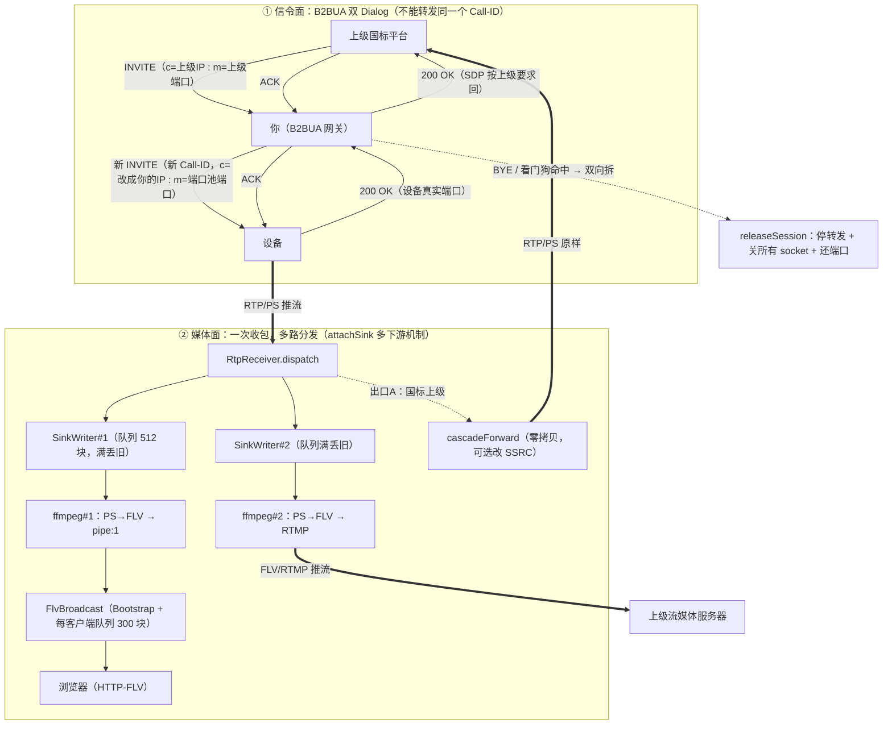

# 国标级联设计方案

> GB/T 28181 平台间互联（上级/下级）设计推演 — 基于本项目现状的能力差距分析
>
> 状态：**设计推演，未实现**。本文记录级联"是什么、协议差在哪、本项目要补什么、媒体面怎么走"的完整决策链，供后续立项参考。

---

## 1. 概述

### 1.1 是什么

国标级联是**平台与平台之间**的 GB/T 28181 对接——平台像"设备一样"接入更大的平台（作为下级），或把下属平台的设备纳入管理（作为上级）：

```text
派出所平台 ←→ 分局平台 ←→ 市局平台 ←→ 省厅平台
```

市局想看分局辖区的摄像头，不需要分局把设备"过户"，而是两个平台之间国标信令互通：下级平台向上级**注册**、上报辖区设备**目录**，上级直接点播下级管辖的设备。

### 1.2 一个准确的类比

级联与**短信网关**（SMGP/CMPP/SGIP）的上下级互联完全同构：

| 短信网关 | 国标级联 |
|---|---|
| SP 接入 SMG | 设备注册平台 |
| SMG ↔ SMG（SMGP 本就来联网） | 平台 ↔ 平台 |
| 企业代码/SP 编号虚拟映射 | 虚拟国标编号（20 位行政区划编码） |
| MT/MO 透传 + 状态报告回传 | 点播指令下发 + 报警事件上报 |
| 计费转发链路 | 心跳/校时/目录共享 |
| 平台流水号 ↔ 网关流水号映射 | 上级 Call-ID ↔ 设备 Call-ID 绑定 |

**协议同构、角色对偶**——一个网关既接收下级接入又向上级注册，同一套报文双向都会编解析。做过短信网关的人做级联，信令思维直接复用。

### 1.3 典型场景

- 公安"雪亮工程"/天网多级架构（派出所→分局→市局→省厅）
- 企业多园区联网，集团平台统一查看各分厂视频
- 与不受己方控制的政府/集团既有视频平台对接（对方只收国标）

---

## 2. 三种对接角色

| 角色 | 位置 | 行为 |
|---|---|---|
| **下级平台** | 我方平台做下级 | 主动向上级注册（周期 REGISTER + 401 挑战 + Digest 重试），上报目录，响应上级点播 |
| **上级平台** | 我方平台做上级 | 接收下级注册，管理下级虚拟设备，向下级发点播/云台指令 |
| **信令网关** | 两个外部平台之间做转发 | 纯 SIP 信令转译 + 媒体中转 |

---

## 3. 协议同一性：与设备交互用的是同一套协议

**级联不定义任何新协议**——平台间走的就是平台-设备那套 SIP + MANSCDP，这是 GB/T 28181 高明的设计。逐项对照：

| 交互 | 平台↔设备 | 平台↔平台（级联） | 差异 |
|---|---|---|---|
| 注册 | 设备 REGISTER + 401 挑战 + Digest | 下级平台 REGISTER + 401 + Digest | **零差异**，凭据换成级联密码 |
| 心跳 | MESSAGE keepalive | MESSAGE keepalive | 零差异 |
| 目录查询 | Catalog | Catalog | 响应结构相同，内容是**虚拟编号层级目录** |
| 点播 | INVITE + SDP + ACK | INVITE + SDP + ACK | 零差异，目标编号是虚拟号 |
| 停止 | BYE | BYE | 零差异 |
| 云台/查询/设备信息 | MANSCDP DeviceControl 等 | 同左 | 零差异，编号换虚拟号 |
| 回放/下载 | INVITE(带时间) + MANSRTSP | 同左 | 零差异 |
| 报警上报 | NOTIFY/Alarm | NOTIFY/Alarm | 零差异 |
| 语音广播/对讲 | ✅ | 一般不用 | 平台间不语音 |

### 3.1 真正有差异的只有三处

1. **编号规则**：级联设备用虚拟 20 位国标编号，按行政区划段（GB/T 2260）+ 嵌入下级平台编号生成；上级只认虚拟号，由网关维护"虚拟号 ↔ 真实设备"映射表
2. **目录组织**：级联 Catalog 可以很大，支持 SumNum 分批下发；层级是"行政区划/业务分组/虚拟目录/设备"，而设备直采是一级平铺
3. **SDP 收流地址归属**：上级点播时 SDP 的 `c=` 行写的是**上级平台的收流 IP**——下级要么重新 INVITE 真实设备后中转媒体，要么协商让设备直推上级（见第 5 章）

---

## 4. 本项目现状：底座已具备双角色 UA

实测代码确认：当前平台**既是服务端（UAS）也是客户端（UAC）**，不是纯 Server 形态。

| 角色 | 现有能力 | 位置 |
|---|---|---|
| **UAS** | 收 REGISTER → 401 挑战（WWW-Authenticate）→ 校验 Authorization → 200 OK | `RegisterHandler` / `SipResponseBuilder:138-165` |
| **UAS** | 收设备反向 INVITE（语音广播）→ 200 OK | `SipResponseBuilder.ok()` |
| **UAC** | 主动 INVITE（点播/对讲）、ACK、BYE、INFO（保活/PTZ/MANSRTSP）、MESSAGE（查询/广播）、SUBSCRIBE（报警订阅） | `SipRequestBuilder` |

语音广播场景"设备反向 INVITE → 平台应答"已把 UAS 侧最难的链路跑通。级联缺的**不是角色能力**。

### 4.1 级联要补的 4 块

| # | 缺口 | 与现状的关系 |
|---|---|---|
| 1 | **注册客户端状态机**：周期 REGISTER + 收 401 挑战 → 客户端算 Digest 摘要重试 | `SipRequestBuilder` 无 `register()` 构造器；`SipDigestAuth` 只做了服务端**校验**侧，没有客户端**计算**侧 |
| 2 | **对端管理**：上级/下级平台的地址、级联密码、编号前缀管理 | 现有 `DeviceRegistry` 是设备视角，没有"平台对端"实体 |
| 3 | **虚拟编号目录映射** + Catalog 按行政区划重组 | 现有目录是设备直采的一级平铺结构 |
| 4 | **上下游会话绑定 + 媒体中转** | 现有 `sessionsByCallId` 单级会话模型，不区分"这个会话的上游是谁"；`SipRequestBuilder` 无 `notify()`（报警上报要新增） |

---

## 5. 媒体面：两种模式与抉择

以下级平台收到上级点播为例。

### 5.1 全链路总览图

一张图看完整条调用链：**① 信令面**建双 Dialog → **② 媒体面**一次收包多路分发（本地播放 + 两种级联出口）→ **③ 拆除路径**全部落在现有清理代码上。



读图要点：

1. **出口A 与出口B 按上级类型二选一**：国标平台走 `cascadeForward` RTP 直转（ffmpeg 不参与）；流媒体服务器走 ffmpeg#2 推 FLV/RTMP。两条路都挂在 `RtpReceiver.dispatch` 这同一个分叉口上（详见 5.2 / 5.5）
2. **DEV 节点跨两个分区出现**：信令面里它是 Dialog 对端，媒体面里同一台设备把 RTP 推给 `RtpReceiver`——端口池分配的端口就是为此准备的
3. **CF 回到 UP 同一条边**：国标上级既是 INVITE 的发起方，也是 RTP 的收流方（SDP `c=` 行它自己声明的地址），无需另设节点
4. **拆除是单点收敛的**：无论哪侧触发（上级 BYE / 设备断流 / 会话关闭），最终都汇到 `releaseSession` 一条清理路径——这是资源不泄漏的保证

### 5.2 中转模式（默认选择）

```text
上级平台                    你（下级平台）                    设备
   |--INVITE(c=上级IP, m=上级端口)-->|                        |
   |                            |--新INVITE(新Call-ID)-------->|
   |                            |  SDP c=改成【你的IP】        |
   |                            |  m=用端口池分配的端口        |
   |<--200 OK(SDP按上级要求回)-----|                            |
   |                            |<----200 OK(设备真实端口)------|
   |                            |                            |--RTP 推到你
   |<===== RTP 转发（改目的地址） =====|<================|
   |--BYE---------------------->|--BYE------------------------>| + 停转发
```

要点：

1. **不能原封不动转发 INVITE**：SDP `c=` 行是上级的收流 IP，原样给设备，设备就直接推给上级、把你绕过了（这恰是直推模式，但对网络有要求）。走中转必须把 `c=` 改成自己的地址
2. **必须建新 Dialog（B2BUA），不是转发同一个 Call-ID**：设备的 200 OK 带的 Contact/To-tag/SDP 应答与上级 Dialog 协商结果不同（端口、SSRC 都不同），同一 Call-ID 会把两边会话状态搅在一起。上下级各一个 Dialog，平台在中间桥接，维护"上级 Call-ID ↔ 设备 Call-ID"绑定表
3. **给上级的 200 OK**：`c=` 仍按上级的要求回它的地址（上级只关心"我能在哪收"）

### 5.3 直推模式

给上级的 200 OK 透传设备真实 IP + 端口，让上级直连设备收流。

### 5.4 模式对比

| | **中转模式** | **直推模式** |
|---|---|---|
| 网络要求 | 设备可达你、你可达上级（**最容易满足**） | **设备 IP 必须对上级可达**（同网段/已打通路由，NAT 场景直接死） |
| 平台带宽 | 全量扛 | 零 |
| SSRC 冲突 | 中转时改 RTP 头 SSRC 即可控 | 多上级点播同一设备时 SSRC 冲突难管 |
| 适用 | 跨公网/跨安全域（**级联默认选择**） | 同机房、大流量下级→上级 |

公安/雪亮工程场景基本都用中转——跨域之间不可能让设备 IP 暴露给上级。

### 5.5 另一种出口：上级是流媒体服务器时（FLV/RTMP 推流）

先厘清一个常见误区：**FLV 发不给国标平台**。国标上级只收 RTP 封装的 PS 流（SDP `m=video port` 期待的是 RTP 包），收到 FLV 直接解析失败。上级分两种，FLV 只有一种能收：

| 上级类型 | 收什么 | FLV/RTMP 可用 |
|---|---|---|
| 国标 GB28181 平台 | RTP 封装的 PS 流 | ❌ |
| 流媒体服务器（ZLM/SRS/NVR/直播平台） | RTMP / HTTP-FLV / HLS | ✅ |

**推荐方案：双 Sink + 独立 ffmpeg 推流**——利用 `RtpReceiver.attachSink` 现成的“支持多个下游同时消费”机制（`RtpReceiver.java:292`）：

```text
设备 RTP/PS → RtpReceiver.dispatch
                ├─ SinkWriter#1 → ffmpeg#1 → pipe:1 → FlvBroadcast → 浏览器（现有链路原样）
                └─ SinkWriter#2 → ffmpeg#2 → -f flv rtmp://上级IP:1935/live/{callId}   ← 新增
```

代码落点（以现有代码为例）：

| 改动 | 位置 | 内容 |
|---|---|---|
| 注册第二下游 | `MediaService.startMediaPipeline`（`attachSink` 调用旁） | `rtpReceiver.attachSink(callId, p2.getOutputStream())`，机制现成一行接入 |
| ffmpeg#2 命令 | 仿 `buildFfmpeg`（`MediaService.java:1081-1131`） | 输入相同（`-f mpeg -i pipe:0`），输出改 `-f flv rtmp://上级IP:1935/live/xxx`，`-c:v copy -c:a aac` 透传不重编码 |
| 推流进程管理 | `StreamSession` 加第二 Process 引用 | `doStop`/`shutdown` 关闭清单加一项 |
| 上级地址 | 级联配置 | 按上级要求拼 RTMP(1935) / HTTP-FLV |

**为什么必须独立进程而不是 ffmpeg#1 双输出**（`-f flv pipe:1 -f flv rtmp://...` 一条命令俩输出）：ffmpeg 单进程多输出**共享写入线程**——RTMP 推流网络抖动时写阻塞会把 `pipe:1` 一起卡住，本地浏览器播放跟着卡。独立进程下 ffmpeg#2 挂了只拆它自己那路 sink，**本地播放零影响**——与 `SinkWriter` 队列“慢下游丢帧但不阻塞接收”（`RtpReceiver.java:32`）同一设计哲学。

**备选：FlvBroadcast 分路**（省一份转码）：`FlvBroadcast 订阅出口 → ffmpeg#2: -f flv -i pipe:0 -c copy -f flv rtmp://...`。代价是要在 `FlvBroadcast` 加“订阅级 OutputStream”出口（它现在是给 HTTP 响应写字节的），改造面更大；除非 CPU 紧张（多路推流时转码翻倍），否则优先双 Sink。

**为什么国标级联不能用 ffmpeg 转码后发**（三个坑）：

1. **格式陷阱**：ffmpeg 的 rtp muxer 输出**裸 H264 over RTP**，`rtp_mpegts` 输出 **TS over RTP**——都不是国标规定的 **PS 封装**，上级按 PS 解析直接失败
2. **无谓损耗**：本级收一份 PS → 解封装 → 重封装 → 发一份，编解码延迟和 GOP 边界问题全引进来，带宽还翻倍
3. **故障点叠加**：转码进程成了级联通路上的单点

---

## 6. B2BUA 实现设计（结合本项目底座）

### 6.1 会话绑定模型

```
sessionsByCallId 扩成上下游绑定：
  ┌────────────────────────────────────────┐
  │ 上游 Dialog: 上级 Call-ID + 上级地址    │
  │ 下游 Dialog: 设备 Call-ID + 设备会话    │
  │ 绑定键：虚拟国标编号 → 真实 deviceId:channelId │
  └────────────────────────────────────────┘
```

与短信网关"平台流水号 ↔ 网关流水号"映射同一思维。

### 6.2 RTP 旁路转发实现设计

#### 插入点

现有主路径（实测 `RtpReceiver` 代码）：每会话独立线程阻塞 `socket.receive(p)` → `dispatch(p, r)`。级联转发是**第二条下游路径**，插在统计刷新之后、与写 ffmpeg 管道并列：

```text
run(socket, r) ──receive──▶ dispatch(p, r)
                                ├─ 统计刷新（packets/bytes/lastPacketAt）
                                ├─ parseRtpHeader（RTP 头解析）
                                ├─ forward(p, h, r)      ← 现有下游：写 ffmpeg 管道
                                └─ cascadeForward(p, r)  ← 新增旁路：上级收流（null 即跳过）
```

旁路设计：`cascadeForward == null` 时一次 volatile 读即返回，对现有直播/回放/下载链路零影响。

#### 数据结构

`Session` 增加级联转发目标（volatile 引用，null = 不级联）：

```text
CascadeForward
├─ target      InetSocketAddress   上级收流地址（来自上级 INVITE 的 SDP c=/m= 行）
├─ sendSocket  DatagramSocket      旁路发送 socket（ephemeral 端口，不复用接收 socket）
├─ rewriteSsrc boolean + newSsrc   是否改 SSRC（默认否）
├─ sent        long                发包计数（观测）
├─ failures    long                连续失败计数（兜底触发）
└─ closed      volatile boolean    拆除标志（防关闭后发送）
```

#### 转发路径：零拷贝 + 可选 4 字节改写

- **不改 SSRC（默认）**：`sendSocket.send(new DatagramPacket(p.getData(), p.getOffset(), p.getLength(), target))`——Java `DatagramPacket` 构造共享底层数组不复制，微秒级。每会话一个收包线程天然单生产者；`DatagramSocket` 线程安全，无需队列、无需额外线程，send 到内核缓冲即返回
- **要改 SSRC 时**：只动 RTP 固定头 offset+8..11 四个字节（`ByteBuffer.putInt`）。注意前提 CC=0（CC>0 时 SSRC 后还有 CSRC 列表，国标设备均满足）。**更优做法是根本不改包**——INVITE 给设备时就在 SDP `y=` 行指定 SSRC，与通告给上级的值保持一致，两边一致零改包

#### 端口池

`RtpPortPool` 每个级联点播占 1 个端口（收设备流）；转发是纯发送，不占监听端口。发送用独立 ephemeral socket 而非复用 RTP 端口——RTP 协议本身不校验源端口，但独立 socket 便于按会话关闭、统计，且避免“媒体端口外发数据”的防火墙困惑。

#### 生命周期：与现有清理路径同地绑定

| 事件 | 动作 |
|---|---|
| 上级 INVITE 到达 | 解析 SDP 得上级地址 → `acquirePort()` → INVITE 设备（SDP `c=` 写自己）→ `CascadeForward` 挂到 `Session` |
| 正常结束（上级 BYE / 平台主动停） | 清引用 → 关 sendSocket |
| 设备断流（看门狗命中） | `doStop` 链路 → 级联 BYE 上级 + 停转发 |
| `releaseSession` / `close` | 与关接收 socket、还端口同一处顺带关 sendSocket，天然不泄漏 |

关键点：**拆除与现有资源清理同代码路径**，不新增独立清理机制——这是不泄漏的保证。

#### 观测与兜底

- 发包/失败计数进 `CascadeForward`，随会话日志输出（与 `r.packets/bytes` 同风格）
- **UDP send 到不可达地址不报错**（黑洞，Java 无 ICMP 感知）——不能依赖 send 异常判上级存活；连续失败计数仅覆盖 socket 级错误（如 socket 已关）
- **反向保活归上级**：上级收不到流自有超时机制，会 BYE 或干等；本级看门狗只管设备侧断流，触发时**双向拆**（BYE 设备 + BYE 上级）

#### 风险与边界

| 项 | 结论 |
|---|---|
| 带宽 | 中转模式全量扛：评估 = 上级路数 × 码率，超 capacity 时对上级返回资源不足 |
| 时延 | 增加一跳转发，局域网 <1ms，可忽略 |
| 大包 | RTP <1500 字节，UDP 单包无分片问题 |
| 安全性 | 上级收流地址来自 SIP 信令（已过 Digest 鉴权的对端），无需额外校验 |

**一句话**：`Session` 挂一个转发目标，`dispatch` 加一条旁路，`releaseSession` 顺手关 socket——整个改动对现有链路是纯增量，不碰任何现有代码路径。

### 6.3 看门狗直接复用

级联会话的 RTP 收包异常判定，`watchdogTick` 三段逻辑（首包超时 / 推流中断 / 灌流超限）原样可用：

- 触发时先 BYE 设备、再 BYE 上级，双向都拆干净
- 设备侧断流 → 看门狗触发后主动 BYE 上级（即"通知上级会话结束"）

### 6.4 BYE 的级联方向

| 事件源 | 动作 |
|---|---|
| 上级 BYE | 拆设备 Dialog + 停转发 |
| 设备断流（看门狗命中） | 主动 BYE 上级 + 拆设备 Dialog |
| 平台停机 | 两侧 Dialog 全部 BYE |

---

## 7. 工作量估算

| 层 | 内容 | 工时 |
|---|---|---|
| 信令 | 注册客户端状态机 + 客户端 Digest 计算 + 对端管理 + 虚拟编号目录映射 | 2-3 周 |
| 媒体 | B2BUA 会话绑定 + RTP 中转 + 看门狗复用 + NOTIFY 上报 | 2-3 周 |
| **合计** | 单一角色（只做下级或只做上级） | **4 周左右** |
| | 两种角色都要做 | **按上限 6 周** |

**成本分布**：协议层几乎零成本（与设备同一套 SIP+MANSCDP，短信网关的映射+注册状态机经验直接复用），全部成本在编号映射、目录重组、会话绑定、媒体中转这四块工程。这是 wvp 相对本项目最重的一块功能。

---

## 8. 决策依据：什么时候值得做

只有一种情况值得做：**你的平台需要接入一个不受你控制的更大平台（政府/集团既有视频平台），且对方只收国标**。

自己内部的摄像头通过本项目 API 直接管理，不需要级联。若确认要做，建议顺序：

1. 先做**下级平台**角色（注册客户端 + 中转），这是公安/企业场景的主路径
2. 上级平台角色（接收下级注册 + 虚拟设备管理）可延后，按需再上

---

## 9. 关键结论

1. **级联与设备协议完全同一套**（SIP + MANSCDP + Digest），国标不为级联定义新协议；差异仅在编号规则、目录组织、SDP 收流地址三处
2. 本项目已具备 SIP 双角色底座（UAC + UAS），缺的是注册客户端状态机、对端管理、编号映射、会话绑定+媒体中转四块
3. 媒体面选型分两种出口：**上级是国标平台 → RTP 零解析直转**（`dispatch` 旁路 + `Session` 挂 `CascadeForward`）；**上级是流媒体服务器 → 双 Sink + 独立 ffmpeg 推 FLV/RTMP**（复用 `attachSink` 多下游机制，故障隔离）。转码只服务播放器和落盘，从不服务国标对接
4. 建设思维与短信网关上下级互联同构：映射表 + 注册状态机 + 级联清理，缺的只有媒体流经验——而那部分本项目已经跑通（多端口 RTP 接收、端口池、ffmpeg 管道），补级联是"信令思维已有 + 媒体思维已有"的组合
